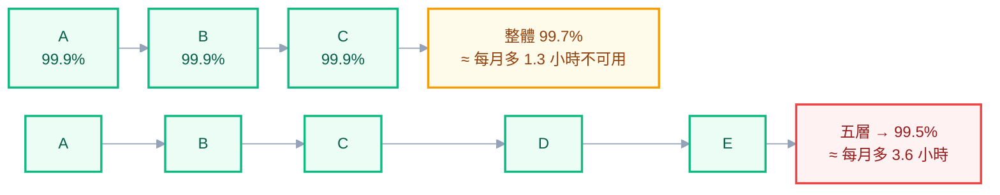

# 附錄 W：微服務拆分與服務間通訊

附錄 C-7 攤平了 Istio 的欄位、附錄 J 講了 Ingress Gateway 怎麼用。但它們都跳過了一個更前面的問題：**你該把系統拆成幾個服務？**

這個問題值得單獨處理，因為 **K8s 讓「多開一個服務」變得非常容易——而容易不等於該做**。一個 `kubectl apply` 就多一個服務，但它帶來的成本要好幾年才會完全顯現。

這一份談拆分的判斷、拆了之後服務怎麼溝通、以及 service mesh 到底解決了什麼。它是這套教材裡最偏架構的一份，但每個決定最後都落回你要維運的那座叢集。

---

## Part 1：拆分的真實成本

先把成本攤開，判斷才有基礎。

### 分散式系統的固有難題

單體裡的一次函式呼叫，拆開之後變成一次網路呼叫。這個轉變帶來的不只是延遲：

| 單體內 | 跨服務 |
| --- | --- |
| 呼叫要嘛成功要嘛拋例外 | **可能逾時——你不知道對方做了沒** |
| 一個交易涵蓋全部 | 要處理部分成功 |
| 重構時編譯器會告訴你哪裡壞了 | **介面變更要靠溝通與版本管理** |
| 除錯就是一個堆疊追蹤 | 要跨服務拼湊 |
| 部署是一件事 | 版本相容性矩陣 |

**「逾時之後你不知道對方做了沒」是分散式系統最根本的難題**，而且它沒有完美的解法——只能靠冪等設計繞過去（Part 5）。

### 每個服務的固定成本

除了程式碼，每多一個服務就多一份：CI/CD 管線、監控與告警、runbook 與 on-call 責任、資源配置與成本、版本與相容性管理、以及**一份要維護的文件**。

**這些成本幾乎與服務大小無關。** 一個只有三支 API 的服務，跟一個有三十支的服務，在維運上的固定成本差不多。這就是為什麼「拆得越細越好」是錯的——**細到某個程度之後，固定成本會超過拆分的收益**。

### 模組化不等於分散式

最常見的誤解：「我們的程式碼太亂了，拆成微服務就會變乾淨。」

**不會。** 邊界沒想清楚的單體，拆開之後會變成邊界沒想清楚的分散式系統——而且現在那些糾纏的依賴變成了網路呼叫，除錯難度上升一個量級。

正確的順序是：**先在單體裡把模組邊界劃清楚**（清楚的模組界線、不互相直接存取對方的資料表），確認邊界穩定之後，再考慮把某個模組獨立出去。**如果你在單體裡都劃不出乾淨的邊界，拆開只會讓問題更難修。**

---

## Part 2：什麼時候該拆

### 好理由

| 理由 | 具體長什麼樣 |
| --- | --- |
| **獨立擴縮** | 某個部分的負載是其他部分的十倍（例如圖片處理 vs 後台管理） |
| **獨立發布節奏** | 某部分一天改三次，某部分半年不動 |
| **團隊邊界** | 兩個團隊在同一個 repo 上互相踩腳 |
| **技術棧差異** | 這部分適合用別的語言（ML 模型、影像處理） |
| **故障隔離** | 這部分掛掉不該影響核心流程 |
| **合規邊界** | 處理敏感資料的部分需要更嚴格的隔離 |

**注意這六個理由都是「營運上的」而不是「程式碼上的」。** 這不是巧合——拆分是一個組織與營運的決策，不是程式碼整潔度的決策。

### 不是理由

- 「程式碼太大了」→ 那是模組化問題
- 「想試試看新技術」→ 用副專案試
- 「大公司都這樣做」→ 他們的組織規模跟你不一樣
- 「這樣比較好招人」→ 維運成本不會因此消失

### 一個實用的判準

**如果這兩個部分永遠會一起部署、一起擴縮、由同一個人維護，那它們不該是兩個服務。**

反過來說，需要拆的訊號通常很明確：你會聽到「這個改動要等他們那邊一起上」、「為了那個功能我們整個服務都要擴容」、「他們改壞了害我們也掛掉」。

---

## Part 3：怎麼拆

### 沿業務邊界，不是技術層次

**錯的拆法**：拆成「前端服務 / 邏輯服務 / 資料服務」。這樣任何一個功能變更都要動三個服務、三次部署、三次協調——比單體更糟。

**對的拆法**：沿業務能力拆，例如「訂單」「庫存」「通知」。每個服務**擁有自己的資料**，對外只透過 API。

判斷邊界的一個實用問題：**這個變更需要動幾個服務？** 常見的功能變更如果總是要動三個服務，代表邊界劃錯了。

### 資料所有權是真正的邊界

**服務的邊界不是程式碼的邊界，是資料的邊界。**

一個服務如果要直接讀另一個服務的資料表，那它們實際上還是耦合的——對方改 schema 你就壞掉，而且你們無法獨立部署。**這種「表面上兩個服務、實際上共用資料庫」的架構，是分散式單體**，同時具備兩者的缺點。

所以拆分的第一步通常不是拆程式碼，是**拆資料表的所有權**：確定每張表由哪個服務擁有、其他服務只能透過 API 存取。這一步做不到的話，程式碼拆了也沒意義。

### 漸進拆（Strangler 模式）

不要大改寫。用附錄 U 那個「前面加一層代理」的手法：

1. 在單體前面加一個代理（Ingress 就可以）
2. 新功能寫在新服務裡，代理把對應路徑導過去
3. 舊功能逐步搬遷，一次一塊，每次都能獨立驗證與回滾
4. 單體逐漸縮小，最後可能完全消失，也可能保留一個核心

**每一步都是可回滾的**，這是它相對於「重寫」的最大優勢。

---

## Part 4：服務間通訊的四種模式

| 模式 | 耦合度 | 一致性 | K8s 上怎麼落地 |
| --- | --- | --- | --- |
| **同步 HTTP / gRPC** | 高（依賴對方可用） | 強（呼叫完就知道結果） | Service + DNS，最直接 |
| **非同步訊息** | 低 | 最終一致 | 部署 RabbitMQ / Kafka，或用雲端託管 |
| **事件驅動** | 最低 | 最終一致 | 同上 + 事件 schema 管理 |
| **共享資料庫** | 最高（實際上沒拆） | 強 | 反模式，但過渡期偶爾務實 |

### 同步呼叫：預設選擇，但要知道代價

叢集內直接用 Service 名稱呼叫（`http://order-svc`）最簡單，適合「需要立即得到結果」的場景。

**代價是可用性相乘。** A 依賴 B、B 依賴 C，三個服務各自 99.9% 可用，串起來是 99.7%。**依賴鏈越長，整體可用性越差**，而且一環故障會沿著鏈往上傳（Part 5 的級聯故障）。

**每個服務都「很可靠」，串起來卻不可靠**——這是拆分最違反直覺的代價，而且它不會出現在任何單一服務的儀表板上。

gRPC 相對 HTTP 的差異在效能與型別安全，但在 K8s 上有一個具體的坑：**gRPC 是長連線的，預設的 Service 負載平衡（L4）會讓連線黏在同一個後端**，導致新擴出來的 Pod 沒有流量。解法是用 mesh（L7 負載平衡）或在客戶端做連線輪替。

### 非同步訊息：解耦，但複雜度轉移

「送出訂單」之後放進佇列，庫存服務自己去消費。好處是庫存服務掛掉時訂單仍然能收，恢復後補上。

**但複雜度沒有消失，只是轉移了**：現在你要維運一個訊息系統、處理重複投遞（至少一次語意）、處理順序、處理死信、以及**除錯時要追蹤跨越佇列的流程**。

判準：**「對方暫時處理不了也沒關係」的操作用非同步；「需要立刻知道結果」的用同步。**

### 共享資料庫：什麼時候可以接受

理論上是反模式，但實務上有一種情境可以接受：**遷移的過渡期**（附錄 U 的雙跑期）。新舊系統共用資料庫，讓切換可以隨時回滾。

**接受的前提是它有明確的結束日期。** 過渡期無限延長的話，你得到的是分散式單體。

---

## Part 5：分散式的必修課

拆開之後，這五件事從「可選的最佳實踐」變成「不做就會出事」。

### 1. 逾時是必填的

**沒設逾時的呼叫等於無限等待。** 下游變慢時，你的執行緒／連線會一個個卡住，最後整個服務失去回應——**明明是別人的問題，你先掛了**。

每一個跨服務呼叫都要有逾時，而且**逾時要小於上游給你的逾時**，否則上游已經放棄了你還在等。

### 2. 重試要有三個條件

重試能提高成功率，但也能把小問題放大成雪崩（附錄 Q 的重試放大）。三個條件缺一不可：

- **冪等**：重試一次不會產生兩筆訂單
- **指數退避 + 抖動**：不要固定間隔（所有客戶端會同步重試造成尖峰）
- **上限**：不能無限重試

**而且要清楚整條鏈上有幾層在重試。** Istio 預設就有重試，加上應用層自己的，實際請求數可能是你以為的九倍。

### 3. 斷路器

下游持續失敗時，**與其一直打它，不如直接快速失敗**——給它恢復的空間，也避免自己的資源被卡住。

在 K8s 上可以用 Istio 的 `outlierDetection`（附錄 C-7）或應用層的函式庫。

### 4. 冪等鍵

因為「逾時之後你不知道對方做了沒」（Part 1），**寫入類操作必須設計成可以安全重試**。標準做法是讓呼叫方產生一個唯一的鍵，被呼叫方用它去重。

**這件事只能在應用層做，任何基礎設施都幫不了你。** mesh 可以幫你重試，但無法讓重試變安全——那是你的程式碼要負責的。

### 5. 分散式追蹤

拆開之後，「這個請求為什麼慢」不再是看一份日誌就能回答的（實戰第六章）。追蹤從「好有好無」變成必要。

---

## Part 6：Service Mesh 解決什麼、不解決什麼

### 能解決的

| 能力 | 沒有 mesh 的話 |
| --- | --- |
| 服務間 mTLS | 每個應用自己處理憑證 |
| 統一的重試／逾時／熔斷 | 每個服務各寫一套，語言不同就再寫一次 |
| 流量分流（金絲雀、鏡像） | 靠 Ingress annotation 或應用層 |
| 統一的可觀測性（黃金訊號） | 每個應用自己埋 |
| 細粒度授權（誰能呼叫誰） | 應用層自己檢查 |

**mesh 最大的價值是「跨語言的一致性」**——你有 .NET、Python、Node 三種服務時，重試邏輯寫三套 vs 在 mesh 統一配置，差別很明顯。

### 不能解決的

**這一節比上一節重要。**

| mesh 幫不了你的 | 為什麼 |
| --- | --- |
| **服務邊界劃錯** | 它只管流量，不管你為什麼要打這麼多次呼叫 |
| **資料一致性** | 跨服務交易是應用層問題 |
| **冪等** | mesh 會重試，但不會讓重試變安全 |
| **依賴鏈太長** | 可用性相乘的數學不會因為加了 sidecar 而改變 |
| **共享資料庫造成的耦合** | 那不是流量問題 |

**一句話：加 mesh 不會讓爛的拆分變好，只會讓你更清楚地看到它有多爛**（因為可觀測性變好了）。

### 該不該裝

| 情況 | 建議 |
| --- | --- |
| 少於 5–10 個服務、單一語言 | **不裝**。用函式庫或 Ingress 就夠 |
| 多語言、服務數量多 | 值得評估 |
| 需要零信任網路（服務間 mTLS 強制） | 這是 mesh 最強的理由 |
| 團隊沒有 mesh 維運能力 | 先不裝（附錄 J 講過 Istio 的真實成本） |

輕量的替代方案：用 Gateway API 處理南北向流量（附錄 C-5）、用應用層函式庫處理重試與熔斷、用 NetworkPolicy 做基本的服務間隔離（附錄 C-3）。**這組合能覆蓋多數中小規模的需求，而且沒有 sidecar 的複雜度。**

---

## Part 7：反過來——什麼時候該合併

很少人談這個，但它跟拆分一樣重要。出現這些訊號時，該考慮把服務合併回去：

- **總是一起部署**：每次改動都要同時發兩個服務
- **只有一個呼叫方**，而且是同一個團隊維護的
- **之間的呼叫極度頻繁**，延遲成為瓶頸
- **共用資料**，其中一個總是要問另一個要資料
- **維運成本明顯高於價值**：一個服務一年沒改過，但每季都要跟著升級依賴

**合併不是承認失敗，是根據新資訊修正決策。** 拆分是可逆的，而且早期的邊界猜測本來就常常不準。

---

## 檢查清單

**決定拆分前**

- [ ] 拆分理由是營運上的（擴縮、發布節奏、團隊、故障隔離），不是「程式碼太亂」
- [ ] 已在單體裡把模組邊界劃清楚，且邊界穩定
- [ ] **資料所有權能拆開**（不是兩個服務讀同一批表）
- [ ] 團隊有能力承擔每個服務的固定成本（CI、監控、on-call）
- [ ] 用 Strangler 漸進拆，不是重寫

**拆完之後**

- [ ] 每個跨服務呼叫都有逾時，且小於上游的逾時
- [ ] 重試都滿足冪等 + 退避 + 上限三條件
- [ ] **知道整條鏈上有幾層在重試**
- [ ] 寫入類操作有冪等鍵
- [ ] 有分散式追蹤
- [ ] 有斷路器或 outlier detection
- [ ] 依賴鏈長度有評估過（可用性相乘）

**Service Mesh**

- [ ] 裝它的理由具體（多語言一致性、零信任 mTLS），不是「比較現代」
- [ ] 團隊有維運能力（附錄 J 的成本評估）
- [ ] 知道它解決不了邊界設計與資料一致性
- [ ] 已評估過輕量替代方案

## 常見誤區

| # | 誤區 | 真相 |
| --- | --- | --- |
| 1 | 程式碼太亂，拆微服務會變乾淨 | 會變成邊界不清的分散式系統，更難修 |
| 2 | 拆越細越好 | 每個服務有固定成本，細到某個程度就不划算 |
| 3 | 沿技術層次拆（UI/邏輯/資料） | 任何變更都要動三個服務 |
| 4 | 兩個服務共用資料庫也算拆了 | 那是分散式單體，同時有兩者的缺點 |
| 5 | 同步呼叫最單純所以最安全 | 可用性相乘，且會級聯故障 |
| 6 | 非同步訊息比較好因為解耦 | 複雜度轉移到訊息系統，不是消失 |
| 7 | 有 mesh 就有韌性 | mesh 會重試，但冪等要你自己做 |
| 8 | 加 mesh 能改善架構 | 它只會讓你更清楚看到問題 |
| 9 | gRPC 在 K8s 上直接用就好 | 長連線會黏在同一個 Pod，需要 L7 負載平衡 |
| 10 | 拆了就不能合併 | 合併是修正決策，不是失敗 |

## 連結

- [[74-distributed-tracing]] — 附錄 AZ：服務越多，推理分支越多——追蹤把「哪裡慢」變成觀察
- [[73-long-lived-connections]] — 附錄 AY：**這裡那兩行 gRPC 坑的完整展開**——症狀、四種解法與部署斷線
- [[72-cascading-failure]] — 附錄 AX：拆分之後的代價之一——級聯失敗與四種韌性模式的優先序
- [[24-yaml-fields-istio]] — 附錄 C-7：Istio 全欄位，含 `outlierDetection` 與重試設定
- [[32-istio-ingress-gateway]] — 附錄 J：mesh 的真實維運成本與選型
- [[39-performance-troubleshooting]] — 附錄 Q：重試放大與尾端延遲
- [[practice-5-database-and-state]] — 實戰 5：資料所有權與 schema 變更
- [[43-migration-to-k8s]] — 附錄 U：Strangler 模式與漸進切換
- [[20-yaml-fields-network-storage]] — 附錄 C-3：Service 與 NetworkPolicy
- [[k8s-mastery]] — 教材總目錄
