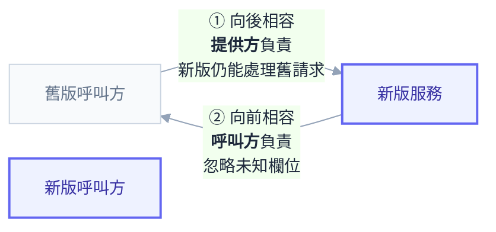

# 附錄 Y：API 演進與版本管理

附錄 W 講了服務之間該怎麼溝通——同步、非同步、事件。但它跳過了一個會跟著你好幾年的問題：**那個介面要怎麼改？**

這件事在單體裡不存在。改一個函式簽章，編譯器會把所有呼叫點標紅，你一次改完一起部署。拆開之後，這個安全網消失了：呼叫方在另一個 repo、另一個團隊、另一個部署節奏，而且**你不會知道誰在用你那個「應該沒人用」的欄位**。

這一份講介面怎麼演進而不打破別人，以及在 K8s 上多版本並存的具體做法。

---

## Part 1：為什麼 API 變更這麼難

三個結構性原因：

**你不再控制所有呼叫方。** 內部服務還能發訊息協調，外部 API 或行動 App 則完全不行——舊版 App 可能在使用者手機上跑一年。

**部署不是原子的。** 滾動更新期間**新舊版本必然同時在跑**（實戰第五章的 expand-contract 講過同一件事在資料庫的版本）。所以即使只有你一個呼叫方，你也不能假設「改完一起上」。

**呼叫方的升級節奏不受你控制。** 你說「下週改」，對方說「我們這季的 sprint 排滿了」。

由此得到一條原則：**任何介面變更都要假設「舊的呼叫方會存在一段時間」**，而那段時間比你以為的長。

---

## Part 2：什麼算破壞性變更

判準：**呼叫方不改任何程式碼，還能正常運作嗎？** 不能就是破壞性。

| 變更 | 破壞性？ | 說明 |
| --- | --- | --- |
| 新增選填欄位（回應） | 否 | 前提是呼叫方會忽略未知欄位 |
| 新增選填參數（請求） | 否 | |
| 新增端點 | 否 | |
| **移除欄位** | **是** | 最明顯的一種 |
| **改欄位名稱** | **是** | 等同移除 + 新增 |
| **改欄位型別** | **是** | `"123"` → `123` 會讓嚴格解析的呼叫方爆炸 |
| **新增必填參數** | **是** | 舊呼叫方沒帶就失敗 |
| **收緊驗證規則** | **是** | 原本能過的請求現在被拒 |
| **改變欄位語意** | **是**，且**最陰險** | 型別沒變、名稱沒變，但意思變了——沒有任何工具抓得到 |
| 改錯誤碼／錯誤格式 | **通常是** | 呼叫方可能依錯誤碼分支 |
| 改預設值 | **通常是** | 沒帶那個參數的呼叫方行為突然變了 |
| 改回應的排序 | 視情況 | 沒承諾過順序就不算，但呼叫方可能已經依賴 |

**「改變欄位語意」值得單獨警告。** 例如 `amount` 從「未稅」改成「含稅」——schema 完全沒變、OpenAPI diff 抓不到、契約測試也抓不到，但下游的帳全錯。**這種變更必須當成移除舊欄位、新增新欄位來處理**（`amountExcludingTax` / `amountIncludingTax`），而不是原地改語意。

### 「加欄位」什麼時候也是破壞性的

理論上加欄位是安全的，但前提是**呼叫方會忽略未知欄位**。如果對方用嚴格模式反序列化（未知欄位就拋錯），或者用的是會驗證 `additionalProperties: false` 的 schema，那加欄位也會炸。

所以這件事要雙向約定：**提供方承諾只加不改，呼叫方承諾忽略未知欄位。** 少任何一邊，這個契約就不成立。

---

## Part 3：相容性的兩個方向

多數人只想到一個方向，但實際上有兩個：



**② 決定了你能不能安全地加欄位**——而它不是你能單方面控制的，要靠呼叫方遵守 Tolerant Reader。

| 方向 | 意思 | 誰負責 |
| --- | --- | --- |
| **向後相容** | 新版服務能處理舊版呼叫方的請求 | 提供方 |
| **向前相容** | 舊版呼叫方能處理新版服務的回應 | **呼叫方** |

**向前相容常被忽略，但它決定了你能不能安全地加欄位。** 呼叫方要做到的是 **Tolerant Reader（寬容讀取）** 原則：

- 忽略不認識的欄位，不要因此報錯
- 不要依賴欄位順序
- 不要假設列舉值只有你知道的那幾個（收到未知值時有預設行為）
- 只讀自己需要的欄位，不要整包驗證

```csharp
// 寬容：只綁自己要的欄位，未知欄位自動忽略（System.Text.Json 預設行為）
public record OrderDto(string Id, decimal AmountExcludingTax);

// 不寬容：嚴格模式，對方加一個欄位你就 500
var opts = new JsonSerializerOptions { UnmappedMemberHandling = JsonUnmappedMemberHandling.Disallow };
```

**在團隊內部把 Tolerant Reader 訂成規範**，會讓後續所有的 API 演進輕鬆非常多——因為「加欄位」從此真的是安全的。

---

## Part 4：版本化策略

先講一個容易被忽略的判斷：**多數變更根本不需要新版本。** 只要是相容的（加欄位、加端點），直接改就好。**版本化是給破壞性變更用的最後手段**，因為每多一個版本，你就多一份要維護、測試、監控的東西。

真的需要時，三種做法：

| 方式 | 長什麼樣 | 優點 | 缺點 |
| --- | --- | --- | --- |
| **URL 路徑** | `/v1/orders` | 直觀、好在 Ingress 分流、好除錯 | URL 不再「純粹指向資源」 |
| **Header** | `Accept: application/vnd.api.v2+json` | URL 乾淨 | 難用瀏覽器測、Ingress 分流較複雜 |
| **Query 參數** | `/orders?version=2` | 簡單 | 容易被忽略、快取行為混亂 |

**在 K8s 環境，URL 路徑版本通常是最務實的選擇**——因為它可以直接在 Ingress 層分流到不同的 Deployment，不需要應用自己處理多版本（Part 5）。

版本號的粒度也要決定：**整個服務一個版本**（簡單，但一個端點的破壞性變更會逼所有端點升版）vs **每個端點各自版本**（彈性，但管理複雜）。對多數團隊來說前者夠用。

---

## Part 5：在 K8s 上讓多版本並存

### 做法一：兩個 Deployment + Ingress 路徑分流（推薦）

```yaml
apiVersion: networking.k8s.io/v1
kind: Ingress
metadata:
  name: api
  namespace: demo
spec:
  ingressClassName: nginx
  rules:
    - host: api.example.com
      http:
        paths:
          - path: /v2
            pathType: Prefix
            backend:
              service:
                name: api-v2
                port:
                  number: 80
          - path: /v1
            pathType: Prefix
            backend:
              service:
                name: api-v1
                port:
                  number: 80
```

兩個獨立的 Deployment（`api-v1`、`api-v2`），各自有自己的映像、副本數、資源配置。

**好處很實際**：v1 可以逐步縮容（使用者遷移走就減副本）、兩版可以獨立擴縮與部署、v1 進入維護模式後不必再跟著 v2 一起發版、而且**用附錄 Q 的方法可以分別看兩版的延遲與錯誤率**。

代價是要維護兩套部署，以及**兩版共用同一個資料庫**時的相容性問題（見下）。

### 做法二：同一個 Deployment 內部處理多版本

應用自己依路徑或 header 分派（ASP.NET Core 的 API versioning 套件就是做這件事）。

好處是部署單純、資源共用；代價是兩版的程式碼綁在一起，**無法獨立部署或回滾**，而且 v1 的 bug 修正要重新部署整個服務。

**判準**：版本差異小、預期並存時間短 → 做法二；版本差異大、v1 要長期維護 → 做法一。

### 做法三：用 Istio 依 header 分流

```yaml
apiVersion: networking.istio.io/v1
kind: VirtualService
metadata:
  name: api
spec:
  hosts: ["api.example.com"]
  gateways: ["istio-system/public-gateway"]
  http:
    - name: v2-by-header
      match:
        - headers:
            api-version:
              exact: "2"
      route:
        - destination:
            host: api
            subset: v2
    - name: default-v1
      route:
        - destination:
            host: api
            subset: v1
```

適合 header 版本化，而且可以做漸進式遷移（先讓特定客戶帶 header 試 v2）。記得 subset 必須先在 `DestinationRule` 定義（附錄 C-7）。

### 兩個版本共用資料庫

**這是多版本並存最麻煩的部分**，而它的解法跟實戰第五章一樣：**expand-contract**。

v1 與 v2 都要能在同一份 schema 上運作，所以：新欄位可為 NULL、舊欄位在 v1 退役前不能刪、寫入時兩版都要維護對方需要的欄位。

**這也是「多版本並存要有明確結束日期」的實際原因**——並存期間你的資料庫 schema 被鎖住，動彈不得。

---

## Part 6：棄用流程

**「發個公告然後三個月後刪掉」是不夠的**，因為你不知道公告有沒有人看到、也不知道還有誰在用。完整流程有四步：

### 1. 先讓「誰在用」變成可觀測

**這是最重要的一步，而且要在宣布棄用之前就做好。** 給 metric 加上版本標籤：

```promql
# 各版本的請求量
sum by (api_version) (rate(http_server_request_duration_seconds_count{job="api"}[5m]))

# 還有誰在用 v1（依呼叫方拆開）
sum by (client_id) (rate(http_server_request_duration_seconds_count{job="api", api_version="v1"}[1h]))
```

`client_id` 可以來自 JWT 的 claim、API key、或 `User-Agent`。**沒有這個資料，你的棄用時程只能靠猜。**

### 2. 在回應裡標記棄用

用標準 header 讓呼叫方（尤其是自動化的）能察覺：

```
Deprecation: true
Sunset: Wed, 31 Dec 2026 23:59:59 GMT
Link: <https://docs.example.com/migrate-v2>; rel="deprecation"
```

`Sunset` header 是 RFC 8594 定義的標準，意思是「這個端點在該日期之後會停止服務」。搭配日誌記錄「誰在呼叫已棄用端點」，可以主動去找那些沒看公告的人。

### 3. 分階段收緊

| 階段 | 做什麼 |
| --- | --- |
| **公告** | 文件標記、發訊息、加 `Deprecation` header |
| **監控** | 每週看 v1 流量趨勢與剩餘呼叫方 |
| **主動聯繫** | 針對還在用的呼叫方個別溝通（**這一步最有效**） |
| **軟性降級** | 對 v1 加上限流或刻意的延遲，讓「還在用」變得有感 |
| **關閉** | 回 410 Gone 一段時間（而不是 404），訊息指向遷移文件 |

**回 410 而不是直接關掉**很重要——410 明確表示「這個資源曾經存在但已永久移除」，比 404 的「找不到」對排查的人友善得多。

### 4. 時間表要多長

| 對象 | 建議期間 |
| --- | --- |
| 內部服務，同一團隊 | 數週 |
| 內部服務，跨團隊 | 一到兩個季度 |
| 外部 API（有合約） | 六個月到一年，依合約 |
| 行動 App | **看最舊的活躍版本**，通常一年以上 |

行動 App 那一列常被低估：使用者不會主動更新，而你無法強制。**除非有強制更新機制，否則舊版 API 要活很久。**

---

## Part 7：內部與外部 API 的差異

| | 內部 API | 外部 API |
| --- | --- | --- |
| 呼叫方 | 知道是誰 | 可能不知道 |
| 協調難度 | 可以直接找人 | 只能公告 |
| 棄用期 | 數週到數月 | 半年到數年 |
| 版本化嚴謹度 | 可以較寬鬆 | 必須嚴謹 |
| 破壞性變更 | 協調後可做 | 幾乎不可能 |

**但「內部 API 可以隨便改」是錯的。** 團隊一多，內部協調的成本會迅速接近外部。而且內部 API 常常沒有版本化、沒有契約測試、沒有使用量監控——**出事時反而比外部 API 更難處理**。

務實的做法：內部 API 同樣要有使用量監控與棄用流程，只是時程可以短得多。

---

## Part 8：讓 CI 擋下破壞性變更

**單元測試抓不到破壞性變更**——你把欄位改名，自己的測試也一起改了，全部綠燈，但呼叫方會壞。需要專門的機制。

### OpenAPI diff

如果服務有產生 OpenAPI 規格（ASP.NET Core 內建），在 CI 比對新舊版：

```powershell
# 用 oasdiff 之類的工具檢查破壞性變更
oasdiff breaking openapi-main.json openapi-pr.json
```

有破壞性變更就讓 PR 失敗，除非明確標記為「這是有意的破壞性變更，且已走版本化流程」。**這一道防線的投資報酬率很高**，因為它把「誰記得檢查」變成自動化。

### 契約測試

更進一步是 consumer-driven contract：呼叫方寫下「我需要這些欄位」的期望，提供方在 CI 驗證自己仍然滿足所有已知呼叫方的期望。

**它的價值在於回答「有沒有人在用這個欄位」**——那正是 Part 6 第一步的問題，只是從執行期資料換成建置期契約。導入成本不低，適合服務數量多、跨團隊協作頻繁的環境。

### 最低限度的替代方案

沒有資源導入契約測試的話，至少做這兩件：**OpenAPI diff 擋 PR**，以及 **metric 帶版本與呼叫方標籤**。這兩者覆蓋了大部分風險，而且都是幾小時的工作量。

---

## 檢查清單

**設計時**

- [ ] 團隊有「什麼算破壞性變更」的共識清單
- [ ] 呼叫方遵守 Tolerant Reader（忽略未知欄位、不依賴順序、處理未知列舉值）
- [ ] 相容的變更直接改，**不要為它開新版本**
- [ ] 語意變更當成「移除 + 新增」處理，不原地改

**多版本並存**

- [ ] 版本化方式已決定（K8s 上通常是 URL 路徑）
- [ ] 兩版能在同一份資料庫 schema 上運作（expand-contract）
- [ ] **並存有明確的結束日期**（否則 schema 被鎖住）
- [ ] 各版本的延遲與錯誤率可以分開監控

**棄用**

- [ ] **宣布棄用之前**，使用量監控已經就位（含呼叫方維度）
- [ ] 回應帶 `Deprecation` 與 `Sunset` header
- [ ] 有主動聯繫剩餘呼叫方的流程
- [ ] 關閉時回 410 而非 404
- [ ] 棄用期間依對象類型設定（行動 App 要一年以上）

**防護**

- [ ] CI 有 OpenAPI diff 擋破壞性變更
- [ ] metric 帶 `api_version` 與呼叫方標籤
- [ ] 內部 API 同樣有監控與棄用流程

---

## 常見誤區

| # | 誤區 | 真相 |
| --- | --- | --- |
| 1 | 「內部 API 可以隨便改」 | 團隊一多，協調成本接近外部；且內部通常更沒有監控 |
| 2 | 「加欄位一定安全」 | 呼叫方嚴格反序列化的話會炸；要雙向約定 |
| 3 | 「改語意不算破壞性」 | **最陰險的一種**，schema diff 與契約測試都抓不到 |
| 4 | 每次變更都開新版本 | 每個版本都是維護負擔；相容的變更直接改 |
| 5 | 「發公告三個月後刪」 | 不知道誰在用，時程只能靠猜 |
| 6 | 先宣布棄用再想怎麼監控 | 順序反了——監控要先就位 |
| 7 | 直接關閉回 404 | 回 410 + 遷移連結對排查的人友善得多 |
| 8 | 多版本可以無限期並存 | 資料庫 schema 會被鎖住 |
| 9 | 單元測試能抓破壞性變更 | 你改欄位時測試也一起改了 |
| 10 | 行動 App 三個月就能淘汰舊版 | 使用者不會主動更新，通常要一年以上 |

## 連結

- [[71-schema-migration]] — 附錄 AW：expand-contract 展開成可執行的三步，含改名的完整例子
- [[45-microservices-and-communication]] — 附錄 W：服務間該怎麼溝通、依賴鏈與可用性
- [[practice-5-database-and-state]] — 實戰 5：expand-contract 的資料庫版本
- [[42-helm-chart-design]] — 附錄 T：chart 的 values 也是一種 API，破壞性變更三步
- [[28-ingress-nginx-annotations]] — 附錄 F：路徑分流與 canary
- [[24-yaml-fields-istio]] — 附錄 C-7：依 header 分流的 VirtualService
- [[39-performance-troubleshooting]] — 附錄 Q：依版本拆開看延遲與錯誤率
- [[27-upgrades-and-deprecations]] — 附錄 E：K8s 自己的 API 棄用流程（值得參考的範例）
- [[k8s-mastery]] — 教材總目錄
