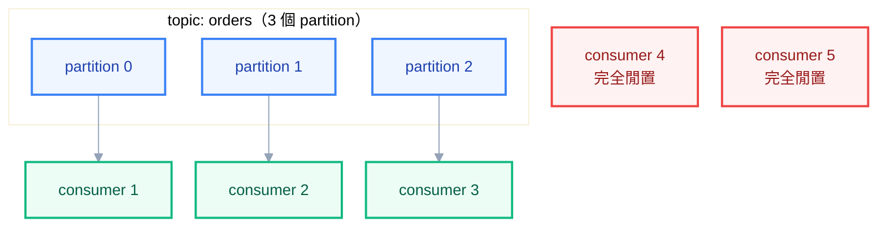

# 附錄 AA：事件驅動與訊息系統

附錄 W 把「非同步訊息」列為服務間通訊的四種模式之一，然後說了一句「複雜度沒有消失，只是轉移了」就跳過去了。這一份把那句話展開——**轉移到哪裡去了、在 K8s 上要處理哪些事。**

先說結論的方向：訊息系統本身不難理解（就是一個佇列），難的是它在 K8s 上帶來的三件事——**consumer 怎麼擴縮**（它不是 HTTP 服務，HPA 的預設指標沒用）、**優雅關閉怎麼做**（處理到一半被砍掉會怎樣）、以及**至少一次投遞語意逼著你把冪等做對**。

---

## Part 1：先問要不要用

訊息系統解決四件事：

| 能力 | 具體長什麼樣 |
| --- | --- |
| **解耦** | 下游掛掉時上游仍能收單，恢復後補上 |
| **削峰** | 尖峰時把請求堆在佇列裡，consumer 按自己的速度處理 |
| **重試** | 失敗的訊息自動重新投遞，不必上游重打 |
| **廣播** | 一個事件多個訂閱者，新增訂閱者不用改發布方 |

代價也很具體：**多一個要維運的有狀態系統**（備份、升級、擴容、監控）、**除錯變成跨系統追蹤**、以及**最終一致性**——「下單成功」之後，庫存可能一秒後才扣。

### 什麼時候不需要

- 需要立刻知道結果（同步呼叫更簡單）
- 呼叫鏈短、下游可用性夠高
- 只是為了「重試」——**同步呼叫加上重試與斷路器就能解決**，不必為此引入訊息系統
- 團隊沒有維運有狀態系統的能力

**判準**：「對方暫時處理不了也沒關係」的操作用非同步；「需要立刻知道結果」的用同步。為了架構好看而引入訊息系統，最後的結果是多了一個沒人敢動的元件。

---

## Part 2：選型

### Kafka 與 RabbitMQ 的根本差異

這兩個常被並列，但它們是不同的東西：

| | Kafka | RabbitMQ |
| --- | --- | --- |
| 本質 | **可重播的日誌**（訊息留著） | **佇列**（消費完就消失） |
| 訊息消費後 | 還在，靠 offset 標記讀到哪 | 被移除 |
| 重播歷史 | ✅ 可以 | ❌ 不行 |
| 路由能力 | 弱（topic + partition） | **強**（exchange、routing key、binding） |
| 順序保證 | partition 內 | queue 內 |
| 吞吐量 | 極高 | 中高 |
| 維運複雜度 | **高** | 中 |
| 適合 | 事件溯源、資料管線、多訂閱者、要重播 | 任務佇列、複雜路由、RPC 風格 |

**「能不能重播」是最關鍵的差異。** 需要「新加一個服務，把過去三個月的事件重跑一遍」這種能力，就只能用 Kafka；只是要把工作丟給背景處理，RabbitMQ 簡單得多。

雲端託管（SQS、Service Bus、Pub/Sub、MSK）則是第三個選項，而且**對多數團隊是最佳解**——理由跟實戰第五章「資料庫該不該進叢集」完全一樣。

### 該不該跑在 K8s 上

| 情境 | 建議 |
| --- | --- |
| 雲端環境 | **用託管服務**，備份、HA、修補都是別人的事 |
| 開發／測試環境 | 跑在 K8s 沒問題 |
| 地端且已有訊息中介 | 留在原地 |
| 地端且必須自建 | 跑在 K8s，但**一定用 Operator** |

**絕對不要自己拼 StatefulSet 跑 Kafka。** 它需要處理 broker 的滾動重啟順序、partition 重新分配、controller 選舉、擴容時的資料搬遷——這些全部要自己寫。用 Strimzi（Kafka）或 RabbitMQ Cluster Operator，它們把這些包成 CRD（附錄 R 講過 Operator 的價值正是在這種 L3 生命週期管理）。

---

## Part 3：跑在 K8s 上的要點

用 Operator 的話，設定大致長這樣（以 Strimzi 為例）：

```yaml
apiVersion: kafka.strimzi.io/v1beta2
kind: Kafka
metadata:
  name: main
  namespace: messaging
spec:
  kafka:
    replicas: 3
    config:
      offsets.topic.replication.factor: 3
      transaction.state.log.replication.factor: 3
      min.insync.replicas: 2 # 至少兩個副本寫入才算成功
      default.replication.factor: 3
    storage:
      type: jbod
      volumes:
        - id: 0
          type: persistent-claim
          size: 200Gi
          class: fast-ssd
          deleteClaim: false # 刪 Kafka CR 時保留資料
    resources:
      requests:
        memory: 8Gi
        cpu: "2"
      limits:
        memory: 8Gi
    jvmOptions:
      -Xms: 4g
      -Xmx: 4g
    template:
      pod:
        topologySpreadConstraints:
          - maxSkew: 1
            topologyKey: topology.kubernetes.io/zone
            whenUnsatisfiable: DoNotSchedule
```

四個值得注意的設定：

**`min.insync.replicas: 2` 配 `replicas: 3`** 是標準的耐久性設定——允許一個 broker 掛掉仍可寫入，但不會在只剩一個副本時還接受寫入（那樣一掛就掉資料）。

**JVM 堆積要明確設，而且不要等於記憶體 limit。** Kafka 大量依賴作業系統的 page cache，堆積設太大反而傷害效能。常見比例是堆積佔容器記憶體的一半。這也是附錄 K 說「記憶體 limit 一定要設」在有狀態服務上的具體應用。

**`deleteClaim: false`** 讓刪除 Kafka CR 時保留 PVC——這是附錄 R 講的「逃生門」在資料層的體現。

**`topologySpreadConstraints`** 讓 broker 分散在不同可用區，否則一個區故障就失去多數決。

---

## Part 4：Consumer 的部署與擴縮

**這一節是 K8s 環境特有的部分，也是最容易做錯的。**

### Consumer 不是 HTTP 服務

一個關鍵差異：**沒有請求進來**。它主動去拉訊息、處理、確認。這造成三個具體問題：

**問題一：HPA 的預設指標沒用。** consumer 閒著的時候 CPU 很低，忙的時候 CPU 也可能不高（大部分時間在等 I/O）。用 CPU 擴縮的結果是**佇列堆了十萬筆訊息，HPA 完全不動**。

**問題二：readiness 的意義不同。** 沒有流量要導，readiness 失敗不會讓它「不收請求」——它還是會自己去拉訊息。所以 readiness 對 consumer 的意義是「我準備好開始消費了嗎」，通常檢查「跟訊息中介的連線是否建立」。

**問題三：優雅關閉的時間需求完全不同。** 一個 HTTP 請求可能 200ms，一筆訊息可能處理三十秒。

### 用 KEDA 依佇列長度擴縮

KEDA 是解決問題一的標準做法——它把「佇列深度」變成 HPA 能用的指標：

```yaml
apiVersion: keda.sh/v1alpha1
kind: ScaledObject
metadata:
  name: order-consumer
  namespace: demo
spec:
  scaleTargetRef:
    name: order-consumer
  minReplicaCount: 1
  maxReplicaCount: 10
  pollingInterval: 15
  cooldownPeriod: 300
  triggers:
    - type: kafka
      metadata:
        bootstrapServers: main-kafka-bootstrap.messaging:9092
        consumerGroup: order-processor
        topic: orders
        lagThreshold: "100" # 每 100 筆積壓擴一個副本
```

RabbitMQ 的話 trigger 換成 `rabbitmq` 加 `queueLength`。

**KEDA 可以縮到零**（`minReplicaCount: 0`），對「一天只跑幾次」的 consumer 很省成本——但要注意冷啟動延遲，以及縮到零期間沒有任何東西在消費（第一筆訊息會等到 Pod 起來）。



### Kafka 的並行上限是 partition 數

**這是一個硬限制，而且很多人踩到才知道：** 同一個 consumer group 裡，一個 partition 只會被一個 consumer 消費。所以 topic 有 6 個 partition，consumer 擴到 20 個副本，**其中 14 個完全閒著**。

所以 `maxReplicaCount` 不該超過 partition 數。而 partition 數要在建立 topic 時就規劃好——**它可以增加但不能減少**，而且增加會打亂既有的訊息分佈（同一個 key 可能被路由到不同 partition，破壞順序保證）。

RabbitMQ 沒有這個限制，多個 consumer 可以同時消費同一個 queue。

### 優雅關閉

```yaml
spec:
  terminationGracePeriodSeconds: 120 # 要大於「最長一筆訊息的處理時間」
  containers:
    - name: consumer
      lifecycle:
        preStop:
          exec:
            command: ["/bin/sh", "-c", "sleep 5"]
```

應用端要做的是：收到 SIGTERM 後**停止拉取新訊息**、把手上正在處理的做完並確認、然後才退出。

**沒做對的後果**：處理到一半被 SIGKILL，訊息沒被確認 → 重新投遞 → **如果不冪等，那筆訂單會被處理兩次**。這正好接到下一節。

---

## Part 5：訊息語意的必修課

### 至少一次是預設，所以冪等是必須

多數訊息系統的預設保證是 **at-least-once（至少一次）**：訊息保證會被送到，但可能送不只一次。

重複的來源比想像中多：consumer 處理完但確認前掛掉、網路造成確認丟失、consumer 重新平衡（rebalance）、以及上面那個「處理到一半被砍」。

**「恰好一次」在分散式系統裡是昂貴且脆弱的**（Kafka 的交易機制只在特定範圍內成立）。務實的做法是接受 at-least-once，然後**把處理做成冪等的**：

- 用訊息裡的唯一 ID 去重（存進資料庫並加唯一約束）
- 或讓操作本身天然冪等（設定為某值，而不是「加 1」）

**這件事只能在應用層做，訊息系統幫不了你。** 這跟附錄 W 講「mesh 會重試但無法讓重試變安全」是同一個道理。

### 順序保證的範圍很小

| 系統 | 保證範圍 |
| --- | --- |
| Kafka | **同一個 partition 內**有序 |
| RabbitMQ | 同一個 queue、單一 consumer 時有序 |

也就是說：要保證「同一個訂單的事件依序處理」，就必須讓它們進同一個 partition——用訂單 ID 當 partition key。**但這也意味著那個訂單的處理無法平行化**，這是順序與吞吐的取捨。

**跨 partition 或多 consumer 時完全沒有順序保證**，所以應用不能依賴「先收到建立、後收到更新」——訊息裡要帶版本或時間戳，讓 consumer 能自己判斷。

### 死信與 poison message

一筆處理不了的訊息（格式錯、資料有問題）如果一直重試，會**卡住整個佇列**——後面的訊息全部等它。這叫 poison message。

解法是死信佇列（DLQ）：重試 N 次仍失敗就移到 DLQ，主佇列繼續往下。

```yaml
# RabbitMQ 的 queue 宣告（應用端或 Operator 設定）
x-dead-letter-exchange: dlx
x-delivery-limit: 5
```

**但 DLQ 不是垃圾桶，是待辦清單。** 三條紀律：DLQ 的深度要監控並告警、要有人負責定期檢視、以及要有把訊息重新投遞回主佇列的機制（修好問題之後）。**沒人看的 DLQ 等於靜默丟失資料。**

### 背壓

上游產生訊息的速度持續超過下游處理速度時，佇列會無限成長，最後撐爆磁碟或記憶體。

三個處理方向：**擴 consumer**（KEDA，但受 partition 數限制）、**限制生產端**（上游感知佇列深度並減速）、**設定佇列上限與丟棄策略**（明確決定「滿了怎麼辦」——拒絕新訊息還是丟掉舊的）。

**最糟的是沒有明確決定**，那樣系統會在最不合適的時機自己做決定。

---

## Part 6：該監控什麼

| 指標 | 為什麼重要 |
| --- | --- |
| **Consumer lag** | **最重要的一個**——積壓多少未處理訊息、趨勢是增是減 |
| DLQ 深度 | 有多少訊息處理不了 |
| 訊息處理耗時 | 單筆處理的 P95 |
| 消費速率 vs 生產速率 | 兩者的差就是 lag 的變化率 |
| Broker 磁碟使用率 | 訊息會佔磁碟，滿了就寫不進去 |
| Rebalance 頻率 | 頻繁重新平衡代表 consumer 不穩 |

```promql
# Kafka consumer lag（Strimzi 或 kafka-exporter 提供）
sum by (consumergroup, topic) (kafka_consumergroup_lag)

# lag 的變化趨勢：正值代表在惡化
deriv(sum(kafka_consumergroup_lag{consumergroup="order-processor"})[10m:])
```

**告警要對「lag 持續成長」而不是「lag 大於某個值」**——尖峰時 lag 暫時衝高是正常的，只要它在下降。持續成長才代表 consumer 追不上（附錄 H 的告警原則：只對需要人做事的狀況發出）。

### 追蹤要跨越訊息邊界

分散式追蹤（實戰第六章）預設只跟著 HTTP 呼叫走。訊息會斷開這條鏈，除非你**把 trace context 放進訊息 header**，consumer 端再取出來接續。

OpenTelemetry 對主流訊息系統有現成的 instrumentation，但**跨佇列的 context 傳遞常常要自己確認有沒有真的接上**——這是「訊息處理慢但查不出哪一段」的常見原因。

---

## 常見設計錯誤

| # | 錯誤 | 後果 |
| --- | --- | --- |
| 1 | 為了「重試」而引入訊息系統 | 同步呼叫 + 重試就夠，多一個要維運的系統 |
| 2 | 自己拼 StatefulSet 跑 Kafka | broker 重啟順序、partition 搬遷全要自己寫 |
| 3 | 用 CPU 指標對 consumer 做 HPA | 佇列堆十萬筆但完全不擴 |
| 4 | consumer 副本數超過 partition 數 | 多出來的完全閒置 |
| 5 | 假設 exactly-once | 昂貴且脆弱；該做的是冪等 |
| 6 | 沒有冪等就接受 at-least-once | **訂單被處理兩次** |
| 7 | `terminationGracePeriodSeconds` 用預設 30 秒 | 長處理被砍斷，訊息重複投遞 |
| 8 | 沒有 DLQ | 一筆壞訊息卡住整個佇列 |
| 9 | 有 DLQ 但沒人看 | 靜默丟失資料 |
| 10 | 依賴跨 partition 的順序 | 沒有這個保證 |
| 11 | 告警設「lag > 1000」 | 尖峰誤報；該對「持續成長」告警 |
| 12 | 沒有背壓策略 | 佇列無限成長直到撐爆 |

---

## 檢查清單

**選型**

- [ ] 引入理由具體（解耦／削峰／廣播／重播），不是為了重試
- [ ] Kafka vs RabbitMQ 的選擇基於「要不要重播」與路由需求
- [ ] 雲端環境優先評估託管服務
- [ ] 自建的話用 Operator，不自己拼 StatefulSet

**Broker**

- [ ] 多副本 + `min.insync.replicas` 設定正確
- [ ] 跨可用區分散
- [ ] JVM 堆積明確設定且小於容器記憶體
- [ ] PVC 保留策略確認過（刪 CR 不刪資料）
- [ ] 磁碟使用率有監控

**Consumer**

- [ ] 用 KEDA 依佇列深度擴縮，不是 CPU
- [ ] `maxReplicaCount` 不超過 partition 數
- [ ] `terminationGracePeriodSeconds` **大於最長處理時間**
- [ ] 應用收到 SIGTERM 會停止拉取並做完手上的
- [ ] readiness 檢查的是「與中介的連線」

**語意**

- [ ] **處理是冪等的**（唯一 ID 去重或天然冪等）
- [ ] 需要順序的訊息用同一個 key 進同一 partition
- [ ] 不依賴跨 partition 的順序，訊息帶版本或時間戳
- [ ] 有 DLQ，且**有人負責看**與重新投遞機制
- [ ] 有明確的背壓策略

**可觀測性**

- [ ] 監控 consumer lag，且告警針對「持續成長」
- [ ] 監控 DLQ 深度
- [ ] trace context 有跨越訊息邊界

## 連結

- [[74-distributed-tracing]] — 附錄 AZ：訊息佇列是 trace context 最常見的斷點
- [[72-cascading-failure]] — 附錄 AX：冪等是重試的前提，而重試本身是故障放大器
- [[45-microservices-and-communication]] — 附錄 W：四種通訊模式與同步 vs 非同步的判準
- [[practice-5-database-and-state]] — 實戰 5：有狀態服務該不該進叢集（同樣的決策邏輯）
- [[40-operators-and-stateful]] — 附錄 R：為什麼用 Operator 而不自己拼、StatefulSet 運維
- [[practice-6-observability]] — 實戰 6：分散式追蹤與告警設計
- [[41-advanced-scheduling]] — 附錄 S：批次工作與 KEDA 的關係
- [[39-performance-troubleshooting]] — 附錄 Q：處理慢的分層定位
- [[19-yaml-fields-workloads]] — 附錄 C-2：HPA 與 Job 全欄位
- [[k8s-mastery]] — 教材總目錄
