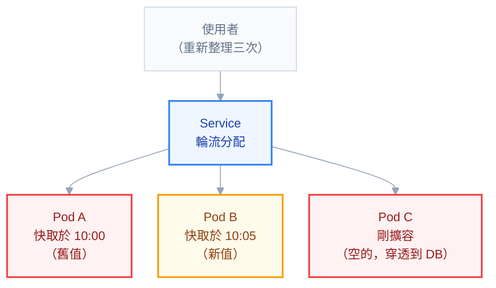

# 附錄 AB：快取策略

快取是所有效能優化裡**看起來最簡單、實際上最容易出錯**的一個。「加個快取」聽起來像是幾行程式碼，但它引入的是一整類新問題：資料什麼時候過期、多個副本的快取不一致怎麼辦、快取掛了會不會拖垮整個服務、以及最尷尬的——**加了之後反而更慢**。

在 K8s 上這些問題被放大，因為**多副本是預設**。單機時「應用內快取」是最簡單的選擇；三個副本時，那個選擇會讓使用者按重新整理看到不同的結果。

這一份講怎麼在 K8s 環境做對。

---

## Part 1：先確認真的需要

**先量測，再優化。** 附錄 Q 那套方法要先用上——把延遲拆開，確認慢在哪一段。常見的情況是：以為是資料庫慢所以加快取，實際上慢在 CPU throttle 或連線池排隊，加了快取完全沒用。

快取值得加的三種情況：

| 情況 | 判準 |
| --- | --- |
| **同樣的查詢重複很多次** | 命中率預期能到 80% 以上 |
| **下游是瓶頸** | 資料庫已經吃緊，且無法簡單擴容 |
| **計算成本高** | 一次查詢要 join 五張表或跑複雜運算 |

不值得加的情況也很具體：**查詢本來就很快**（快取的往返可能比查詢還久）、**資料變動頻繁**（命中率低且一致性問題大）、**每個使用者的查詢都不同**（命中率趨近零）。

**「命中率會是多少」這個估算要在動手之前做。** 命中率 30% 的快取，多數請求付出了查快取的成本卻沒得到好處——它讓系統更慢也更複雜。

---

## Part 2：三層快取

| 層 | 位置 | 延遲 | 一致性 | K8s 上的問題 |
| --- | --- | --- | --- | --- |
| **CDN / 瀏覽器** | 使用者端 | 最快 | 最難控制 | 失效要靠 CDN API |
| **應用內記憶體** | Pod 裡 | 極快（奈秒級） | **多副本各自一份** | 本章重點 |
| **分散式**（Redis） | 獨立服務 | 快（毫秒級網路往返） | 全副本一致 | 多一個依賴 |

三層可以疊加，而**最有效的組合通常是「記憶體 + Redis」**：記憶體擋住絕大多數請求、Redis 保證多副本看到一致的資料。.NET 9 的 `HybridCache` 就是把這兩層包在一起的抽象。

---

## Part 3：本機快取在多副本下的陷阱

**這是 K8s 環境最常見、也最容易被忽略的問題。**

單機時 `IMemoryCache` 是完美的選擇——快、簡單、沒有額外依賴。三個副本之後，它變成三份獨立的快取，帶來四個具體問題：



**問題一：使用者看到不一致的資料。** 副本 A 在 10:00 快取了資料、副本 B 在 10:05 快取，使用者的請求輪流打到不同副本，重新整理兩次看到兩種結果。**症狀是「有時候是舊的、有時候是新的」，而且極難重現。**

**問題二：清除快取沒有統一入口。** 管理員按下「清除快取」，那個請求只會打到其中一個副本——**另外兩個的舊資料還在**。要做對必須有一個廣播機制（Redis pub/sub 或訊息系統），而那就等於你已經需要分散式快取了。

**問題三：擴縮容時新副本是冷的。** HPA 擴出來的新 Pod 快取全空，前幾秒所有請求都穿透到資料庫。尖峰時擴容正好是資料庫壓力最大的時候——**擴容這個動作本身加重了下游負擔**（這跟實戰第五章的連線池乘法是同一類問題）。

**問題四：記憶體佔用是副本數的倍數。** 每個副本各自快取 500MB，十個副本就是 5GB，而且內容大量重複。

### 什麼時候本機快取仍然是對的

不是不能用，而是要用在對的地方：

- **不變或極少變的資料**（設定表、國家清單、費率表）
- **可以容忍短暫不一致**的資料，且 TTL 設得夠短
- **極高頻的熱點**，用來擋住對 Redis 的呼叫（L1 + L2 的 L1）
- 單副本的服務（但那本身就有可用性問題）

**判準：「兩個使用者在同一秒看到不同結果，會出事嗎？」** 會出事就不能只用本機快取。

---

## Part 4：Redis 在 K8s 上

### 該不該進叢集

跟實戰第五章的資料庫決策**幾乎相同的邏輯**，但有一個重要差別：**純快取的 Redis 資料是可重建的**。

| 用途 | 建議 |
| --- | --- |
| **純快取**（掉了重建即可） | 跑在 K8s 完全可以接受 |
| **session 儲存** | 掉了使用者被登出——比純快取嚴格，考慮託管 |
| **當資料庫用**（唯一真相來源） | **當成資料庫看待**，適用實戰 5 的決策表 |
| 雲端環境 | 託管服務通常更划算 |

「可重建」讓 Redis 成為少數適合放進叢集的有狀態服務——**前提是你真的把它當快取用**。很多團隊的 Redis 慢慢變成了唯一真相來源（存了 session、存了佇列、存了計數器），那時候它的失去成本就完全不同了。

### 部署形態

| 形態 | 適合 | 注意 |
| --- | --- | --- |
| **單一實例** | 開發、純快取且可接受短暫中斷 | 掛了就全空 |
| **Sentinel**（主從 + 自動故障轉移） | 需要高可用但資料量不大 | 客戶端要支援 Sentinel |
| **Cluster**（分片） | 資料量大到單機裝不下 | 跨 slot 操作受限，複雜度高 |

**多數快取場景用單一實例或 Sentinel 就夠。** 上 Cluster 之前先確認你真的需要分片——它帶來的限制（多 key 操作必須同 slot、Lua script 受限）常常比預期麻煩。

### 四個必設的參數

```yaml
# 以 Bitnami Redis chart 的 values 為例
master:
  persistence:
    enabled: false # 純快取不需要持久化，省 IO 與複雜度
  resources:
    requests:
      memory: 2Gi
    limits:
      memory: 2Gi # Redis 要 Guaranteed QoS，避免被驅逐
commonConfiguration: |-
  maxmemory 1500mb
  maxmemory-policy allkeys-lru
  appendonly no
```

**`maxmemory` 一定要設，而且要小於容器的 memory limit。** 沒設的話 Redis 會一直吃記憶體直到被 OOMKilled——而 OOMKilled 的 Redis 是整個快取瞬間全空，下游會被穿透的流量打爆。設了 `maxmemory` 之後，Redis 會依 `maxmemory-policy` 自己淘汰舊資料，優雅得多。

`maxmemory` 通常設成 limit 的 70–75%，因為 Redis 自身的開銷（複製緩衝、客戶端緩衝）不算在 `maxmemory` 裡。

**`maxmemory-policy` 對快取用途要設 `allkeys-lru` 或 `allkeys-lfu`**（淘汰最少用的）。預設的 `noeviction` 會在滿了之後**拒絕所有寫入**——對快取來說是錯的行為。

**純快取關掉持久化。** 快取重建得回來，開持久化只是增加 IO 與故障面。反過來說，如果你的 Redis 需要持久化，那代表它不只是快取（見上一節）。

### 連線的差異

實戰第五章講過「連線數 = Pod 數 × 連線池」的乘法。**Redis 客戶端通常不同**——StackExchange.Redis 這類客戶端用的是**多工（multiplexing）**：一個連線上可以同時跑很多個請求，所以不需要大的連線池。

**這反而造成另一個錯誤：有人把 Redis 客戶端當成資料庫連線池用，每個請求開一個連線。** 正確做法是整個應用共用一個 `ConnectionMultiplexer` 單例。

### Redis 掛掉時該怎樣

**這是設計上最重要的一個決定：快取不可用時，服務該降級還是一起掛？**

答案幾乎永遠是**降級**——查不到快取就去查資料庫，慢一點但還能服務。實作上要注意：

- 對 Redis 的呼叫要有**短逾時**（幾百毫秒），不能讓它拖垮請求
- 要有斷路器，Redis 持續失敗時直接跳過快取，不要每次都等逾時
- **要壓測「沒有快取時」的容量**——如果下游根本扛不住全部流量，那你的快取不是優化而是必需品，需要當成關鍵依賴來設計（多副本、監控、告警）

沒做這個決定的下場是：Redis 掛掉 → 所有請求卡在等 Redis 逾時 → 執行緒耗盡 → **整個服務掛掉，即使資料庫還好好的**。

---

## Part 5：失效策略

### 三種寫入模式

| 模式 | 怎麼運作 | 適合 |
| --- | --- | --- |
| **Cache-aside**（旁路） | 讀：先查快取，沒有就查 DB 並寫入快取；寫：更新 DB 後**刪除**快取 | **預設選擇** |
| **Write-through** | 寫入時同時更新 DB 與快取 | 讀多寫少且要求快取總是新的 |
| **Write-behind** | 先寫快取，非同步刷回 DB | 極高寫入量，但**有掉資料的風險** |

**Cache-aside 是預設**，因為它最簡單、失敗模式最好理解，而且快取掛掉時不影響寫入路徑。

### 寫入後要刪除，不要更新

這是一個反直覺但重要的細節：**更新資料之後，應該刪除快取而不是更新快取。**

原因是併發：兩個請求同時更新，A 先寫 DB、B 後寫 DB，但 B 先更新快取、A 後更新快取——**快取裡留下的是舊值，而且會一直錯到過期**。刪除則沒有這個問題，下次讀取會重新載入正確的值。

代價是刪除後的第一次讀取會穿透到 DB，但那是可接受的。

### 三種失效方式

| 方式 | 說明 | 注意 |
| --- | --- | --- |
| **TTL** | 設定存活時間，到期自動消失 | 最簡單；**TTL 要加隨機抖動**（見 Part 6） |
| **主動失效** | 資料變更時明確刪除 | 準確，但要記得所有相關的 key |
| **版本化 key** | key 帶版本號，改版本等於全部失效 | 適合批次失效，舊資料靠 TTL 自然淘汰 |

版本化 key 值得一提：`product:v3:123` 這種形式，要讓所有商品快取失效時只要把版本推到 v4，不必逐一刪除。舊的 v3 資料會自己過期。

---

## Part 6：Cache Stampede

**快取雪崩是快取系統最典型的故障，而且它常常發生在流量最高的時候。**

三種形態：

**形態一：大量 key 同時過期。** 系統啟動時一次載入的資料，TTL 都設一小時 → 一小時後**同時全部過期** → 所有請求同時穿透到資料庫。

**形態二：熱點 key 過期。** 一個超高頻的 key 過期的瞬間，可能有幾百個併發請求同時發現「沒有快取」，然後**全部去查同一筆資料**。

**形態三：冷啟動。** 部署或擴容之後快取全空（Part 3 的問題三）。

### 四個解法

**1. TTL 加隨機抖動**（解決形態一，成本最低）

```csharp
var ttl = TimeSpan.FromMinutes(60) + TimeSpan.FromSeconds(Random.Shared.Next(0, 600));
```

讓過期時間分散在 60–70 分鐘之間，就不會同時到期。**這一行程式碼解決了最常見的一種雪崩**，投報率極高。

**2. 單飛（single flight）**（解決形態二）

同一個 key 只讓第一個請求去查資料庫，其他請求等待它的結果。.NET 9 的 `HybridCache` 內建這個行為；自己實作則用 per-key 的 `SemaphoreSlim`。

**3. 提前更新。** 快取到期前（例如剩 10%）就非同步刷新，讓使用者永遠讀到快取。

**4. 永不過期 + 背景刷新。** 快取不設 TTL，由背景工作定期更新。適合資料量小且極熱的內容（設定、費率）。代價是背景工作掛掉的話資料會靜默地舊掉——**要對「上次刷新時間」告警**。

### K8s 特有的補充：擴容時的冷啟動

`minReadySeconds` 與 `startupProbe`（實戰第二章）可以讓新 Pod 慢一點才接流量，但那不會讓快取變熱。真的在意的話有兩個做法：**新 Pod 啟動時預熱**（在 readiness 通過前先載入熱點資料），或**用共享的 Redis 而非本機快取**（新 Pod 立刻就能用）。

後者是更根本的解法——**這也是「多副本環境該用分散式快取」的另一個理由**。

---

## Part 7：「加了快取反而更慢」

這個情況比想像中常見，五個成因：

| 成因 | 怎麼發現 |
| --- | --- |
| **命中率太低** | 監控命中率；低於 50% 就要重新評估 |
| **序列化成本超過查詢成本** | 快取一個小物件卻要 JSON 序列化／反序列化，可能比直接查還慢 |
| **網路往返** | Redis 在另一個可用區，每次多幾毫秒（附錄 M 的跨區流量） |
| **快取物件太大** | 大物件在應用內快取造成 GC 壓力，在 Redis 造成網路與記憶體壓力 |
| **快取本身成為瓶頸** | 單一 Redis 實例的 CPU 打滿，所有請求排隊 |

**第二項最容易被忽略。** 快取一筆「查詢只要 0.5ms」的資料，但序列化 + 網路往返要 1.5ms——**加了快取讓它變慢三倍**。判準是：快取的成本（往返 + 序列化）必須明顯小於原本的成本。

第三項在雲端環境要特別注意：Redis 與應用如果不在同一個可用區，每次呼叫都跨區。用 `topologySpreadConstraints` 或 node affinity 讓它們靠近，或至少確認 Service 有設 `trafficDistribution: PreferClose`（附錄 C-3）。

---

## Part 8：該監控什麼

| 指標 | 為什麼重要 | 大概的健康值 |
| --- | --- | --- |
| **命中率** | 快取有沒有在做事 | > 80%（依場景） |
| 快取操作延遲 P99 | 快取本身有沒有變慢 | < 5ms |
| **淘汰率**（evicted keys） | 持續淘汰代表記憶體不夠 | 接近 0 |
| Redis 記憶體使用 vs maxmemory | 快滿了要擴容 | < 80% |
| Redis 連線數 | 有沒有客戶端在濫開連線 | 穩定 |
| 快取錯誤率 | 降級路徑有沒有在被觸發 | 接近 0 |

```promql
# 命中率
rate(cache_hits_total[5m]) / (rate(cache_hits_total[5m]) + rate(cache_misses_total[5m]))

# Redis 記憶體水位
redis_memory_used_bytes / redis_memory_max_bytes

# 淘汰速率（持續大於 0 代表記憶體不足）
rate(redis_evicted_keys_total[5m])
```

**「命中率」與「淘汰率」要一起看**：命中率下降 + 淘汰率上升 = 記憶體不夠，快取還來不及被用就被淘汰了。這時候擴記憶體比調 TTL 有效。

---

## 常見誤區

| # | 誤區 | 真相 |
| --- | --- | --- |
| 1 | 慢就加快取 | 先量測慢在哪；可能是 throttle 或連線池 |
| 2 | 多副本用本機快取沒差 | 使用者重新整理會看到不同結果 |
| 3 | 「清除快取」按鈕會清掉所有副本 | 只會打到其中一個 |
| 4 | Redis 不用設 `maxmemory` | 會 OOMKilled，快取瞬間全空打爆下游 |
| 5 | `maxmemory-policy` 用預設 | 預設 `noeviction` 滿了就拒絕寫入 |
| 6 | 快取需要開持久化 | 純快取不需要；需要的話它就不只是快取 |
| 7 | 更新資料後更新快取 | 併發下會留下舊值；應該**刪除** |
| 8 | TTL 設固定值 | 大量 key 同時過期造成雪崩；要加抖動 |
| 9 | Redis 掛了服務跟著掛 | 要降級 + 短逾時 + 斷路器 |
| 10 | 沒壓測過「沒有快取」的容量 | 快取掛掉時才發現下游根本扛不住 |
| 11 | 命中率沒在監控 | 可能加了快取反而更慢卻不知道 |
| 12 | Redis 客戶端每個請求開連線 | 應該共用一個多工連線 |

---

## 檢查清單

**決定加快取前**

- [ ] 已用附錄 Q 的方法確認慢在哪一段
- [ ] 估算過預期命中率
- [ ] 確認快取成本（往返 + 序列化）明顯小於原成本

**選層**

- [ ] 多副本環境**沒有只靠本機快取**存放會變動的資料
- [ ] 本機快取只用於不變資料或 L1
- [ ] 判準過「兩個使用者同一秒看到不同結果會不會出事」

**Redis 設定**

- [ ] `maxmemory` 有設且小於 memory limit（約 70–75%）
- [ ] `maxmemory-policy` 設為 `allkeys-lru` / `allkeys-lfu`
- [ ] 純快取關閉持久化
- [ ] requests = limits（Guaranteed QoS，避免被驅逐）
- [ ] 客戶端共用單一多工連線

**韌性**

- [ ] 快取呼叫有短逾時與斷路器
- [ ] **Redis 掛掉時服務會降級而非一起掛**
- [ ] 已壓測「沒有快取」時的容量

**失效與雪崩**

- [ ] 用 cache-aside，寫入後**刪除**而非更新
- [ ] **TTL 有隨機抖動**
- [ ] 熱點 key 有單飛機制
- [ ] 擴容時的冷啟動有處理（預熱或用共享快取）

**監控**

- [ ] 命中率、淘汰率、記憶體水位、快取延遲都有儀表板
- [ ] 命中率明顯下降有告警

## 連結

- [[72-cascading-failure]] — 附錄 AX：快取雪崩與級聯失敗是同一類問題的兩面
- [[39-performance-troubleshooting]] — 附錄 Q：先量測再優化、延遲分層定位
- [[practice-5-database-and-state]] — 實戰 5：有狀態服務該不該進叢集、連線數的乘法
- [[45-microservices-and-communication]] — 附錄 W：逾時、斷路器與降級
- [[49-messaging-and-events]] — 附錄 AA：用 pub/sub 做跨副本的快取失效通知
- [[35-cloud-networking]] — 附錄 M：跨可用區流量的延遲與成本
- [[practice-6-observability]] — 實戰 6：把命中率做成儀表板
- [[k8s-mastery]] — 教材總目錄
