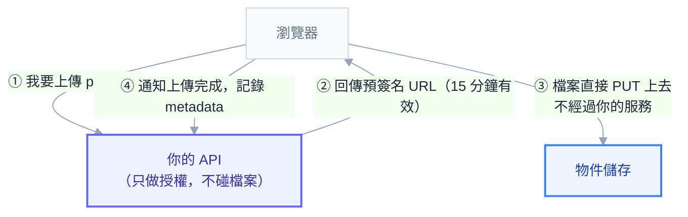

# 附錄 AD：檔案與物件儲存

實戰第一章列過遷移的常見卡點，其中一句是「`D:\uploads` 這類本機檔案是最常見的卡點」，然後給了三個選項就帶過去了。這一份把它展開。

這個主題值得單獨處理，因為它牽涉一個**多數團隊第一次做都會做錯的決定**：把使用者上傳的檔案放進 PVC。那個決定在單副本時完全正常，擴容那天才會發現問題——而那時候檔案已經散在三個 PVC 裡了。

---

## Part 1：為什麼不要把使用者檔案放 PVC

五個具體理由：

**1. RWO 讓你無法水平擴展。** 多數區塊儲存（EBS、GCE PD）只支援 `ReadWriteOnce`——一次只能掛在一個節點上（附錄 C-3）。三個副本排在不同節點，其中兩個掛不上，卡在 `Multi-Attach error`。

**2. RWX 有它自己的代價。** 改用 NFS / CephFS / EFS 可以多節點共掛，但延遲高、成本高、而且**多了一個要維運的儲存系統**。

**3. 備份很麻煩。** PVC 快照是檔案系統層級的（附錄 L），要單獨還原「某個使用者的某個檔案」非常笨拙。物件儲存則天然有版本控制與生命週期管理。

**4. 容量規劃變成硬約束。** PVC 的大小要事先決定，滿了要手動擴容（而且只能擴大不能縮小）。物件儲存是無限的，用多少算多少。

**5. 檔案流量會穿過你的應用。** 這是最容易被低估的一點——每一次下載都佔用一個 worker、一份記憶體、一段 Ingress 頻寬（Part 4 詳述）。

### PVC 仍然是對的場景

不是全面否定，而是用在對的地方：

| 場景 | 為什麼 PVC 可以 |
| --- | --- |
| **暫存檔案**（處理中的中間產物） | 隨 Pod 生滅，用 `emptyDir` 更好 |
| 單機工具的工作目錄 | 不需要跨副本共享 |
| 資料庫的資料檔 | 那是有狀態服務，本來就綁定單一 Pod |
| **快取**（可重建） | 掉了無所謂 |

**判準：這個檔案掉了會不會有人來抱怨？** 會的話就不該只放在 PVC。

---

## Part 2：物件儲存的心智模型

從檔案系統換過來時，有三個觀念要調整：

**沒有目錄，只有扁平的 key。** `uploads/2026/08/abc.jpg` 看起來像路徑，實際上整串就是一個 key，`/` 只是慣例。所以「重新命名一個資料夾」在物件儲存裡是「把底下每個物件複製到新 key 再刪除舊的」——**這是 O(n) 的操作，不是 O(1)**。

**不能 append，只能整個覆寫。** 要在檔案末尾加東西，得下載、修改、重新上傳。所以物件儲存不適合日誌檔這類持續追加的內容。

**大檔要分段上傳（multipart）。** 超過幾百 MB 的檔案，SDK 會自動切成多段平行上傳，中斷後可以續傳。這也是它比 PVC 更適合大檔的原因之一。

一致性方面，主流服務現在都提供寫入後立即讀取的一致性，但**列舉（list）的即時性仍可能有延遲**——所以不要用「列舉 bucket」當作業務邏輯的依據，該用資料庫記錄檔案的 metadata。

---

## Part 3：在 K8s 上的選項

| 選項 | 適合 | 注意 |
| --- | --- | --- |
| **雲端託管**（S3 / GCS / Blob） | 雲端環境 | 幾乎永遠是對的選擇 |
| **MinIO（自建）** | 地端、或需要 S3 相容介面 | 要自己管容量與備份 |
| **既有的 NAS/SAN** | 已經有且夠用 | 沒有 S3 API 的話應用要另外處理 |

**在雲端就用託管服務**——理由跟實戰第五章的資料庫、附錄 AB 的 Redis 完全一樣：備份、擴容、耐久性都是別人的事，而物件儲存的託管服務便宜到自建幾乎沒有經濟理由。

### 地端自建 MinIO 的要點

```yaml
# 以 MinIO Operator 的 Tenant 為例（概念示意）
apiVersion: minio.min.io/v2
kind: Tenant
metadata:
  name: storage
  namespace: minio
spec:
  pools:
    - servers: 4              # 分散式模式至少 4 個
      volumesPerServer: 4     # 每台 4 顆磁碟
      volumeClaimTemplate:
        spec:
          accessModes: ["ReadWriteOnce"]
          storageClassName: local-ssd
          resources:
            requests:
              storage: 1Ti
  requestAutoCert: true
```

三個重點：

**分散式模式需要足夠的磁碟數。** MinIO 用糾刪碼（erasure coding）提供耐久性，磁碟太少就沒有冗餘可言。單機模式只適合開發環境。

**用本機磁碟而不是網路儲存。** 在 NFS 上跑 MinIO 是把一層儲存疊在另一層上，效能與可靠性都不好。

**它是有狀態服務，適用附錄 R 與實戰 5 的所有原則**：用 Operator 不要自己拼、PVC 保留策略要確認、備份要獨立於叢集。

---

## Part 4：上傳與下載不要經過應用

**這是本章最重要的一節。**

直覺的做法是：使用者上傳 → 打到你的 API → API 收下檔案 → 寫進物件儲存。這個流程可以動，但它有四個代價：

| 代價 | 具體是什麼 |
| --- | --- |
| **記憶體與磁碟** | 檔案要先在應用裡緩衝 |
| **佔用 worker** | 一個 100MB 的上傳可能佔住一個執行緒好幾十秒 |
| **Ingress 限制** | `proxy-body-size` 那條鏈的每一層都要調（附錄 F） |
| **雙倍流量** | 檔案進來一次、出去一次，頻寬與跨區費用都翻倍 |

正解是**預簽名 URL（presigned URL）**：讓應用只負責「授權」，檔案本身直接在瀏覽器與物件儲存之間傳輸。



```csharp
// 產生一個 15 分鐘有效的上傳網址
var request = new GetPreSignedUrlRequest
{
    BucketName = "uploads",
    Key = $"users/{userId}/{Guid.NewGuid()}.jpg",   // 由伺服器決定路徑
    Verb = HttpVerb.PUT,
    Expires = DateTime.UtcNow.AddMinutes(15),
    ContentType = "image/jpeg"
};
var url = s3.GetPreSignedURL(request);
```

**這個做法把應用從資料路徑上完全拿掉**：Ingress 的 body size 限制不再相關、worker 不會被佔住、頻寬成本減半、而且大檔上傳的可靠性由 SDK 的 multipart 機制處理。

### 直傳的安全設計

放手讓瀏覽器直接寫入儲存，安全性完全依賴那張預簽名 URL 怎麼開。五條：

1. **路徑由伺服器決定**，不要讓客戶端指定 key——否則使用者可以覆寫別人的檔案
2. **有效期要短**（幾分鐘到十幾分鐘）
3. **限制 Content-Type 與大小**（用 presigned POST policy 可以強制這兩者）
4. **上傳完成後由後端驗證**：檢查實際大小、實際類型（不要相信副檔名）、必要時掃毒
5. **在資料庫記錄 metadata 之前，那個檔案不算存在**——避免使用者上傳了但沒有對應紀錄的孤兒檔

第 4 點值得強調：**預簽名 URL 只保證「這個人有權上傳」，不保證「他上傳的東西是安全的」。** 驗證仍然要做，只是移到上傳完成之後。

### 下載也一樣

同一套邏輯適用下載：不要讓檔案流經應用，改成產生一個有時效的預簽名下載 URL，或把 bucket 掛在 CDN 後面。

**公開內容用 CDN、私有內容用預簽名 URL。** 兩者都不需要應用參與資料傳輸。

### CORS

瀏覽器直傳需要在 bucket 上設 CORS，否則會被瀏覽器擋下：

```json
[{
  "AllowedOrigins": ["https://app.example.com"],
  "AllowedMethods": ["PUT", "GET"],
  "AllowedHeaders": ["Content-Type"],
  "MaxAgeSeconds": 3000
}]
```

**這是直傳最常見的第一個障礙**，而且錯誤訊息出現在瀏覽器 console 而不是你的日誌裡——知道要往這裡查可以省很多時間。

---

## Part 5：大檔與 Ingress 的關係

如果你**沒有**用直傳，那檔案會穿過整條 Ingress 鏈，而那條鏈上每一層都有上限：

| 層 | 設定 | 常見預設 |
| --- | --- | --- |
| CDN / Cloudflare | 方案限制 | 免費方案約 100 MB（正文第 13 章的案例） |
| Ingress Controller | `proxy-body-size` | **1 MB**（附錄 F） |
| 應用框架 | 請求大小限制 | 依框架 |

**任何一層漏改，症狀都是 413，而且應用日誌完全沒紀錄**——因為請求根本沒到應用。

用了直傳之後，這整條鏈就完全不相關了——這是它除了效能之外的另一個大好處。

---

## Part 6：檔案處理工作

上傳完成之後常常還要做事：產縮圖、轉檔、掃毒、擷取 metadata。

**不要在上傳的請求裡同步做。** 理由跟附錄 AA 一樣：那會讓使用者等、佔住 worker、而且失敗了整個上傳都算失敗。

正確的架構是事件驅動：

```
上傳完成 → 發一則訊息 → worker 消費 → 處理 → 更新狀態
```

三個設計要點：

**worker 要冪等。** 訊息可能重複投遞（附錄 AA），同一張圖可能被處理兩次——用「輸出的 key 是確定性的」來達成（同樣的輸入產生同樣的輸出 key，重複執行只是覆寫）。

**資源要單獨設。** 影像處理是 CPU 與記憶體密集的，跟 API 服務的資源需求完全不同——**它應該是獨立的 Deployment**，有自己的 requests/limits 與 HPA（或 KEDA 依佇列深度擴縮）。

**大檔處理要串流，不要整個載入記憶體。** 一個 500MB 的影片如果整個讀進記憶體，limit 設多少都不夠。

**前端要能表達「處理中」狀態。** 上傳完成不等於可用——這是非同步處理必然的代價，UI 要反映它。

---

## Part 7：生命週期與成本

物件儲存便宜，但**「便宜」不等於「不用管」**——它最大的成本風險是**只進不出**。

三個該做的：

**生命週期規則**：例如「30 天後轉到低頻儲存、365 天後歸檔或刪除」。這是在儲存端設定的，不需要應用參與。

**孤兒檔案盤點**：資料庫記錄被刪了但檔案還在，是最常見的浪費來源。定期跑一個對帳工作（正好是附錄 AC 的 CronJob 用例）比對兩邊，找出沒有對應紀錄的物件。

**版本控制的取捨**：開啟版本控制可以救誤刪，但**每個版本都在計費**——要搭配生命週期規則自動清理舊版本，否則儲存量會悄悄膨脹。

> 對照附錄 K 的孤兒資源盤點：那份講的是叢集內的 PV/PVC，這裡講的是叢集外的物件。**兩邊都要盤點**，而物件儲存因為「不會滿」所以更容易被忽略。

---

## Part 8：安全

| 項目 | 做法 |
| --- | --- |
| **不要公開整個 bucket** | 預設全私有，公開內容放獨立的 bucket 或走 CDN |
| **路徑不可猜** | 用 UUID 而非 `user123/photo1.jpg`（防止遍歷猜測） |
| **權限最小化** | 應用只需要對特定前綴的讀寫權，不需要整個帳號的權限 |
| **憑證用 IRSA** | 不要把 access key 塞進 Secret（附錄 M） |
| **上傳後驗證** | 實際類型（magic number 而非副檔名）、大小、必要時掃毒 |
| **加密** | 靜態加密開啟；敏感內容考慮客戶端加密 |
| **個資** | 刪除請求要真的刪掉（含所有版本與備份） |

「路徑不可猜」與「預簽名 URL」是互補的：即使有人猜到了路徑，沒有簽名也存取不了。但**如果你的 bucket 有任何公開部分，路徑就是唯一的防線**——那時候可猜的路徑等於沒有保護。

---

## 常見誤區

| # | 誤區 | 真相 |
| --- | --- | --- |
| 1 | 使用者檔案放 PVC | 擴容那天發現 RWO 掛不上、檔案散在多個 PVC |
| 2 | 用 RWX 就解決了 | 延遲高、成本高、多一個要維運的系統 |
| 3 | 上傳要經過應用才安全 | 預簽名 URL 一樣安全，且不佔資源；驗證移到上傳後 |
| 4 | 直傳就不用驗證 | 預簽名只授權「可以傳」，不保證內容安全 |
| 5 | 讓客戶端指定上傳路徑 | 可以覆寫別人的檔案 |
| 6 | 物件儲存有目錄 | 只是扁平 key，改「資料夾」名是 O(n) |
| 7 | 可以在物件末尾 append | 只能整個覆寫 |
| 8 | 縮圖在上傳請求裡同步做 | 使用者要等、佔 worker、失敗連上傳一起失敗 |
| 9 | 物件儲存便宜所以不用管 | 只進不出 + 版本控制會讓成本悄悄膨脹 |
| 10 | 資料庫刪了檔案就沒了 | 孤兒檔案是最常見的浪費，要定期對帳 |
| 11 | 開了版本控制就安全了 | 每個版本都計費，要配生命週期規則 |
| 12 | 用副檔名判斷檔案類型 | 要看 magic number |

---

## 檢查清單

**架構**

- [ ] 使用者上傳的檔案**不在 PVC 裡**
- [ ] 雲端環境用託管物件儲存，地端自建用 Operator
- [ ] 檔案的 metadata 記在資料庫，不靠列舉 bucket

**上傳／下載**

- [ ] **用預簽名 URL，檔案不經過應用**
- [ ] 路徑由伺服器決定且不可猜（UUID）
- [ ] 預簽名有效期短、限制 Content-Type 與大小
- [ ] bucket 的 CORS 已設定
- [ ] **上傳完成後有後端驗證**（實際類型、大小、掃毒）
- [ ] 下載走預簽名或 CDN

**沒用直傳的話**

- [ ] Ingress `proxy-body-size` 已調
- [ ] CDN 的大小限制已確認
- [ ] 應用有串流處理，不整個載入記憶體

**處理工作**

- [ ] 縮圖／轉檔非同步做，不在上傳請求裡
- [ ] worker 是獨立的 Deployment，資源與擴縮獨立
- [ ] worker 冪等（輸出 key 是確定性的）
- [ ] 前端能表達「處理中」狀態

**成本與安全**

- [ ] 有生命週期規則
- [ ] **有孤兒檔案對帳的排程**
- [ ] 版本控制配了舊版本清理規則
- [ ] bucket 預設全私有
- [ ] 憑證走 IRSA / Workload Identity，不是長期 key
- [ ] 靜態加密已開啟

## 連結

- [[practice-1-containerize-your-app]] — 實戰 1：本機檔案是遷移最常見的卡點
- [[20-yaml-fields-network-storage]] — 附錄 C-3：PV/PVC 全欄位與 accessModes 的真義
- [[28-ingress-nginx-annotations]] — 附錄 F：`proxy-body-size` 與那條大小限制鏈
- [[49-messaging-and-events]] — 附錄 AA：事件驅動的檔案處理與冪等
- [[51-background-jobs]] — 附錄 AC：孤兒檔案對帳的 CronJob
- [[35-cloud-networking]] — 附錄 M：IRSA 與 VPC Endpoint（省 NAT 費用）
- [[33-cost-optimization]] — 附錄 K：叢集內的孤兒資源盤點（對照）
- [[62-stateful-workloads-decision]] — 附錄 AN：跨區的 PV 為何會讓 Pod 永遠排不回去
- [[k8s-mastery]] — 教材總目錄
