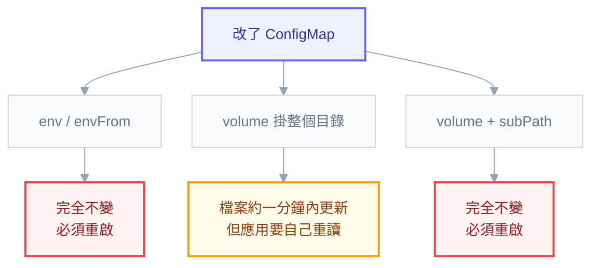

# 附錄 AE：設定管理的完整策略

正文第 6 章講了 ConfigMap 與 Secret 的機制、附錄 C-1 攤平了它們的欄位、實戰第二章示範了怎麼注入。但有一件事沒人講過：**一個系統的設定，整體上該怎麼組織？**

這個問題比它看起來重要，因為**設定變更造成的事故比程式碼變更多**——而且原因很結構性：設定沒有型別檢查、沒有單元測試、review 常常比較草率、生效速度又快。一個打錯的字元可以在三十秒內讓服務全掛。

這一份講設定的分類、多環境的組織、變更的防護，以及熱重載的真相。

---

## Part 1：先分類，分類決定放哪裡

把所有設定丟進一個 ConfigMap 是最常見的做法，也是最容易出事的做法。正確的第一步是**依「變更頻率」與「敏感度」分類**：

| 類型 | 例子 | 變更頻率 | 該放哪 |
| --- | --- | --- | --- |
| **環境差異** | DB 位址、網域、外部 API endpoint | 很低 | ConfigMap（每環境一份） |
| **機密** | 密碼、金鑰、憑證 | 低（但要能快速輪替） | Secret + Vault/ESO |
| **調校參數** | 逾時、連線池大小、批次大小、快取 TTL | 中 | ConfigMap，但要能快速改 |
| **功能開關** | 新功能啟用、降級開關 | **高** | **Feature flag 系統，不是 ConfigMap** |

**最後一列是關鍵區分。** 功能開關的變更頻率跟其他三類差一個量級——它可能一天改好幾次、需要針對特定使用者、需要立即生效、而且需要有人在事故當下快速切換。用 ConfigMap 做這件事會很痛苦（Part 5 詳述）。

一個實用的判準：**「這個值改了之後，我能接受等一次滾動更新嗎？」** 能接受 → ConfigMap；不能 → 你要的是 feature flag。

---

## Part 2：多環境怎麼組織

### 不要用 git 分支管環境

常見的做法是 `dev` / `staging` / `main` 三個分支，各自有自己的設定。**這是一個會慢慢腐爛的設計**：

- 分支會漂移，`dev` 有的修正忘了 cherry-pick 到 `main`
- 無法一眼看出「這兩個環境差在哪」
- merge 衝突會發生在設定檔上，而那正是最不該有衝突的地方

**正解是同一個分支、用目錄或 overlay 區分環境**：

```
k8s/
├── base/                    # 所有環境共通
│   ├── deployment.yaml
│   ├── service.yaml
│   └── kustomization.yaml
└── overlays/
    ├── dev/
    │   ├── kustomization.yaml
    │   └── config.yaml       # 只放跟 base 不同的部分
    └── prod/
        ├── kustomization.yaml
        └── config.yaml
```

```powershell
# 一眼看出兩個環境的差異——這是這個結構最大的價值
diff <(kubectl kustomize k8s/overlays/dev) <(kubectl kustomize k8s/overlays/prod)
```

**「能夠 diff 兩個環境」是判斷設定組織好壞的最直接指標。** 做不到的話，你永遠無法確定「測試環境過了正式環境會不會過」。

### 哪些值該在哪一層

| 層 | 放什麼 | 原則 |
| --- | --- | --- |
| **base** | 所有環境相同的、以及**安全的預設值** | 越多越好 |
| **overlay** | 真正因環境而異的 | 越少越好 |

**overlay 越薄越好。** 每一個出現在 overlay 的值，都是一個「環境之間可能不一致」的風險點（附錄 Z 講過：能消除的環境差異必須消除）。

實務上 overlay 通常只該有這幾類：副本數、資源大小、網域、外部依賴位址、以及環境專屬的開關。**如果你的 prod overlay 有五十行，那是一個訊號。**

### Helm 的對應做法

用 Helm 的話結構是一樣的，只是換成 values 疊層：

```powershell
helm template api ./chart -f values.yaml -f values-prod.yaml
```

`values.yaml` 是 base、`values-prod.yaml` 只放差異。附錄 T 講的「最小可用要夠小」在這裡有第二層意義——**chart 的預設值越好，各環境的 values 就越薄。**

---

## Part 3：設定變更的四道防護

設定變更之所以危險，是因為它繞過了程式碼變更的所有安全網。所以要專門為它建立防護：

### 防護一：schema 驗證（在 CI 就擋）

`values.schema.json`（附錄 T）或 `conftest` 政策（附錄 Z）可以檢查型別與必填。**這一層抓的是「打錯字」與「型別錯」，成本最低效果最好。**

### 防護二：啟動時驗證（讓壞設定進不了叢集）

**這是最有價值的一道，因為它把設定錯誤變成部署失敗，而不是執行期故障。**

```csharp
builder.Services.AddOptions<DatabaseOptions>()
    .Bind(builder.Configuration.GetSection("Database"))
    .ValidateDataAnnotations()
    .ValidateOnStart();          // 驗證失敗就啟動失敗
```

配合 K8s 的滾動更新機制，效果是：**新 Pod 因為設定錯誤而起不來 → readiness 不通過 → 舊 Pod 不會被砍掉 → 服務不受影響 → 你在 `kubectl get pods` 看到 CrashLoop 但線上還好好的。**

這比「Pod 起來了但行為不對」好太多。**沒有 `ValidateOnStart` 的話，一個打錯的連線字串會讓服務跑起來然後每個請求都失敗。**

### 防護三：漸進生效

設定變更也該走跟程式碼一樣的漸進路徑——透過 ConfigMap 的 checksum 觸發滾動更新（附錄 T），變更就自動享有 `maxUnavailable: 0` 與 readiness 的保護（實戰第二章）。

**這是「用滾動更新而非熱重載」的最大論據**（Part 4）。

### 防護四：可回滾

設定在 git 裡的話，回滾就是 `git revert` + ArgoCD 同步（實戰第三章）。**但前提是設定真的全部在 git 裡**——有人用 `kubectl edit configmap` 改過的話，那個變更沒有歷史、無法回滾、而且下次同步會被蓋掉（如果開了 selfHeal 反而是好事）。

---

## Part 4：熱重載的真相

「改設定不用重啟」聽起來很好，但它的實際行為比多數人以為的複雜。



### 三種注入方式的行為

| 方式 | ConfigMap 改了會怎樣 | 應用要做什麼 |
| --- | --- | --- |
| `env` / `envFrom` | **完全不會變** | 必須重啟 |
| volume 掛整個目錄 | 檔案內容約一分鐘內更新 | **應用要自己重讀檔案** |
| volume + `subPath` | **完全不會變** | 必須重啟 |

**兩個常見誤解**：以為 `env` 會跟著變（不會，環境變數在程序啟動時就固定了）、以為掛成 volume 就自動生效（檔案會變，但**應用如果只在啟動時讀一次，那就沒有意義**）。

`subPath` 破壞熱重載這件事在正文第 6 章與附錄 C-1 都提過，這裡再說一次是因為它太常見：**要掛單一檔案又想熱重載，唯一的解法是掛整個目錄。**

### 該不該用熱重載

| | 熱重載 | 滾動更新（checksum） |
| --- | --- | --- |
| 生效速度 | 快（秒級） | 慢（一次滾動） |
| 各副本一致性 | **不保證**（更新有時間差） | 保證 |
| 可回滾 | 靠改回去 | `rollout undo` |
| 故障重現 | **困難**（不知道當時是哪個版本的設定） | 容易（跟著 Pod 版本） |
| 適合 | 緊急降級、日誌等級 | **其餘全部** |

**預設應該用滾動更新。** 熱重載的隱藏代價是「你不知道當時跑的是哪一版設定」——出事後重現故障變得很困難，因為 Pod 的映像沒變、YAML 沒變，只有 ConfigMap 的內容在某個時間點變過。

**熱重載只保留給兩種情況**：需要立即生效的緊急降級（但那更適合 feature flag）、以及不影響行為正確性的東西（日誌等級是最典型的例子）。

---

## Part 5：Feature Flag

### 它跟 ConfigMap 的分工

| | ConfigMap | Feature flag |
| --- | --- | --- |
| 變更頻率 | 低到中 | **高** |
| 生效速度 | 一次滾動更新 | **立即** |
| 針對特定對象 | 做不到 | **可以**（使用者、租戶、百分比） |
| 誰來改 | 工程師（透過 git） | 工程師、PM、甚至客服 |
| 稽核 | git 歷史 | flag 系統的紀錄 |

**分工原則**：「這是這個環境的固定設定」→ ConfigMap；「這是一個可以被打開關掉的行為」→ feature flag。

### 三種值得用 flag 的場景

**1. 漸進發布。** 功能先部署但關閉，確認部署沒問題之後才逐步打開——**把「部署」與「發布」拆開**，兩者的風險就分開了。這比金絲雀更細緻，因為它可以針對特定使用者。

**2. 緊急降級開關。** 事故當下，「關掉那個吃資源的推薦功能」比「回滾整個部署」快得多，也精準得多。**這個開關要在事故之前就做好，並寫進 runbook**（附錄 H）。

**3. A/B 測試與逐步遷移。** 新舊實作並存，用 flag 控制比例。

### Flag 是會累積的債務

**每個 flag 都是一個 if 分支，而 if 分支會讓程式碼路徑倍增。** 二十個永久存在的 flag 代表理論上有一百萬種組合，而你只測過其中幾種。

三條紀律：**每個 flag 建立時就要有預期壽命**（暫時的 vs 永久的）、**暫時的 flag 要有清理待辦與負責人**、以及**定期盤點**（哪些 flag 已經 100% 打開超過三個月？那就該把 if 拿掉了）。

沒有這套紀律的話，flag 系統會從「降低風險的工具」變成「沒人敢動的地雷區」。

---

## Part 6：機密的組織

正文第 8 章講了 Vault 的信任鏈、附錄 C-5 攤平了 ESO 的欄位。這裡補的是**組織方式**：

### 分層授權

| 層級 | 誰能看 | 例子 |
| --- | --- | --- |
| 應用層機密 | 該應用的 SA | 資料庫密碼、API key |
| 團隊層機密 | 團隊成員 | 共用的第三方帳號 |
| 平台層機密 | 平台團隊 | registry 憑證、TLS 私鑰 |

**原則是「誰需要就給誰，不多給」**——這在 Vault 的 policy 或雲端的 IAM 上實作，而不是「大家都用同一個 Secret」。

### 三個實務要點

**應用不該知道機密從哪來。** 它只讀環境變數或檔案；來源是 Secret、Vault 還是雲端的機密管理服務，是部署層的決定。**這讓你可以在不改應用的情況下升級機密管理方式。**

**輪替要能在不停機的情況下完成。** 對資料庫密碼來說，這通常意味著「兩組憑證並存的過渡期」——舊的還能用時就先讓應用換到新的，確認之後才停用舊的。這跟實戰第五章的 expand-contract 是同一個思路。

**外洩的處置順序是先輪替再清理**（附錄 P）。這件事要寫進 runbook，因為事故當下沒有人會有心力思考順序。

---

## Part 7：五種常見的設定事故

| 形態 | 為什麼發生 | 預防 |
| --- | --- | --- |
| **打錯字靜默使用預設值** | 環境變數名稱錯，應用讀不到就用預設 | **必填項不給預設值**，讓它啟動失敗 |
| **改一個值全掛** | 沒有驗證、沒有漸進、立即全域生效 | `ValidateOnStart` + 滾動更新 |
| **同一個值在多處重複** | ConfigMap、Helm values、程式碼預設各一份 | 單一來源，其餘引用 |
| **改了 ConfigMap 但沒生效** | 用 `env` 注入，或用了 `subPath` | checksum annotation 觸發重啟 |
| **測試環境過了正式環境掛** | 兩邊設定結構不同 | overlay 要薄，且能 diff |

**第一項值得展開，因為它最陰險。** 應用讀 `DATBASE_URL`（打錯字），讀不到就用程式碼裡的預設值 `localhost`——**服務正常啟動、健康檢查通過、只有實際查詢時才失敗**。而如果那個預設值指向某個真的存在的東西（開發用的 SQLite、測試資料庫），問題可能好幾天後才被發現。

解法很簡單但需要紀律：**環境相關的必填設定不要給預設值**。讓它在啟動時就失敗，配合 Part 3 的第二道防護，壞設定根本進不了叢集。

---

## 檢查清單

**分類**

- [ ] 設定已依「變更頻率 × 敏感度」分類
- [ ] 高頻切換的行為用 feature flag，不是 ConfigMap
- [ ] 機密不在 ConfigMap 裡、不在 git 明文裡

**多環境**

- [ ] **不用 git 分支管環境**
- [ ] 用 base + overlay（或 values 疊層）
- [ ] **能夠 diff 兩個環境的最終產出**
- [ ] overlay 很薄，只有真正因環境而異的值

**防護**

- [ ] CI 有 schema 驗證
- [ ] 應用有 **`ValidateOnStart`**（壞設定 = 部署失敗，不是執行期故障）
- [ ] **必填的環境設定不給預設值**
- [ ] 設定變更透過 checksum 觸發滾動更新
- [ ] 設定全部在 git，沒有人用 `kubectl edit` 改線上

**熱重載**

- [ ] 清楚三種注入方式的行為差異
- [ ] 沒有用 `subPath` 又期待熱重載
- [ ] 熱重載只用在緊急降級與日誌等級

**Feature flag**

- [ ] 每個 flag 有預期壽命與負責人
- [ ] 有定期盤點與清理
- [ ] **緊急降級開關已存在並寫進 runbook**

**機密**

- [ ] 分層授權，不是大家共用一份
- [ ] 應用不知道機密從哪來
- [ ] 輪替可以不停機完成
- [ ] 外洩處置順序（先輪替）寫進 runbook

---

## 常見誤區

| # | 誤區 | 真相 |
| --- | --- | --- |
| 1 | 所有設定丟一個 ConfigMap | 不同變更頻率的東西該分開 |
| 2 | 用 git 分支管環境 | 會漂移、無法 diff、在最不該衝突的地方衝突 |
| 3 | `env` 注入的 ConfigMap 會熱更新 | 不會，環境變數啟動時就固定 |
| 4 | 掛成 volume 就自動生效 | 檔案會變，但應用要自己重讀 |
| 5 | `subPath` 掛單檔也能熱更新 | 不會，唯一解法是掛整個目錄 |
| 6 | 熱重載比滾動更新好 | 各副本不一致、故障難重現 |
| 7 | 設定給預設值比較安全 | **打錯字會靜默使用預設**，是最陰險的事故 |
| 8 | 設定變更比程式碼變更安全 | 沒型別、沒測試、review 草率、生效快 |
| 9 | feature flag 可以一直留著 | 每個 flag 都是分支，會倍增測試組合 |
| 10 | 用 `kubectl edit` 改一下沒關係 | 沒有歷史、無法回滾、會被同步蓋掉 |

## 連結

- [[06-config-and-storage]] — 正文：ConfigMap/Secret 的機制與更新語意
- [[18-yaml-fields-pod]] — 附錄 C-1：`env`/`envFrom`/volume 的完整欄位與 `subPath`
- [[42-helm-chart-design]] — 附錄 T：values 介面設計、`values.schema.json`、checksum annotation
- [[practice-2-deploy-real-app]] — 實戰 2：Kustomize overlay 的多環境
- [[practice-3-gitops-pipeline]] — 實戰 3：設定變更的 git 流程與回滾
- [[38-security-incident-response]] — 附錄 P：機密外洩先輪替再清理
- [[48-testing-in-k8s]] — 附錄 Z：能消除的環境差異必須消除
- [[k8s-mastery]] — 教材總目錄
