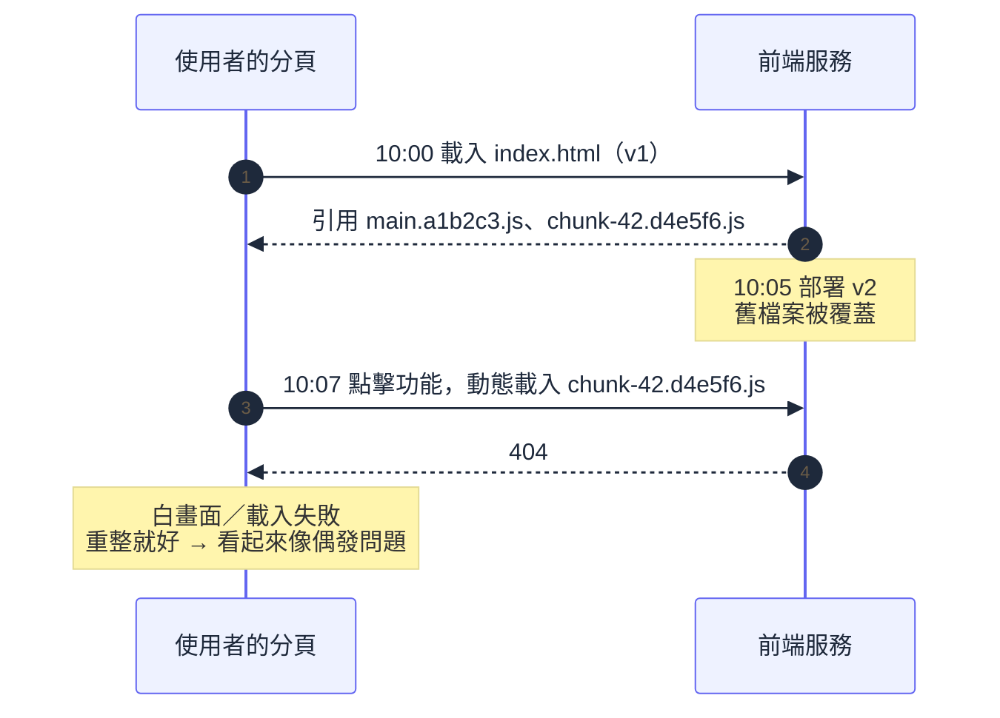

# 附錄 AH：前端在 K8s 上的部署

實戰第一章給了前端的 Dockerfile、SPA 的 `try_files` 回退、以及環境變數兩難的兩個解法。那些讓前端跑得起來，但沒有處理它特有的部署問題——**而多數 K8s 教材完全不談這塊**，於是前端的部署事故常常是「查了很久才發現跟後端的思路完全不同」。

這一份補上。核心是三個根本差異，以及由它們推導出來的所有問題。

---

## Part 1：前端跟後端的三個根本差異

| | 後端 | 前端 |
| --- | --- | --- |
| 產物 | 長期執行的程式 | **靜態檔案** |
| 執行環境 | 你的叢集 | **使用者的瀏覽器** |
| 版本切換 | 滾動更新，你完全控制 | **不是原子的**——使用者可能已經載入舊版 |

**第三點是所有前端部署問題的根源。**

後端的滾動更新有明確的邊界：一個請求要嘛打到舊版、要嘛打到新版，處理完就結束了。前端不是——使用者在十分鐘前載入了 `index.html`，那份 HTML 引用了一組特定的 JS 檔案，而**那個「工作階段」會持續到他關閉分頁為止**。你在中間部署了新版，他的瀏覽器完全不知情。

由此推導出後面幾乎所有的問題與解法。

---

## Part 2：四種部署形態

| 形態 | 需要 K8s 嗎 | 適合 |
| --- | --- | --- |
| **靜態檔案 + nginx 容器** | 是 | 已經有 K8s、要跟後端同網域同 Ingress |
| **靜態檔案 + 物件儲存 + CDN** | **否** | **純 SPA 的最佳解** |
| **SSR**（Next.js / Nuxt） | 是 | 需要 SEO、首屏速度、伺服器端資料 |
| **微前端** | 是 | 多團隊各自負責一部分介面 |

### 一個誠實的建議：純 SPA 不太需要跑在 K8s 上

如果你的前端就是一包編譯出來的靜態檔案，**把它放進物件儲存 + CDN 幾乎在每個維度上都更好**：更快（邊緣節點就近提供）、更便宜（不用 Pod 也不用 Ingress 頻寬）、更可靠（不會因為叢集有事而掛）、而且**完全沒有 Part 3 那個舊檔案 404 的問題**（因為舊檔案還在）。

那為什麼很多團隊還是放在 K8s？通常是三個理由：**要跟 API 同網域**（避開 CORS 與 cookie 問題）、**已經有 Ingress 所以順手**、或**地端沒有 CDN**。這些都是合理的理由——但值得知道你是在為了那些理由付出成本，而不是因為「東西本來就該放 K8s」。

**折衷做法**：靜態檔案放物件儲存/CDN，用 Ingress 的路徑規則把 `/` 導過去、`/api` 導到後端——這樣既有同網域又有 CDN 的好處。

---

## Part 3：「舊 JS 檔案 404」——最經典的前端部署事故

### 事故長什麼樣

```
10:00  使用者載入 index.html（引用 main.a1b2c3.js、chunk-42.d4e5f6.js）
10:05  你部署 v2（產生 main.x9y8z7.js、chunk-42.q1w2e3.js，舊檔案被覆蓋）
10:07  使用者點擊某個功能，觸發動態載入 chunk-42.d4e5f6.js
       → 404 → 白畫面或「載入失敗」
```

**症狀的特徵是「只有部分使用者、只在部署後一段時間內、而且重新整理就好了」**——這讓它很難重現也很難查。使用者的回報通常是「剛剛突然壞掉，我重整就好了」，聽起來像偶發問題。



### 為什麼滾動更新讓它更嚴重

實戰第二章的 `maxSurge: 1, maxUnavailable: 0` 對後端是正解，但對前端有副作用：**更新期間新舊 Pod 同時存在**，使用者的請求輪流打到兩邊——他可能從舊 Pod 拿到 v1 的 HTML，然後從新 Pod 要 v2 才有的檔案，或反過來。

這讓問題不只發生在「部署完之後」，而是**在整個滾動更新的窗口內都可能發生**。

### 四個解法

| 解法 | 做法 | 效果 |
| --- | --- | --- |
| **物件儲存 / CDN**（推薦） | 新版檔案疊加上去，舊檔案不刪 | **根本解決** |
| **保留前幾版的檔案** | 建置時把舊版產物一起放進映像 | 有效但映像變大、管理麻煩 |
| **前端攔截載入錯誤** | 捕捉 chunk load error，提示使用者重新整理 | **必備的安全網**，即使有上面兩者 |
| **部署後主動提示** | 前端輪詢版本號，發現變了就提示「有新版本」 | 體驗最好，但要實作 |

**第三項是無論如何都該做的**——因為即使檔案還在，使用者也可能因為網路問題載入失敗：

```jsx
// 概念示意：攔截動態載入失敗，提示重新整理而不是白畫面
window.addEventListener('vite:preloadError', (event) => {
  event.preventDefault();
  showReloadPrompt();   // 「頁面已更新，請重新整理」
});
```

React 的 error boundary 也應該處理這類錯誤——**白畫面是最糟的失敗形態**，因為使用者不知道發生什麼事，也不知道重整就好了。

**第四項的實作方式**：前端定期（或在切換路由時）打一個 `/version.json`，跟載入時的版本比對，不一致就顯示提示。這比等使用者撞到 404 好得多。

---

## Part 4：快取策略

前端的快取設定有一個明確的正解，但很多人設反：

| 檔案 | Cache-Control | 為什麼 |
| --- | --- | --- |
| `index.html` | `no-cache` 或 `max-age=0, must-revalidate` | **它是版本的入口，必須每次確認** |
| 帶 hash 的資源（`main.a1b2c3.js`） | `max-age=31536000, immutable` | **內容變了檔名就變，所以可以永久快取** |
| 不帶 hash 的資源 | `max-age` 短一點 | 沒有 hash 就無法安全地長期快取 |

**這組設定的邏輯值得理解**：建置工具（Vite、webpack）會把內容雜湊放進檔名，所以「同一個檔名 = 同一份內容」永遠成立——那就可以放心讓瀏覽器永久快取。而 `index.html` 是唯一指向這些檔名的地方，所以它絕對不能被快取，否則使用者永遠拿到舊版的檔名清單。

**設反的後果**：`index.html` 被快取一小時 → 部署後一小時內使用者還是拿到舊版；或帶 hash 的資源不快取 → 每次進站都重新下載全部 JS，浪費頻寬也變慢。

nginx 的設定：

```nginx
server {
    listen 8080;
    root /usr/share/nginx/html;

    # 帶 hash 的靜態資源：永久快取
    location /assets/ {
        add_header Cache-Control "public, max-age=31536000, immutable";
        try_files $uri =404;
    }

    # index.html 與 SPA 路由回退：不快取
    location / {
        add_header Cache-Control "no-cache";
        try_files $uri $uri/ /index.html;
    }
}
```

**CDN 的失效**：用了 CDN 的話，部署後要讓 `index.html` 的快取失效（purge）。帶 hash 的資源不需要——它們是新檔名，本來就不在快取裡。**這也是「只 purge index.html」比「purge 全部」快且便宜的原因。**

---

## Part 5：環境變數（延伸實戰 1）

實戰第一章講過核心問題：**前端的環境變數在 build 時就被烤進 JS，不是執行時讀的**。三種解法的完整比較：

| 解法 | 做法 | 取捨 |
| --- | --- | --- |
| **build 時注入** | 每個環境各 build 一份映像 | **違背「同一映像到處跑」**，且要 build N 次 |
| **runtime 產生 config.json** | 容器啟動時依環境變數產生設定檔，前端啟動時先讀它 | 一個映像多環境，但多一次請求 |
| **相對路徑 + Ingress**（推薦） | 前端呼叫 `/api/...`，由 Ingress 分流 | **最乾淨，完全不需要設定** |

**單一網域的情況用第三種。** 它不只解決環境變數問題，還順帶解決 CORS 與 cookie 的跨網域問題。

需要跨網域（前端在 CDN、API 在別的網域）時用第二種：

```sh
#!/bin/sh
cat > /usr/share/nginx/html/config.json <<EOF
{ "apiBaseUrl": "${API_BASE_URL}", "environment": "${APP_ENV}" }
EOF
exec nginx -g "daemon off;"
```

### 一個安全提醒

**前端的所有「環境變數」都是公開的。** 它們被編譯進 JS 或放在 `config.json` 裡，任何使用者打開開發者工具都看得到。

所以：**API key、密鑰、內部服務位址一律不能放**。前端只能有「公開也無所謂」的設定。需要呼叫第三方 API 且該 API 需要金鑰時，正解是**後端代理**——前端打你的後端，後端帶著金鑰去打第三方。

---

## Part 6：SSR 的特殊考量

Next.js / Nuxt 這類 SSR 應用**是一個真正的 Node 服務**，所以它回到一般 Deployment 的所有規則（實戰第二章）：要設 probe、要設資源、要處理優雅關閉。但有四件事跟後端不同：

**1. Node 的記憶體與容器 limit 要對齊。** Node 的預設堆積上限不一定會依容器 limit 調整，可能出現「堆積還沒滿但容器已經被 OOMKilled」。明確設定：

```yaml
env:
  - name: NODE_OPTIONS
    value: "--max-old-space-size=768"   # 小於 memory limit
resources:
  limits:
    memory: 1Gi
```

這跟附錄 AA 講 Kafka 的 JVM 堆積是同一個道理——**執行環境的堆積上限要小於容器上限，留空間給執行環境本身的開銷。**

**2. SSR 的 CPU 需求比想像中高。** 每個請求都要在伺服器上渲染 React 樹，那是 CPU 密集的。它比靜態檔案服務吃資源一個量級以上，requests 要據此設定（附錄 K 的方法）。

**3. 需要快取層。** SSR 的結果常常可以快取（同樣的頁面對多數使用者是一樣的）。附錄 AB 的所有原則適用——尤其是「多副本下不要只用本機快取」。

**4. 冷啟動較慢。** Node 應用啟動 + 首次渲染的預熱需要時間，用 `startupProbe` 保護（實戰第二章），並注意 HPA 擴容時新 Pod 的前幾個請求會比較慢（附錄 Q 的尾端延遲）。

**部署形態上，Next.js 的 standalone 輸出模式**（只打包執行需要的檔案）能大幅縮小映像，值得使用——這是實戰第一章「多階段建置」在前端的具體應用。

---

## Part 7：前端的可觀測性

後端的監控在附錄 H 與實戰六章講過了，但**前端跑在使用者的瀏覽器裡，你的叢集監控看不到它**。三塊要補：

**錯誤收集。** JS 執行期錯誤、未處理的 Promise rejection、資源載入失敗（包含 Part 3 那個 chunk 404）。沒有這個的話，前端的錯誤只有使用者知道。

**真實使用者監控（RUM）。** 實際使用者感受到的載入時間與互動延遲——這跟你在伺服器端量到的 P95 是**完全不同的數字**，因為它包含網路、瀏覽器解析、渲染。**使用者說「很慢」而你的後端 metric 顯示一切正常時，答案通常在這裡。**

**trace 從瀏覽器串到後端。** 前端發起請求時帶上 trace context，後端接續——這樣一個「使用者點了按鈕之後很慢」的問題可以一路追到資料庫查詢（實戰第六章的分散式追蹤延伸到瀏覽器）。

**版本標記很重要**：前端的錯誤要帶上建置版本，否則你無法分辨「這個錯誤是舊版還在用的使用者遇到的」還是「新版引入的」——而 Part 1 說過，舊版的使用者會存在一段時間。

---

## 檢查清單

**形態選擇**

- [ ] 評估過「純 SPA 是否需要跑在 K8s 上」
- [ ] 用 K8s 的理由明確（同網域／已有 Ingress／地端無 CDN）

**部署安全**

- [ ] **有處理「舊 JS 檔案 404」**（CDN 保留舊檔、或保留前幾版、或攔截載入錯誤）
- [ ] 前端有攔截 chunk load error 並提示重新整理，**不會白畫面**
- [ ] 考慮過部署後主動提示使用者重載

**快取**

- [ ] `index.html` 設 `no-cache`
- [ ] 帶 hash 的資源設 `immutable, max-age=31536000`
- [ ] CDN 部署後只 purge `index.html`

**設定**

- [ ] 單網域用相對路徑 + Ingress，不注入 API 位址
- [ ] 跨網域用 runtime `config.json`，不是每環境 build 一個映像
- [ ] **沒有任何機密放在前端設定裡**

**SPA 基本**

- [ ] nginx 有 `try_files` 回退到 `index.html`
- [ ] 容器非 root、port > 1024（實戰 1）

**SSR**

- [ ] `NODE_OPTIONS --max-old-space-size` 小於 memory limit
- [ ] CPU requests 依實測設定（SSR 比靜態服務吃資源）
- [ ] 有 `startupProbe` 保護冷啟動
- [ ] 有快取層，且不是只用本機快取

**可觀測性**

- [ ] 有前端錯誤收集，且帶建置版本
- [ ] 有 RUM（真實使用者的載入與互動時間）
- [ ] trace 從瀏覽器串到後端

---

## 常見誤區

| # | 誤區 | 真相 |
| --- | --- | --- |
| 1 | 前端跟後端一樣部署就好 | **版本切換不是原子的**，使用者可能已載入舊版 |
| 2 | 部署完就是新版了 | 開著分頁的使用者還在跑舊版，可能好幾小時 |
| 3 | 舊 JS 404 是偶發問題 | 是必然發生的結構性問題，只是難重現 |
| 4 | `index.html` 可以快取久一點 | 它是版本入口，快取多久舊版就多活多久 |
| 5 | 帶 hash 的資源也要短快取 | 內容變檔名就變，可以且應該永久快取 |
| 6 | 每個環境 build 一個映像沒關係 | 違背「同一映像到處跑」，且測過的不是上線的那個 |
| 7 | 前端環境變數可以放 API key | **全部公開**，打開 DevTools 就看得到 |
| 8 | SSR 跟靜態前端差不多 | 它是 Node 服務，CPU 需求高一個量級 |
| 9 | Node 會自動依容器 limit 調堆積 | 要明確設 `--max-old-space-size` |
| 10 | 後端 metric 正常就代表使用者不慢 | 使用者感受包含網路與渲染，要靠 RUM |
| 11 | 純 SPA 一定要放 K8s | 物件儲存 + CDN 在多數維度更好 |
| 12 | 白畫面就白畫面 | 最糟的失敗形態；要攔截並提示重整 |

## 連結

- [[73-long-lived-connections]] — 附錄 AY：WebSocket／SSE 的自動重連是前端必備，不是加分項
- [[practice-1-containerize-your-app]] — 實戰 1：前端 Dockerfile、`try_files`、環境變數兩難
- [[practice-2-deploy-real-app]] — 實戰 2：Ingress 路徑分流（前端 `/`、API `/api`）
- [[28-ingress-nginx-annotations]] — 附錄 F：Ingress 的快取、重寫與 CORS
- [[52-file-and-object-storage]] — 附錄 AD：靜態檔案放物件儲存 + CDN
- [[50-caching]] — 附錄 AB：SSR 的快取層與多副本一致性
- [[39-performance-troubleshooting]] — 附錄 Q：使用者感受的延遲與伺服器端數字的差異
- [[practice-6-observability]] — 實戰 6：分散式追蹤（延伸到瀏覽器）
- [[k8s-mastery]] — 教材總目錄
