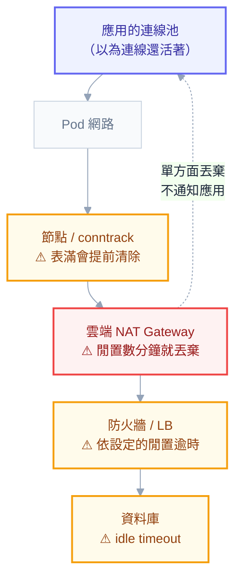

# 附錄 AI：資料庫連線的深入

實戰第五章講了那個最重要的算術：**連線數 = Pod 數 × 每 Pod 連線池大小**，以及擴容本身可能壓垮資料庫。那是入口，但它後面還有一整層問題，而這些問題在 K8s 環境比在 VM 環境更容易出現。

具體來說：**連線在 K8s 上更容易「看起來還在但實際已死」**（多了一層 NAT 與 conntrack）、**故障轉移時所有 Pod 會同時重連**（把剛起來的資料庫再打掛一次）、以及**Pod 被驅逐時手上的交易該怎麼辦**。

這一份處理那些。

---

## Part 1：連線為什麼貴

建立一條資料庫連線不是「開一個 TCP」那麼簡單，它包含：TCP 三次握手 → TLS 交握 → 認證 → **資料庫端建立 session**。

最後一步是最貴的。以 Oracle 的 dedicated server 模式來說，**每條連線在資料庫主機上對應一個作業系統程序**，有自己的記憶體（PGA）。所以「多開幾條連線」在 Oracle 上是實實在在的資源消耗——這也是為什麼實戰第五章那個乘法特別致命。

所以要用連線池。四個參數各自的意義：

| 參數 | 意義 | 設定原則 |
| --- | --- | --- |
| **Min Pool Size** | 常駐的最少連線 | 不設 0（每次冷啟動都要重建），但也不要太大（× Pod 數會佔滿資料庫） |
| **Max Pool Size** | 上限 | **從資料庫容量反推**（實戰 5） |
| **Connection Timeout** | 拿不到連線時等多久 | 短（10–15 秒），拿不到就快速失敗 |
| **Connection Lifetime** | 一條連線最多活多久 | **設一個上限**（見 Part 4） |

**`Min Pool Size` 不該設 0 的理由**：Pod 剛啟動或閒置後的第一個請求要付出建立連線的成本（可能數十到數百毫秒）。設成 2–5 讓常見情況都有現成連線可用。

**但它會乘以 Pod 數。** `Min = 5` × 20 個 Pod = 100 條常駐連線，即使系統完全閒置——這在小型資料庫上就已經是可觀的比例。**`Min` 也要納入實戰 5 那個乘法計算。**

---

## Part 2：連線池中介該不該用

### 它解決什麼

PgBouncer（PostgreSQL）、Oracle Connection Manager / DRCP（Oracle）這類中介，做的事情是：**把「N 個 Pod × M 條連線」收斂成「固定的 K 條實際連線」。**

```
沒有中介：20 Pod × 20 連線 = 400 條真實連線
有中介：  20 Pod × 20 連線 → 中介 → 50 條真實連線
```

因為多數連線在多數時間是閒置的（應用拿著它但沒在跑查詢），中介可以在請求之間重複使用同一條真實連線。

### 三種 pooling 模式

| 模式 | 何時歸還連線 | 收斂效果 | 限制 |
| --- | --- | --- | --- |
| **Session** | 應用斷線時 | **幾乎沒有** | 無 |
| **Transaction** | 交易結束時 | **好** | 見下方 |
| **Statement** | 每個語句結束 | 最好 | 限制最多，不能用交易 |

**Transaction pooling 是實務上的選擇**，但它會讓一些東西壞掉，而且**壞掉的方式常常是隱晦的**：

- **session 變數**（`SET` 設定的東西）——下一個交易可能拿到不同的實體連線
- **prepared statement**（除非驅動與中介都正確處理）
- **暫存表**
- **advisory lock / session 級別的鎖**
- **`LISTEN` / `NOTIFY`** 這類長期訂閱

**導入 transaction pooling 之前，一定要確認應用沒有依賴這些。** 症狀通常是「偶爾失敗」或「換了一個連線之後設定不見了」，而不是明確的錯誤。

### 在 K8s 上的部署形態

| 形態 | 優點 | 缺點 |
| --- | --- | --- |
| **獨立 Deployment**（共用） | 收斂效果最好、好管理 | 多一跳、本身是單點（要多副本） |
| **Sidecar**（每個 Pod 一個） | 沒有額外網路跳轉、故障隔離 | **收斂效果差很多**（每個 Pod 各自一組池） |

**要收斂效果就用獨立 Deployment。** sidecar 形態的中介主要價值在「統一連線管理與觀測」，而不是減少連線數——這一點常被搞混。

獨立部署的話它自己就是關鍵路徑上的元件：要多副本、要 PDB、要監控，而且**它掛掉等於資料庫掛掉**。

### 判準：多數團隊不需要

**先做完這三件事，再考慮中介**：

1. 把每個 Pod 的池上限從資料庫容量反推（實戰 5）
2. 確認 `Min Pool Size` 沒有設太大
3. 確認 HPA 的 `maxReplicas` 是合理的

**多數「連線不夠」的問題在這三步就解決了。** 真的需要中介的訊號是：Pod 數量本來就很多（幾十個以上）、或連線的建立/銷毀速率很高、或資料庫的連線上限是硬限制無法調高。

---

## Part 3：讀寫分離

### 它在 K8s 上的額外複雜度

讀寫分離本身是資料庫的課題，但在 K8s 上有兩件事要特別注意：

**第一，兩個連線池。** 主庫與副本各一個池，所以實戰 5 的乘法要算兩次。而且副本通常有多個，要嘛靠資料庫的負載平衡端點，要嘛應用自己輪替。

**第二，複製延遲造成的「寫完讀不到」。** 使用者送出表單 → 寫入主庫 → 立刻導向列表頁 → 從副本讀 → **看不到剛才寫的東西**。這在 K8s 上更容易發生，因為請求可能打到不同的 Pod，行為不一致。

三種處理方式：

| 方式 | 做法 | 取捨 |
| --- | --- | --- |
| **寫後讀主庫** | 同一個使用者在寫入後的 N 秒內都讀主庫 | 簡單有效，但要有辦法記住狀態（cookie/session） |
| **關鍵路徑一律讀主庫** | 只有明確可以容忍延遲的查詢才走副本 | **最務實**，從保守開始 |
| **等待複製追上** | 寫入後取得 LSN／SCN，讀取時等副本追到該位置 | 最正確但最複雜 |

**建議從第二種開始**：預設全部讀主庫，只把明確安全的查詢（報表、搜尋、統計）移到副本。**反過來做（預設讀副本、遇到問題才改）會產生一堆難以重現的 bug。**

### 多數團隊不需要

讀寫分離解決的是「主庫的讀取負載太高」。在那之前，先確認：查詢有沒有索引、有沒有 N+1、有沒有可以用快取擋掉的（附錄 AB）。**加了讀寫分離之後，資料一致性的心智負擔會跟著你很多年**，值得先確定真的需要。

---

## Part 4：連線失效與健康檢查

**這是 K8s 環境比 VM 環境更嚴重的一塊。**

連線是有狀態的長連線，而它跟資料庫之間隔著好幾層：Pod 網路 → 節點 → NAT/SNAT → 可能還有雲端 NAT Gateway → 防火牆 → 資料庫。**這條路徑上任何一環認為「這條連線閒置太久」，都會單方面把它丟掉——而應用端不會被通知。**

結果是應用池裡留著一條「看起來還在但實際已死」的連線，下次拿到它時才發現，症狀是**偶發的連線錯誤**，而且通常在流量低的時段之後出現（因為閒置久了才會被清掉）。



**⚠ 標記的每一層都可能單方面丟棄連線，而且都不會通知應用端**——這就是為什麼防護要做在最上面那一層（主動汰換），而不是等下面通知你。

### 常見的殺手

| 來源 | 典型逾時 |
| --- | --- |
| 雲端 NAT Gateway | 閒置數分鐘就丟棄 |
| 防火牆 / 負載平衡器 | 依設定，常見數分鐘到一小時 |
| Linux conntrack 表 | 已建立的 TCP 預設很長，但表滿了會提前清除（附錄 Q） |
| 資料庫端的 idle timeout | 依設定 |

**雲端 NAT 那一列是最常見的**（附錄 M）：節點在私有 subnet、透過 NAT Gateway 連外部資料庫，而 NAT 對閒置連線的容忍度通常只有幾分鐘。

### 三道防護

**1. 連線生命週期上限**——讓連線在還沒被外部丟棄之前就主動汰換：

```
Connection Lifetime = 300      # 一條連線最多用 5 分鐘就重建
Connection Idle Lifetime = 60  # 閒置 60 秒就關掉（如果驅動支援）
```

**設得比路徑上最短的逾時更短**，這樣主動權在你手上。

**2. TCP keepalive**——讓連線不要「看起來閒置」：

Linux 的預設 keepalive 是兩小時，遠遠長過 NAT 的容忍度。要在應用或容器層調短：

```yaml
securityContext:
  sysctls:
    - name: net.ipv4.tcp_keepalive_time
      value: "120"
    - name: net.ipv4.tcp_keepalive_intvl
      value: "30"
```

（注意這些 sysctl 需要 kubelet 允許，見附錄 C-1。）

**3. 取出時驗證**——從池裡拿連線時先確認它還活著。多數驅動有這個選項（Oracle 的 `Validate Connection`），代價是每次取用多一次往返，所以**它是最後一道防線而不是第一道**。

**優先序是 1 > 2 > 3**：主動汰換成本最低且最可靠。

---

## Part 5：故障轉移時應用該有的行為

資料庫主從切換（計畫內維護或計畫外故障）時，**所有現有連線會全部斷掉**。這時候應用的行為決定了「使用者感受到十秒的錯誤」還是「服務掛掉半小時」。

### 三個必須做對的

**1. liveness 不要檢查資料庫。**

這在正文第 4 章與實戰第一章都講過，但在這個情境下後果最嚴重：資料庫切換 → 所有 Pod 的 liveness 失敗 → **所有 Pod 同時被重啟** → 資料庫剛起來就被一波冷啟動的連線風暴打上——**你把一次十秒的切換變成了一次完整的服務中斷。**

正確做法：liveness 只檢查自己（`/healthz`），readiness 可以檢查資料庫（`/readyz`）。這樣的效果是「不收流量但不重啟」，資料庫回來之後自動恢復。

**2. 重連要有退避與抖動。**

沒有抖動的話會出現**打雷群效應（thundering herd）**：二十個 Pod 在同一毫秒發現連線斷了，同時重連，把剛起來的資料庫再打掛一次。

```csharp
// 概念：指數退避 + 隨機抖動
var delay = TimeSpan.FromMilliseconds(
    Math.Min(baseMs * Math.Pow(2, attempt), maxMs) * (0.5 + Random.Shared.NextDouble() * 0.5));
```

**抖動比退避本身更重要**——固定間隔的重試只是把同時衝擊延後，沒有分散它。

**3. 斷路器。**

資料庫持續不可用時，與其讓每個請求都等連線逾時（然後耗盡執行緒），不如快速失敗（附錄 W）。這也是附錄 AB 講 Redis 降級時的同一個原則。

### 連線字串要指向什麼

指向會自動跟隨主庫的端點（資料庫叢集的 VIP、雲端託管的 endpoint、或 Oracle 的 TAF/服務名），而不是某個實體 IP。**這是資料庫端的設定，但它決定了應用端的重連能不能成功**——所以要在演練時一起驗證（附錄 L 的還原演練可以順便涵蓋）。

---

## Part 6：交易與 Pod 生命週期

**長交易在 K8s 上有一個額外的代價：Pod 可能在交易進行中被驅逐。**

驅逐的來源很多：滾動更新、節點 drain、資源不足、spot 回收（附錄 S）。所以：

**交易要短。** 長交易佔住連線、持有鎖、而且被中斷的損失大。「跑一小時的交易」在 K8s 上幾乎一定會在某次被打斷——改成分批提交（附錄 AC 的 checkpoint 模式）。

**優雅關閉要涵蓋交易。** `terminationGracePeriodSeconds` 要大於「最長一筆交易的時間」，並且應用收到 SIGTERM 後要停止接受新工作、把手上的做完（實戰第二章、附錄 AC）。

**寫入操作要冪等。** 因為「交易到底提交了沒」在被中斷時可能是未知的——這跟附錄 AA 的訊息處理是同一個問題（逾時之後你不知道對方做了沒）。

---

## Part 7：監控

**兩邊的數字要對得起來**——應用端以為開了多少連線、資料庫端實際看到多少。對不上通常代表有洩漏或有中介沒被算進去。

| 指標 | 在哪看 | 意義 |
| --- | --- | --- |
| 池使用率（使用中 / 上限） | 應用 | 接近 100% 代表要調大或有洩漏 |
| **等待連線的時間** | 應用 | **大於 0 就代表池不夠**（附錄 Q 的延遲來源之一） |
| 連線建立速率 | 應用 | 持續很高代表連線一直被丟棄（Part 4） |
| 資料庫端 session 數 | 資料庫 | 對照應用端的預期 |
| 資料庫端 session 數 / 上限 | 資料庫 | **接近上限要告警**（實戰 6 的告警清單有這條） |

**「等待連線的時間」是最有診斷價值的一個**：它讓「應用慢」與「資料庫慢」分開——等待時間長代表池不夠（你的問題），查詢時間長代表資料庫慢（另一個問題）。附錄 Q 講的 L4「連線池排隊」就是靠這個指標定位。

---

## 檢查清單

**池設定**

- [ ] `Max Pool Size` 從資料庫容量反推（實戰 5）
- [ ] **`Min Pool Size` 也納入 × Pod 數的計算**
- [ ] `Connection Timeout` 短，拿不到就快速失敗
- [ ] **`Connection Lifetime` 有上限**

**連線失效**

- [ ] 知道路徑上最短的閒置逾時是多少（NAT、防火牆、DB）
- [ ] 連線生命週期設得比它更短
- [ ] TCP keepalive 有調（預設兩小時太長）
- [ ] 有取出時驗證當最後防線

**中介**

- [ ] 先做完池上限反推、Min 調整、maxReplicas 檢查，再考慮中介
- [ ] 用 transaction pooling 的話，**確認應用沒有依賴 session 狀態**
- [ ] 中介是獨立 Deployment（要收斂效果），且有多副本與 PDB

**讀寫分離**

- [ ] 確認真的需要（先看索引、N+1、快取）
- [ ] **預設讀主庫，只把明確安全的查詢移到副本**
- [ ] 兩個池都納入連線數計算

**故障轉移**

- [ ] **liveness 不檢查資料庫**
- [ ] 重連有指數退避**與抖動**
- [ ] 有斷路器
- [ ] 連線字串指向會跟隨主庫的端點
- [ ] 切換行為在演練中驗證過

**交易**

- [ ] 沒有長交易（改成分批提交）
- [ ] `terminationGracePeriodSeconds` 大於最長交易時間
- [ ] 寫入操作冪等

**監控**

- [ ] 應用端池使用率與**等待時間**
- [ ] 資料庫端 session 數，且與應用端預期對得起來
- [ ] session 數接近上限有告警

---

## 常見誤區

| # | 誤區 | 真相 |
| --- | --- | --- |
| 1 | 只要算 `Max Pool Size` | `Min` 也會 × Pod 數常駐佔用 |
| 2 | 連線池越大越好 | 壓垮資料庫；且大池會掩蓋慢查詢問題 |
| 3 | 連線建立後就一直有效 | NAT／防火牆會單方面丟棄，應用不會被通知 |
| 4 | 偶發的連線錯誤是網路不穩 | 通常是閒置連線被中間層丟棄 |
| 5 | TCP keepalive 預設值夠用 | Linux 預設兩小時，遠長過 NAT 的容忍度 |
| 6 | 加中介就能解決連線問題 | 先做池上限反推；多數情況那就夠了 |
| 7 | Transaction pooling 沒有副作用 | session 變數、暫存表、advisory lock 都會壞 |
| 8 | sidecar 形態的中介能收斂連線 | 每個 Pod 各一組池，收斂效果差很多 |
| 9 | liveness 檢查資料庫比較嚴謹 | **資料庫切換會讓所有 Pod 同時重啟** |
| 10 | 重連有退避就夠了 | **沒有抖動只是把同時衝擊延後** |
| 11 | 讀寫分離是免費的效能提升 | 一致性的心智負擔會跟著你很多年 |
| 12 | 長交易在 K8s 上跟在 VM 上一樣 | Pod 會被驅逐，長交易幾乎一定會被打斷 |

## 連結

- [[72-cascading-failure]] — 附錄 AX：連線池被慢下游吃光的機制，以及艙壁模式
- [[71-schema-migration]] — 附錄 AW：長時間 migration 鎖表時，症狀是延遲暴增而非「migration 在跑」
- [[practice-5-database-and-state]] — 實戰 5：連線數的乘法、資料庫該不該進叢集、expand-contract
- [[39-performance-troubleshooting]] — 附錄 Q：連線池排隊造成的延遲、L4 應用層定位
- [[45-microservices-and-communication]] — 附錄 W：逾時、重試三條件、斷路器
- [[50-caching]] — 附錄 AB：用快取減少資料庫負載、降級策略
- [[35-cloud-networking]] — 附錄 M：NAT Gateway 與私有 subnet 的連線路徑
- [[51-background-jobs]] — 附錄 AC：分批提交與 checkpoint
- [[34-multicluster-and-dr]] — 附錄 L：故障轉移演練
- [[k8s-mastery]] — 教材總目錄
