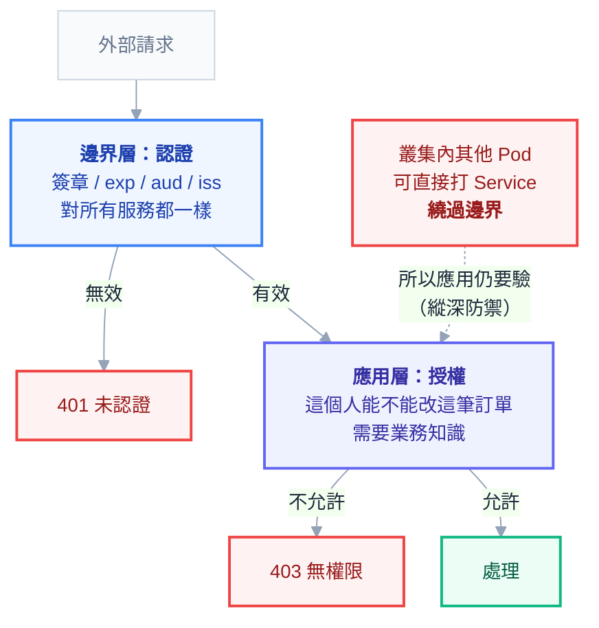

# 附錄 AJ：對外 API 的邊界

附錄 F 講了 ingress-nginx 的 annotation、附錄 J 講了 Istio Ingress Gateway、附錄 C-5 講了 Gateway API。這三份都在講**路由**——流量怎麼從外面進到對的服務。

但邊界層要做的不只是路由。認證、限流、配額、WAF、金鑰管理——這些該放在哪一層？放錯的後果很具體：**放太多在邊界，它會變成瓶頸與單點；放太少，每個服務各自實作一套，漏掉一個就是漏洞。**

這一份講那個職責劃分。

---

## Part 1：邊界層該做什麼

判準是：**這件事對所有服務都一樣嗎？**

| 該放邊界（對所有服務都一樣） | 該放應用（每個服務不同） |
| --- | --- |
| TLS 終結與憑證管理 | **業務授權**（這個人能不能改這筆訂單） |
| 路由與版本分流 | 資料驗證與轉換 |
| **基本的認證檢查**（token 有效嗎） | 商業邏輯 |
| 粗粒度限流（每 IP、每 token） | 細粒度配額（每租戶的用量） |
| WAF / 已知攻擊模式 | 領域相關的規則 |
| 統一的存取日誌與追蹤 | 業務事件記錄 |

**「不該放邊界」那一欄的共同點是：它們需要知道業務規則。**

邊界層是所有服務共用的元件。一旦它開始理解「訂單」「租戶」「權限模型」，就會發生三件事：它變成所有團隊都要改的地方（協調成本）、它的變更會影響所有服務（爆炸半徑）、以及它需要存取業務資料（架構耦合）。

**一個實用的反問：「這個規則改了，需要重新部署邊界層嗎？」** 需要的話，它多半該放在應用裡。

---

## Part 2：認證放哪一層

這是最常被問也最容易搞混的一題，尤其在 Google OAuth + JWT 這種架構下。

### 分層才是正解

| 層 | 負責 | 回應 |
| --- | --- | --- |
| **邊界層** | token **存在嗎、簽章對嗎、過期了嗎、`aud`/`iss` 對嗎** | 401 |
| **應用層** | 這個身分**能不能做這件事**、能不能碰這筆資料 | 403 |

**邊界層做「認證」（你是誰），應用層做「授權」（你能做什麼）。**



這個分工的理由很實際：**簽章驗證對所有服務都一樣**（同一組公鑰、同樣的檢查），放邊界可以讓無效請求在進入叢集深處之前就被擋掉，省下後端資源。而**授權需要業務知識**——「這個使用者能不能看這筆訂單」只有訂單服務知道。

### 邊界層驗 JWT 的三種做法

| 做法 | 適合 |
| --- | --- |
| **Istio `RequestAuthentication` + `AuthorizationPolicy`** | 已經有 Istio（附錄 C-7） |
| **oauth2-proxy + ingress `auth-url`** | ingress-nginx 環境（附錄 F） |
| **API Gateway 產品**（Kong、APISIX 等） | 需要更多邊界功能時 |

### 兩個必須知道的陷阱

**陷阱一：驗了 token 不等於擋住沒帶 token 的請求。**

附錄 C-7 講過這件事，但它值得在架構層再說一次，因為它是**最常見的安全誤設**：Istio 的 `RequestAuthentication` 只驗「有帶 token 的請求」——沒帶 token 的會被視為匿名流量**直接放行**。要真的擋下來，必須再加一條 `AuthorizationPolicy` 要求 `requestPrincipals`。

**兩個物件必須成對出現。** 只寫前者的下場是：把 `Authorization` header 拿掉反而暢行無阻。

**陷阱二：應用不能假設請求一定經過邊界。**

叢集內部的其他服務可以直接打你的 Service，繞過 Ingress。所以**應用層仍然要驗 token**——這不是重複工作，是縱深防禦。

實作上有兩種選擇：應用完整驗一次（最安全），或邊界層驗完之後把身分放進 header（`x-auth-request-email`）而應用信任它——**但後者的前提是「應用只接受來自邊界層的流量」**，那需要 NetworkPolicy 或 mTLS 來保證（附錄 C-3、C-7）。

**沒有那個保證的話，信任 header 等於把認證繞過的方法寫在文件上。**

---

## Part 3：限流的層次

限流也是分層的，而且**兩層都要**：

| 層 | 限什麼 | 用途 |
| --- | --- | --- |
| **邊界層** | 每 IP、每 token 的請求速率 | 擋掉暴力破解、爬蟲、明顯的濫用 |
| **應用層** | 每租戶、每 API key 的配額 | 商業規則（方案限制、公平使用） |

**只做邊界層限流的問題**：它不知道「這個 token 屬於哪個方案」，所以無法表達「免費用戶每天 1000 次」這種商業規則。

**只做應用層限流的問題**：惡意流量已經進到應用了，它仍然消耗了連線、執行緒與資料庫查詢。

### 多副本下的限流不準

附錄 F 提過但值得強調：**ingress-nginx 的限流是每個副本各自計數**。三個副本設 `limit-rps: 10`，實際上限接近 30。

三種處理：**接受它**（把設定值除以副本數，但副本數會變）、**用有共享狀態的限流**（Istio 的 rate limit service、或 gateway 產品內建的）、或**在應用層用 Redis 做精確計數**。

**商業配額（「這個方案每天 1000 次」）必須是精確的**，所以那一層一定要用共享狀態，通常是 Redis（附錄 AB）。

### 超額的回應

```
HTTP/1.1 429 Too Many Requests
Retry-After: 60
X-RateLimit-Limit: 1000
X-RateLimit-Remaining: 0
X-RateLimit-Reset: 1755400000
```

**`Retry-After` 是必要的**——沒有它，客戶端只能猜，而且通常會猜錯（立刻重試，讓情況更糟）。三個 `X-RateLimit-*` header 則讓良好的客戶端可以自我調節，在額度用完之前就慢下來。

---

## Part 4：API Key 與租戶配額

對外提供 API 時，key 的生命週期要想清楚：

| 階段 | 要有的能力 |
| --- | --- |
| **發放** | 自助或審核；一個客戶可以有多把（不同用途、不同權限） |
| **識別** | key → 租戶 → 方案 → 配額，這條鏈要快（快取，附錄 AB） |
| **輪替** | **新舊並存的過渡期**，讓客戶能無痛換 |
| **撤銷** | 立即生效（所以不能只靠長 TTL 的快取） |
| **稽核** | 誰在什麼時候用了哪把 key |

**「新舊並存」那一項是最常被忽略的**：如果輪替意味著「舊 key 立刻失效」，客戶就必須在瞬間切換，那實務上做不到。允許一個客戶同時有兩把有效的 key，讓他從容切換——這跟附錄 AI 講資料庫密碼輪替、附錄 Y 講 API 版本過渡是同一個模式。

**撤銷要能立即生效**這一點跟快取有張力：key 的驗證結果通常會快取（否則每個請求一次資料庫查詢），但撤銷之後快取還在。解法是短 TTL（幾十秒）加上主動失效（撤銷時發一個 pub/sub 通知，附錄 AA）。

---

## Part 5：對外與對內要分開

**同一個服務對外與對內的要求完全不同**，所以不該用同一個入口：

| | 對外 | 對內 |
| --- | --- | --- |
| 認證 | JWT / API key | mTLS 或 SA 身分 |
| 限流 | 嚴格 | 寬鬆或不限 |
| WAF | 需要 | 不需要 |
| 暴露的端點 | 只有公開 API | 可以有管理端點 |

實作上是**兩個 Ingress（或一個對外、一個 internal-only）**：

```yaml
# 對外
apiVersion: networking.k8s.io/v1
kind: Ingress
metadata:
  name: api-public
  annotations:
    nginx.ingress.kubernetes.io/limit-rps: "20"
    nginx.ingress.kubernetes.io/auth-url: "https://auth.example.com/oauth2/auth"
spec:
  ingressClassName: nginx
  rules:
    - host: api.example.com
      # 只列公開路徑
---
# 對內（不同的 ingressClass，或雲端的 internal LB）
apiVersion: networking.k8s.io/v1
kind: Ingress
metadata:
  name: api-internal
spec:
  ingressClassName: nginx-internal
  rules:
    - host: api.internal
```

**兩個常見的錯誤**：把 `/admin` 或 `/metrics` 掛在對外的 Ingress 上（即使加了認證，也是不必要的暴露面）、以及**以為「內部網路」就等於安全**——內部的 Ingress 仍然要有認證，因為叢集內的任何 Pod 都連得到它。

**網路層與應用層要雙重保護**：NetworkPolicy 限制誰能連到這個服務（附錄 C-3），加上應用層的身分驗證。任何一層都不該是唯一的防線。

---

## Part 6：WAF 與已知攻擊

邊界層適合擋的是**與業務無關的通用攻擊**：SQL injection 的常見模式、路徑穿越、掃描器的指紋、已知的惡意 payload。

ingress-nginx 可以開 ModSecurity + OWASP CRS（附錄 F），但要知道取捨：

| | 開 WAF | 不開 |
| --- | --- | --- |
| 防護 | 擋掉大量自動化掃描 | 靠應用自己 |
| 效能 | **每個請求多一次規則比對** | 無影響 |
| 誤擋 | **會有**，尤其是含特殊字元的正常請求 | 無 |
| 維運 | 要調規則、處理誤報 | 無 |

**務實的導入方式跟附錄 O 的政策一樣：先偵測模式（只記錄不擋）跑一段時間、看有多少誤報、調規則、最後才切成阻擋。** 直接開阻擋模式的下場是正常使用者被擋、而且客服收到的回報是「網站壞了」而不是「我被 WAF 擋了」。

**誤擋要有處理流程**：使用者回報 → 從 WAF 日誌找到對應的規則 ID → 判斷是規則太嚴還是真的攻擊 → 調整或加例外。沒有這個流程的話，WAF 會因為第一次誤擋就被整個關掉。

**更前面的一層是 CDN**：Cloudflare 這類服務在流量進到你的叢集之前就能擋掉大量的惡意流量與 DDoS——**那是比在叢集裡擋更有效的位置**，因為那些流量根本不會消耗你的資源（附錄 C-8 講過 Cloudflare Tunnel 的設定）。

---

## Part 7：邊界層是單點

**所有流量都經過它，所以它掛了就是全部掛。** 這件事值得在設計時明確面對：

- **多副本**（至少 3 個，跨可用區）
- **PDB**（附錄 C-2）確保維護時不會全部下線
- **資源要給足**，而且 requests 依實測設定（附錄 K）——它被 CPU throttle 會讓所有服務變慢
- **不要跟一般工作負載搶節點**：用 taint/affinity 給它專屬節點，或至少確保它的 PriorityClass 較高（附錄 S）
- **升級要謹慎**：Ingress controller 的版本升級會影響所有服務，走附錄 E 的流程

該監控的：

| 指標 | 為什麼 |
| --- | --- |
| 各 upstream 的錯誤率與延遲 | 分辨是邊界的問題還是後端的問題 |
| **邊界自己的延遲**（`$request_time` − `$upstream_response_time`） | 附錄 F 提過，這個差值揭露邊界層的排隊 |
| 4xx / 5xx 分布 | 429 突然變多 = 有人在打；401 變多 = 認證有問題 |
| 連線數與 worker 使用率 | 容量預警 |
| WAF 攔截數 | 誤擋的早期訊號 |

---

## 檢查清單

**職責劃分**

- [ ] 邊界層沒有業務邏輯（反問：這個規則改了要重新部署邊界嗎）
- [ ] 認證在邊界、授權在應用
- [ ] **應用仍然驗證身分**（不假設請求一定經過邊界）
- [ ] 若信任邊界注入的 header，有 NetworkPolicy 或 mTLS 保證來源

**認證**

- [ ] **`RequestAuthentication` 有配 `AuthorizationPolicy`**（或等價的「拒絕匿名」設定）
- [ ] 驗證涵蓋簽章、`exp`、`aud`、`iss`
- [ ] 公鑰（JWKS）有快取且能自動輪替

**限流與配額**

- [ ] 邊界層有粗粒度限流
- [ ] 商業配額用共享狀態（Redis）精確計數
- [ ] 知道 ingress 限流是**每副本各自計數**
- [ ] 429 回應帶 `Retry-After` 與 `X-RateLimit-*`

**API Key**

- [ ] 輪替時**新舊 key 可並存**
- [ ] 撤銷能立即生效（短 TTL + 主動失效）
- [ ] key → 租戶 → 配額的查詢有快取
- [ ] 有使用稽核

**對外／對內分離**

- [ ] 對外與對內用不同的 Ingress
- [ ] `/admin`、`/metrics` 不在對外的 Ingress 上
- [ ] 內部服務也有認證（不假設內網安全）
- [ ] NetworkPolicy 與應用認證雙重保護

**WAF**

- [ ] 先偵測模式跑過，看過誤報率才切阻擋
- [ ] 有誤擋的處理流程
- [ ] 評估過在 CDN 層擋（比在叢集裡擋更有效）

**可用性**

- [ ] 邊界層多副本、跨可用區、有 PDB
- [ ] 資源依實測設定，不會被 throttle
- [ ] 有 `$request_time` − `$upstream_response_time` 的監控
- [ ] 升級走完整流程（它影響所有服務）

---

## 常見誤區

| # | 誤區 | 真相 |
| --- | --- | --- |
| 1 | 認證授權都放邊界比較統一 | 授權需要業務知識，放邊界會讓它耦合所有領域 |
| 2 | 邊界驗過了應用就不用驗 | 叢集內可繞過；要縱深防禦 |
| 3 | `RequestAuthentication` 會擋下沒帶 token 的請求 | **不會**，必須配 `AuthorizationPolicy` |
| 4 | 信任邊界注入的 header 很方便 | 沒有 NetworkPolicy/mTLS 保證來源就是繞過方法 |
| 5 | ingress 的 `limit-rps` 是全域的 | **每副本各自計數**，實際上限 = 值 × 副本數 |
| 6 | 商業配額可以用 ingress 限流做 | 它不知道方案與租戶；要在應用層用共享狀態 |
| 7 | 429 直接回就好 | 沒有 `Retry-After` 客戶端會立刻重試讓情況更糟 |
| 8 | API key 輪替就是換一把 | 要有新舊並存的過渡期 |
| 9 | 內部服務不用認證 | 叢集內任何 Pod 都連得到 |
| 10 | WAF 開了就安全 | 會誤擋；要先偵測模式並建立處理流程 |
| 11 | 在叢集裡擋 DDoS | 流量已經消耗你的資源；該在 CDN 擋 |
| 12 | 邊界層跟一般服務一樣配置就好 | 它是所有流量的單點，要專屬資源與更高優先級 |

## 連結

- [[66-ingress-to-gateway-api]] — 附錄 AR：限流與外部認證在 Gateway API 沒有標準對應，要決定搬到哪一層
- [[28-ingress-nginx-annotations]] — 附錄 F：限流、外部認證、WAF 的具體 annotation
- [[32-istio-ingress-gateway]] — 附錄 J：Istio IGW 的選型與 503 旗標
- [[24-yaml-fields-istio]] — 附錄 C-7：`RequestAuthentication` 與 `AuthorizationPolicy` 必須成對
- [[22-yaml-fields-ecosystem]] — 附錄 C-5：Gateway API 的路由與 filter
- [[47-api-versioning]] — 附錄 Y：對外 API 的版本與棄用（同樣是邊界的課題）
- [[50-caching]] — 附錄 AB：key 驗證結果的快取與主動失效
- [[20-yaml-fields-network-storage]] — 附錄 C-3：NetworkPolicy 作為第二道邊界
- [[k8s-mastery]] — 教材總目錄
