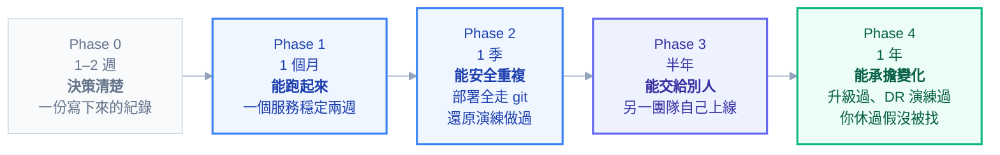

# 附錄 AK：導入路線圖

這套教材有 72 份文件、四十幾萬字，而它是**主題式組織**的——你想知道 NetworkPolicy 怎麼寫，查得到；想知道成本怎麼優化，查得到。

但它沒有回答一個剛接手的人最需要的問題：**這些東西該按什麼順序做？**

因為順序錯了的代價很具體：太早上 service mesh 會讓你在還沒站穩時多背一個複雜元件；監控留到最後意味著前三個月的問題都靠猜；安全基線等到有事才做則是把技術債變成事故。

這一份把教材重新排成一條時間軸。**它不是規定，是一個經過排序的預設路徑**——你的環境有特殊性，但偏離之前先知道預設是什麼。

---

## Phase 0：開始之前（一到兩週）

**這個階段唯一的產出是一份寫下來的決策紀錄，沒有任何 YAML。**

| 要決定的 | 依據 |
| --- | --- |
| 真的需要 K8s 嗎？ | [[43-migration-to-k8s]] Part 0 的好理由與壞理由 |
| 託管還是自建？ | [[35-cloud-networking]] 的責任分界 |
| 資料庫進不進叢集？ | [[practice-5-database-and-state]] 的決策表 |
| 第一個搬什麼？ | [[43-migration-to-k8s]] 的容器化難度評分——**選最容易的，不是最重要的** |
| 哪些系統不搬？ | 同上，「不搬」是合法結論 |

**為什麼這一步不能跳過**：這些決定會影響後面所有階段，而且改起來很貴。花兩週寫清楚，比六個月後發現方向錯了便宜太多。

> **這個階段最常見的錯誤是「先建叢集再想要放什麼」。** 叢集本身沒有價值，它承載的工作負載才有——先確定第一個工作負載是什麼，叢集的規格與設定才有依據。

---

## Phase 1：第一個月——能跑起來

**目標：一個非關鍵服務在叢集上穩定運行，而且你能查得到它的狀態。**

### 該做的六件事

1. **建立叢集**（minikube 練手 → 正式的開發叢集）
2. **把第一個服務容器化**（[[practice-1-containerize-your-app]]）
3. **寫出完整的一組 manifest**（[[practice-2-deploy-real-app]]）——七個物件、三種 probe、資源設定
4. **裝上 Ingress Controller 與 cert-manager**（[[28-ingress-nginx-annotations]]）
5. **裝上基礎監控**（kube-prometheus-stack，先不必自訂）
6. **把附錄 D 的實驗做過一輪**（[[26-lab-drills]]）——這是這個月最重要的一項

第 6 項值得強調：**親手把 Pod 弄成 OOMKilled、看過 CPU throttle、製造過 CrashLoop**，之後遇到真的問題時的反應速度完全不同。這個投資報酬率高得驚人，而且只花一天。

### 該讀的

[[intro-0-start-here]] 到 [[intro-6-error-messages]]（沒基礎的話）→ [[practice-1-containerize-your-app]]、[[practice-2-deploy-real-app]] → 正文 [[00-docker-foundations]] 到 [[03-api-and-yaml]]。

### 明確不要做的

**列出來比列該做的更重要**，因為誘惑很大：

- ❌ service mesh
- ❌ 多叢集
- ❌ 自己寫 Operator
- ❌ 複雜的 CI/CD（先手動 `kubectl apply` 也可以）
- ❌ 平台化（只有你一個人用，不需要 golden path）

### 完成的定義

- [ ] 服務跑了兩週沒有非計畫性中斷
- [ ] 你能在五分鐘內回答「這個服務現在健康嗎」
- [ ] 你能自己從零寫出一份 Deployment 而不複製貼上（[[practice-4-write-yaml-from-scratch]]）
- [ ] 附錄 D 的實驗做過一輪

---

## Phase 2：第一季——能安全地重複

**目標：三到五個服務、部署是自動的、有安全基線、出事時查得到。**

### 該做的

| 主題 | 具體動作 | 參考 |
| --- | --- | --- |
| **GitOps** | 裝 ArgoCD、manifest 進 git、開 `selfHeal` | [[practice-3-gitops-pipeline]] |
| **CI** | tag 觸發建置、推 registry、更新 manifest | 同上 |
| **安全基線** | 所有 namespace 開 PSA `warn` → `enforce` | [[21-yaml-fields-cluster-security]] |
| **可觀測性** | 應用曝露 metrics、四個黃金訊號的儀表板、六條告警 | [[practice-6-observability]] |
| **日誌** | 結構化、trace ID、集中收集、**設好保留期** | [[55-logging-strategy]] |
| **資料庫連線** | 算清楚連線池的乘法 | [[practice-5-database-and-state]] |
| **備份** | etcd 快照 + Velero + **做一次還原演練** | [[34-multicluster-and-dr]] |

### 該讀的

正文 [[04-workloads]] 到 [[11-argocd]]（核心機制）→ [[29-status-and-conditions]]（狀態判讀）→ [[practice-3-gitops-pipeline]] 到 [[practice-6-observability]]。

### 明確不要做的

- ❌ service mesh（除非有明確需求，[[32-istio-ingress-gateway]] 的判準）
- ❌ 多叢集
- ❌ 自訂 Operator
- ❌ 過早優化成本（東西還在變，量測沒有意義）

### 完成的定義

- [ ] 部署完全透過 git，沒有人手動 apply
- [ ] 有人手動改線上會被 `selfHeal` 改回去
- [ ] 半夜出事時，告警會響，而且**告警有 runbook 連結**
- [ ] **做過一次真的還原演練**（不是「有備份」）
- [ ] 每個服務都通過 [[21-yaml-fields-cluster-security]] 結尾那份 YAML 檢查清單

---

## Phase 3：半年——能交給別人

**目標：其他團隊能自己上線，而你不是瓶頸。**

這個階段的轉變比前兩個大：**你從「做事的人」變成「讓別人能做事的人」**（[[37-platform-engineering]]）。

### 該做的

| 主題 | 具體動作 | 參考 |
| --- | --- | --- |
| **責任邊界** | 寫下來並公告誰負責什麼 | [[37-platform-engineering]] |
| **Golden path** | 一份內部 chart + CI 範本 + 範例專案 | [[42-helm-chart-design]] |
| **Namespace 自助化** | PR 申請 → 自動產生 quota/LimitRange/PSA/RBAC | [[37-platform-engineering]] |
| **政策強制** | admission policy 擋掉 root、無 limit、`latest` | 同上 |
| **值班與 runbook** | 分級、runbook 模板、輪值與 shadow 期 | [[30-production-readiness]]、[[44-knowledge-transfer]] |
| **知識傳承** | 四種角色的培訓路徑 | [[44-knowledge-transfer]] |
| **開發者體驗** | 一鍵起環境、inner loop 壓到十秒內 | [[54-developer-experience]] |

### 完成的定義

- [ ] **另一個團隊自己上線過一個服務**，而你只做了 review
- [ ] 有人（不是你）處理過一次 P1 事故
- [ ] 新人第一週能自己部署到開發環境
- [ ] 安全基線是 `enforce` 而不是靠 review

**第一項是這個階段唯一真正的驗收標準。** 其他都是手段。

---

## Phase 4：第一年——能承擔事故與成長

**目標：叢集能面對真實世界的變化——升級、故障、成長、成本壓力。**

| 主題 | 具體動作 | 參考 |
| --- | --- | --- |
| **升級節奏** | 一年至少兩次，有掃描與檢查清單 | [[27-upgrades-and-deprecations]] |
| **DR 演練** | 三種情境各演練過，且**計時** | [[34-multicluster-and-dr]] |
| **成本治理** | requests 調校、孤兒盤點、成本歸屬標籤 | [[33-cost-optimization]] |
| **容量規劃** | 知道還能塞多少、什麼時候該加節點 | [[30-production-readiness]] |
| **效能方法論** | 團隊能自己定位「變慢了」 | [[39-performance-troubleshooting]] |
| **安全事故準備** | 隔離、蒐證、輪替流程都寫成 runbook | [[38-security-incident-response]] |

### 完成的定義

- [ ] 完成過一次 K8s 版本升級，且沒有非計畫性中斷
- [ ] 三種 DR 情境都演練過並記錄了實際耗時
- [ ] 知道叢集的排程飽和度與真實飽和度，且差距在合理範圍
- [ ] 你休過一次假，沒被找

**最後一項是整個路線圖的終點**（[[44-knowledge-transfer]]）。

---

## 三條橫向的線

有三件事不屬於任何單一階段，而是**每個階段都要往前推一點**：

### 安全

| 階段 | 做到哪 |
| --- | --- |
| Phase 1 | 非 root、不用 `latest`、Secret 不進 git |
| Phase 2 | PSA `enforce: restricted`、NetworkPolicy 基線、映像掃描 |
| Phase 3 | admission policy 強制、RBAC 最小化、機密走 Vault/ESO |
| Phase 4 | 事故應變 runbook、供應鏈簽章、稽核日誌 |

**不要等到「有空」才做安全**——每個階段都有它該有的水準，落後的話補起來的成本會隨規模放大。

### 成本

| 階段 | 做到哪 |
| --- | --- |
| Phase 1 | 不用管（規模太小） |
| Phase 2 | 每個工作負載有 requests/limits |
| Phase 3 | 成本歸屬標籤、開始看飽和度 |
| Phase 4 | requests 調校、孤兒盤點、定期檢討 |

**Phase 1 不用管成本是刻意的**——那時候東西還在變，量測沒有意義，而過早優化會拖慢學習。

### 知識傳承

**這條線從第一天就要做**，不能等到 Phase 3：

- Phase 1 起：每個決定寫下理由（輕量的決策紀錄）
- Phase 2 起：runbook 跟服務一起產出，不是事後補
- Phase 3 起：輪值、配對排錯、事故檢討當教材
- 全程：**在公開頻道回答問題**（[[44-knowledge-transfer]]）

---

## 六個常見的順序錯誤

| # | 錯誤 | 為什麼糟 | 該什麼時候做 |
| --- | --- | --- | --- |
| 1 | **一開始就上 service mesh** | 還沒站穩就多一個複雜元件與新的失敗模式 | 有明確需求時（[[32-istio-ingress-gateway]] 的判準） |
| 2 | **一開始就做多叢集** | 複雜度翻倍，而單叢集的問題還沒解決 | 有明確的隔離或 DR 需求時 |
| 3 | **監控留到最後** | 前幾個月的問題都靠猜，而且養成壞習慣 | **Phase 1 就要有基礎監控** |
| 4 | 安全基線等到有事才做 | 補起來的成本隨規模放大 | 每個階段都推進一點 |
| 5 | **太早平台化** | 只有一個團隊時，golden path 是為誰做的？ | Phase 3，有第二個團隊時 |
| 6 | 先建叢集再想放什麼 | 規格與設定沒有依據 | Phase 0 先決定工作負載 |

**第 3 項最容易被合理化**：「先讓服務跑起來，監控之後再說」——但那個「之後」通常是第一次半夜出事的時候，而那時候你沒有任何資料可以查。**基礎監控（kube-prometheus-stack）裝起來只要半天**，沒有理由延後。

**第 5 項則是反過來的誘惑**：讀完附錄 O 之後很容易想立刻建平台，但**只有一個團隊時，golden path 就是你自己的 manifest**——把它抽象成 chart 沒有收益，只有成本。等到第二個團隊要上線時再做。

---

## 「還沒準備好」的訊號

每個階段結束前，如果出現這些訊號，**應該停下來補而不是往前推**：

| 階段 | 還沒準備好的訊號 |
| --- | --- |
| Phase 1 → 2 | 服務還常常出非計畫性中斷；你不確定它現在健不健康 |
| Phase 2 → 3 | 還有人手動改線上；出事時只能靠你查 |
| Phase 3 → 4 | 其他團隊上線仍然要你參與每一步；runbook 沒有人驗證過 |
| Phase 4 → 成熟 | DR 沒演練過；升級靠運氣；你不敢休假 |

**往前推的誘惑總是存在**（新技術比較有趣、主管會問進度），但**基礎沒打穩就往上疊，最後會在最糟的時機崩塌**——通常是第一次真正的事故。

---

## 一頁式總表

| 階段 | 時間 | 目標 | 唯一的驗收標準 |
| --- | --- | --- | --- |
| **0** | 1–2 週 | 決策清楚 | 有一份寫下來的決策紀錄 |
| **1** | 1 個月 | 能跑起來 | 一個服務穩定兩週，你查得到狀態 |
| **2** | 1 季 | 能安全地重複 | **部署完全透過 git，且還原演練做過** |
| **3** | 半年 | 能交給別人 | **另一個團隊自己上線過，你只做 review** |
| **4** | 1 年 | 能承擔變化 | **升級過一次、DR 演練過、你休過假沒被找** |

---

## 連結

- [[69-third-self-assessment]] — 附錄 AU：每個 Phase 結束時可用來自我檢驗
- [[65-inheriting-a-cluster]] — 附錄 AQ：**這份是從零導入，那份是接手既有叢集**——站穩後從 Phase 2 接上
- [[k8s-mastery]] — 教材總目錄（主題式導航）
- [[intro-0-start-here]] — 零基礎的六章台階
- [[43-migration-to-k8s]] — 附錄 U：Phase 0 的決策依據與分波策略
- [[26-lab-drills]] — 附錄 D：Phase 1 最高投報率的一天
- [[practice-3-gitops-pipeline]] — 實戰 3：Phase 2 的核心
- [[37-platform-engineering]] — 附錄 O：Phase 3 的主軸
- [[44-knowledge-transfer]] — 附錄 V：貫穿全程的那條線
- [[30-production-readiness]] — 附錄 H：Phase 3–4 的維運節奏
- [[46-advanced-self-assessment]] — 附錄 X：每個階段結束時的自我檢測
