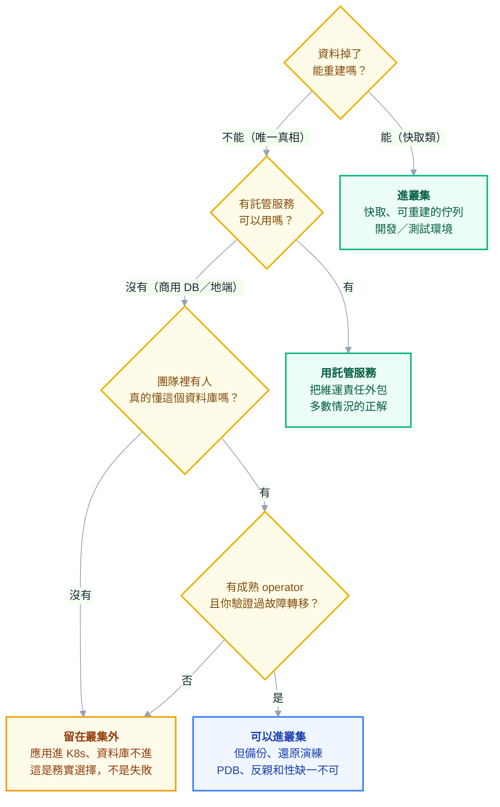

# 附錄 AN：有狀態服務要不要進叢集

教材教了 StatefulSet 怎麼寫（[[04-workloads]]）、儲存怎麼接（[[52-file-and-object-storage]]）、怎麼從叢集連外部資料庫（[[practice-5-database-and-state]]）。但有一個問題一直沒回答，而它是你當上 K8s 管理員後**一定會被問到**的：

> 「那我們的資料庫，可不可以也搬上 K8s？」

這個問題沒有通用答案——**任何直接回答「可以」或「不行」的人都在唬你**。但它有一套可以照著走的判斷框架，而且這套框架的結論通常比直覺更保守。

這一份講清楚：為什麼有狀態這麼難、StatefulSet 到底給了什麼又沒給什麼、operator 補上哪一段、以及怎麼做這個決定。

---

## Part 1：為什麼有狀態這麼難

K8s 的設計核心有一個前提：**Pod 是可替換的**。掛了就換一個、要升級就砍掉重建、節點要維護就搬到別台。整套排程、滾動更新、驅逐機制都建立在這個假設上。

**有狀態服務違反了這個前提。** 一個裝著資料的 Pod 不是可替換的——它是那份資料的**唯一持有者**（或多數持有者之一）。

同一個 K8s 機制，對兩種工作負載的意義完全相反：

| K8s 機制 | 對無狀態服務 | 對有狀態服務 |
| --- | --- | --- |
| 重新排程到別的節點 | 沒事，換台機器跑 | **儲存跟得上嗎？跨區的話跟不上** |
| 滾動更新 | 沒事，逐一換掉 | 換掉的是主節點嗎？切換要多久？ |
| 節點驅逐 | 沒事，別台起來 | **可能同時失去多數副本 → 失去 quorum** |
| 水平擴縮 | 加副本就分擔流量 | 加副本要先同步資料，可能要數小時 |
| 健康檢查失敗重啟 | 沒事，重啟就好 | 重啟中的資料庫可能正在做 crash recovery |
| `kubectl delete pod` | 沒事 | 可能是災難 |

**最後一列不是誇飾。** 對無狀態服務，刪 Pod 是最常見的除錯手段；對有狀態服務，它可能觸發一次非預期的主從切換。

這就是為什麼「把資料庫搬上 K8s」不是搬遷問題，而是**你願不願意接手一整組新的失敗模式**的問題。

---

## Part 2：StatefulSet 給了什麼、沒給什麼

第 4 章講了 StatefulSet 的三個保證，這裡要講的是它的**邊界**——因為誤解這條邊界是災難的起點。

### 它給的三件事

| 保證 | 具體是什麼 | 解決什麼問題 |
| --- | --- | --- |
| **穩定的網路身分** | `db-0`、`db-1` 名字不變，各有 DNS | 副本之間能互相定址、能指定誰是誰 |
| **穩定的儲存** | 每個序號綁定自己的 PVC，重建仍是同一份 | Pod 重建不會拿到別人的資料 |
| **有序的啟停** | 依序號啟動、逆序終止 | 讓有初始化順序的系統能正常起來 |

### 它**沒有**給的五件事

**這一段是整份最重要的內容。**

| 沒給 | 意思是 |
| --- | --- |
| **備份** | StatefulSet 完全不知道備份是什麼。你砍掉它，資料就照 PVC 的回收策略處置 |
| **選主與故障轉移** | 主節點掛了誰接手？K8s 不知道，也不會處理 |
| **資料一致性** | 副本之間有沒有同步、有沒有分裂，K8s 一無所知 |
| **版本升級的資料遷移** | 換映像版本時，資料格式要不要轉？K8s 只會換映像 |
| **擴縮容時的資料重分布** | 加一個副本，資料怎麼分過去？K8s 只負責把 Pod 拉起來 |

> **一句話總結：StatefulSet 不是資料庫的解決方案，它只是讓資料庫「有可能被管理」的最低基礎設施。**
>
> 上面五件事全部都是資料庫維運的核心工作，而它們全部不在 StatefulSet 的範圍內。

**「我用 StatefulSet 跑了 MySQL，好像也沒事」**——通常是因為還沒遇到節點故障、還沒需要升級大版本、還沒真的還原過備份。這三件事任何一件發生時，上面五個空缺會同時出現。

---

## Part 3：Operator 補的是哪一段

Operator 的本質（[[09-extending-kubernetes]] 講了怎麼寫）在這個脈絡下有更具體的意義：

> **Operator = 把 DBA 的操作知識寫成程式，讓它在叢集裡代替人執行。**

一個成熟的資料庫 operator 通常會處理：初始化叢集、**選主與自動故障轉移**、備份排程與 PITR、版本升級的完整流程、擴縮容時的資料同步、憑證輪替、以及 metrics 匯出。

也就是 Part 2 那五個空缺，operator 補的正是它們。**所以「用 StatefulSet 自己跑資料庫」與「用成熟的 operator 跑」不是同一件事的兩種寫法，它們的風險差了一個數量級。**

### 但 operator 有它自己的成本

**你多了一個要維運的東西。** 而且當它出問題時，你要同時懂兩層：資料庫本身、以及 operator 的行為。事故當下，「這是資料庫的問題還是 operator 的問題」是一個很難回答又很急的問題。

### 評估 operator 時，資料庫場景要多問三件事

選 operator 的**通用**準則（維護狀態、CRD 穩定性、升級路徑、逃生門、權限範圍、finalizer 行為）在 [[40-operators-and-stateful]] 的 Part 3 有完整清單，**那份先讀**。這裡只補資料庫場景**額外**要問的三件：

| 額外要問 | 為什麼 |
| --- | --- |
| **故障轉移你自己測過嗎？** | 文件說會自動切換，跟你驗證過是兩回事 |
| 備份**還原**的文件完整嗎？ | 備份功能人人有，還原文件常常沒有 |
| 它在什麼規模下被驗證過？ | 你的資料量與連線數在那個範圍內嗎 |

**第一項要當成硬性條件**：在非生產環境把主節點的 Pod 刪掉，計時到服務恢復。沒做過這件事就上生產，等於買了保險但沒看過保單。

而 R 的清單裡「**逃生門**」那一項在資料庫場景特別致命——operator 停止維護時，你的資料庫生命週期不能跟著一起停擺。

---

## Part 4：決策框架

四個問題就能決定大部分情況：



### 「資料能不能重建」是最好用的單一判準

如果你只能問一個問題，問這個。它把有狀態服務切成性質完全不同的兩類：

| 資料性質 | 例子 | 進叢集的風險 |
| --- | --- | --- |
| **可重建** | Redis 快取、可重新計算的中間結果、能從上游重放的佇列 | **低**——最壞情況是一段時間變慢 |
| **唯一真相** | 業務資料庫、使用者上傳的檔案、稽核紀錄 | **高**——最壞情況是資料永久消失 |

**中間地帶要特別小心：Redis 當快取可重建，Redis 當 session store 就不可重建**（使用者全部被登出）。同一個技術，用途不同，答案不同。

Kafka 也一樣：當成緩衝區可重建，當成事件來源（event sourcing）就是唯一真相。

### 三種常見情境

**商用資料庫（Oracle、SQL Server）** —— 通常留在叢集外。授權模式常按 CPU 計價，容器化的資源配置會讓授權計算變複雜；而且成熟的 operator 生態遠不如開源資料庫。

**開源資料庫且雲端有託管服務** —— 用託管。把備份、故障轉移、版本升級的責任外包出去，價格通常遠低於你自己維運的隱形成本。**這是多數情況的正解**，而選它不代表你不會用 K8s。

**開發與測試環境** —— 進叢集非常合理。資料可拋棄、要快速建立與銷毀、要每個分支一套——這正是 K8s 擅長的（呼應 [[54-developer-experience]] 的臨時環境）。

---

## Part 5：如果決定要進叢集，最低要求

以下每一項都不是「最佳實踐」，是**缺一項就會出事**的底線：

| 要求 | 不做的後果 |
| --- | --- |
| **可靠的儲存** | `hostPath` 或無副本的 local volume，節點掛了資料就沒了 |
| **PodDisruptionBudget** | `kubectl drain` 會一次帶走多數副本，直接失去 quorum |
| **反親和性** | 所有副本被排到同一節點，那台掛了就全滅 |
| **備份在叢集外** | 備份跟資料在同一個故障域，等於沒備份 |
| **還原演練** | 沒還原過的備份不算備份（[[34-multicluster-and-dr]]） |
| **Guaranteed QoS** | requests≠limits 時可能在節點吃緊時被驅逐 |
| **`priorityClassName`** | 資源不足時被低優先級的批次工作擠掉 |
| **升級先在非生產跑一遍** | 大版本升級卡在中途，而生產無法回頭 |

其中**前三項最常被漏掉，而且它們會在同一個時刻一起爆炸**：升級叢集 → `drain` 節點 → 沒有 PDB → 副本又都在同一台 → 資料庫整組消失。

一份最小的保護：

```yaml
apiVersion: policy/v1
kind: PodDisruptionBudget
metadata:
  name: db-pdb
spec:
  minAvailable: 2 # 三副本時至少留兩個，保住 quorum
  selector:
    matchLabels:
      app: db
---
# StatefulSet 的 spec.template.spec 內
affinity:
  podAntiAffinity:
    requiredDuringSchedulingIgnoredDuringExecution: # 硬性，不是 preferred
      - labelSelector:
          matchLabels:
            app: db
        topologyKey: kubernetes.io/hostname
```

> **反親和性要用 `required` 而不是 `preferred`。** `preferred` 在資源不足時會默默地把兩個副本放到同一台，而你不會收到任何通知——直到那台節點掛掉。

---

## Part 6：六種常見災難模式

| # | 情境 | 為什麼會發生 |
| --- | --- | --- |
| 1 | 升級叢集時資料庫全滅 | 沒 PDB + 副本都在同一台 |
| 2 | Pod 重建後排不回去、卡在 `Pending` | PV 綁在 A 區，Pod 被排到 B 區的節點 |
| 3 | 滾動更新把所有副本同時重啟 | `podManagementPolicy: Parallel` 或改了不該改的欄位 |
| 4 | 備份存在同一個叢集裡 | 叢集掛了備份跟著掛 |
| 5 | HPA 掛在 StatefulSet 上 | 有狀態服務擴容要同步資料，不是加 Pod 就好——**幾乎總是錯的** |
| 6 | PVC 刪不掉／殘留佔用成本 | StatefulSet 刪除**不會**連帶刪 PVC（設計如此，但常被忘記） |

**第 2 項值得展開**：跨可用區的叢集裡，PV 通常綁在特定區域。Pod 被重新排程到另一區的節點時，儲存跟不過去，於是永遠卡在 `Pending`。錯誤訊息是 `volume node affinity conflict`——**它不會告訴你「你的儲存不能跨區」**，要自己看出來（[[29-status-and-conditions]] 的思路）。

**第 6 項會變成長期的成本漏洞**：刪了 StatefulSet 覺得清乾淨了，PVC 還在，磁碟還在計費（呼應 [[33-cost-optimization]] 的孤兒資源）。

---

## Part 7：中間路線不丟臉

多數公司的實際狀態是這樣的，而它是完全合理的架構：

> **應用進叢集，資料庫留在外面。**

這正是本教材實戰篇第五章的假設，也是絕大多數企業導入 K8s 的第一階段終點。你拿到了 K8s 的主要好處（部署一致性、彈性擴縮、GitOps、自動復原），而把最高風險的部分留在原地。

### 如果要逐步遷移，順序是

1. **開發與測試環境的資料庫**——資料可拋棄，練手成本最低
2. **可重建的資料**——快取、可重放的佇列
3. **非關鍵的業務資料庫**——影響範圍可控的那個
4. **核心資料庫**——只有在前三步都經歷過真實故障與還原演練之後

**多數公司停在第 2 步，而這完全沒問題。** 導入 K8s 的價值不取決於資料庫在不在裡面。

> **判斷你準備好進下一步的標準只有一個：上一步的東西，你在生產環境經歷過至少一次非計畫性故障，並且順利恢復了。**
>
> 沒有那次經驗，往下走只是把風險往上疊。

---

## 檢查清單

### 做決定之前

- [ ] 這份資料**掉了能不能重建**？（最重要的一題）
- [ ] 有沒有託管服務可用？成本真的比自己維運高嗎（含人力）？
- [ ] 團隊裡有人真的懂這個資料庫的維運嗎？
- [ ] 恢復目標（RTO/RPO）是多少？進叢集後還達得到嗎？

### 如果決定進叢集

- [ ] 用的是成熟 operator，不是自己組 StatefulSet
- [ ] **在非生產環境刪過主節點 Pod，計時過恢復時間**
- [ ] **還原演練做過**，且有紀錄（[[61-compliance-and-audit]]）
- [ ] PDB 已設，`minAvailable` 能保住 quorum
- [ ] 反親和性用 `required` 而非 `preferred`
- [ ] 備份送到**叢集外**的儲存
- [ ] QoS 是 Guaranteed、有 `priorityClassName`
- [ ] 大版本升級路徑已在非生產跑過一次
- [ ] 沒有把 HPA 掛在它身上
- [ ] 知道刪除 StatefulSet 不會刪 PVC

---

## 常見誤區

| # | 誤區 | 真相 |
| --- | --- | --- |
| 1 | StatefulSet 就是 K8s 的資料庫方案 | 它只給身分、儲存、順序；備份／選主／一致性全都沒有 |
| 2 | 用了 operator 就不用懂資料庫 | 出事時你要同時懂資料庫與 operator 兩層 |
| 3 | 「跑了半年沒事」＝穩了 | 通常只是還沒遇到節點故障、大版本升級、真實還原 |
| 4 | 資料庫留在外面代表 K8s 導入不徹底 | 這是多數企業的合理終點，價值不打折 |
| 5 | 反親和性設 `preferred` 就夠 | 資源緊時會默默同機部署，且不通知你 |
| 6 | HPA 也可以用在有狀態服務 | 擴容要同步資料，加 Pod 不等於加容量 |
| 7 | 刪掉 StatefulSet 就清乾淨了 | **PVC 會留下**，磁碟繼續計費 |
| 8 | 備份有排程就安全 | 沒還原演練過的備份不算備份 |
| 9 | 快取進叢集很安全 | 要看用途——Redis 當 session store 就不是快取 |
| 10 | 託管服務比較貴 | 沒把人力、事故、學習成本算進去的比較不算比較 |

## 連結

- [[04-workloads]] — 正文：StatefulSet 的三個保證與寫法
- [[practice-5-database-and-state]] — 實戰 5：資料庫在叢集外時的連線與狀態處理
- [[52-file-and-object-storage]] — 附錄 AD：PV/PVC、StorageClass、跨區限制
- [[09-extending-kubernetes]] — 正文：operator 模式是怎麼運作的
- [[34-multicluster-and-dr]] — 附錄 L：備份與還原演練，沒演練過的備份不算備份
- [[07-scheduling-and-resources]] — 正文：親和性、QoS、priorityClass
- [[33-cost-optimization]] — 附錄 K：殘留 PVC 是典型的孤兒資源
- [[29-status-and-conditions]] — 附錄 G：`volume node affinity conflict` 這類訊息怎麼讀
- [[61-compliance-and-audit]] — 附錄 AM：演練要留紀錄
- [[k8s-mastery]] — 教材總目錄
