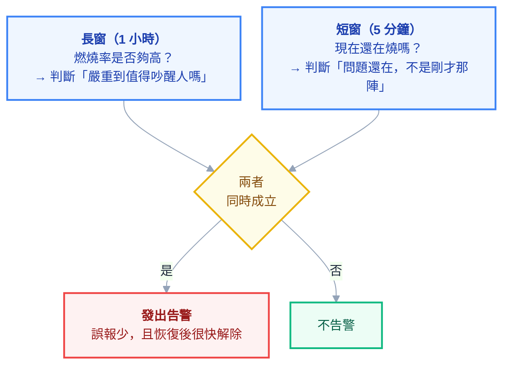

# 附錄 AP：SLO、錯誤預算與告警設計

實戰第六章寫過一句原則：**「從 SLO 導出告警，不要從指標導出告警。」** 附錄 H 的檢查清單也要求「每條告警都對應 SLO」。

但兩份都沒說**怎麼做**——SLO 從哪來、錯誤預算怎麼算、那句原則要怎麼變成一條真的 PromQL。這一份補上那一段，因為它是「監控做完了但半夜還是一直被吵醒」與「告警一響就知道要做什麼」之間的差別。

> 這一份假設你已經讀過 [[14-prometheus-grafana]]（PromQL、Alerting Rules、Alertmanager）與 [[practice-6-observability]]（四個黃金訊號）。這裡不重複那些機制，只講**怎麼決定要告警什麼**。

---

## Part 1：為什麼「指標門檻」式的告警一定會失敗

多數團隊的告警是這樣長出來的：出了一次事故 → 「下次要早點知道」 → 加一條 `CPU > 80%` 的告警。半年後有四十條告警，每天響五次，沒有一次需要做事。

**這條路的終點是所有人都把告警靜音。** 而那才是真正的風險——不是沒有告警，是**有告警但沒人看**。

問題出在起點：`CPU > 80%` 這種門檻在問「**系統的某個零件看起來如何**」，但你真正在乎的是「**使用者現在有沒有受影響**」。這兩者的關係比想像中弱得多：

| 情境 | 零件指標 | 使用者感受 |
| --- | --- | --- |
| CPU 90%，但請求都在 100ms 內完成 | 🔴 告警 | ✅ 完全無感 |
| CPU 20%，但下游 DB 卡住，請求全部 timeout | ✅ 安靜 | 🔴 服務等於掛了 |
| 記憶體用量高，但那是快取，本來就該用滿 | 🔴 告警 | ✅ 無感 |

上表第一、三列就是**誤報**，第二列是**漏報**。而誤報累積起來會讓人忽略告警，於是漏報的那次也沒人理——**兩種錯誤會互相放大。**

所以要換一個起點：**先定義「服務對使用者算是好的」是什麼意思，再對「不好」告警。** 那個定義就是 SLO。

---

## Part 2：SLI、SLO、錯誤預算三個詞

這三個詞常被混用，但它們是三層不同的東西：

| 詞 | 是什麼 | 例子 |
| --- | --- | --- |
| **SLI**（指標） | 一個**衡量服務好壞的數字** | 成功請求數 ÷ 總請求數 |
| **SLO**（目標） | 對那個數字訂的**目標** | 「30 天內 SLI ≥ 99.9%」 |
| **錯誤預算** | 目標**允許你失敗的額度** | 100% − 99.9% = 0.1% |

### 錯誤預算的算術要自己算過一次

「99.9%」聽起來很抽象，換算成時間就非常具體：

| SLO | 每 30 天可以壞多久 | 感覺 |
| --- | --- | --- |
| 99% | **7 小時 12 分** | 相當寬鬆 |
| 99.9% | **43 分鐘** | 常見的預設 |
| 99.95% | **21 分鐘** | 一次沒處理好的事故就用光 |
| 99.99% | **4 分 19 秒** | **人為介入來不及**，必須靠自動復原 |

> **這張表最重要的用途是壓下不切實際的目標。** 當有人說「我們要五個九」時，把這張表拿出來：那代表**每月只能壞 26 秒**，而人類收到告警、打開電腦、看懂狀況就不只 26 秒了。
>
> 也就是說，超過 99.99% 的目標不是「更努力」能達成的，它要求**架構上不存在需要人介入的故障模式**。這是設計問題，不是紀律問題。

### 錯誤預算的真正價值：它是一個決策工具

錯誤預算不只是統計，它把「要衝功能還是要顧穩定」這個永恆爭論變成一個**可以查數字回答的問題**：

- **預算還很多** → 可以冒險：發版快一點、做風險較高的變更
- **預算快用完** → 凍結非必要變更，把力氣放在穩定性

**這讓「穩定性」第一次有了跟「功能進度」對等的量詞。** 沒有錯誤預算時，穩定性的訴求永遠輸給有明確日期的功能需求，因為前者說不出「不做會怎樣」。

---

## Part 3：怎麼訂第一個 SLO

### 選 SLI：從使用者的角度，不是從元件的角度

**問「使用者怎麼判斷這個服務壞了」，而不是「這個服務有哪些指標」。**

對多數 Web API 來說，兩個 SLI 就夠了：

| SLI | 定義 | PromQL 骨架 |
| --- | --- | --- |
| **可用性** | 非 5xx 的請求比例 | `sum(rate(http_requests_total{status!~"5.."}[5m])) / sum(rate(http_requests_total[5m]))` |
| **延遲** | 在門檻內完成的請求比例 | `sum(rate(http_request_duration_seconds_bucket{le="0.3"}[5m])) / sum(rate(http_request_duration_seconds_count[5m]))` |

> **延遲 SLI 要寫成「比例」而不是「P95」。** 「P95 < 300ms」很難跟錯誤預算搭起來；「99% 的請求在 300ms 內」則直接就是一個可以算預算的比例。這個轉換是 SLO 實作裡最常卡住的一步。

### 三個常見的錯

**第一，把 4xx 算成失敗。** 使用者送了錯誤的參數拿到 400，那是**服務正常運作**。把 4xx 算進去，你的 SLO 會被使用者的行為綁架。（例外：401/403 大量暴增可能代表認證系統壞了，那要另外監控。）

**第二，用所有端點的平均。** 健康檢查端點每秒被打好幾次且永遠成功，它會把真正重要的端點稀釋掉。**要排除健康檢查與探針流量**，必要時對關鍵端點分別訂 SLO。

**第三，第一次就訂得太嚴。** 合理的做法是**先量兩週，看現況是多少，再把 SLO 訂在略低於現況的地方**。一開始就訂 99.99% 而現況是 99.5%，結果是預算永遠是負的，於是所有人都不看它了。

### 起手式

1. 選 **1–2 個**最重要的使用者旅程（例如「登入」與「送出訂單」）
2. 對它們量兩週，記下實際的可用性與延遲分布
3. SLO 訂在**略低於現況**——先讓它是可達成的
4. 跑三個月，每月檢討一次，再逐步收緊

**不要一次幫二十個服務訂 SLO。** 那會變成一個沒有人維護的表格。

---

## Part 4：燃燒率告警——這一節是重點

有了 SLO 之後，告警要問的問題變成：

> **「照現在這個速度，錯誤預算會不會太快用完？」**

這個「速度」就是**燃燒率（burn rate）**：燃燒率 1 代表剛好在 30 天結束時用完預算；燃燒率 10 代表用掉預算的速度是十倍快。

### 為什麼要「多視窗」

只看一個時間窗會兩頭不討好：

| 只看短窗（如 5 分鐘） | 只看長窗（如 6 小時） |
| --- | --- |
| 反應快 | 反應慢，事故燒很久才響 |
| **誤報多**——一次尖峰就響 | 誤報少 |
| 恢復後很快解除 | **恢復後還會繼續響很久** |

解法是**兩個窗同時成立才告警**：



**長窗負責「嚴不嚴重」，短窗負責「還在不在發生」。** 短窗通常取長窗的十二分之一。

### 四組標準門檻

以 30 天窗、99.9% SLO 為例，這組數字是業界通用的起點：

| 長窗 | 短窗 | 燃燒率 | 觸發時已燒掉 | 該怎麼處理 |
| --- | --- | --- | --- | --- |
| 1 小時 | 5 分鐘 | **14.4** | 2% | **立刻叫人**（page） |
| 6 小時 | 30 分鐘 | **6** | 5% | **立刻叫人** |
| 1 天 | 2 小時 | **3** | 10% | 開工單，上班時間處理 |
| 3 天 | 6 小時 | **1** | 10% | 開工單 |

算法很簡單：1 小時是 30 天的 1/720，燃燒率 14.4 代表這一小時燒掉 `14.4 ÷ 720 = 2%` 的預算。

> **上面兩列叫醒人、下面兩列只開工單，這個分界就是「告警疲勞」的解方。** 燒得慢的問題確實需要處理，但它**不需要在凌晨三點處理**。

### 寫成 PromQL

```yaml
groups:
  - name: slo-burn-rate
    rules:
      # 快燒：1 小時燒掉 2% 預算 → 叫人
      - alert: ErrorBudgetBurnFast
        expr: |
          (
            sum(rate(http_requests_total{job="api",status=~"5.."}[1h]))
            / sum(rate(http_requests_total{job="api"}[1h]))
          ) > (14.4 * 0.001)
          and
          (
            sum(rate(http_requests_total{job="api",status=~"5.."}[5m]))
            / sum(rate(http_requests_total{job="api"}[5m]))
          ) > (14.4 * 0.001)
        labels:
          severity: page
        annotations:
          summary: "API 錯誤預算燃燒率過高（1h 已燒 2%）"
          runbook_url: "https://wiki.internal/runbooks/api-slo-burn"

      # 慢燒：1 天燒掉 10% 預算 → 開工單，不叫人
      - alert: ErrorBudgetBurnSlow
        expr: |
          (
            sum(rate(http_requests_total{job="api",status=~"5.."}[1d]))
            / sum(rate(http_requests_total{job="api"}[1d]))
          ) > (3 * 0.001)
          and
          (
            sum(rate(http_requests_total{job="api",status=~"5.."}[2h]))
            / sum(rate(http_requests_total{job="api"}[2h]))
          ) > (3 * 0.001)
        labels:
          severity: ticket
        annotations:
          summary: "API 錯誤預算慢速燃燒（1d 已燒 10%）"
          runbook_url: "https://wiki.internal/runbooks/api-slo-burn"
```

其中 `0.001` 就是 `1 - 0.999`，也就是允許的錯誤率。**改 SLO 只要改這個數字。**

> **實務提醒：`[1d]` 這種長區間的 `rate()` 計算成本不低。** 用 Recording Rules 先把各個窗的錯誤率算好、告警規則只讀結果，能省下可觀的查詢負擔（[[14-prometheus-grafana]] 的 Recording Rules 正是為此而生）。

---

## Part 5：告警要對症狀發，不是對原因發

燃燒率告警是「症狀告警」的典型——它問的是使用者受不受影響。但仍有少數例外**該**對原因告警：

| 類型 | 該不該叫人 | 例子 |
| --- | --- | --- |
| **症狀**：使用者已受影響 | ✅ 叫人 | 錯誤預算快速燃燒、關鍵流程失敗 |
| **迫近的耗盡**：還沒影響但快了 | ✅ 叫人 | 磁碟四小時內滿、憑證三天後過期 |
| **原因**：某個零件不正常 | ❌ 不叫人 | CPU 高、Pod 重啟、單一副本掛掉 |
| **資訊**：知道就好 | ❌ 進儀表板 | 部署完成、擴縮容發生 |

**第二列是唯一該對「原因」叫人的情況**，判準很明確：**這件事會在人來得及反應的時間內變成使用者可見的故障，而且晚了就來不及。** 磁碟滿了才處理就已經是事故了；憑證過期當下才發現，換發加部署的時間你沒有。

**第三列是多數團隊告警最多、價值最低的部分。** Pod 重啟了三次但服務完全正常——那是 K8s 在做它該做的事（自動復原），不是需要人的事。這些應該進儀表板，在**調查時**看，而不是在**平時**吵。

> **一個檢驗方法：對每條會叫人的告警問「收到之後我要立刻做什麼？」** 答不出具體動作、或答案是「先看一下」，那它就不該叫人。
>
> 這一題答不出來的告警，通常已經被團隊默默忽略很久了。

---

## Part 6：runbook 與告警的最小品質標準

一條會叫醒人的告警，**至少**要滿足：

| 要求 | 為什麼 |
| --- | --- |
| **有 `runbook_url`** | 凌晨三點的人不會臨場想出處理步驟 |
| **標題說「什麼壞了」不是「什麼指標超標」** | 「訂單 API 錯誤率上升」勝過「burn_rate > 14.4」 |
| **附上受影響範圍** | 哪個服務、哪個環境、影響多少比例 |
| **可以被抑制** | 上游掛掉時，下游的一連串告警要能收斂成一則 |

### runbook 的最小內容

不需要寫成大部頭文件，四段就夠：

1. **這個告警代表什麼**（一句話）
2. **先確認什麼**（兩三個具體指令或儀表板連結）
3. **常見原因與對應動作**（列出前幾名）
4. **升級給誰**（處理不了時找誰、怎麼找）

**第 4 點最常被漏掉，也最重要**——值班的人最需要知道的往往不是怎麼修，而是**什麼時候該叫人幫忙、叫誰**。

### 定期刪告警

告警規則只會增加不會減少，除非你刻意去砍。每季做一次：

- **響過但從沒導致任何動作的** → 刪掉或降級成工單
- **從來沒響過的** → 確認它還有沒有效（很可能指標名稱早就變了）
- **一響就一串的** → 合併，或修正抑制規則

> **「這一季刪掉了幾條告警」是一個比「新增幾條」更健康的指標。**

---

## 檢查清單

### SLO

- [ ] 選的是**使用者旅程**，不是元件指標
- [ ] 延遲 SLI 寫成**比例**（「99% 在 300ms 內」）而非 P95 門檻
- [ ] **4xx 不算失敗**；健康檢查與探針流量已排除
- [ ] 先量兩週再訂目標，訂在**略低於現況**
- [ ] 只從 1–2 個關鍵旅程開始
- [ ] 換算成時間看過一次（99.9% ＝ 每月 43 分鐘）

### 告警

- [ ] 用**多視窗燃燒率**，不是單一指標門檻
- [ ] **快燒叫人、慢燒開工單**，兩者分開
- [ ] 長區間的計算用 Recording Rules 先算好
- [ ] 每條會叫人的告警都能回答「收到之後我要立刻做什麼」
- [ ] 每條都有 `runbook_url`
- [ ] runbook 有寫**升級給誰**
- [ ] 原因類指標進儀表板，不叫人
- [ ] 磁碟／憑證這類「迫近耗盡」保留為叫人告警
- [ ] 每季檢討一次，**刪掉沒價值的**

---

## 常見誤區

| # | 誤區 | 真相 |
| --- | --- | --- |
| 1 | 告警越多越安全 | 誤報會讓人忽略告警，**漏報跟著一起發生** |
| 2 | `CPU > 80%` 是好告警 | 它跟使用者感受的關聯很弱，兩種錯誤都會犯 |
| 3 | SLO 訂高一點比較有企圖心 | 訂到永遠達不到，就沒有人會看它 |
| 4 | 99.99% 是努力就能達成的 | 每月只剩 4 分鐘，**人為介入來不及**——那是架構要求 |
| 5 | 4xx 也算失敗 | 那是服務正常運作；SLO 會被使用者行為綁架 |
| 6 | 延遲 SLO 就是 P95 門檻 | 要寫成比例才能接上錯誤預算 |
| 7 | 單一時間窗就夠 | 短窗誤報多、長窗恢復後還響；要**兩窗同時成立** |
| 8 | 所有告警都該叫人 | 慢燒的問題不需要在凌晨三點處理 |
| 9 | Pod 重啟要告警 | 那是 K8s 在自動復原，該進儀表板 |
| 10 | 告警只能加不能刪 | **每季刪掉幾條，是比新增幾條更健康的指標** |

## 連結

- [[14-prometheus-grafana]] — 正文：PromQL、Recording/Alerting Rules、Alertmanager 路由
- [[practice-6-observability]] — 實戰 6：四個黃金訊號、「只對需要人立刻做事的狀況告警」
- [[30-production-readiness]] — 附錄 H：上線前檢查、必備告警清單、事故流程
- [[39-performance-troubleshooting]] — 附錄 Q：告警響了之後的分層定位
- [[55-logging-strategy]] — 附錄 AG：日誌的三種用途與告警的關係
- [[44-knowledge-transfer]] — 附錄 V：runbook 是知識傳承的載體
- [[61-compliance-and-audit]] — 附錄 AM：事故處理紀錄同時是合規證據
- [[k8s-mastery]] — 教材總目錄
