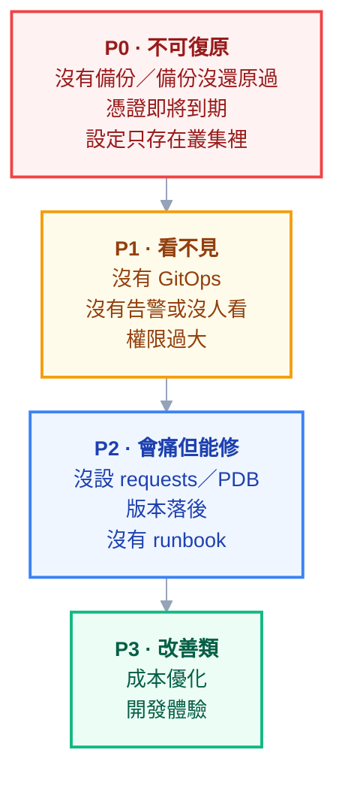

# 附錄 AQ：接手一座既有叢集

附錄 AK 講的是**從零導入**——你有一張白紙，可以照著順序把每件事做對。

但更常見的情況是另一種：**叢集已經在跑了、建它的人要走了、而從下週開始它是你的。** 這兩件事的難度不同，而且不是「接手比較簡單」——

> 從零導入時，你知道每一個決定是怎麼做的。接手時，你要在**不知道裡面有什麼**的情況下對它負責。

這一份是給那個處境的。核心心法只有一句：

> **你最大的風險不是你不會的東西，是你不知道它存在的東西。**

不會的東西你可以查、可以學、可以問。而**你不知道存在的東西會在半夜自己出現**——一個沒人記得的 CronJob、一張兩週後過期的憑證、一個只有前任知道要手動重跑的步驟。

所以前三個月的主線任務不是「改善」，是**把未知變成已知**。

---

## Part 1：第一週——只看不動

**除非有正在燒的火，第一週不要改任何東西。**

這不是膽小。在你還沒搞清楚系統之間的依賴之前，任何一個「看起來明顯該修」的東西，都可能是某個你還不知道的機制在依賴的。改了之後出事，你會同時失去系統的穩定與團隊的信任——而後者更難拿回來。

第一週的目標是三張圖：**這座叢集有什麼、誰在用、什麼會半夜叫我。**

### 盤點指令

```powershell
# --- 基本盤 ---
kubectl version
kubectl get nodes -o wide
kubectl get --raw='/readyz?verbose' # 控制平面各元件健康狀態

# --- 有什麼在跑 ---
kubectl get ns
kubectl get deploy,sts,ds,cronjob -A
kubectl get pods -A --field-selector=status.phase!=Running # 不正常的先看

# --- 對外暴露了什麼（最該優先搞清楚的）---
kubectl get ingress -A
kubectl get svc -A --field-selector spec.type=LoadBalancer
kubectl get svc -A -o json | ConvertFrom-Json |
  Select-Object -ExpandProperty items |
  Where-Object { $_.spec.type -eq 'NodePort' } |
  Select-Object @{n='ns';e={$_.metadata.namespace}}, @{n='name';e={$_.metadata.name}}

# --- 誰有權限 ---
kubectl get clusterrolebinding -o wide
kubectl get rolebinding -A -o wide

# --- 意外的來源：叢集被誰擴充過 ---
kubectl get crd
kubectl get validatingwebhookconfiguration,mutatingwebhookconfiguration
kubectl api-resources --verbs=list -o name | Select-String -NotMatch "k8s.io$"

# --- 有沒有 GitOps ---
kubectl get applications -A 2>$null # ArgoCD
kubectl get helmrelease -A 2>$null # Flux
helm list -A
```

### 每個指令你在找什麼

| 指令 | 在找什麼 | 危險訊號 |
| --- | --- | --- |
| `get nodes -o wide` | 節點數、版本一致性、OS | 節點版本不一致、只有 1 個控制平面節點 |
| `get ingress -A` / LoadBalancer | **對外暴露面** | 有你不認得的對外服務 |
| `get crd` | 誰擴充過這座叢集 | 有 CRD 但找不到對應的 operator |
| **`get *webhookconfiguration`** | **會攔截你操作的東西** | 有 webhook 但背後的服務已經不在 |
| `get clusterrolebinding` | 誰有最高權限 | 一堆人綁 `cluster-admin` |
| `get applications -A` | 真相來源在哪 | **空的——代表沒有 GitOps** |
| `get cronjob -A` | 定期會發生什麼事 | 有 CronJob 但沒人知道它在做什麼 |

> **`webhookconfiguration` 那一列要特別強調。** 一個失效的 admission webhook 會讓相關的 `kubectl apply` **全部卡住或失敗**，而錯誤訊息通常只說「呼叫 webhook 失敗」，不會告訴你這個 webhook 是三年前某個實驗留下的。這是接手時最容易被埋伏的一項（[[09-extending-kubernetes]]）。

### 同時要做的：畫出「誰在用」

技術盤點只是一半。另一半是**每個 namespace 背後是哪個團隊、哪個人**。

沒有 owner 的 namespace 是最大的風險來源：出事時沒人能告訴你它能不能停、資源要不要保留、裡面的資料重不重要。**把 owner 找出來並寫進 label**，這件事越早做越好：

```powershell
kubectl label namespace legacy-app owner=team-b --overwrite
```

---

## Part 2：第二到四週——找出未知數

有了地圖之後，開始問問題。這六題**一定要問出答案**，而且要的是證據不是口頭保證：

| # | 問題 | 要什麼證據 |
| --- | --- | --- |
| 1 | **備份存在嗎？還原過嗎？** | 備份檔案本身 + 上一次還原演練的紀錄 |
| 2 | **憑證什麼時候到期？** | 實際查出來的日期，不是「應該還久」 |
| 3 | **叢集裡的東西有多少在 git 裡？** | 比對結果，不是印象 |
| 4 | 告警送到哪？誰在看？ | 打開那個頻道，看最近有沒有人回應 |
| 5 | 版本落後多少？還在支援期嗎？ | 版本號 + 對照支援政策 |
| 6 | 有沒有「大家都知道但沒人處理」的問題 | 問每一個人，答案通常不一樣 |

### 第 1 題：備份

```powershell
# etcd 快照存在嗎、多久以前
kubectl -n kube-system get pod -l component=etcd
# 備份排程（可能是 CronJob、可能是叢集外的排程、也可能不存在）
kubectl get cronjob -A | Select-String -Pattern "backup|etcd|velero"
kubectl get backups.velero.io -A 2>$null
```

**如果答案是「不知道」或「應該有吧」，那就是沒有。** 這會直接變成你的 P0（見 Part 3）。

而且要記得問憑證：[[12-cluster-operations]] 講過，**只備份 etcd 而沒有 `/etc/kubernetes/pki` 是還原不回來的**，而這一項在交接時幾乎沒有人會主動提。

### 第 2 題：憑證

```powershell
kubeadm certs check-expiration # kubeadm 建的叢集
# 應用層憑證（cert-manager 管的）
kubectl get certificate -A
```

憑證過期是**有明確日期的定時炸彈**，而且它到期時的錯誤訊息（一堆 x509）不會指向真正的原因。**第一週就把所有到期日抄下來放進行事曆。**

### 第 3 題：這是最重要的一題

> **「叢集裡跑的東西，有多少在 git 裡？」這題的答案決定你接下來三個月的工作內容。**

三種可能，工作量差很多：

| 答案 | 意味著 | 接下來 |
| --- | --- | --- |
| 幾乎都在，且有 ArgoCD 在同步 | 狀態可重建 | 你可以直接開始改善 |
| 在 git 裡但靠人手動 apply | 會漂移，且沒人知道漂了多少 | 先接上 GitOps |
| **不在 git 裡** | **叢集就是唯一真相，掛了無法重建** | **這是你的第一優先** |

粗略的量法是把 live 狀態導出來跟 repo 比對。導出時記得**先清掉 `status`、`metadata.uid`、`resourceVersion` 這類伺服器產生的欄位**，否則差異全是雜訊：

```powershell
kubectl get deploy -A -o yaml > live-deployments.yaml
# 逐一比對前先移除伺服器端欄位，否則 diff 沒有可讀性
```

**在還沒有 GitOps 之前，你的叢集是不可重建的**——這句話值得跟主管講一次，因為它把一件技術債翻譯成了業務風險。

---

## Part 3：風險排序——先修什麼

盤點完你會得到一長串問題，而且它們看起來都很急。排序的準則是三個乘數：

> **爆炸半徑 × 發生機率 × 你能不能復原**

第三項最常被忽略但最關鍵：**一個「一定會發生但五分鐘能修好」的問題，遠不如「機率不高但發生了就回不來」的問題重要。**



**P0 的共同特徵是「發生了就回不來」**，所以它排第一不是因為機率高，是因為沒有第二次機會。

> **先做能「止血」的，不要先做能「展示」的。**
>
> 新官上任很容易想先做一個看得見的成果——升級到最新版、導入 service mesh、做一個漂亮的儀表板。但如果備份還沒驗證過，那些都是在沒有安全網的情況下走鋼索。
>
> 而且順序搞反的代價是不對稱的：先做止血，之後還有機會做展示；先做展示，出事時你什麼都沒有。

---

## Part 4：前 90 天要建立的安全網

按順序，每一項都是下一項的前提：

**第一，備份 + 一次真的還原演練。** 不是確認備份存在，是**在測試環境還原一次並計時**（[[34-multicluster-and-dr]] 有完整腳本）。這件事做完之前，其他所有事情都是在沒有安全網的狀態下進行。

**第二，把現況寫進 git——即使很醜。** 不要等到「整理好」再進 git。先把現況原封不動導出來提交，之後再慢慢清理。**未經整理但在 git 裡，遠勝過整理中但只存在叢集裡。**

**第三，最小告警集。** 不是完整監控體系，是三到五條「響了一定有事」的告警（[[64-slo-and-alerting]]）。多了你會忽略，少了你會漏。

**第四，一份 runbook——即使只有三頁。** 內容就三件事：怎麼確認服務是好的、最常見的三個問題怎麼處理、處理不了時找誰。

**第五，逃生門。** 知道最壞情況下怎麼恢復：完整重建要多久、有沒有辦法暫時把流量切走、哪些服務可以先犧牲。**這件事要在平時想清楚，因為事故當下沒有時間想。**

---

## Part 5：跟人有關的部分

技術盤點有指令可以跑，這一段沒有，但它常常決定成敗。

### 前任要走時，交接要問的十題

1. 有沒有**只有你知道**的手動步驟？（最重要的一題）
2. 有沒有哪個東西「不要碰它就會一直好好的」？
3. 上次半夜被叫起來是為什麼？
4. 有沒有你一直想修但沒時間修的東西？
5. 哪些設定是為了繞過某個問題才那樣寫的？
6. 有哪些密碼／金鑰只存在你的個人筆記裡？
7. 外部依賴有哪些？（憑證商、雲端帳號、第三方 API）
8. 哪些人／系統會直接連到叢集，繞過正常流程？
9. 如果你明天就不在，最先會壞的是什麼？
10. 你會建議我**不要**做什麼？

> **第 1、5、9 題最有價值**，因為它們問的是「文件裡不會有的東西」。而第 5 題常常會揭露一整串你原本會誤以為是「寫錯了」而想去修掉的設定。

### 期待管理

一上任就承諾改造是常見的錯。**前三個月的產出是「這座叢集現在是可理解、可復原的」，而不是「我加了什麼新東西」。** 這個定位要一開始就跟主管講清楚，否則你會被推著去做 P3 而跳過 P0。

### 「這個我不知道」是專業回答

接手時你一定會被問到答不出來的問題。**說「我還不知道，我查完回覆你」是專業的**；猜一個答案然後被推翻，才會真的損害信任。

而且這句話有一個附帶好處：它讓「未知」變成可以公開追蹤的清單，而不是你一個人的焦慮。

---

## Part 6：90 天後該長什麼樣

三個可驗證的里程碑——**都是「做過」而不是「知道」**：

| 里程碑 | 怎麼驗證 |
| --- | --- |
| **這座叢集可以被重建** | 在測試環境從 git + 備份還原過一次 |
| **它壞掉時我會知道** | 告警響過至少一次，而且是真的有事 |
| **我不在時別人能撐住** | runbook 存在，且**別人照著跑過一次** |

三項都達成之後，你才從「維持」進入「改進」——這時候再回頭讀 [[59-adoption-roadmap]]，你會發現它的 Phase 2 之後正好接得上。

---

## 檢查清單

### 第一週

- [ ] 除非有正在燒的火，**什麼都不改**
- [ ] 跑完盤點指令，特別是 **webhook 與 CRD**
- [ ] 列出所有對外暴露的服務
- [ ] 找出每個 namespace 的 owner，寫進 label
- [ ] 抄下所有憑證到期日，放進行事曆

### 第一個月

- [ ] 備份存在嗎？**還原演練過嗎**？（要證據）
- [ ] **叢集裡的東西有多少在 git 裡**（要比對，不要憑印象）
- [ ] 告警送到哪、誰在看（打開那個頻道確認）
- [ ] 版本還在支援期嗎
- [ ] 問過每一個人「有沒有大家都知道但沒人處理的問題」
- [ ] 跟前任問過那十題

### 前 90 天

- [ ] 做過**一次真的還原演練**並計時
- [ ] 現況已進 git（醜也沒關係）
- [ ] 三到五條「響了一定有事」的告警
- [ ] 一份三頁 runbook，含「找誰」
- [ ] 想清楚最壞情況的逃生門
- [ ] 跟主管對齊過：前三個月的產出是**可理解、可復原**

---

## 常見誤區

| # | 誤區 | 真相 |
| --- | --- | --- |
| 1 | 先做一個看得見的成果建立信任 | **先止血，再展示**；順序反了出事時什麼都沒有 |
| 2 | 看到明顯該修的就先修 | 你還不知道誰依賴它；第一週只看不動 |
| 3 | 備份「應該有」 | 沒有證據就是沒有；而且要含 `/etc/kubernetes/pki` |
| 4 | 等整理好再進 git | **未整理但在 git 裡，勝過整理中但只在叢集裡** |
| 5 | 先建立完整監控體系 | 先要三到五條會響且該響的告警 |
| 6 | 沒人用的 namespace 可以刪 | 先找到 owner；「沒人認領」不等於「沒人在用」 |
| 7 | CRD 與 webhook 是小事 | **失效的 webhook 會讓 apply 全面失敗**，且訊息不會指向它 |
| 8 | 答不出來很丟臉 | 「我查完回覆你」是專業；猜錯才損害信任 |
| 9 | 交接文件寫完就夠 | 最有價值的是文件裡不會有的：手動步驟、繞過的設定 |
| 10 | 90 天要交出改進成果 | 90 天的目標是**可理解、可復原**，改進在那之後 |

## 連結

- [[59-adoption-roadmap]] — 附錄 AK：從零導入的 Phase 0–4；接手站穩後從 Phase 2 接上
- [[12-cluster-operations]] — 正文：etcd 備份、憑證輪替、升級、節點維護
- [[34-multicluster-and-dr]] — 附錄 L：還原演練的完整腳本與 RTO/RPO
- [[64-slo-and-alerting]] — 附錄 AP：最小告警集該怎麼選
- [[13-troubleshooting]] — 正文：分層定位方法論與案例庫
- [[09-extending-kubernetes]] — 正文：webhook 為何會讓 apply 全面卡住
- [[44-knowledge-transfer]] — 附錄 V：交接與文件四分法，反過來讀就是接手指南
- [[61-compliance-and-audit]] — 附錄 AM：盤點權限與變更紀錄的指令
- [[practice-3-gitops-pipeline]] — 實戰 3：把現況接上 GitOps
- [[k8s-mastery]] — 教材總目錄
