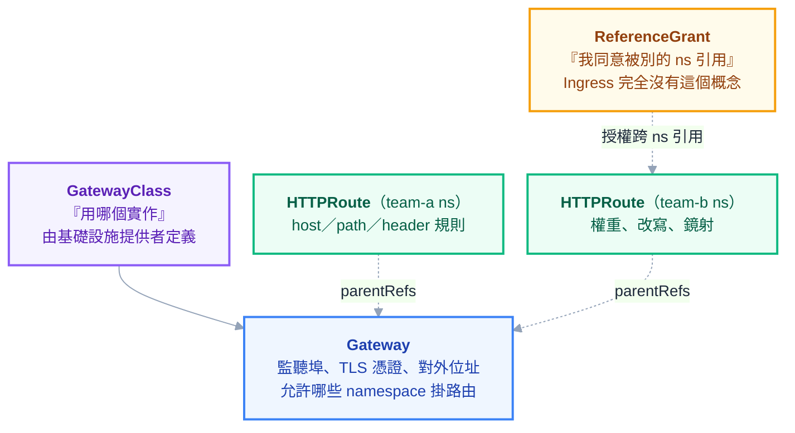

# 附錄 AR：從 Ingress 遷移到 Gateway API

附錄 F 是一整份 **ingress-nginx annotation 百科**。那份文件存在這件事本身，就是 Ingress 出問題的證據——**如果規格夠用，就不需要一整份文件來記某個 controller 私有的擴充語法。**

附錄 C-5 寫了 Gateway API 的欄位長什麼樣。這一份補中間那一段：**為什麼會有它、該不該換、怎麼換、以及什麼時候不要換。**

---

## Part 1：Ingress 的三個結構性問題

Ingress 是穩定的 API，但它**已經不再新增功能**。理解為什麼，比記住它有哪些欄位更有用。

### 問題一：規格太小，於是所有東西都塞進 annotation

Ingress 的規格只涵蓋「host + path → service」。但真實世界需要重寫路徑、限流、逾時、body 大小、CORS、認證、金絲雀……這些**全部沒有標準欄位**，於是每個 controller 自己發明 annotation。

結果就是附錄 F 那份百科：一份**只對 ingress-nginx 有效**的知識。換成別的 controller，那些設定全部要重寫，而且不會有人告訴你哪些沒對應——它們只是**靜默地不生效**。

### 問題二：沒有角色分離

一個 Ingress 物件裡同時混了兩種人該管的事：

| 欄位 | 誰該決定 |
| --- | --- |
| TLS 憑證、監聽埠、對外 IP | **叢集／平台管理員** |
| host 與 path 的路由規則 | **應用團隊** |

因為它們在同一個物件裡，你只能二選一：要嘛給應用團隊改 Ingress 的權限（那他們也能改 TLS 設定），要嘛所有路由變更都要經過平台團隊（那平台團隊變成瓶頸）。

**這正是附錄 O 講的「平台團隊不該是瓶頸」在網路層的具體版本**，而 Ingress 的資料模型讓它無解。

### 問題三：表達力不足

| 需求 | Ingress | Gateway API |
| --- | --- | --- |
| host + path 路由 | ✅ | ✅ |
| 依 header 分流 | ❌ 需 annotation | ✅ 規格內 |
| 依權重分流（金絲雀） | ❌ 需 annotation | ✅ `weight` |
| 改寫路徑 | ❌ 需 annotation | ✅ `URLRewrite` filter |
| 增刪 header | ❌ 需 annotation | ✅ `RequestHeaderModifier` |
| 流量鏡射 | ❌ | ✅ `RequestMirror` |
| 跨 namespace 引用需對方同意 | ❌ 無此概念 | ✅ `ReferenceGrant` |

> **Gateway API 最大的價值不是「功能比較多」，而是「這些功能寫在規格裡而不是 annotation 裡」——所以換 controller 不用重寫路由。**

---

## Part 2：三層資源與角色分離

Gateway API 把 Ingress 的一個物件拆成三層，而**這個拆法本身就是它的主要設計目的**：



拆開之後，RBAC 終於能對上真實的責任分工：**平台團隊擁有 Gateway，應用團隊在自己的 namespace 建 HTTPRoute 並用 `parentRefs` 掛上去**。應用團隊改路由不需要平台團隊核准，也碰不到 TLS。

而 Gateway 這邊用 `allowedRoutes` 決定誰可以掛：

```yaml
apiVersion: gateway.networking.k8s.io/v1
kind: Gateway
metadata:
  name: public-gw
  namespace: infra
spec:
  gatewayClassName: nginx # 或 istio、envoy-gateway 等
  listeners:
    - name: https
      protocol: HTTPS
      port: 443
      hostname: "*.example.com"
      tls:
        mode: Terminate
        certificateRefs:
          - name: wildcard-example-com
      allowedRoutes:
        namespaces:
          from: Selector # 只有帶這個 label 的 namespace 能掛
          selector:
            matchLabels:
              gateway-access: "true"
```

應用端：

```yaml
apiVersion: gateway.networking.k8s.io/v1
kind: HTTPRoute
metadata:
  name: api
  namespace: team-a
spec:
  parentRefs:
    - name: public-gw
      namespace: infra # 掛到平台團隊的 Gateway
  hostnames:
    - api.example.com
  rules:
    - matches:
        - path:
            type: PathPrefix
            value: /v2
      filters:
        - type: URLRewrite
          urlRewrite:
            path:
              type: ReplacePrefixMatch
              replacePrefixMatch: /
      backendRefs:
        - name: api-v2
          port: 80
```

> **`backendRefs` 指向別的 namespace 的 Service 時，那個 namespace 必須建 `ReferenceGrant` 表示同意。** 忘記建的話——**路由不會報錯，它只是不生效**。這是 Gateway API 最常見的第一個坑，見 Part 6。

---

## Part 3：annotation 對照表——以及對不上的那些

遷移的實際工作量，取決於你用了多少 annotation。

| ingress-nginx annotation | Gateway API 對應 |
| --- | --- |
| `rewrite-target` | ✅ `URLRewrite` filter |
| `canary-weight` | ✅ `backendRefs[].weight` |
| `ssl-redirect` | ✅ `RequestRedirect` filter |
| `configuration-snippet`（加 header） | ✅ `RequestHeaderModifier` |
| `permanent-redirect` | ✅ `RequestRedirect` |
| `proxy-body-size`、`proxy-*-timeout` | ⚠️ **仍是實作專屬**（各 controller 自訂 policy） |
| `limit-rps`（限流） | ⚠️ **無標準對應** |
| `auth-url`、`auth-signin`（外部認證） | ⚠️ **無標準對應** |
| `configuration-snippet`（任意 nginx 設定） | ❌ **設計上就不會有對應** |

**這張表的右半邊才是重點。** 遷移不是語法翻譯，而是要面對「有些東西過去之後沒有了」。

三類處理方式：

**能對應的** —— 直接翻譯，這部分最輕鬆。

**實作專屬的** —— 各 controller 用自己的 policy 資源（不同 controller 名稱不同）。**功能還在，但可攜性又沒了**——這時要誠實承認：Gateway API 解決了大部分 annotation 問題，不是全部。

**沒有對應的** —— 要往上或往下移。限流與外部認證通常該搬到邊界層（[[58-api-gateway-and-edge]]）或 service mesh（[[32-istio-ingress-gateway]]），而不是硬留在 Gateway 這一層。**這往往是件好事**，因為它逼你把「什麼職責該在哪一層」想清楚。

**而 `configuration-snippet` 塞任意 nginx 設定的那類，設計上就不會有對應**——那本來就是逃生門，不是功能。

---

## Part 4：遷移策略——並行，不要切換

**不要規劃一個「切換日」。** 兩套系統可以同時跑，這是這次遷移最重要的一件事。

### 並行架構

```text
                  ┌── ingress-nginx ──→ 尚未遷移的服務
DNS / 負載平衡器 ─┤
                  └── Gateway controller ──→ 已遷移的服務
```

兩個 controller 各自有自己的對外位址，**用 DNS 決定哪些主機名走哪邊**。逐服務搬，每搬一個就切一個 DNS 記錄。

### 每個服務的搬遷步驟

1. **在新 Gateway 上建 HTTPRoute**，用一個臨時主機名（`api-gw.example.com`）
2. **比對兩邊的回應**——同樣的請求打舊的與新的，比對狀態碼、header、body
3. **確認 status 是好的**（`Accepted` 且 `ResolvedRefs` 為 true，見 Part 6）
4. **切 DNS**，觀察錯誤率與延遲
5. **留舊路由一段時間**再刪——DNS 有快取，切回去是最快的回滾手段

> **第 2 步不要跳過。** 路徑改寫的行為在兩套實作間有微妙差異（尾斜線、大小寫、編碼字元），而這類差異在測試環境常常看不出來，上線才由使用者發現。

### 順序

先搬**沒有 annotation 的簡單服務**，累積信心與工具；**重度依賴 annotation 的放最後**，因為那些需要真的做架構決定（限流搬去哪、認證搬去哪），不該在你還不熟新系統時處理。

---

## Part 5：什麼時候不要換

**Gateway API 是好設計，但「好設計」不等於「你現在需要」。**

| 你的情況 | 建議 |
| --- | --- |
| 只有幾條路由、幾乎沒用 annotation | **不用換**——換了沒有實質好處 |
| 單一團隊、沒有責任邊界問題 | 主要價值用不到，優先序很低 |
| 重度依賴某 controller 的專屬功能 | 先確認新方案有沒有；沒有就先別動 |
| 多團隊共用同一個入口、平台團隊是瓶頸 | ✅ **這是最強的理由** |
| 需要金絲雀、header 分流、流量鏡射 | ✅ 值得——不必再靠 annotation 拼湊 |
| 想換 controller（換雲、換實作） | ✅ 換一次痛，之後就不用再痛 |
| 已經在用 Istio 且路由都在 VirtualService | 先想清楚定位重疊的問題 |

> **一個務實的中間立場：新服務用 Gateway API，既有服務不動。**
>
> 這樣你不必為了統一而承擔一次大遷移，而新東西自然長在新的架構上。等到既有服務因為其他原因要改時，順手搬過去。**遷移不一定要是一個專案，它可以是一個預設值。**

---

## Part 6：實作要點與常見卡點

### CRD 要自己裝

Gateway API **不是內建 API**，是一組 CRD。要先安裝 CRD，再安裝支援它的 controller。這代表 [[27-upgrades-and-deprecations]] 的版本管理也適用於它：CRD 有自己的版本，升級時要對照 controller 的相容性。

```powershell
kubectl get crd | Select-String "gateway.networking.k8s.io"
kubectl get gatewayclass # 看有哪些實作可用
```

### 各 controller 支援程度不同

Gateway API 有一致性測試，但**不是每個 controller 都支援全部功能**。`GRPCRoute` 之外的 `TCPRoute`／`UDPRoute`／`TLSRoute` 成熟度也不同。**用某個功能之前，先確認你的 controller 支援它**——否則你會寫出一份語法正確、但被靜默忽略的設定。

### status 要用看的，不要用猜的

這是 Gateway API 相對 Ingress 的一大改進：**它的 status 會明確告訴你哪裡不對**。

```powershell
kubectl get gateway public-gw -n infra -o jsonpath='{.status.conditions}'
kubectl get httproute api -n team-a -o jsonpath='{.status.parents}'
```

| Condition | 意思 | 為 false 時 |
| --- | --- | --- |
| `Accepted` | Gateway/Route 被 controller 接受 | 設定有誤，或 `allowedRoutes` 不允許這個 namespace |
| `ResolvedRefs` | 引用的東西（Service、Secret）都找得到且**有權限** | **常常是忘了 `ReferenceGrant`** |
| `Programmed` | 底層資料平面真的套用了 | controller 還在處理，或它自己有問題 |

> **`ResolvedRefs: false` 是遷移期最常見的錯誤，而症狀是「路由完全沒反應」而不是報錯。** 養成習慣：建完 HTTPRoute **先看 status，再測流量**——這比從瀏覽器的 404 往回推快得多（[[29-status-and-conditions]] 的思路）。

### 其他常見卡點

| 卡點 | 原因 |
| --- | --- |
| HTTPRoute 建好了但沒生效 | `allowedRoutes` 不允許該 namespace；或忘了 `ReferenceGrant` |
| 路徑改寫結果跟舊的不一樣 | 兩套實作對尾斜線／前綴的處理有差異 |
| TLS 憑證找不到 | 憑證在 Gateway 所在的 namespace，不是應用的 |
| 多個 HTTPRoute 搶同一個 host+path | 有明確的優先序規則（越精確越優先），但要查清楚 |

---

## 檢查清單

### 決定要不要換

- [ ] 盤點過用了哪些 annotation，並標出**沒有對應**的那些
- [ ] 確認換的理由是**責任邊界**或**表達力**，不是「比較新」
- [ ] 考慮過「新服務用新的、舊的不動」這個中間選項
- [ ] 目標 controller 支援你需要的功能（查過一致性）

### 遷移執行

- [ ] **並行運行**，不是切換日
- [ ] 先搬沒有 annotation 的簡單服務
- [ ] 每個服務都**比對過新舊回應**（狀態碼、header、body）
- [ ] 切 DNS 後觀察錯誤率與延遲
- [ ] 舊路由留一段時間才刪（DNS 快取＝回滾路徑）
- [ ] 限流／認證這類無對應功能，已決定搬到哪一層

### 上線後

- [ ] `Accepted`、`ResolvedRefs`、`Programmed` 三個 condition 都是 true
- [ ] RBAC 已按三層拆開（平台管 Gateway、應用管 HTTPRoute）
- [ ] 跨 namespace 的引用都有 `ReferenceGrant`
- [ ] Gateway API CRD 版本納入升級管理

---

## 常見誤區

| # | 誤區 | 真相 |
| --- | --- | --- |
| 1 | Gateway API 就是新版 Ingress | 它的核心是**角色分離**，不只是新語法 |
| 2 | 所有 annotation 都有對應 | 限流、外部認證等**沒有標準對應**，要改架構 |
| 3 | 換過去就完全可攜了 | 逾時、body 大小等仍是實作專屬 policy |
| 4 | 要規劃一個切換日 | **並行跑**，逐服務用 DNS 切，隨時可回滾 |
| 5 | 語法對了就會生效 | 忘了 `ReferenceGrant`／`allowedRoutes` 會**靜默失敗** |
| 6 | 沒反應就去看瀏覽器和日誌 | **先看三個 condition**，它會直接告訴你原因 |
| 7 | Gateway API 是內建的 | 是 CRD，要自己裝，且有自己的版本管理 |
| 8 | 每個 controller 功能一樣 | 支援程度不同；用之前先確認 |
| 9 | 新的比較好所以該全面換 | 單一團隊、少量路由的情況換了沒好處 |
| 10 | 遷移一定是一個專案 | 可以是一個**預設值**：新服務用新的 |

## 連結

- [[28-ingress-nginx-annotations]] — 附錄 F：ingress-nginx annotation 百科，這份的「對照表」來源
- [[22-yaml-fields-ecosystem]] — 附錄 C-5：Gateway API 全欄位參考
- [[05-networking]] — 正文：Service、Ingress、封包路徑
- [[20-yaml-fields-network-storage]] — 附錄 C-3：Ingress 與 Service 欄位
- [[37-platform-engineering]] — 附錄 O：責任邊界，Gateway API 是它在網路層的實作
- [[58-api-gateway-and-edge]] — 附錄 AJ：限流與認證該放在哪一層
- [[32-istio-ingress-gateway]] — 附錄 J：Istio 的入口方案與定位重疊問題
- [[29-status-and-conditions]] — 附錄 G：先看 status 再猜的思路
- [[27-upgrades-and-deprecations]] — 附錄 E：CRD 也有版本管理
- [[k8s-mastery]] — 教材總目錄
