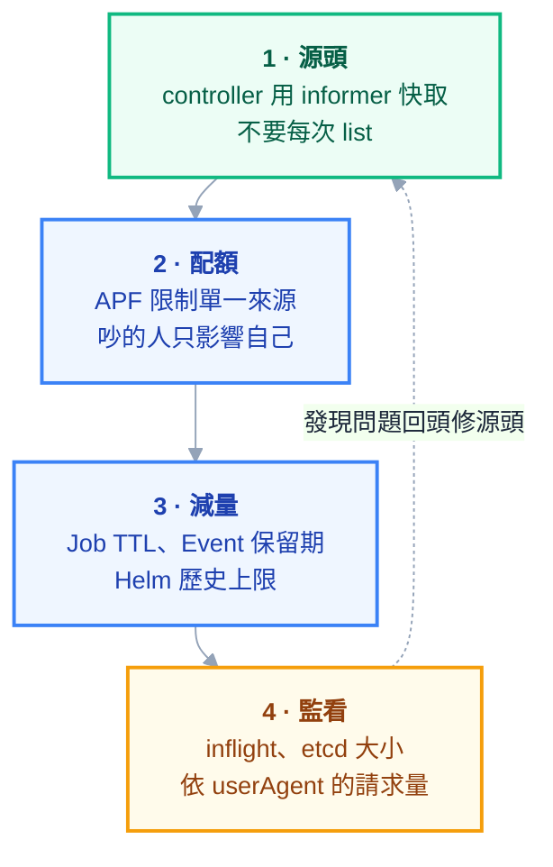

# 附錄 AS：叢集長大之後——規模瓶頸與 API Server 保護

正文第 2 章講了控制平面各元件怎麼運作，附錄 K 講了節點層的成本與碎片化。但有一個問題兩份都沒回答，而它會在你當管理員的第二年找上門：

> **這座叢集長大之後，會先撞到什麼牆？**

多數人以為答案是「節點不夠」或「Pod 排不下」。**幾乎不是。** 那兩個問題有明確的錯誤訊息、有現成的解法（加機器）。真正會讓你半夜起來的是另一類：**控制平面被拖垮**——症狀是 `kubectl` 變慢、部署卡住、controller 反應遲鈍，而節點的 CPU 看起來都很閒。

這一份講清楚那些牆在哪、怎麼提早看到、以及怎麼保護控制平面。

---

## Part 1：文件上的上限，與你實際會先撞到的

Kubernetes 官方文件列出的規模門檻大致是這樣（**這些數字會隨版本演進，以你所用版本的文件為準**）：

| 維度 | 文件上限 |
| --- | --- |
| 單節點 Pod 數 | 110 |
| 節點數 | 5,000 |
| 總 Pod 數 | 150,000 |
| 總容器數 | 300,000 |

**但你幾乎不會先撞到這些。** 這些數字是在「其他條件都調校過」的前提下測出來的，而真實叢集通常在遠低於這些規模時就先撞到別的東西：

| 你實際會先撞到的 | 為什麼 |
| --- | --- |
| **etcd 容量** | 物件太多、太大、或 Event 太多 |
| **API Server 記憶體** | 有人在做大量 `list` |
| **watch 連線數** | 每個 controller、每個節點都在 watch |
| **單一 namespace 物件數** | `kubectl get` 變得很慢 |
| **Secret／ConfigMap 的放大** | 掛到很多 Pod 就被讀很多次 |
| **Event 洪水** | 某個東西在瘋狂重啟，Event 淹掉 etcd |

> **這一節最重要的觀念：規模問題通常不是「總量」問題，是「某個東西行為不當」的問題。** 一個寫得差的 controller 可以在 50 個節點的叢集上把 API Server 打垮，而一個健康的叢集跑 500 個節點也很安穩。
>
> 所以「我們的叢集不大，不用擔心」是錯的推論。

---

## Part 2：etcd——最硬的那道牆

etcd 存放叢集的**全部**狀態，而它有幾個很具體的限制：

| 限制 | 典型值 | 撞到會怎樣 |
| --- | --- | --- |
| 資料庫大小配額 | 預設 2GB，建議不超過 8GB | **etcd 進入唯讀**，整個叢集無法寫入 |
| 單一物件大小 | 約 1MB 上限 | 該物件存不進去 |
| 歷史版本累積 | 需定期壓縮與整理 | 空間被舊版本吃光 |

**「etcd 滿了」的後果比想像中嚴重：整個叢集變成唯讀。** 不能建 Pod、不能改 Deployment、不能刪東西——**連刪東西都不行，因為刪除也是一次寫入**。這是少數會讓你完全動彈不得的故障。

### 誰在吃 etcd 空間

```powershell
# etcd 目前用了多少
kubectl -n kube-system exec etcd-<node> -- etcdctl endpoint status --write-out=table

# 物件數量分布——通常會有意外
kubectl get events -A --no-headers | Measure-Object | Select-Object Count
kubectl get secrets -A --no-headers | Measure-Object | Select-Object Count
kubectl get configmap -A --no-headers | Measure-Object | Select-Object Count
```

三個常見的意外來源：

**第一，Event。** 一個 CrashLoopBackOff 的 Pod 每分鐘產生數則 Event，一百個這樣的 Pod 就是持續的寫入洪水。Event 有保留期會自動清，但**在保留期內它們佔著空間**，而且每一次寫入都在消耗 etcd 的寫入能力。

**第二，Helm 的 release 歷史。** 每次升級都存一份，預設會保留很多版（[[10-helm]]）。上百個 release × 每個十幾版，都在 Secret 裡。

**第三，被遺忘的物件。** 舊的 ConfigMap、已完成的 Job（沒設 `ttlSecondsAfterFinished`）、孤兒 PVC。

> **`ttlSecondsAfterFinished` 值得單獨強調**：Job 完成後預設**不會**自己消失。CronJob 跑久了會累積成千上萬個 Job 與對應的 Pod 物件，而每一個都在 etcd 裡（[[19-yaml-fields-workloads]]）。這是最常見的「叢集莫名變慢」原因之一。

---

## Part 3：API Server——被一行指令打垮

這是最容易被低估的風險。

### 一次 `list` 可以吃掉幾 GB 記憶體

當有人執行 `kubectl get pods -A`（或某個 controller 做等效的事），API Server 要：**從 etcd 或 watch cache 取出所有 Pod → 反序列化成物件 → 序列化成回應 → 傳出去**。

**這整份資料會同時存在於記憶體裡。** 幾萬個 Pod 就是好幾 GB，而如果同時有好幾個這種請求——API Server OOM，控制平面短暫消失。

而它復原之後會發生什麼？**所有 controller 重新連線、重新 list、再打一次。** 這就是 API Server 過載最惡劣的性質：**它的復原過程會重現造成它掛掉的負載。**

### 誰在做這件事

| 來源 | 典型行為 |
| --- | --- |
| **寫得差的 controller** | 每次 reconcile 都 `list` 全部資源，而不是用 informer 的快取 |
| **監控與盤點腳本** | 每分鐘掃一次全叢集 |
| **CI 流程** | 每次部署都 `get -A` |
| **人** | 除錯時反覆 `kubectl get pods -A` |

**第一項是最大宗，也最難發現**，因為它安靜地跑在叢集裡。[[09-extending-kubernetes]] 講的 informer 機制正是為了解決這件事：**controller 應該 watch 一次、在本地維護快取，而不是每次都去問。**

### 怎麼查出來

```powershell
# 依來源分類的請求量（找出誰最吵）
# rate(apiserver_request_total[5m]) by (userAgent, verb, resource)

# 長時間的 list 請求
# apiserver_request_duration_seconds_bucket{verb="LIST"}

# 目前的 inflight 請求數（接近上限就是警訊）
# apiserver_current_inflight_requests
```

> **`userAgent` 這個 label 是找兇手最快的路徑。** 它會直接告訴你是哪個元件在打，而不用去猜。這是每個叢集管理員都該有的一張儀表板（[[14-prometheus-grafana]]）。

---

## Part 4：保護控制平面的四道防線



### 第一道：源頭

**最有效但也最慢**——因為它需要改別人的程式。自己寫的 controller 一定要用 informer（[[40-operators-and-stateful]] 的 reconcile 原則）。第三方的則在採用前就該問「它會怎麼存取 API」。

### 第二道：APF（API Priority and Fairness）

這是**你唯一能單方面部署的防線**，不需要別人配合。它把請求分成多個優先級與流量池，**讓吵鬧的來源只影響自己那一池**：

```yaml
apiVersion: flowcontrol.apiserver.k8s.io/v1
kind: FlowSchema
metadata:
  name: limit-batch-scanner
spec:
  priorityLevelConfiguration:
    name: low-priority-pool # 指向一個容量較小的池
  matchingPrecedence: 500
  rules:
    - subjects:
        - kind: ServiceAccount
          serviceAccount:
            name: inventory-scanner
            namespace: tooling
      resourceRules:
        - verbs: ["list", "get"]
          apiGroups: ["*"]
          resources: ["*"]
          clusterScope: true
          namespaces: ["*"]
```

完整欄位在 [[23-yaml-fields-rare-builtins]]。**共用叢集一定要設這個**——它是「一個團隊打爆 API Server 大家一起慢」（[[37-platform-engineering]] Part 4）的直接解方。

### 第三道：減量

這些是低成本高回報的設定，**今天就可以做**：

| 設定 | 效果 |
| --- | --- |
| Job 的 `ttlSecondsAfterFinished` | 完成的 Job 自動消失 |
| CronJob 的 `successfulJobsHistoryLimit` / `failedJobsHistoryLimit` | 限制保留數量 |
| Helm 的 release 歷史上限 | 少存很多 Secret |
| Event 保留期 | 縮短保留時間 |
| 清掉沒用的 namespace 與孤兒物件 | 直接減量 |

### 第四道：監看

三個一定要有的告警（呼應 [[64-slo-and-alerting]] 的「迫近耗盡要叫人」）：

- **etcd 資料庫大小接近配額** —— 這是會讓叢集唯讀的那個
- **API Server inflight 請求接近上限**
- **etcd 寫入延遲上升** —— 通常是所有問題最早的訊號

> **etcd 的寫入延遲是控制平面健康的領先指標。** 它變差時，你還有時間；等到 `kubectl` 變慢，通常已經在事故裡了。

---

## Part 5：其他會咬人的規模效應

### Secret 與 ConfigMap 的放大

一個 Secret 掛到 500 個 Pod，就是 500 個 kubelet 在 watch 它。改一次，**500 個節點同時來讀**。

這通常沒事，但當它跟「大 Secret」或「頻繁更新」結合時就會有事。實務原則：**掛到很多 Pod 的東西要小、要少變**。

### 單一 namespace 物件過多

`kubectl get pods -n huge-ns` 變得很慢時，問題不在網路，在於 API Server 要處理那一大包。**沒有硬性上限，但過幾千個就會有感。**

這也是 namespace 劃分的一個實務理由——不只是為了權限隔離，也是為了讓日常操作維持可用（[[37-platform-engineering]]）。

### 節點數與 DaemonSet 的乘法

每個 DaemonSet × 每個節點 = 一個 Pod、一份 watch、一份資源預留。**十個 DaemonSet 在 200 個節點上就是 2000 個 Pod**——這些在你算容量時常常被忘記，卻是實實在在的物件與連線。

### CRD 與自訂資源

CRD 的實例跟內建資源一樣存在 etcd，**一樣佔空間、一樣被 watch**。一個產生大量 CR 的 operator，效果等同於大量內建物件。

---

## Part 6：什麼時候該拆叢集

當單一叢集的規模開始造成問題，選項有兩個：**調校**，或**拆開**。

| 訊號 | 傾向 |
| --- | --- |
| 少數幾個來源造成負載 | **調校**——APF + 修那幾個來源 |
| etcd 持續逼近配額，減量後仍成長 | 考慮拆 |
| 控制平面事故影響到不相干的團隊 | **拆**——爆炸半徑太大 |
| 需要不同的升級節奏 | 拆 |
| 只是「聽說大叢集不好」 | **不要拆**——多叢集的維運成本是實打實的 |

**拆叢集不是免費的**：多一套控制平面要升級、要備份、要監控，跨叢集的服務發現與流量管理也是新問題（[[34-multicluster-and-dr]]）。

> **判準：拆叢集是為了縮小爆炸半徑，不是為了效能。** 如果你的動機是效能，先做完調校那三道防線——多數情況它就夠了。

---

## 檢查清單

### 立刻可做

- [ ] 所有 Job／CronJob 設了 `ttlSecondsAfterFinished` 與歷史數量上限
- [ ] Helm release 歷史有上限
- [ ] 查過 Event、Secret、ConfigMap 的總數，找過意外來源
- [ ] 有一張**依 `userAgent` 分類的 API 請求量**儀表板

### 保護控制平面

- [ ] 共用叢集已設 **APF**，會吵的來源限在自己的池
- [ ] 自己寫的 controller 用 informer，不是每次 `list`
- [ ] 第三方 controller 採用前問過它怎麼存取 API
- [ ] 大 Secret／ConfigMap 沒有掛到大量 Pod

### 告警

- [ ] **etcd 資料庫大小接近配額**（會讓叢集唯讀）
- [ ] **etcd 寫入延遲上升**（最早的領先指標）
- [ ] API Server inflight 接近上限
- [ ] 控制平面節點資源用量

### 決策

- [ ] 拆叢集的動機是**縮小爆炸半徑**，不是效能
- [ ] 拆之前已做完三道調校防線

---

## 常見誤區

| # | 誤區 | 真相 |
| --- | --- | --- |
| 1 | 我們叢集不大，不用擔心規模 | **一個行為不當的 controller 就能打垮 50 節點的叢集** |
| 2 | 規模上限是 Pod 數 | 你會先撞到 etcd 容量與 API Server 記憶體 |
| 3 | etcd 滿了頂多不能建新東西 | **整個叢集唯讀——連刪東西都不行** |
| 4 | Job 跑完就不見了 | 不會，要設 `ttlSecondsAfterFinished` |
| 5 | Event 會自動清所以無所謂 | 保留期內佔空間，且持續消耗寫入能力 |
| 6 | API Server 掛了重啟就好 | **復原時所有 controller 同時重新 list，會重現當初的負載** |
| 7 | `kubectl get -A` 只是個查詢 | 幾萬個物件時它會讓 API Server 吃掉數 GB |
| 8 | APF 是進階功能，不急 | **共用叢集的必備品**，是你唯一能單方面部署的防線 |
| 9 | 大叢集不好所以要拆 | 拆是為了爆炸半徑；多叢集成本是實打實的 |
| 10 | 等 `kubectl` 變慢再處理 | 那時通常已在事故裡；看 **etcd 寫入延遲** |

## 連結

- [[70-node-lifecycle-and-ha]] — 附錄 AV：控制平面的另一半——高可用拓撲與 quorum
- [[68-registry-operations]] — 附錄 AT：節點數成長後，拉取行為與速率限制的放大
- [[02-cluster-internals]] — 正文：控制平面各元件與 `kubectl apply` 的旅程
- [[12-cluster-operations]] — 正文：etcd 備份還原、壓縮與整理
- [[23-yaml-fields-rare-builtins]] — 附錄 C-6：APF（FlowSchema／PriorityLevelConfiguration）全欄位
- [[09-extending-kubernetes]] — 正文：informer 機制，controller 該怎麼讀 API
- [[40-operators-and-stateful]] — 附錄 R：reconcile 六原則
- [[19-yaml-fields-workloads]] — 附錄 C-2：Job／CronJob 的 TTL 與歷史上限欄位
- [[37-platform-engineering]] — 附錄 O：共用叢集的隱形共用資源
- [[64-slo-and-alerting]] — 附錄 AP：「迫近耗盡」型告警該怎麼設
- [[34-multicluster-and-dr]] — 附錄 L：真的要拆叢集時的拓撲選擇
- [[33-cost-optimization]] — 附錄 K：孤兒資源盤點
- [[k8s-mastery]] — 教材總目錄
