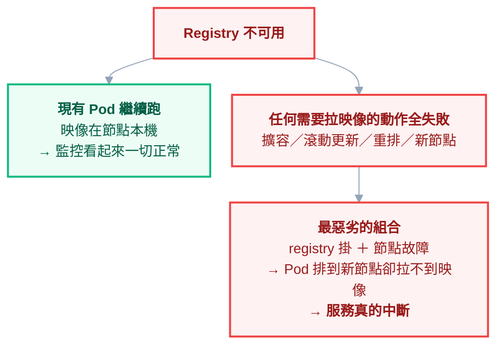

# 附錄 AT：映像 Registry 的營運

教材寫過 `imagePullPolicy` 與 `imagePullSecrets` 的欄位（[[18-yaml-fields-pod]]）、`ImagePullBackOff` 怎麼修（[[13-troubleshooting]]）、映像簽章與 SBOM（[[38-security-incident-response]]）。

但那些都是從**Pod 這一端**看的。這一份從另一端看：**registry 本身是一個你要維運的系統**——而且它有一個很少被意識到的性質：

> **它是叢集少數「掛了就起不了新 Pod」的外部單點依賴。**

多數團隊把 registry 當成一個「東西放在那裡」的儲存空間，直到某天它不可用，而剛好有一台節點故障。

---

## Part 1：registry 掛了會怎樣

先講後果，因為它決定了你該投入多少心力。

| 情境 | 有沒有事 |
| --- | --- |
| 已經在跑的 Pod | ✅ **沒事**——映像已在節點本機 |
| 同一節點重啟已有映像的 Pod | ✅ 通常沒事（視 `imagePullPolicy`） |
| 擴容（HPA 加副本） | ❌ 新 Pod 若排到沒有該映像的節點就卡住 |
| 滾動更新 | ❌ **新版本拉不下來，更新卡在中途** |
| 節點故障，Pod 重排到新節點 | ❌ **拉不到映像，服務起不來** |
| 新節點加入（Cluster Autoscaler） | ❌ 什麼都跑不起來 |



> **這張圖的重點在左邊那支：registry 掛掉時，你的監控大概率是綠的。** 現有 Pod 都好好的，SLO 沒有變化，直到某個觸發拉取的事件發生——而那個事件常常正是「節點故障」，也就是你最需要系統自我修復的時刻。
>
> **結論：registry 的可用性要求，等同於你最重要服務的可用性要求。** 多數人沒有這樣看待它。

實務上的緩解：**內部有一份鏡像／快取**（Part 3），讓外部 registry 不可用時仍能拉到映像。

---

## Part 2：tag 策略——`latest` 為什麼是災難

### 三種指定方式

| 方式 | 例子 | 可重現性 |
| --- | --- | --- |
| **可變 tag** | `app:latest`、`app:dev` | ❌ 同一個字串，不同時間指向不同內容 |
| **不可變 tag** | `app:1.4.2` | ⚠️ 靠紀律——技術上仍可被覆寫 |
| **digest** | `app@sha256:9f2a...` | ✅ **內容定址，永遠是同一份** |

### `imagePullPolicy` 的隱含規則

這是最多人搞混的一點：

| `imagePullPolicy` | 行為 |
| --- | --- |
| `Always` | 每次都向 registry 確認 |
| `IfNotPresent` | 節點上有就用，不問 |
| `Never` | 只用本機，沒有就失敗 |

**沒有明寫時，K8s 依 tag 決定預設值**：tag 是 `latest`（或沒寫 tag）→ 預設 `Always`；其他 tag → 預設 `IfNotPresent`。

這造成一個很陰的現象：**你用 `app:1.4.2`，然後偷偷覆寫了那個 tag，但節點上已經有舊的，於是它不會去拉新的**。同一個 tag，不同節點跑著不同的內容，而 `kubectl describe` 看起來完全一樣。

> **這是最難查的一類 bug：「同樣的版本，A 節點行為正常，B 節點不正常」。** 而且你檢查所有 YAML 都會發現它們一模一樣。

### 為什麼 GitOps 下 `latest` 特別壞

ArgoCD 比對的是**期望狀態與實際狀態**（[[11-argocd]]）。如果期望狀態寫著 `app:latest`，那它永遠是「同步的」——即使 registry 上的 `latest` 已經換了三次內容。

**`latest` 讓 git 不再是真相來源**，因為那行字沒有描述任何確定的東西。這跟 GitOps 的前提直接衝突。

### 建議

**tag 用版本號且視為不可變（能開 registry 的不可變設定就開），生產環境用 digest 釘死。**

digest 的可讀性很差，所以要讓工具去維護它——CI 建置完把 digest 寫回 manifest repo，人只看 git 的 diff：

```yaml
# CI 產出的 manifest（人不手寫這一行）
image: registry.internal/app@sha256:9f2a4c1e...
```

這樣同時得到三件事：**可重現**（digest 唯一）、**可稽核**（git 有紀錄）、**可回滾**（改回上一個 commit）。

---

## Part 3：拉取限制與 pull-through 快取

### 一種很難診斷的 `ImagePullBackOff`

公有 registry 通常有**拉取速率限制**。當你的叢集有幾十個節點、每次部署都從外面拉，很容易撞到。

症狀特別容易誤導：**映像明明存在、名字明明正確、權限明明對**，但就是拉不下來。要看到真正的原因得往下挖：

```powershell
kubectl describe pod <pod> | Select-String -Pattern "Failed|Warning" -Context 0,3
# 關鍵字通常是 toomanyrequests 或 rate limit
```

**而且它是間歇性的**——重試幾次可能就過了，於是很容易被誤判成「網路不穩」，然後這個問題會一直存在。

### pull-through cache

在叢集內（或近處）架一個快取型 registry，所有拉取先問它，沒有才往外拉。一次投入解決四件事：

| 問題 | 怎麼被解決 |
| --- | --- |
| 速率限制 | 同一個映像只從外部拉一次 |
| 拉取速度 | 就近，不必走外網 |
| 外部不可用 | 已快取的映像仍拉得到 |
| 離線／內網環境 | 本來就是唯一解 |

**這是投入報酬率很高的一項**，尤其在節點數會成長的叢集。

---

## Part 4：保留政策——兩端的磁碟都會爆

### registry 端

每次 CI 建置產生一個 tag。一天二十次建置、一年就是幾千個，而每個都佔空間（共用的 layer 會去重，但仍然可觀）。

保留規則要同時考慮三件事，缺一就會出事：

- 保留**最近 N 個**版本
- 保留**目前在跑的**（生產、預備環境正在用的）
- 保留**有明確標記的**（release、LTS）

> **最大的陷阱：刪掉了正在用的映像。** 當下不會有任何症狀——因為 Pod 已經在跑、映像在節點本機。**直到那個節點重啟或 Pod 被重新排程，才會發現映像不存在了**，而這時候你也回不去。
>
> 所以清理政策一定要**先掃描叢集實際在用的映像**，而不是只看時間。

```powershell
# 叢集裡實際在用的所有映像（清理前必跑）
kubectl get pods -A -o jsonpath='{range .items[*]}{range .spec.containers[*]}{.image}{"\n"}{end}{end}' |
  Sort-Object -Unique
```

**別忘了 `initContainers` 與 `ephemeralContainers` 的映像**，還有沒在跑但保留著的 Deployment 歷史版本（回滾會用到）。

### 節點端

kubelet 有自己的映像垃圾回收，依磁碟使用率門檻觸發（[[23-yaml-fields-rare-builtins]] 有欄位）。要注意兩件事：

**第一，門檻設太高會來不及**——磁碟滿了會讓節點進入 `DiskPressure`，開始驅逐 Pod（[[29-status-and-conditions]]）。

**第二，映像太大會放大這個問題**。這也是「把映像做小」除了拉取速度之外的第二個理由（[[00-docker-foundations]] 的 layer 機制）。

---

## Part 5：安全與存取

### pull secret 的管理痛點

`imagePullSecrets` 是 **namespace 範圍**的。新增一個 namespace 就要再放一份，而憑證輪替時要全部更新——很容易漏掉一兩個，然後那個 namespace 在幾週後某次重排時壞掉。

兩個緩解方式：

**綁到 ServiceAccount** —— 把 pull secret 掛在 `default` ServiceAccount 上，該 namespace 的 Pod 就不用各自宣告：

```yaml
apiVersion: v1
kind: ServiceAccount
metadata:
  name: default
  namespace: team-a
imagePullSecrets:
  - name: registry-cred
```

**用 External Secrets 之類的機制同步**（[[22-yaml-fields-ecosystem]]），讓憑證有單一來源，輪替時一次更新。

### 其他要顧的

| 項目 | 說明 |
| --- | --- |
| **registry 不可匿名寫入** | 讀可以放寬，寫一定要認證 |
| **簽章驗證** | 用 admission policy 擋掉未簽章的映像（[[38-security-incident-response]]） |
| **掃描結果當 gate** | 高風險漏洞擋在部署前，而不是事後報表 |
| **來源限制** | admission policy 只允許特定 registry 前綴，防止有人拉外部映像進生產 |

**最後一項最容易被忽略但成本最低**：一條政策就能確保生產環境的映像都來自你自己的 registry。

---

## Part 6：多架構映像

### 什麼時候會遇到

兩個場景越來越常見：**開發機是 arm（Apple Silicon）而伺服器是 x86**，以及**雲端的 arm 節點比較便宜**。

錯誤訊息很有辨識度但不會解釋原因：

```text
exec format error
```

意思是**映像的架構跟節點的架構對不上**。它不會說「你在 arm 上跑 amd64 映像」。

### manifest list

解法是建置**多架構映像**：同一個 tag 底下有多個架構的映像，由一份 manifest list 索引，節點拉取時自動取得對應版本。

```powershell
# 檢查一個 tag 支援哪些架構
docker manifest inspect registry.internal/app:1.4.2
```

**成本要算進去**：多架構建置時間大致翻倍（或需要對應架構的建置機器），儲存空間也是。**如果你的節點全是同一種架構，就不需要做這件事**——先確認需求再投入。

而如果叢集裡**混用架構**，記得用 `nodeSelector` 或親和性把只有單一架構的工作負載固定住（[[07-scheduling-and-resources]]）：

```yaml
nodeSelector:
  kubernetes.io/arch: amd64
```

---

## 檢查清單

### 可用性

- [ ] 想過「registry 掛掉 + 節點故障」的組合情境
- [ ] 有 **pull-through 快取或內部鏡像**
- [ ] registry 的監控與告警等同重要服務
- [ ] 知道 registry 掛掉時**監控會是綠的**

### tag 與版本

- [ ] 生產**不用 `latest`**
- [ ] tag 視為不可變（registry 端能鎖就鎖）
- [ ] 生產用 **digest 釘死**，由 CI 自動寫回 manifest
- [ ] 理解 `imagePullPolicy` 依 tag 決定預設值的隱含規則

### 保留

- [ ] registry 有保留政策
- [ ] **清理前先掃描叢集實際在用的映像**（含 init／ephemeral 容器與回滾歷史）
- [ ] kubelet 映像 GC 門檻檢查過，不會來不及
- [ ] 映像有在控制大小

### 安全

- [ ] pull secret 綁 ServiceAccount，或有單一來源同步
- [ ] registry 不可匿名寫入
- [ ] admission policy **限制映像來源前綴**
- [ ] 簽章驗證與掃描 gate

### 架構

- [ ] 知道節點是什麼架構
- [ ] 混用架構時有 `nodeSelector` 固定
- [ ] 只有單一架構時**不做**多架構建置

---

## 常見誤區

| # | 誤區 | 真相 |
| --- | --- | --- |
| 1 | registry 只是個儲存空間 | 它是**掛了就起不了新 Pod** 的單點依賴 |
| 2 | registry 掛了監控會告訴我 | **現有 Pod 都好好的，監控是綠的** |
| 3 | 用版本號 tag 就安全了 | tag 可被覆寫，而 `IfNotPresent` 會讓節點繼續用舊的 |
| 4 | `latest` 只是不夠嚴謹 | **它讓 git 不再是真相來源**，與 GitOps 前提衝突 |
| 5 | `ImagePullBackOff` 就是名字或權限錯 | 也可能是**速率限制**，且是間歇性的 |
| 6 | 清理舊映像只看時間就好 | 會刪到正在用的；**當下無症狀，重排時才爆** |
| 7 | 節點磁碟 kubelet 會自己顧 | 門檻設太高會來不及，先進 `DiskPressure` |
| 8 | pull secret 設一次就好 | 它是 namespace 範圍的，新 namespace 會漏 |
| 9 | 映像來源不用管 | 一條 admission policy 就能擋掉外部映像進生產 |
| 10 | 多架構映像有益無害 | 建置成本翻倍；**單一架構就不要做** |

## 連結

- [[00-docker-foundations]] — 正文：image layer、映像大小與建置機制
- [[18-yaml-fields-pod]] — 附錄 C-1：`imagePullPolicy`、`imagePullSecrets` 欄位
- [[13-troubleshooting]] — 正文：`ImagePullBackOff` 的排查流程
- [[11-argocd]] — 正文：期望狀態與 `latest` 的衝突
- [[38-security-incident-response]] — 附錄 P：供應鏈、簽章、SBOM、掃描
- [[63-ci-in-cluster]] — 附錄 AO：建置端的快取與 pull-through
- [[23-yaml-fields-rare-builtins]] — 附錄 C-6：kubelet 映像 GC 欄位
- [[29-status-and-conditions]] — 附錄 G：`DiskPressure` 與驅逐
- [[07-scheduling-and-resources]] — 正文：`nodeSelector` 與架構固定
- [[67-scaling-limits]] — 附錄 AS：節點數成長後拉取行為的放大
- [[k8s-mastery]] — 教材總目錄
