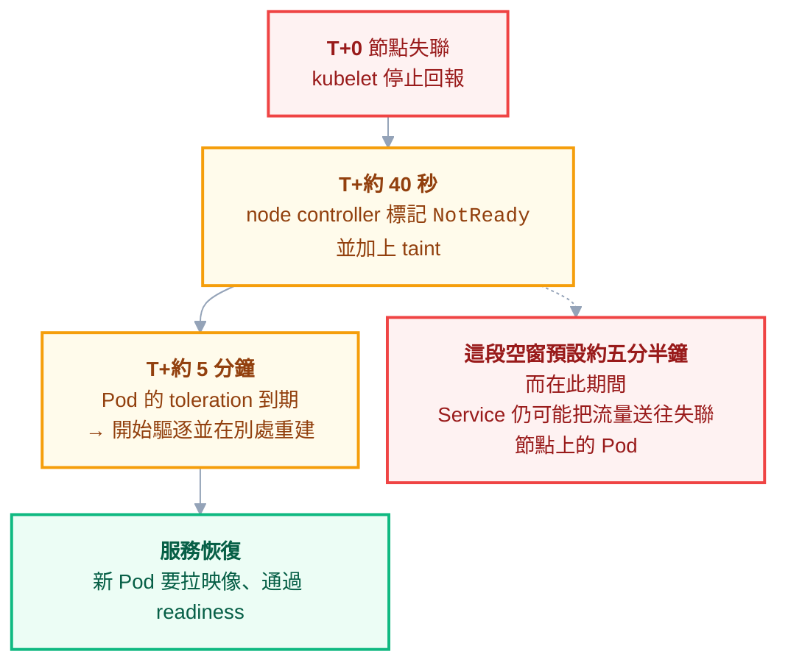

# 附錄 AV：節點生命週期與控制平面高可用

正文第 12 章講了節點**維護**（cordon、drain 的分寸）與 allocatable 的三塊保留，附錄 K 講了節點的成本與碎片化。

但有三件事一直沒講，而它們都會在你當管理員時直接找上你：

1. 節點**壞掉**（不是計畫性維護）時，K8s 自己會做什麼、你該做什麼
2. **控制平面掛一台會怎樣**——以及為什麼「兩台」比「一台」更糟
3. 一個心態問題：**你會不會 SSH 上去把它修好**

第三題聽起來最軟，但它決定了前兩題的答案能不能落實。

---

## Part 1：節點是牲畜，不是寵物

### 「修好它」與「換掉它」

節點的磁碟滿了、某個系統套件版本不對、kubelet 設定要調——直覺是 SSH 上去改。**而這是 K8s 環境裡最容易累積技術債的一個習慣。**

三個理由：

| 問題 | 為什麼致命 |
| --- | --- |
| **不可重現** | 這台節點跟其他節點不一樣了，而沒有任何地方記錄這件事 |
| **新節點沒有** | 擴容或自動擴縮產生的新節點，不會有你手動做的修改 |
| **沒有紀錄** | 三個月後沒人記得為什麼這台跟別台不同（[[61-compliance-and-audit]] 的變更管理漏洞） |

**第二點是最實際的傷害**：你手動修好了一台，問題「解決」了，然後叢集半夜自動擴容一台新的，症狀回來了——而你已經不記得上次是怎麼修的。

### 正確的做法

節點應該由一份**設定來源**產生（映像、佈建腳本、IaC）。要改節點就改那個來源，然後**換掉節點**——而不是原地修改。

> **一個判準：如果這台節點現在消失，我能不能在十分鐘內得到一台設定完全一樣的？**
>
> 答不出「能」的話，你的節點就是寵物，而寵物會生病、會死，而且死的時候沒有備份。

**例外是診斷**：出問題時 SSH 上去看日誌、看行程、看磁碟是完全合理的。**看可以，改不行**——真的需要改，就改來源再換掉節點。緊急情況下的臨時修改也要當成 break-glass 處理：留紀錄、事後補回來源。

---

## Part 2：節點壞掉時會發生什麼

### 一條你必須知道的時間線

節點失聯之後，Pod **不會立刻**被搬走。整條時間線大致是：



（實際數值取決於 `node-monitor-grace-period` 與 Pod 的 `tolerationSeconds`，各版本與各託管平台的預設值不同——**要查自己環境的實際值**。）

> **這條時間線最重要的推論：單一副本的服務，在節點故障時會中斷數分鐘，而這是設計上的正常行為，不是 bug。**
>
> 想要更快，方向不是去調短那些參數（調太短會讓網路抖動觸發大規模誤驅逐），而是**多副本 + 跨節點分散**（[[07-scheduling-and-resources]] 的反親和性）。

### `NotReady` 的常見原因

| 原因 | 怎麼看出來 |
| --- | --- |
| kubelet 掛了或卡住 | 節點上的服務狀態、kubelet 日誌 |
| 網路不通 | 節點還活著但 API Server 連不上 |
| **磁碟滿** | `DiskPressure` condition（[[29-status-and-conditions]]） |
| 記憶體壓力 | `MemoryPressure`，通常伴隨大量驅逐 |
| PID 耗盡 | `PIDPressure`，常見於失控地開行程的應用 |
| 底層機器故障 | 雲端主控台或硬體監控 |

**磁碟滿是最常見的一個**，而它的來源通常是映像堆積或日誌沒輪替（[[68-registry-operations]]、[[55-logging-strategy]]）。

### 自動修復與它的風險

雲端託管的節點池多半有自動修復：偵測到節點持續不健康就把它換掉。這是好功能，但有一個必須知道的風險：

> **如果讓所有節點同時變成「不健康」的原因是叢集層面的（例如某個 DaemonSet 壞了、或網路元件出問題），自動修復會開始輪流重建所有節點——而每一台重建後仍然不健康。**
>
> 結果是叢集陷入重建迴圈，而且比原本的問題嚴重得多。

所以自動修復一定要**有速率限制**（同時只能修一台、單位時間內最多幾台），並且**在它動作時發出通知**——你需要知道「今天換掉了三台節點」，因為那通常代表有更深的問題。

---

## Part 3：控制平面高可用

### etcd 的 quorum：為什麼一定要奇數

etcd 要求**過半數**節點存活才能寫入。這條規則有一個非常反直覺的後果：

| etcd 節點數 | 過半數需要 | **可容忍故障數** | 評價 |
| --- | --- | --- | --- |
| 1 | 1 | **0** | 沒有 HA，但簡單 |
| **2** | **2** | **0** | ❌ **比 1 台更糟** |
| 3 | 2 | **1** | ✅ 常見的正解 |
| 4 | 3 | **1** | ❌ 跟 3 台一樣，多花一台 |
| 5 | 3 | **2** | ✅ 更高韌性，但寫入更慢 |

> **「兩台比一台更糟」是這張表最重要的一列。**
>
> 兩台的過半數是 2，所以**任何一台掛掉就失去 quorum**——可容忍故障數跟單台一樣是 0，但你有兩倍的機器可能故障。也就是說：**你付了雙倍的成本，換到更高的故障機率。**
>
> 同理，4 台的容錯能力跟 3 台完全一樣。偶數永遠是浪費。

### 失去 quorum 會怎樣

**整個叢集停止寫入**——不能建 Pod、不能更新、不能刪除。已經在跑的東西繼續跑（kubelet 不需要 API Server 就能維持現有 Pod），但叢集失去所有自我修復能力：**Pod 掛了不會重建、節點掛了不會重排**。

而且失去 quorum 之後的還原程序遠比想像中麻煩，這也是 [[12-cluster-operations]] 的 etcd 備份為什麼是 P0 的原因。

### 跨區部署的取捨

把三台 etcd 放在三個可用區，可以容忍整個區掛掉。代價是 **etcd 的每次寫入都要跨區確認**，而跨區延遲直接變成叢集所有寫入操作的延遲。

實務上：**跨區通常值得**（區級故障是真實會發生的），但要知道你在買什麼、付什麼。而如果區與區之間的延遲很高，這個選擇要重新評估。

### 其他控制平面元件

| 元件 | HA 模式 | 意義 |
| --- | --- | --- |
| **API Server** | 無狀態，多台 + 負載平衡 | 每一台都能服務請求，真正的水平擴展 |
| **controller-manager** | Leader election | 多台只有一台在工作，其餘是熱備 |
| **scheduler** | Leader election | 同上 |
| **etcd** | Quorum | **唯一有「過半數」限制的** |

**理解這個差異很重要**：加 API Server 是加吞吐量，加 controller-manager 只是加容錯——**而加 etcd 到偶數則什麼都沒加**。

### 託管控制平面的取捨

用雲端託管的 K8s，控制平面的 HA 由供應商負責——這通常是**正確的選擇**，它把上面整段變成別人的問題。代價是你對控制平面參數的控制較少（某些 flag 不能改、審計日誌的取得方式受限）。

**如果你不打算專職維運控制平面，就用託管的。** 自建控制平面的價值只在有明確的合規或客製需求時才成立。

---

## Part 4：沙箱執行時——什麼時候需要

一般容器**共用節點的 kernel**。這是容器輕量的原因，也是它的安全邊界比虛擬機弱的原因：一次容器逃逸的影響範圍是**整台節點**（[[37-platform-engineering]] 的隔離維度表）。

沙箱執行時（gVisor、Kata 這類）用不同方式在容器與 kernel 之間加一層，換取更強的隔離。

### 什麼時候真的需要

| 情境 | 需要嗎 |
| --- | --- |
| 跑**不受信任的程式碼**（客戶提交、第三方外掛） | ✅ **這是主要用例** |
| CI 執行來自 fork 的 PR（[[63-ci-in-cluster]]） | ✅ 值得考慮 |
| 法規要求超出容器的隔離強度 | ✅ |
| 多團隊共用叢集，但都是內部團隊 | ❌ **專用節點池就夠了** |
| 只是「感覺比較安全」 | ❌ |

**成本是實打實的**：效能有損失（系統呼叫要多走一層）、某些工作負載相容性不佳、多一套要維運與升級的元件。

> **順序建議：先用專用節點池 + taint 把不信任的工作負載隔到獨立機器上，不夠再考慮沙箱。** 節點池隔離的成本低得多，而且解決了大部分實際場景。

---

## Part 5：節點汰換

### 為什麼要定期汰換，即使它沒壞

三個理由：**套用安全更新**、**避免長壽節點慢慢漂移**（磁碟碎片、殘留狀態、被手動改過的東西）、以及**確認你的汰換流程真的能用**。

第三點最容易被忽略：**一個從來沒被演練過的汰換流程，在你緊急需要它時（重大漏洞、硬體故障）不會順利。**

### 汰換 SOP

```powershell
# 1. 先加新節點，確認 Ready（永遠是先加再減）
kubectl get nodes

# 2. cordon 舊節點——不再排新 Pod 進來，但現有的不動
kubectl cordon old-node-1

# 3. drain——把 Pod 趕走，PDB 會擋住不安全的驅逐
kubectl drain old-node-1 --ignore-daemonsets --delete-emptydir-data

# 4. 確認服務正常，再移除節點
kubectl delete node old-node-1
```

四個要點：

**先加再減。** 先有新容量再趕走舊的，否則 drain 的 Pod 無處可去，直接變成事故。

**PDB 是安全網，被擋住不是問題是保護。** `drain` 卡住時的正確反應是去看哪個 PDB 擋住了、為什麼——而不是加 `--force`（[[62-stateful-workloads-decision]]）。

**一次一台。** 尤其在有狀態工作負載的叢集裡。並行汰換多台是失去 quorum 的最快方式。

**有狀態的最後動。** 它們的重建成本最高、風險最大。

---

## 檢查清單

### 節點作為牲畜

- [ ] 節點由**設定來源**產生，不是手工配置
- [ ] **沒有人 SSH 上去改東西**（看可以）
- [ ] 能回答「這台消失，十分鐘內能不能得到一樣的」
- [ ] 緊急的手動修改有留紀錄並補回來源

### 故障處理

- [ ] 知道自己環境**節點失聯到 Pod 重排的實際時間**
- [ ] 關鍵服務**多副本 + 跨節點分散**（不是靠調短驅逐參數）
- [ ] `DiskPressure` 有告警；映像與日誌有清理機制
- [ ] 自動修復有**速率限制**且會通知

### 控制平面

- [ ] etcd 是**奇數台**（3 或 5，**絕不是 2 或 4**）
- [ ] 知道失去 quorum 時叢集會**停止寫入但現有 Pod 繼續跑**
- [ ] etcd 備份與還原**演練過**
- [ ] 評估過跨區的延遲代價
- [ ] 不打算專職維運控制平面的話，用託管的

### 隔離與汰換

- [ ] 不受信任的工作負載**至少**隔到專用節點池
- [ ] 沙箱執行時只用在真的需要的地方
- [ ] 汰換流程**演練過**，不是只寫在文件裡
- [ ] 汰換是先加再減、一次一台、有狀態的最後動

---

## 常見誤區

| # | 誤區 | 真相 |
| --- | --- | --- |
| 1 | SSH 上節點修好就行 | 新節點不會有你的修改，**症狀會回來且你不記得怎麼修的** |
| 2 | 節點掛了 Pod 馬上搬走 | 預設約**五分半鐘**空窗，這是正常行為 |
| 3 | 把驅逐參數調短就好 | 調太短會讓網路抖動觸發**大規模誤驅逐** |
| 4 | 兩台 etcd 比一台安全 | ❌ **可容忍故障數都是 0，但故障機率加倍** |
| 5 | 四台 etcd 比三台好 | 容錯完全相同，純粹浪費 |
| 6 | 失去 quorum 就是全掛 | 現有 Pod 繼續跑，但**失去所有自我修復能力** |
| 7 | 加 controller-manager 增加處理能力 | 那是 leader election，多台只是熱備 |
| 8 | 自動修復開著就安心 | 沒有速率限制時可能陷入**全叢集重建迴圈** |
| 9 | 沙箱執行時比較安全所以該用 | 多數內部工作負載**專用節點池就夠** |
| 10 | `drain` 被 PDB 擋住就加 `--force` | 被擋是**保護**，要去看為什麼 |

## 連結

- [[12-cluster-operations]] — 正文：cordon／drain 的分寸、etcd 備份還原、憑證與升級
- [[02-cluster-internals]] — 正文：控制平面各元件的職責
- [[07-scheduling-and-resources]] — 正文：反親和性、驅逐、QoS
- [[29-status-and-conditions]] — 附錄 G：`NotReady` 與各種 Pressure condition 的判讀
- [[37-platform-engineering]] — 附錄 O：隔離維度表，kernel 共用的意義
- [[62-stateful-workloads-decision]] — 附錄 AN：PDB 與有狀態工作負載的汰換風險
- [[63-ci-in-cluster]] — 附錄 AO：不受信任程式碼的隔離需求
- [[67-scaling-limits]] — 附錄 AS：etcd 容量與控制平面保護
- [[34-multicluster-and-dr]] — 附錄 L：控制平面全滅時的還原
- [[68-registry-operations]] — 附錄 AT：節點磁碟被映像塞滿
- [[k8s-mastery]] — 教材總目錄
