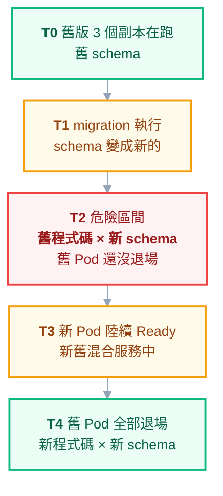

# 附錄 AW：資料庫 Schema 變更與部署的交界

正文第 11 章講了 ArgoCD 的 `PreSync` hook **機制**，附錄 Y 講了兩個 API 版本共用資料庫時要用 expand-contract。

但有一個更普遍的情況兩份都沒展開，而它才是多數人真正會遇到的：

> **你根本沒有多版本 API，只是做一次普通的滾動更新。**

而這就足夠了——因為：

> **滾動更新讓每一次部署都變成「新舊版本並存」，只是並存期很短。**

所以 expand-contract 不是「有多版本 API 時才需要的進階技巧」，**它是每一次 schema 變更都需要的基本功**。這一份講清楚那段並存期到底發生什麼、migration 該怎麼跑、以及最容易被忽略的一半：回滾。

---

## Part 1：滾動更新期間到底發生什麼



**T2 那段紅色區間是所有事故的來源。** 它的長度取決於滾動更新的速度（幾十秒到幾分鐘），而且**如果部署失敗卡住，它可能持續很久**。

### 四種會在 T2 炸掉的變更

| 變更 | 舊程式碼會怎樣 |
| --- | --- |
| **刪掉欄位** | `SELECT` 該欄位直接報錯——**整個功能掛掉** |
| **改欄位型別** | 讀出來型別不符，反序列化失敗 |
| **改欄位名** | 等同於「刪一個 + 加一個」，舊程式碼找不到 |
| **加 `NOT NULL` 且無預設值** | 舊程式碼的 `INSERT` 沒帶這個欄位 → **寫入全部失敗** |

**最後一項特別陰**：它不影響讀取，所以健康檢查是綠的、首頁正常，只有寫入路徑壞掉。你會在幾分鐘後從使用者回報得知，而不是從監控。

> **共同點：這四種都是「舊程式碼還在跑」造成的，而不是新程式碼有問題。** 所以在測試環境（只有一個版本）永遠測不出來——這是 [[48-testing-in-k8s]] 說的「測試環境測不到的東西」的具體案例。

---

## Part 2：Expand-Contract——展開成可執行的步驟

核心原則一句話：

> **任何時刻，資料庫 schema 必須同時相容「正在跑的所有版本」。**

做法是把一次變更拆成**跨三次部署**的三步。以最常見也最容易做錯的「欄位改名」為例（`user_name` → `username`）：

### 第一次部署：Expand

**只加不改**——加新欄位，可為 NULL，舊欄位原封不動。

```sql
ALTER TABLE users ADD COLUMN username VARCHAR(100) NULL;
```

程式碼：**寫入時兩個欄位都寫，讀取時仍讀舊的**。

此時舊版程式碼完全不受影響（它看不到新欄位也沒關係），新版寫入兩邊。**這一步可以安全回滾。**

### 第二次部署：Migrate

回填歷史資料，然後把讀取切到新欄位。

```sql
UPDATE users SET username = user_name WHERE username IS NULL;
```

程式碼：**寫入兩個欄位，讀取改用新的**。

此時就算回滾到上一版（讀舊欄位），資料也還在，因為**兩邊都還在寫**。**這一步也可以安全回滾。**

### 第三次部署：Contract

**確認沒有任何舊版本還在跑之後**，才停止寫入舊欄位，並在再下一次部署刪掉它。

```sql
ALTER TABLE users DROP COLUMN user_name;
```

**這一步不可回滾**——所以它要單獨做、要確認過、而且不該跟其他變更綁在一起。

### 三步的回滾能力對照

| 步驟 | 動作 | 可回滾？ |
| --- | --- | --- |
| Expand | 加可為 NULL 的新欄位 | ✅ 完全安全 |
| Migrate | 回填 + 讀取切換 | ✅ 兩邊都在寫，回滾無損 |
| Contract | 刪舊欄位 | ❌ **不可逆，要獨立部署** |

> **多數團隊的錯誤是把三步壓成一次部署**——因為「改個欄位名而已」。而那一次部署就會經過 Part 1 的 T2 區間，帶著一個舊程式碼讀不到的 schema。

---

## Part 3：migration 該用什麼形式跑

這裡有一個**很多人踩過但很少被寫出來**的陷阱。

| 形式 | 問題 |
| --- | --- |
| **應用啟動時執行** | **每個副本都會跑一次**——3 個副本＝三個並行的 migration |
| **`initContainer`** | 同上，**每個 Pod 各有一個 initContainer** |
| **Job** | ✅ 單一執行，但要自己處理「跑完才部署」的順序 |
| **ArgoCD `PreSync` hook** | ✅ **推薦**——單一 Job，且跑完才套用主要資源 |
| **人工執行** | 可控但不可重現，且容易忘記；只適合極高風險的變更 |

### 為什麼「每個副本都跑」是嚴重問題

多數 migration 工具有鎖機制（一張記錄版本的表 + 鎖），所以**通常**只有一個會真正執行，其他等待。但這帶來三個實際問題：

**第一，啟動時間變長。** 其他副本要等鎖釋放才啟動，可能撞到 `startupProbe` 的上限而被判定失敗、重啟、再排隊——形成迴圈。

**第二，鎖不一定可靠。** 某些工具的鎖在連線中斷時不會正確釋放，留下一個誰都拿不到的鎖，**整個服務起不來**。

**第三，最糟的情況是沒有鎖。** 自己寫的 migration 腳本常常沒有，於是三個副本同時執行 DDL——結果從「其中兩個報錯」到「資料寫壞」都有可能。

### 推薦做法

**用 `PreSync` hook 跑單一個 Job**（機制細節見 [[11-argocd]]）：

```yaml
apiVersion: batch/v1
kind: Job
metadata:
  name: db-migrate
  annotations:
    argocd.argoproj.io/hook: PreSync
    argocd.argoproj.io/hook-delete-policy: BeforeHookCreation
spec:
  backoffLimit: 0 # 失敗就失敗，不要重試——重試可能讓部分套用的狀態更亂
  template:
    spec:
      restartPolicy: Never
      containers:
        - name: migrate
          image: registry.internal/app-migrations@sha256:...
          command: ["/app/migrate", "up"]
```

兩個好處：

- **單一執行**，沒有多副本競態
- **失敗就擋住部署**（fail closed）——migration 沒過，新版程式碼根本不會上線，這正是你要的

> **`backoffLimit: 0` 是刻意的。** migration 失敗通常代表遇到了非預期的資料狀態，自動重試只會讓部分套用的狀態更難收拾。**讓它失敗、讓部署停住、讓人來看**。

---

## Part 4：回滾——最容易被忽略的一半

**應用可以回滾，schema 不行。**

`kubectl rollout undo` 幾秒鐘就把程式碼換回舊版，但資料庫還是新的 schema。如果那個 schema 舊程式碼不相容——**你回滾了，然後服務仍然壞著，而且現在更難查，因為你以為已經回滾了。**

### 「down migration」多半是幻覺

migration 工具通常支援 down script，但對「刪除類」的變更它救不回來：

```sql
-- up
ALTER TABLE users DROP COLUMN user_name;
-- down
ALTER TABLE users ADD COLUMN user_name VARCHAR(100); -- 欄位回來了，資料沒有
```

**結構可以還原，資料不行。** 所以 down script 只對「純結構、無資料損失」的變更有意義，而那類變更本來就是安全的。

> **真正的回滾能力來自 expand-contract 的紀律，而不是 down script。** 前兩步天生可回滾，第三步不可逆但你已經確認過沒人在用了。

### 每次部署都該問的一句話

> **「如果我五分鐘後要回滾，會發生什麼？」**

答不出來的部署，就是還沒準備好的部署。這一題比任何檢查清單都有效，因為它強迫你把 schema 與程式碼的相容性想過一遍。

---

## Part 5：長時間 migration——會卡住整條部署路徑

### 兩個疊加的問題

**第一，鎖表。** 大表上的 DDL 在某些資料庫會鎖住整張表，期間所有讀寫都排隊——**服務等於凍結**，而監控會顯示「延遲暴增」而不是「migration 在跑」。

**第二，卡住部署路徑。** `PreSync` hook 沒跑完，整個 sync 就不會繼續。跑 40 分鐘的 migration 代表這 40 分鐘內：新版上不去、**而且任何緊急修復也發不出去**。

**第二點在事故時特別致命**：你需要緊急發一個修復，但部署管線正卡在一個長時間的 migration 上。

### 原則

> **會跑超過幾分鐘的 migration，不該待在部署路徑上。**

處理方式：

| 做法 | 說明 |
| --- | --- |
| **拆出部署流程** | 獨立執行的 Job，人工觸發、可監控、可中止 |
| **分批回填** | 每次處理一萬筆，跑很多次；程式碼要能處理「回填到一半」的狀態 |
| **線上 DDL 工具** | 多數資料庫有不鎖表的變更方式或工具，代價是更慢、更複雜 |
| **先加欄位、慢慢填** | Expand 那一步本來就很快（加 NULL 欄位），耗時的是回填——**把兩者分開** |

**最後一列是最實用的**：把「快的結構變更」留在部署路徑上，「慢的資料搬移」拆成獨立的背景工作（[[51-background-jobs]] 的分批處理設計）。

---

## Part 6：可以貼進 PR 模板的規則

任何含 schema 變更的 PR，作者要能回答：

1. 這個變更**舊版程式碼**能不能繼續運作？
2. 它是 expand、migrate 還是 contract？**有沒有跟其他步驟混在同一次部署？**
3. 預估執行多久？會不會鎖表？
4. 如果部署後五分鐘要回滾，會發生什麼？
5. migration 是**單一執行**的嗎？（不是每個副本各跑一次）
6. 失敗時會擋住部署嗎？（應該要）

> **第 1 題答「不能」的話，這個 PR 本身就是錯的**——不是需要小心，是需要拆成 expand-contract。

---

## 檢查清單

### 設計

- [ ] 理解**滾動更新讓每次部署都是新舊並存**
- [ ] schema 變更走 **expand-contract 三步，跨三次部署**
- [ ] 新欄位一律**可為 NULL** 或有預設值
- [ ] contract（刪除）**單獨部署**，不與其他變更綁在一起
- [ ] 刪除前**確認過沒有舊版本還在跑**

### 執行

- [ ] migration **單一執行**——不是應用啟動時、不是 `initContainer`
- [ ] 用 `PreSync` hook 或等效的單一 Job
- [ ] **失敗會擋住部署**（fail closed）
- [ ] `backoffLimit: 0`，不自動重試
- [ ] migration 映像用 digest 釘死（[[68-registry-operations]]）

### 時間與風險

- [ ] 知道會跑多久、會不會鎖表
- [ ] **超過幾分鐘的拆出部署路徑**
- [ ] 大表回填分批進行
- [ ] 每次部署都問過「五分鐘後回滾會怎樣」

---

## 常見誤區

| # | 誤區 | 真相 |
| --- | --- | --- |
| 1 | expand-contract 是多版本 API 才需要 | **滾動更新讓每次部署都是多版本** |
| 2 | 改個欄位名而已，一次部署就好 | 那一次部署就會經過舊程式碼讀新 schema 的區間 |
| 3 | 加 `NOT NULL` 欄位很安全 | 舊程式碼的 `INSERT` **會全部失敗**，且讀取正常所以監控是綠的 |
| 4 | 測試環境測過就沒事 | 測試環境**只有一個版本**，測不出並存期的問題 |
| 5 | 在應用啟動時跑 migration 很方便 | **每個副本都會跑**，鎖不可靠時會壞資料 |
| 6 | 用 `initContainer` 比較乾淨 | 同樣是每個 Pod 各跑一次 |
| 7 | migration 失敗自動重試比較穩 | 部分套用的狀態重試會更亂；**該讓它停下來** |
| 8 | 有 down script 就能回滾 | **結構能還原，資料不行** |
| 9 | 回滾應用就等於回滾了 | schema 還是新的；不相容的話**你以為回滾了但仍壞著** |
| 10 | 長 migration 只是等久一點 | 它**卡住整條部署路徑**，包含緊急修復 |

## 連結

- [[11-argocd]] — 正文：`PreSync` hook 與 sync-wave 的完整機制
- [[47-api-versioning]] — 附錄 Y：多版本 API 共用資料庫的 expand-contract
- [[practice-5-database-and-state]] — 實戰 5：資料庫在叢集外時的連線與狀態
- [[04-workloads]] — 正文：滾動更新的機制與參數
- [[57-database-connections]] — 附錄 AI：連線池與資料庫的互動
- [[48-testing-in-k8s]] — 附錄 Z：測試環境測不到的東西
- [[51-background-jobs]] — 附錄 AC：長時間任務的分批與可續跑設計
- [[68-registry-operations]] — 附錄 AT：用 digest 釘死 migration 映像
- [[62-stateful-workloads-decision]] — 附錄 AN：資料庫要不要進叢集
- [[k8s-mastery]] — 教材總目錄
