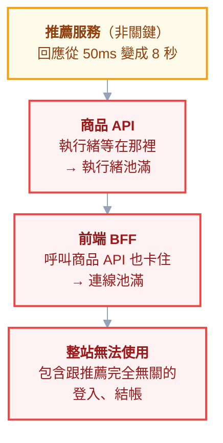

# 附錄 AX：級聯失敗與韌性模式

附錄 Q 講了「服務變慢了」怎麼分層定位，附錄 W 講了服務間通訊的四種模式。但有一個問題兩份都沒回答，而它是多數大型故障的真正形狀：

> **為什麼一個「不重要」的下游服務變慢，會讓整個系統掛掉？**

而且這件事在 K8s 環境**更容易發生**，因為重試太容易開了——Ingress 有重試、service mesh 有重試、HTTP 客戶端函式庫預設就有重試。三層各自開一點，加起來就是災難。

這一份講清楚級聯失敗的機制，以及四種韌性模式該用哪個、按什麼順序。

---

## Part 1：慢，比掛更危險

這是整份最重要的一句話。

**下游「掛掉」時**，你的請求立刻收到連線拒絕——快速失敗，執行緒馬上釋放，你可以走 fallback。

**下游「變慢」時**，你的請求卡在那裡等。每一個等待中的請求都佔著一條執行緒、一條連線、一份記憶體。**幾秒鐘之後，你的執行緒池滿了——於是你也變慢了。**



> **注意最上面那個服務是「非關鍵」的。** 推薦區塊壞掉本來應該只是少一塊畫面，結果它讓整站不能用——**因為沒有人替它設超時**。
>
> 這就是級聯失敗的標準形狀：**故障沿著呼叫鏈往上傳染，而且傳染的是「慢」，不是「錯」。**

### 為什麼多副本救不了你

「我有 10 個副本，應該很穩」——但如果慢的是**共用的下游**，10 個副本會**同時**被卡住。副本數提供的是「單一副本故障」的冗餘，對「共同依賴變慢」完全沒有幫助。

---

## Part 2：重試放大——把算術做一遍

重試是最常見的韌性手段，也是最常見的**故障放大器**。

### 27 倍

假設一條三層的呼叫鏈，每一層都「很合理地」設定重試 3 次：

| 層 | 對下游發出的請求數 |
| --- | --- |
| 前端 → BFF | 3 |
| BFF → 商品 API | 3 × 3 = 9 |
| 商品 API → 資料庫 | 3 × 3 × 3 = **27** |

**一個使用者的一次點擊，變成資料庫的 27 次查詢。**

而這件事發生的時機是——**下游已經有問題的時候**。也就是：

> **重試的本質，是在對方最脆弱的時候，給對方 27 倍的負載。**

這是重試最反直覺的性質：它在對方只是「有點慢」時，把對方打成「完全掛掉」。**很多事故的規模是重試造成的，不是原始故障造成的。**

### 三條規則

**規則一：只在最外層重試。** 每一層都重試就是相乘。決定一個負責重試的層（通常是最靠近使用者的那層，或明確指定的某一層），其他層不重試。

**規則二：只重試冪等操作。** 重試一個扣款請求可能扣兩次——而且第一次可能其實成功了，只是回應在路上超時（[[49-messaging-and-events]] 的冪等要求）。

**規則三：一定要有退避 + 抖動。**

```text
立即重試      →  在對方最忙時再打一次
固定間隔      →  所有客戶端同步，形成一波一波的衝擊
指數退避      →  好，但所有人的「1s、2s、4s」是同一時刻
指數退避+抖動 →  ✅ 負載被打散
```

**抖動（jitter）常被省略，而它才是關鍵的那一半。** 沒有抖動時，所有失敗的客戶端會在同一個時間點一起重試——你只是把「持續的過載」變成「週期性的尖峰」。

### 還要有重試上限與熔斷

即使做對了以上三點，**當下游是真的掛了，重試也只是浪費**。這就接到 Part 4 的熔斷。

---

## Part 3：超時預算——最便宜也最有效的一件事

### 沒有超時等於無限等待

很多 HTTP 客戶端**預設沒有超時**，或預設值長得離譜（幾十秒甚至無限）。這代表一個卡住的下游可以無限期地佔住你的資源。

**如果你只能做一件事來提升韌性，就是設超時。** 它最便宜、不需要任何新元件、而且擋掉了 Part 1 那整條傳染鏈。

### 超時要從外往內遞減

這是最常被做錯的部分：

| 層 | 正確 | 常見錯誤 |
| --- | --- | --- |
| 使用者 → 前端 | 3s | 3s |
| 前端 → BFF | 2.5s | **10s** |
| BFF → 商品 API | 2s | **30s** |
| 商品 API → 資料庫 | 1.5s | **無限** |

> **內層的超時比外層長，等於內層的超時永遠不會生效。**
>
> 外層 3 秒就放棄了、回錯誤給使用者——但**內層那條請求還在跑、還佔著連線與執行緒**，而且沒有人在等它的結果。你付出了資源，卻沒有任何人得到答案。

正確的做法是**先定總預算**（使用者願意等多久），再由外往內逐層分配，每一層留一點餘裕給自己的處理時間。

### 超時要跟重試一起算

**設了 2 秒超時 + 重試 3 次，最壞情況是 6 秒**，不是 2 秒。外層的預算要涵蓋內層的「超時 × 重試次數」，否則外層會在內層還在重試時就放棄——又回到上面那個「沒人在等的請求」問題。

---

## Part 4：熔斷與艙壁

### 熔斷器：不要一直敲一扇壞掉的門

當某個下游連續失敗達到門檻，熔斷器**打開**，之後的請求直接快速失敗，不再真的送出去。過一段時間進入**半開**狀態，放少量請求去試探，成功就關閉、失敗就繼續開著。

它解決兩個問題：**保護自己**（不再把執行緒浪費在必然失敗的請求上）、**保護對方**（給對方喘息的空間恢復）。

在 K8s 上有兩種實作位置：

| 位置 | 說明 |
| --- | --- |
| **應用層**（函式庫） | 精確、可依業務邏輯決定 fallback；但每個語言／服務都要各自實作 |
| **Service mesh**（如 Istio 的 outlierDetection） | 不用改程式碼、全叢集一致；但它只看得到連線層的訊號（[[24-yaml-fields-istio]]） |

**熔斷一定要搭配 fallback**：熔斷之後你要回什麼？快取的舊資料、預設值、還是明確的降級訊息？沒想清楚這個，熔斷只是把「慢」換成「錯」。

### 艙壁：把資源池分開

船艙分隔成多個水密艙，一個進水不會沉船。對應到程式：**呼叫不同下游時用不同的連線池／執行緒池**。

沒有艙壁時，推薦服務卡住會吃光**共用**的連線池，於是連呼叫使用者服務的請求也拿不到連線——**明明使用者服務是好的**。

分開之後，推薦服務最多只能吃光它自己那一池。

---

## Part 5：K8s 層的機制，與它們的極限

K8s 本身有一些相關機制，但它們都有你必須知道的邊界。

### readinessProbe 的雙面性

readiness 失敗時，Pod 被移出 Service 的 endpoint——這在「部分副本有問題」時是對的。

**但如果所有副本都因為同一個下游而 readiness 失敗呢？**

> **Service 沒有任何 endpoint = 100% 的請求失敗。** 而那些副本其實還能提供**部分**功能（登入、結帳都好，只有推薦壞了）。
>
> **有時候「降級的服務」遠好過「沒有服務」。**

所以 readinessProbe **不該檢查下游依賴**——它應該只回答「這個副本自己能不能處理請求」。檢查下游依賴的健康檢查是把別人的故障變成自己的故障（[[04-workloads]] 的探針設計）。

### HPA 在故障時可能讓事情更糟

延遲上升 → CPU 或請求數指標上升 → HPA 擴容 → **更多副本同時打那個已經過載的下游** → 下游更慢 → 延遲更高 → 繼續擴容。

**當瓶頸在下游時，擴容是在加油而不是滅火。** 這也是為什麼事故當下「先擴容看看」有時候會讓情況惡化。

### 負載卸除

當你注定無法處理全部流量時，**主動拒絕一部分，保住其餘**，比讓所有請求一起慢死好。

實務上就是：佇列長度或並行數超過門檻時，直接回 503（並帶上 `Retry-After`），而不是把請求收下來排隊。**排隊等於用記憶體換取更糟的體驗**——使用者早就離開了，你還在處理他的請求。

---

## Part 6：實務優先序

**不要一開始就上 service mesh 來解這件事。** 多數團隊的問題不是「缺少進階韌性模式」，而是**超時根本沒設**。

按這個順序做，投報率遞減：

| 順序 | 做什麼 | 成本 | 效果 |
| --- | --- | --- | --- |
| **1** | **每個對外呼叫都設超時**，且由外往內遞減 | 極低 | **極高** |
| **2** | 重試只在單一層，加退避 + 抖動 | 低 | 高 |
| **3** | 熔斷 + 明確的 fallback | 中 | 中高 |
| **4** | 艙壁（分開連線池） | 中 | 中 |
| **5** | 負載卸除 | 中高 | 情境相關 |

> **第 1 項做完，你已經解決了大部分的級聯失敗。** 而它不需要任何新元件、不需要 service mesh、通常只是幾行設定。

### 怎麼驗證它真的有用

這些設定的問題是**平時看不出來有沒有生效**。驗證方式是主動注入故障：讓某個下游延遲 10 秒，然後看你的服務是否在預期的時間內快速失敗、其他功能是否仍然可用（[[48-testing-in-k8s]] 的混沌測試思路）。

**沒被驗證過的韌性設定，跟沒有設定的差別只在你的自信程度。**

---

## 檢查清單

### 超時（最優先）

- [ ] **每一個對外呼叫都有超時**（HTTP、資料庫、快取、訊息）
- [ ] 超時由外往內**遞減**，不是內層比外層長
- [ ] 有明確的總預算（使用者願意等多久）
- [ ] 外層預算涵蓋內層的「超時 × 重試次數」

### 重試

- [ ] **只有一層在重試**，不是每層都開
- [ ] 只重試**冪等**操作
- [ ] 有指數退避，而且**有抖動**
- [ ] 有重試次數上限
- [ ] 算過最壞情況的放大倍數

### 熔斷與隔離

- [ ] 關鍵下游有熔斷（應用層或 mesh）
- [ ] 熔斷後有**明確的 fallback**
- [ ] 不同下游用不同的連線池

### K8s 層

- [ ] **readinessProbe 不檢查下游依賴**
- [ ] 知道「所有副本 not ready = 服務完全消失」
- [ ] 理解**下游是瓶頸時 HPA 會讓事情更糟**
- [ ] 過載時能快速拒絕而非無限排隊

### 驗證

- [ ] 用注入延遲的方式**驗證過**這些設定真的生效

---

## 常見誤區

| # | 誤區 | 真相 |
| --- | --- | --- |
| 1 | 下游掛掉比較嚴重 | **慢比掛更危險**——掛是快速失敗，慢會綁住你的資源 |
| 2 | 非關鍵服務壞掉影響有限 | 沒設超時的話，它會讓**整站**不能用 |
| 3 | 多副本就有冗餘 | 對「共同依賴變慢」完全沒用，所有副本會一起卡 |
| 4 | 重試讓系統更可靠 | 它在對方最脆弱時給對方**數十倍**負載 |
| 5 | 每層都重試比較保險 | 那是**相乘**：三層各 3 次 = 27 倍 |
| 6 | 指數退避就夠了 | 沒有抖動＝所有客戶端同步重試，變成週期性尖峰 |
| 7 | 內層超時設長一點比較安全 | **內層超時永遠不會生效**，且沒人在等那個結果 |
| 8 | readinessProbe 該檢查資料庫 | 那會讓**所有副本同時消失**；降級服務好過沒有服務 |
| 9 | 事故時先擴容 | 瓶頸在下游時，擴容是**加油不是滅火** |
| 10 | 上 service mesh 就有韌性了 | 多數問題是**超時沒設**，先做那個 |

## 連結

- [[73-long-lived-connections]] — 附錄 AY：連線資源被佔住的另一種形式
- [[39-performance-troubleshooting]] — 附錄 Q：「服務變慢了」的分層定位與尾端延遲
- [[45-microservices-and-communication]] — 附錄 W：四種通訊模式與分散式的必修課
- [[04-workloads]] — 正文：探針設計，為何 readiness 不該檢查下游
- [[24-yaml-fields-istio]] — 附錄 C-8：`outlierDetection`、逾時與重試的 Istio 欄位
- [[49-messaging-and-events]] — 附錄 AA：冪等，重試的前提
- [[50-caching]] — 附錄 AB：快取降級與雪崩，同一類問題的另一面
- [[57-database-connections]] — 附錄 AI：連線池耗盡的機制
- [[48-testing-in-k8s]] — 附錄 Z：用混沌測試驗證韌性設定
- [[64-slo-and-alerting]] — 附錄 AP：級聯失敗在錯誤預算上長什麼樣
- [[k8s-mastery]] — 教材總目錄
