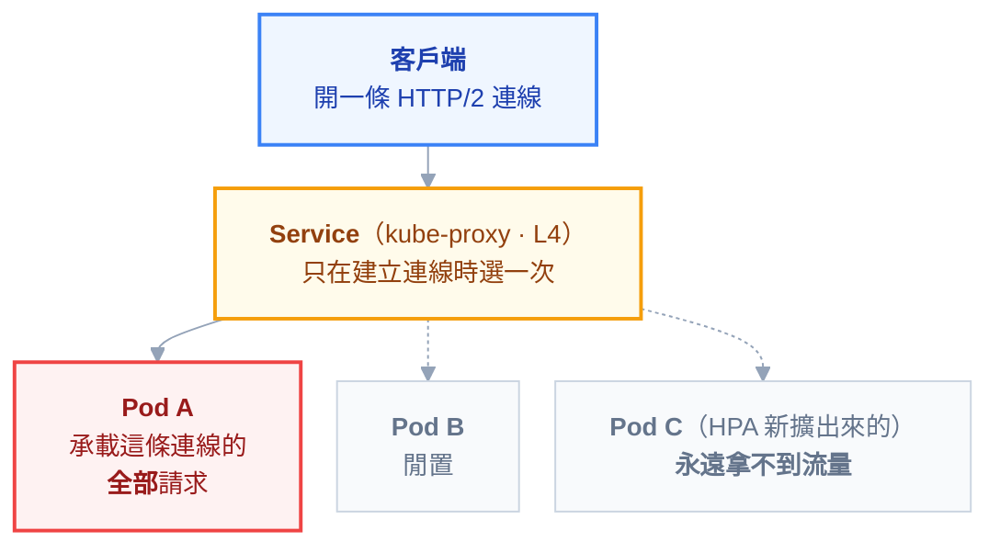

# 附錄 AY：長連線（gRPC／WebSocket）在 K8s 上的行為

附錄 W 用兩行提過一個坑：**gRPC 是長連線的，預設的 Service 負載平衡會讓連線黏在同一個後端。**

那兩行值得展開成一份，因為它連著一整串會讓人困惑好幾天的症狀：**HPA 擴容了但沒有效果、部分 Pod CPU 100% 而其他幾乎閒著、部署後使用者連線莫名被切斷、WebSocket 每 60 秒斷一次。**

這些看起來是不同的問題，**根源是同一個**：K8s 的預設網路模型是為**短連線**設計的，而 gRPC、WebSocket、SSE 都是長連線。

---

## Part 1：為什麼負載會不均

### kube-proxy 做的是連線層負載平衡

Service 的負載平衡發生在**建立連線的那一刻**（[[05-networking]] 的封包路徑）。連線一旦建立，之後所有經過這條連線的資料都送往**同一個 Pod**——kube-proxy 不會、也不能去看裡面的 HTTP 請求。

對短連線來說這沒問題：每個請求一條新連線，每次都重新分配。

**但 HTTP/2（gRPC 的基礎）是多工的**——一條 TCP 連線可以同時承載成百上千個請求。於是：



### 症狀清單

如果你看到以下任一項，先懷疑這件事：

| 症狀 | 為什麼 |
| --- | --- |
| **HPA 擴容了但延遲沒有改善** | 新 Pod 拿不到既有連線的流量 |
| 部分 Pod CPU 滿載、其他接近 0 | 連線分配在建立時就固定了 |
| 擴容後負載**永遠**不平均 | 除非客戶端重新連線，否則不會重新分配 |
| 重啟客戶端就「好了」 | 重連時重新分配了一次 |

> **「重啟客戶端就好了」是這個問題最強的指紋。** 而它也解釋了為什麼這個問題常常被誤判成「客戶端的 bug」。

### HTTP/1.1 也有，只是比較輕

HTTP/1.1 的 keep-alive 同樣會讓連線黏住。但客戶端通常開一個**連線池**（多條連線），這些連線會分散到不同 Pod，所以不均的程度輕得多。

**HTTP/2 把「多條連線」壓縮成「一條連線」，於是把這個輕微的問題放大成嚴重的問題。**

---

## Part 2：四種解法

| 解法 | 怎麼做 | 適用 |
| --- | --- | --- |
| **客戶端負載平衡** | Headless Service + 客戶端自己輪替所有 Pod IP | gRPC 內部呼叫的**標準解** |
| **L7 代理／mesh** | 讓 Envoy 之類的在請求層分配 | 已有 mesh，或跨語言統一處理 |
| **限制連線壽命** | 伺服器端定期關閉連線，強迫重連 | **最簡單，效果好，常被忽略** |
| **每次請求開新連線** | 放棄長連線的好處 | 幾乎不建議 |

### 解法一：Headless Service + 客戶端負載平衡

Headless Service（`clusterIP: None`）的 DNS 不回傳單一虛擬 IP，而是**回傳所有 Pod 的 IP**。客戶端拿到完整清單，自己決定每個請求送給誰：

```yaml
apiVersion: v1
kind: Service
metadata:
  name: grpc-backend-headless
spec:
  clusterIP: None # 關鍵：不建立虛擬 IP
  selector:
    app: grpc-backend
  ports:
    - port: 50051
      name: grpc
```

gRPC 客戶端多半支援這種模式（指定 DNS 解析器 + round-robin 策略），並會定期重新解析 DNS 以感知新的 Pod。

**代價**：客戶端要正確設定；每個客戶端都要各自實作；DNS 快取會讓新 Pod 的感知有延遲。

### 解法三：限制連線壽命（最被低估）

伺服器端設定「一條連線最多存活 N 分鐘」，到期就優雅關閉，客戶端自動重連——**重連時就會被重新分配到不同的 Pod**。

gRPC 伺服器多半有對應參數（連線最大存活時間 + 一段寬限期，讓進行中的請求跑完）。

> **這個做法的優點是完全在伺服器端，不需要客戶端配合、不需要 mesh、不需要改架構。** 對「我只是想讓負載均勻一點」的需求，它常常就夠了。
>
> 設定值是取捨：太短會頻繁重連（浪費握手成本），太長則負載重新分配得太慢。幾分鐘到幾十分鐘是常見範圍。

---

## Part 3：滾動更新會切斷長連線

這是長連線的第二個問題，而且它直接被使用者看見。

### Pod 終止時發生什麼

Pod 被終止時（[[04-workloads]] 的終止流程）：從 endpoint 移除 → 收到 SIGTERM → `preStop` → 寬限期 → SIGKILL。

**對短連線這套流程很完美**：新請求不再進來，舊請求跑完就結束。

**對長連線它不夠**——那條連線可能已經開了兩小時，而且還會繼續開下去。寬限期到了就是硬砍。

| 連線類型 | 使用者看到什麼 |
| --- | --- |
| WebSocket（聊天、即時通知） | 連線斷掉，功能停止（除非前端有重連邏輯） |
| SSE（即時推播） | 推播中斷 |
| gRPC 串流 | 串流中斷，可能是進行到一半的資料傳輸 |

### 三件要做的事

**第一，應用要處理 SIGTERM 並主動關閉長連線。** 收到訊號時，對現有連線送出「即將關閉」的訊息（WebSocket 的 close frame、gRPC 的 GOAWAY），讓客戶端有機會乾淨地重連到別的 Pod，而不是被硬斷。

**第二，`terminationGracePeriodSeconds` 要夠長。** 預設 30 秒對長連線通常不夠。但也不能無限長——太長會讓部署變得極慢。務實做法是給一個合理的排空時間（例如 60–120 秒），到期仍未關閉的就接受被切斷。

**第三，前端／客戶端一定要有自動重連。** 這是最重要的一項，因為**無論你怎麼調，連線終究會斷**——節點故障、網路抖動、部署都會造成中斷。

> **把「連線會斷」當成正常情況來設計，而不是異常。** 在 K8s 上，Pod 是可拋棄的（[[70-node-lifecycle-and-ha]]），所以連線也必須是可重建的。
>
> 有自動重連的話，上面兩項只是把「使用者有感的中斷」變成「無感的短暫重連」；沒有的話，每次部署都是一次可見的故障。

---

## Part 4：路徑上的每一層都可能切斷你

長連線要活著，**整條路徑上每一層的超時都要夠長**——而它們的預設值多半是為短連線設計的。

| 層 | 常見的預設行為 |
| --- | --- |
| **Ingress controller** | 讀取逾時預設常是 60 秒——**WebSocket 會每 60 秒斷一次** |
| **雲端負載平衡器** | 有自己的閒置逾時，且常常獨立設定 |
| **NAT／防火牆** | 閒置連線被靜默丟棄（[[57-database-connections]] 講過同一個機制） |
| **Service mesh** | sidecar 有自己的逾時設定 |

> **「WebSocket 每 60 秒斷一次」幾乎一定是 Ingress 的讀取逾時。** 這是最有辨識度的症狀之一，而 [[28-ingress-nginx-annotations]] 有對應的 annotation。

**而 NAT 那一層不能靠調逾時解決**——你未必控制得了中間的設備。正解是**應用層的 keepalive**：定期送一個小封包（WebSocket ping、gRPC keepalive），讓連線在中間設備眼中一直是「活躍」的。

**注意 keepalive 間隔要短於路徑上最短的閒置逾時**，否則它起不了作用。

---

## Part 5：其他要知道的互動

### 長連線與 HPA

即使解決了負載平衡，**HPA 對長連線的反應仍然遲鈍**：擴出新 Pod 之後，既有連線不會搬過去。要等到連線自然重建（或你用了 Part 2 的連線壽命限制）才會生效。

**實務上：長連線服務的擴容要更早、更保守**，因為它的生效速度比無狀態 HTTP 服務慢得多。

### 連線數本身是一種容量

短連線服務的容量以「每秒請求數」衡量；長連線服務的容量還多一個維度：**同時連線數**。每條連線都佔記憶體與檔案描述符，而**閒置的連線也一樣佔著**。

所以監控要多看兩個指標：**目前連線數**、**連線建立速率**。只看 CPU 會漏掉「連線數逼近上限」這個真正的瓶頸。

### 灰階發布會被拉長

依權重分流（例如 10% 到新版）對長連線的意義不同：**權重只影響「新建立的連線」**。既有連線會一直留在舊版上，直到它們重連為止。

**所以長連線服務的金絲雀觀察期要比預期長很多**，而且「10% 流量」在初期可能實際上遠低於 10%。

---

## 檢查清單

### 負載平衡

- [ ] 知道 kube-proxy 是**連線層**分配，長連線會黏住
- [ ] gRPC 內部呼叫用 **headless Service + 客戶端負載平衡**，或走 L7
- [ ] 或設了**連線最大存活時間**強迫定期重新分配
- [ ] 驗證過負載真的平均（看各 Pod 的連線數，不是只看 CPU）

### 部署與終止

- [ ] 應用**處理 SIGTERM 並主動優雅關閉**長連線（GOAWAY／close frame）
- [ ] `terminationGracePeriodSeconds` 對長連線夠長
- [ ] **客戶端有自動重連**（最重要的一項）
- [ ] 知道連線終究會斷，並照此設計

### 路徑上的逾時

- [ ] Ingress 的讀取逾時足以支撐長連線
- [ ] 雲端負載平衡器的閒置逾時已確認
- [ ] 有**應用層 keepalive**，間隔短於路徑上最短的閒置逾時

### 容量與發布

- [ ] 監控**同時連線數**與連線建立速率，不只 CPU
- [ ] 長連線服務的擴容更早、更保守
- [ ] 知道金絲雀權重只影響**新連線**，觀察期要拉長

---

## 常見誤區

| # | 誤區 | 真相 |
| --- | --- | --- |
| 1 | Service 會平均分配 gRPC 流量 | 它在**建立連線時**分配一次，之後全黏在同一個 Pod |
| 2 | 擴容就能改善長連線服務的延遲 | 新 Pod **拿不到既有連線**的流量 |
| 3 | 負載不均是客戶端的 bug | 「重啟客戶端就好了」正是這個問題的指紋 |
| 4 | HTTP/1.1 沒這問題 | 也有，只是客戶端連線池讓它輕很多 |
| 5 | 要解決只能上 service mesh | **限制連線壽命**是純伺服器端的簡單解 |
| 6 | 滾動更新對長連線是無縫的 | 寬限期到了就硬砍；要主動優雅關閉 |
| 7 | 加長寬限期就沒事了 | 連線終究會斷；**客戶端自動重連才是根本** |
| 8 | WebSocket 每 60 秒斷是應用的 bug | 幾乎一定是 **Ingress 的讀取逾時** |
| 9 | keepalive 設了就安全 | 間隔要**短於**路徑上最短的閒置逾時 |
| 10 | 金絲雀 10% 就是 10% 流量 | 權重只影響**新連線**，既有連線留在舊版 |

## 連結

- [[05-networking]] — 正文：Service 的封包路徑、`sessionAffinity`、`externalTrafficPolicy`
- [[45-microservices-and-communication]] — 附錄 W：四種通訊模式，這份展開它提到的 gRPC 負載平衡坑
- [[04-workloads]] — 正文：Pod 終止流程與 `preStop`
- [[28-ingress-nginx-annotations]] — 附錄 F：逾時相關的 annotation
- [[57-database-connections]] — 附錄 AI：NAT 閒置逾時切斷連線的同一個機制
- [[24-yaml-fields-istio]] — 附錄 C-8：mesh 的 L7 負載平衡與逾時欄位
- [[70-node-lifecycle-and-ha]] — 附錄 AV：Pod 可拋棄，所以連線必須可重建
- [[72-cascading-failure]] — 附錄 AX：連線資源被佔住的另一種形式
- [[56-frontend-deployment]] — 附錄 AH：前端的重連與版本切換
- [[k8s-mastery]] — 教材總目錄
