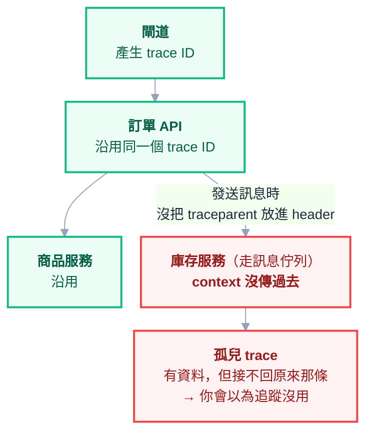

# 附錄 AZ：分散式追蹤

教材給了 metrics 一整章（[[14-prometheus-grafana]]）、給了日誌兩章（[[15-elk-elastic]]、[[55-logging-strategy]]）。而「分散式追蹤」在附錄 Q 與 W 裡被**反覆推薦**——它甚至出現在附錄 Q 的檢查清單裡（「有分散式追蹤」）。

**但從來沒有一份說怎麼做。** 這一份補上第三支柱。

---

## Part 1：它解決 metrics 與日誌解不了的問題

三支柱各自回答不同的問題，而它們**不能互相取代**：

| 支柱 | 回答的問題 | 回答不了的 |
| --- | --- | --- |
| **Metrics** | 「有沒有問題？多嚴重？」 | **問題在哪一段** |
| **Logs** | 「這個服務當時發生什麼？」 | **這個請求經過的其他服務發生什麼** |
| **Traces** | 「這一個請求，在每個服務各花了多久？」 | 整體趨勢（那是 metrics 的事） |

### 具體的差別

監控說「P95 延遲是 800ms」。**然後呢？**

沒有 trace 的話，你的下一步是猜：可能是資料庫、可能是那個新加的服務、可能是快取沒命中。然後你去翻各個服務的日誌——但**每個服務的日誌是獨立的，你沒辦法把同一個請求在五個服務裡的紀錄串起來**。

有 trace 的話，「800ms 花在哪一段」是**一個畫面**：

```text
訂單 API                     ████████████████████ 800ms
├─ 驗證 token                 █ 20ms
├─ 查商品服務                 ███ 90ms
│  └─ 查資料庫                ██ 60ms
├─ 查庫存服務                 ██████████████ 620ms   ← 就是它
│  └─ 查資料庫（無索引）       █████████████ 600ms   ← 具體到這一步
└─ 寫入訂單                   ██ 70ms
```

> **這就是 trace 的全部價值：把「哪裡慢」從推理變成觀察。**
>
> 服務數量越多，這個價值越大——因為推理的分支數是隨服務數指數成長的。

---

## Part 2：核心概念（最少必要的三個）

**Span** —— 一個工作單元（一次 HTTP 呼叫、一次資料庫查詢），有開始時間、結束時間、名稱、屬性。

**Trace** —— 同一個請求的所有 span 組成的樹。它們共用一個 **trace ID**。

**Context propagation** —— 把 trace ID 與 parent span ID 從一個服務傳到下一個服務。標準做法是一個 HTTP header：

```text
traceparent: 00-4bf92f3577b34da6a3ce929d0e0e4736-00f067aa0ba902b7-01
             ^^ ^------- trace id -------------^ ^-- parent id --^ ^^
           版本                                                   旗標
```

### Context propagation 是成敗關鍵

**這是整件事最容易失敗的一環，而且失敗時很難察覺。**

任何一個環節沒把 context 傳下去，後面的 span 就會變成**孤兒**——它們有自己的 trace，但跟前面那段接不起來。你會看到一堆殘缺的 trace，然後以為「追蹤沒什麼用」。



### 四個常見的斷點

| 斷點 | 為什麼 |
| --- | --- |
| **訊息佇列** | context 要自己放進訊息的 header（[[49-messaging-and-events]]） |
| **背景工作／執行緒池** | 換執行緒時 context 沒跟著走（[[51-background-jobs]]） |
| **自己寫的 HTTP client** | 沒被自動 instrumentation 包到 |
| **經過不支援的中介層** | 某些代理會剝掉未知 header |

**訊息佇列那一項最常見**，因為非同步天生就跨越了「一次呼叫」的邊界。而它也最痛——非同步流程本來就最難除錯，結果它正好是 trace 最容易斷掉的地方。

---

## Part 3：怎麼導入

### 自動優先，手動補強

| 方式 | 說明 |
| --- | --- |
| **自動 instrumentation** | SDK／agent 自動包住常見框架（HTTP server、client、DB driver） |
| **手動 span** | 自己在業務關鍵處開 span（「計算運費」「呼叫金流」） |

**順序建議：先全自動，跑一陣子，再針對關鍵路徑補手動 span。**

一開始就手動埋點的問題是：你會埋在**你以為重要**的地方，而那通常不是實際的瓶頸。先讓自動的告訴你瓶頸在哪，再去那裡加細節。

### 在 K8s 上的部署形態

應用不要直接把 trace 送到後端儲存，中間放一個 **collector**：

| 形態 | 說明 |
| --- | --- |
| **DaemonSet collector** | 每個節點一個，應用送到本機節點 —— 常見的預設 |
| **Deployment collector（閘道層）** | 集中處理，方便做 tail sampling（Part 4） |
| **兩層** | 節點層收集 + 集中層取樣，大叢集的常見做法 |

collector 做四件事：**緩衝**（後端掛掉時應用不受影響）、**批次**（減少網路開銷）、**轉換**（加 K8s 屬性、移除敏感欄位）、**路由**（送去不同後端）。

> **「移除敏感欄位」要在導入時就設好。** span 的屬性很容易夾帶查詢參數、request body 片段、使用者識別——這跟日誌是同一個個資風險（[[55-logging-strategy]]、[[61-compliance-and-audit]]），而且更容易被忽略，因為沒有人在「讀」trace。

---

## Part 4：取樣——成本與價值的核心取捨

**100% 保留所有 trace 的成本通常不可接受**：每個請求產生數十個 span，每個 span 有時間戳與一堆屬性。高流量服務會產生比日誌還多的資料。

### 三種取樣策略

| 策略 | 怎麼決定 | 問題 |
| --- | --- | --- |
| **Head-based**（頭部） | 請求一進來就擲骰子決定要不要留 | **出事的那個請求很可能沒被留下** |
| **Tail-based**（尾部） | 等 trace 完成，看結果再決定 | 需要 collector 緩衝完整的 trace |
| **錯誤偏向** | 錯誤與慢請求全留，其餘取樣 | 通常是 tail-based 的一種設定 |

> **head-based 取樣 1% 的意思是：99% 的錯誤 trace 也被丟掉了。**
>
> 而你需要 trace 的時刻，恰恰是「有一個請求出問題」的時刻——這是 head-based 最根本的缺陷。

### tail-based 的操作限制

要「看完整條 trace 再決定」，代表**同一個 trace 的所有 span 必須進到同一個 collector 實例**。這在多副本的 collector 上不是自動成立的，要靠依 trace ID 做一致性路由（多層 collector 架構存在的主要理由）。

### 務實的起手式

1. 先用**低比例的 head sampling**（例如 1–10%）跑起來，確認 context propagation 沒斷
2. 確認鏈路完整之後，再導入 **tail-based**：**錯誤與超過門檻的慢請求全留**，其餘低比例
3. 監控 trace 資料量，把它納入成本檢視（[[33-cost-optimization]]）

### 一個重要的副作用

> **不要用取樣後的 trace 去算 metrics。**
>
> 取樣後的資料**在統計上是偏的**（尤其在錯誤偏向取樣之下——你刻意保留了更多錯誤）。「錯誤率」「P95」這類數字要來自 metrics（[[14-prometheus-grafana]]），而不是 trace。
>
> 混淆這兩者會產生一個很難發現的錯誤：儀表板上的錯誤率比實際高好幾倍。

---

## Part 5：把三支柱串起來——這才是重點

**很多團隊導入了追蹤，然後沒有人用它。** 原因幾乎都一樣：**沒有從「告警」走到「trace」的動線。**

三支柱各自漂亮的儀表板沒有價值，**它們之間的連結才有**：

### 第一條連結：trace ID 進日誌

**每一行日誌都帶上 trace ID**（[[55-logging-strategy]] 的結構化日誌）。有了它：

- 從 trace 看到「庫存服務這一段 620ms」→ 用 trace ID 撈出該服務當時的日誌 → 看到具體的 SQL
- 反過來，從一則錯誤日誌 → 用 trace ID 看到這個請求的完整上下文

**這是投報率最高的一項，而且很便宜**——多半只是在日誌框架裡加一個欄位。

### 第二條連結：從 metrics 跳到 trace

Prometheus 的 exemplar 機制可以在直方圖的桶上附帶一個 trace ID。效果是：**你在延遲圖上看到一根尖峰，點下去就是一條真實的慢請求 trace。**

### 完整動線

```text
告警（錯誤預算燃燒）        ← 附錄 AP
  ↓ 從告警連到儀表板
metrics（哪個服務、哪個端點）← 正文 14
  ↓ exemplar
trace（哪一段慢）           ← 本份
  ↓ trace ID
logs（那一段到底發生什麼）  ← 附錄 AG
```

> **這條動線走得通，可觀測性才算做完。** 否則你只是有三套很貴的系統，而事故當下大家還是在猜。

---

## Part 6：常見失敗模式

| # | 失敗 | 原因 |
| --- | --- | --- |
| 1 | 導入了但沒人用 | **沒有從告警走到 trace 的動線** |
| 2 | trace 都是破碎的 | context propagation 在某處斷了（多半是佇列或執行緒池） |
| 3 | 出事時找不到那條 trace | head-based 取樣把它丟了 |
| 4 | 成本失控 | 沒有取樣，或屬性放了太多東西 |
| 5 | 儀表板數字比實際高 | 用取樣後的 trace 算 metrics |
| 6 | 個資外洩 | span 屬性夾帶查詢參數與使用者資料 |
| 7 | 只有部分服務有 | 鏈路中斷一個服務，後面全看不到 |

**第 7 項值得強調**：追蹤的價值**不是線性累加的**。一條鏈路上有一個服務沒接，那一段之後就全黑了。所以導入時要**按呼叫鏈的順序**推進，而不是「先做最有空的那個團隊」。

---

## 檢查清單

### 導入

- [ ] 先用**自動 instrumentation**，跑穩再補手動 span
- [ ] 應用送到 **collector**，不直接送後端
- [ ] collector 有設**移除敏感屬性**
- [ ] 按**呼叫鏈順序**推進，不是隨機挑服務

### Context propagation

- [ ] 用標準的 `traceparent`，不是自訂 header
- [ ] **訊息佇列**有把 context 放進訊息
- [ ] 背景工作／執行緒切換有帶 context
- [ ] 自己寫的 HTTP client 有被包到
- [ ] 驗證過：隨機挑一條 trace，**從入口到資料庫是完整的**

### 取樣

- [ ] 知道 head-based 會把**大部分錯誤 trace 丟掉**
- [ ] 目標是 **tail-based：錯誤與慢請求全留**
- [ ] trace 資料量納入成本檢視
- [ ] **沒有**用取樣後的 trace 算 metrics

### 串接（最重要）

- [ ] **每一行日誌都有 trace ID**
- [ ] metrics 有 exemplar 可跳到 trace
- [ ] 告警 → metrics → trace → logs 這條動線**真的走過一次**

---

## 常見誤區

| # | 誤區 | 真相 |
| --- | --- | --- |
| 1 | 有 metrics 和日誌就夠了 | 它們回答不了「**哪一段**慢」 |
| 2 | 追蹤就是更詳細的日誌 | 它的價值在**跨服務串接**，不是細節量 |
| 3 | 裝了 SDK 就有完整 trace | context 斷一處，後面全是孤兒 |
| 4 | 非同步流程也會自動接上 | **佇列是最常見的斷點**，要自己傳 |
| 5 | 取樣 1% 也夠用 | 那代表 **99% 的錯誤 trace 被丟掉** |
| 6 | tail-based 只是換個參數 | 需要同一 trace 進同一 collector，架構要配合 |
| 7 | 可以用 trace 算錯誤率 | 取樣後的資料**統計上是偏的** |
| 8 | span 屬性放越多越好 | 成本與**個資風險**都在那裡 |
| 9 | 先讓有空的團隊接 | 要按**呼叫鏈順序**，否則中間一斷就全黑 |
| 10 | 導入完就有價值 | **沒有從告警連過去的動線，就沒有人會用** |

## 連結

- [[14-prometheus-grafana]] — 正文：metrics 與 PromQL，第一支柱
- [[55-logging-strategy]] — 附錄 AG：日誌三種用途，trace ID 該寫進去
- [[15-elk-elastic]] — 正文：日誌的儲存與查詢
- [[39-performance-troubleshooting]] — 附錄 Q：「服務變慢了」的分層定位，追蹤是它的加速器
- [[45-microservices-and-communication]] — 附錄 W：拆分後的除錯難度
- [[49-messaging-and-events]] — 附錄 AA：非同步流程要自己傳遞 context
- [[51-background-jobs]] — 附錄 AC：背景工作的 context 傳遞
- [[64-slo-and-alerting]] — 附錄 AP：告警是這條動線的起點
- [[61-compliance-and-audit]] — 附錄 AM：span 屬性同樣是個資風險
- [[33-cost-optimization]] — 附錄 K：追蹤資料量要納入成本
- [[practice-6-observability]] — 實戰 6：把指標、日誌串起來的實作
- [[k8s-mastery]] — 教材總目錄
