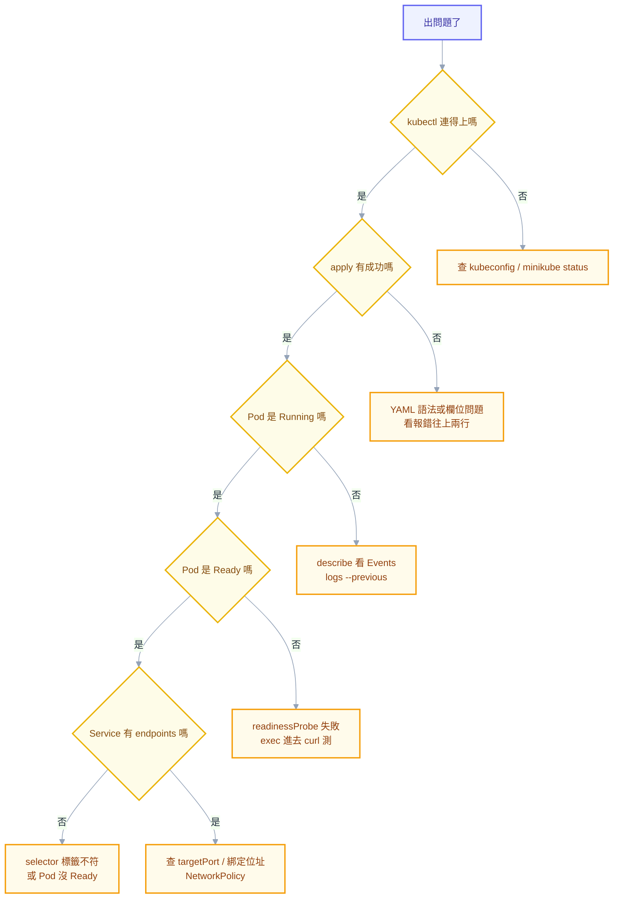

# 入門第六章：錯誤訊息白話翻譯

入門階段最讓人挫折的不是不會做，是**看到一行紅字卻完全不知道它在說什麼**，於是只能整段複製去搜尋，然後在一堆不相干的討論串裡亂試。

這一章是一本翻譯字典。每一條給你三件事：**這行字實際在說什麼**、**最常見的原因**、**下一步做什麼**。按照你會遇到的順序排列——從 Docker、到 kubectl 連線、到 YAML、到 Pod 跑不起來、到服務連不通。

## 先學會怎麼讀

在查表之前，先建立三個習慣，它們比記住任何一條訊息都有用。

**第一，K8s 的真正原因通常不在 `kubectl apply` 的回應裡，而在 event 裡。** `apply` 成功只代表「這份願望被接受了」，不代表它實現了。看實際發生什麼要用：

```powershell
kubectl describe pod <pod-name>     # 看最下方的 Events 區塊
kubectl get events --sort-by=.metadata.creationTimestamp
```

`describe` 最下面那段 Events 是入門階段最該養成的第一反射動作。八成的問題答案就寫在那裡。

**第二，分辨這是哪一層的問題。** 同樣是「連不上」，可能是 YAML 沒過、Pod 沒起來、Service 找不到 Pod、或網路被擋。由外往內一層層排除，比亂猜快得多。

**第三，`--previous` 是 crash 排錯的關鍵。** 容器一直重啟時，當前這個可能還沒產生日誌，你要看的是**上一個已經死掉**的：

```powershell
kubectl logs <pod> --previous
```

---

## A · Docker 階段

**`Cannot connect to the Docker daemon at ... Is the docker daemon running?`**
白話：Docker 引擎沒在跑，你的指令沒人接。
第一步：打開 Docker Desktop，等鯨魚圖示停止轉動再重試。

**`Bind for 0.0.0.0:8080 failed: port is already allocated`**
白話：8080 這個 port 已經被別的東西佔走了（第一章的「一個 port 只能一個程序」）。
第一步：換一個 port（`-p 8081:80`），或找出誰佔用：`Get-NetTCPConnection -LocalPort 8080`。

**`COPY failed: file not found in build context`**
白話：Dockerfile 裡要複製的檔案，在你指定的建置目錄裡找不到。
第一步：確認 `docker build` 最後那個 `.` 有沒有漏、確認檔名大小寫、確認檔案沒被 `.dockerignore` 排除。

**`exec /app: exec format error`**
白話：這個執行檔跟目前的 CPU 架構不合（常見於 Apple Silicon 建的映像跑在 x86，或反過來）。
第一步：建置時指定架構 `docker build --platform linux/amd64`。

**`pull access denied` / `manifest unknown`**
白話：前者是沒權限拉（私有 registry 沒登入），後者是這個映像或 tag 根本不存在。
第一步：檢查 tag 有沒有打錯；私有 registry 先 `docker login`。

---

## B · kubectl 連不上叢集

**`The connection to the server localhost:8080 was refused - did you specify the right host or port?`**
白話：kubectl 找不到叢集設定，於是退回預設值 localhost:8080，那裡當然沒人。
第一步：`minikube start` 把叢集啟動；確認 `~/.kube/config` 存在；`kubectl config current-context` 看目前指向哪。

**`Unable to connect to the server: dial tcp ...: connectex: No connection could be made`**
白話：找得到設定，但連不上那個位址——叢集停了或網路不通。
第一步：`minikube status`，沒跑就 `minikube start`。

**`error: You must be logged in to the server (Unauthorized)`**
白話：身份驗證沒過。憑證過期、token 失效或設定檔壞了。
第一步：本機環境重跑 `minikube start`；正式環境重新取得 kubeconfig。

**`Error from server (Forbidden): pods is forbidden: User "x" cannot list resource "pods" in API group ""`**
白話：**身份是對的，但權限不夠**（這跟上一條的差別很重要：401 是「你是誰」，403 是「你不能做這件事」）。
第一步：`kubectl auth can-i list pods` 確認；請管理員補 RBAC 權限。

---

## C · YAML 與 apply 階段

**`error converting YAML to JSON: yaml: line 12: did not find expected key`**
白話：YAML 語法壞了，通常是縮排不一致。
第一步：**往上找兩三行**（第四章講過，報錯行號常常不是真正出錯的地方）；檢查有沒有混到 Tab。

**`error validating data: ValidationError(Deployment.spec): unknown field "replica"`**
白話：欄位名打錯了，K8s 不認得。
第一步：對照正確拼字（是 `replicas` 不是 `replica`）；用 `kubectl explain deployment.spec` 查有哪些欄位。

**`no matches for kind "Ingress" in version "extensions/v1beta1"`**
白話：這個 apiVersion 已經被移除了，你抄到過時的範例。
第一步：改用新版（Ingress 現在是 `networking.k8s.io/v1`）；`kubectl api-resources` 查目前支援什麼。

**`Deployment.apps "web" is invalid: spec.selector: Invalid value: ...: field is immutable`**
白話：`selector` 建立之後不能改。
第一步：刪掉再重建（`kubectl delete deploy web` 之後重新 apply）。這也是為什麼 selector 要一開始就想好。

**`The Pod "web" is invalid: spec: Forbidden: pod updates may not change fields other than ...`**
白話：Pod 幾乎所有欄位都不能改。
第一步：這正是不要直接寫 Pod 的理由——用 Deployment，它會幫你建新的取代舊的。

**`metadata.labels: Invalid value: 1.1: must be a string`**
白話：label 的值必須是字串，而 `1.10` 被 YAML 解析成數字了（第四章的型別陷阱）。
第一步：加引號 `"1.10"`。

**`admission webhook "x" denied the request`**
白話：有一個守門員擋下了你的 YAML，通常是安全政策。
第一步：讀後面那句具體原因；常見的是 Pod Security Admission 要求非 root、要求 `allowPrivilegeEscalation: false`。

**`exceeded quota: cpu limited to ...`**
白話：這個 namespace 有資源配額，你要的超過剩餘額度。
第一步：`kubectl describe quota -n <ns>` 看用掉多少；調小 requests 或請管理員加額度。

---

## D · Pod 起不來

這一組是入門階段最常遇到的。先記住查法：**`kubectl get pods` 看狀態 → `kubectl describe pod` 看 Events → `kubectl logs` 看應用輸出**。

**`ImagePullBackOff` / `ErrImagePull`**
白話：拉不到映像。`ErrImagePull` 是第一次失敗，`ImagePullBackOff` 是重試等待中。
第一步：`describe` 看具體原因——`not found` 是 tag 打錯，`unauthorized` 是私有 registry 缺 `imagePullSecrets`。

**`CrashLoopBackOff`**
白話：容器啟動後很快就死掉，K8s 反覆重啟並拉長間隔。**這是症狀不是原因。**
第一步：`kubectl logs <pod> --previous` 看它死前說了什麼；再看 `describe` 裡的 `Last State` 有 exit code。

**`CreateContainerConfigError`**
白話：**不是映像問題**——是你引用的 ConfigMap 或 Secret 不存在。
第一步：`describe` 會寫出找不到哪一個；檢查名稱拼字與 namespace 對不對。

**`Init:Error` / `Init:CrashLoopBackOff`**
白話：init container 失敗了，主容器根本還沒開始。
第一步：`kubectl logs <pod> -c <init-container-name>`（要用 `-c` 指定是哪個容器）。

**`Pending` + `0/1 nodes are available: 1 Insufficient cpu`**
白話：沒有節點裝得下——你要的 `requests` 超過剩餘可分配量。
第一步：調小 requests，或加節點。用 `kubectl describe node` 看目前配了多少。

**`Pending` + `1 node(s) had untolerated taint`**
白話：節點上有「排斥標記」，你的 Pod 沒有對應的容忍設定。
第一步：本機環境多半是自己下的 taint，移除它；正式環境確認這個 Pod 該不該上那類節點。

**`Pending` + `pod has unbound immediate PersistentVolumeClaims`**
白話：Pod 要用的儲存還沒準備好。
第一步：`kubectl describe pvc <name>` 看原因——常見是 StorageClass 名稱打錯或不存在。

**`OOMKilled`（exit code 137）**
白話：容器用的記憶體超過 `limits.memory`，被系統強制殺掉。
第一步：調高 limit，或找出為什麼吃這麼多。**注意 OOM 沒有寬限期，優雅關閉的邏輯不會執行。**

**`Error` + exit code 127**
白話：**命令不存在**。
第一步：檢查 `command` 的路徑；很常見的原因是精簡映像（alpine）裡沒有 `bash`，要改用 `sh`。

**`Error` + exit code 126**
白話：檔案找得到但不能執行——權限不足或架構不符。
第一步：確認執行檔有 `x` 權限（第二章的 chmod）。

**`Evicted`**
白話：節點資源不足，kubelet 主動把這個 Pod 趕走。
第一步：`describe` 看是記憶體還是磁碟壓力；磁碟壓力常常是日誌或映像堆積造成的。

**卡在 `ContainerCreating` 很久**
白話：容器還在準備——拉映像、掛載儲存、設定網路，其中一步卡住了。
第一步：`describe` 看 Events，常見是 `FailedMount`（儲存問題）或 `FailedCreatePodSandBox`（網路外掛問題）。

**卡在 `Terminating` 刪不掉**
白話：有 finalizer 在等某個清理動作完成，或容器不理會終止訊號。
第一步：`kubectl get pod <name> -o yaml | Select-String finalizers`；確認是不是有 controller 該來清理卻沒清。

**`Readiness probe failed: HTTP probe failed with statuscode: 404`**
白話：健康檢查打的路徑不存在，所以 K8s 認為它沒準備好，不送流量給它。
第一步：確認應用真的有那個端點；用 `kubectl exec` 進去 `curl` 一次驗證。

**`Liveness probe failed ... Container will be restarted`**
白話：存活檢查失敗，K8s 決定重啟它。
第一步：檢查是不是 `timeoutSeconds` 太短（預設只有 1 秒），或啟動太慢應該改用 `startupProbe`。

---

## E · 服務連不通

**`connection refused`**
白話：連到了那台機器，但那個 port 沒有程式在聽。
第一步：確認容器裡的程式真的聽在那個 port；確認 Service 的 `targetPort` 對不對；確認程式綁的是 `0.0.0.0` 而不是 `127.0.0.1`（第三章的坑）。

**`no such host` / `Name or service not known`**
白話：DNS 查不到這個名字。
第一步：確認 Service 名稱拼對；確認跨 namespace 時用了完整名稱 `<service>.<namespace>`；`kubectl get svc` 確認它存在。

**`i/o timeout` / `context deadline exceeded`**
白話：送出去了但沒回應——通常是被防火牆或 NetworkPolicy 擋掉。
第一步：`Test-NetConnection` 或在 Pod 裡 `curl` 測試；檢查有沒有 NetworkPolicy。

**Service 有了但連不到，`kubectl get endpointslice` 是空的**
白話：Service 沒找到任何後端 Pod。
第一步：**這是 Service 排錯的第一個檢查點**。原因只有兩種——selector 的標籤跟 Pod 不符，或 Pod 還沒 Ready。用 `kubectl get pods --show-labels` 對照。

**透過 Ingress 存取回 `502` / `503` / `504`**
白話：`502` 後端回了無效內容或掛了、`503` 完全找不到可用後端、`504` 後端太慢。
第一步：先看 Service 有沒有 endpoints，再看 Pod 是否 Ready，最後看逾時設定。

**`413 Request Entity Too Large`**
白話：上傳的檔案超過限制。
第一步：這通常在 Ingress 就被擋掉、根本沒到你的程式，所以應用日誌什麼都沒有。要調 Ingress 的 body size 設定。

**`Multi-Attach error for volume`**
白話：這個儲存一次只能掛在一台機器上，但現在有兩個 Pod 在不同節點上要用它。
第一步：常見於滾動更新時新舊 Pod 在不同節點。等舊的完全結束，或改用支援多節點的儲存類型。

---

## F · 其他常見

**`error: unable to upgrade connection: pod does not exist`**
白話：`exec` 或 `logs` 時 Pod 已經不在了（可能剛被重建，名字變了）。
第一步：`kubectl get pods` 拿最新的名字。

**`Error from server (NotFound): pods "x" not found`**
白話：找不到這個名字的 Pod。
第一步：十次有八次是 **namespace 不對**。加 `-n <namespace>`，或 `kubectl get pods -A` 全叢集找。

**`FailedScheduling` 但訊息很長**
白話：scheduler 逐條解釋為什麼每個節點都不行。
第一步：從訊息裡找關鍵字——`Insufficient` 是資源、`taint` 是汙點、`node(s) didn't match` 是 selector 或 affinity。

---

## 一頁式決策樹



---

## 卡住的時候，怎麼問人

自己查不出來要求助時，附上這五樣東西，對方通常一眼就能看出問題——而且很多時候你在整理這些資料的過程中就自己想通了：

1. **你想做什麼**（一句話）
2. **你下了什麼指令**（完整貼上，不要憑印象打）
3. **完整的錯誤訊息**（不要只貼最後一行）
4. `kubectl describe pod <name>` 的 **Events 區塊**
5. `kubectl logs <name> --previous` 的輸出

只說「我的 Pod 起不來」沒有人幫得上忙；貼上這五樣，多半十分鐘內就解決了。

## 恭喜，入門篇結束

到這裡，你已經：

- 知道伺服器、程序、port 是什麼
- 能在終端機裡活動、看日誌、改檔案
- 理解一次網路請求的完整流程
- 會寫並驗證 YAML
- 親手跑過容器、建過映像、部署過 Deployment 與 Service
- 看得懂常見錯誤訊息，知道下一步查什麼

**這已經超過很多「用過 K8s」的人了。** 接下來的路徑：

1. 回到正文 [[00-docker-foundations]]，把容器的原理補起來——你現在用過容器了，讀那章會有實感
2. 讀 [[01-why-kubernetes]] 到 [[03-api-and-yaml]]，建立完整的心智模型
3. 開始做附錄 D 的實驗（[[26-lab-drills]]），把知識變成能力
4. 不認識的名詞隨時查附錄 I（[[31-glossary]]）

## 連結

- [[intro-5-first-container-and-pod]] — 上一章：第一個容器與第一個 Pod
- [[intro-0-start-here]] — 入門篇總覽
- [[13-troubleshooting]] — 正文：分層定位方法論與 19 個真實案例
- [[29-status-and-conditions]] — 附錄 G：狀態與 condition 的完整判讀
- [[31-glossary]] — 附錄 I：術語百科
- [[k8s-mastery]] — 教材總目錄
