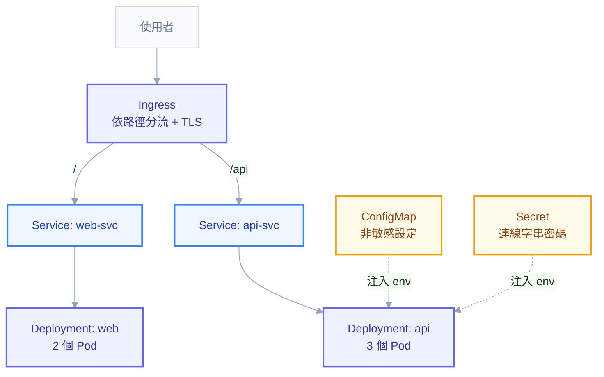

# 實戰第二章：完整部署一組真實應用

上一章你有了兩個映像：`my-api:1.0.0` 和 `my-web:1.0.0`。這一章把它們部署到 K8s，變成一個真的能用的服務——前端可以打開、API 連得到、設定與密碼分開管理、掛了會自己起來、更新時不中斷。

入門篇第五章只寫了 Deployment 和 Service。實務上一組服務需要的東西比那個多，但也沒有想像中多。這一章把它們一次寫齊，**每一段都解釋為什麼需要**。

## 你需要哪些物件



七個物件，各自的職責：

| 物件 | 為什麼需要 |
| --- | --- |
| Namespace | 把這組服務跟別人隔開，也方便一次刪光 |
| ConfigMap | 非敏感設定，跟映像分離 |
| Secret | 密碼類，跟一般設定分開管權限 |
| Deployment × 2 | 維持副本數、滾動更新、自我修復 |
| Service × 2 | 穩定的內部入口與負載平衡 |
| Ingress | 對外的統一入口、路徑分流、TLS |

先建 namespace 並切過去：

```powershell
kubectl create namespace demo
kubectl config set-context --current --namespace=demo
```

## ConfigMap：非敏感設定

```yaml
apiVersion: v1
kind: ConfigMap
metadata:
  name: api-config
  namespace: demo
data:
  ASPNETCORE_ENVIRONMENT: "Production"
  Logging__LogLevel__Default: "Information"
  Features__EnableNewSearch: "true"
  Oracle__Host: "oracle-svc"
  Oracle__Port: "1521"
  Oracle__ServiceName: "XEPDB1"
```

三個要注意的地方。

**所有值都必須是字串**，所以 `1521` 要加引號。這是入門第四章那個 YAML 型別陷阱的實際應用——不加引號 YAML 會解析成數字，而 ConfigMap 的 `data` 只接受字串。

**key 的名字直接對應環境變數名**，雙底線是 ASP.NET Core 的巢狀分隔符（上一章講過），所以 `Logging__LogLevel__Default` 會覆蓋 `appsettings.json` 裡的 `Logging:LogLevel:Default`。

**這裡不能放密碼。** ConfigMap 是明文的，而且通常會進 git。

## Secret：密碼類

```yaml
apiVersion: v1
kind: Secret
metadata:
  name: api-secret
  namespace: demo
type: Opaque
stringData:
  Oracle__User: "app_user"
  Oracle__Password: "SuperSecret123"
```

用 `stringData` 而不是 `data`，你就可以寫明文，API Server 會自動轉成 base64 存起來。（用 `data` 的話要自己先 base64 編碼，容易出錯。）

**但這裡必須講清楚一件事：base64 不是加密。** 任何能讀這個 Secret 的人一行指令就能還原：

```powershell
kubectl get secret api-secret -o jsonpath='{.data.Oracle__Password}' | ForEach-Object { [Text.Encoding]::UTF8.GetString([Convert]::FromBase64String($_)) }
```

所以這份 YAML **絕對不能進 git**。學習階段可以先用 `kubectl create secret` 手動建立：

```powershell
kubectl create secret generic api-secret `
  --from-literal=Oracle__User=app_user `
  --from-literal=Oracle__Password=SuperSecret123
```

正式環境的正解是 Vault + External Secrets Operator（附錄 C-5），讓密碼留在 Vault，K8s 裡只放一份「去哪裡拿」的宣告。這是之後要走的路，現在先知道當前這個做法的極限在哪。

## Deployment：API

這是最長的一份，逐段解釋。

```yaml
apiVersion: apps/v1
kind: Deployment
metadata:
  name: api
  namespace: demo
  labels:
    app.kubernetes.io/name: api
    app.kubernetes.io/part-of: demo-app
    app.kubernetes.io/version: "1.0.0"
spec:
  replicas: 3
  revisionHistoryLimit: 5
  strategy:
    type: RollingUpdate
    rollingUpdate:
      maxSurge: 1
      maxUnavailable: 0
  minReadySeconds: 5
  selector:
    matchLabels:
      app.kubernetes.io/name: api
  template:
    metadata:
      labels:
        app.kubernetes.io/name: api
        app.kubernetes.io/version: "1.0.0"
    spec:
      automountServiceAccountToken: false
      securityContext:
        runAsNonRoot: true
        runAsUser: 64198
        fsGroup: 64198
        seccompProfile:
          type: RuntimeDefault
      containers:
        - name: api
          image: harbor.example.com/demo/my-api:1.0.0
          imagePullPolicy: IfNotPresent
          ports:
            - name: http
              containerPort: 8080
          envFrom:
            - configMapRef:
                name: api-config
            - secretRef:
                name: api-secret
          env:
            - name: ASPNETCORE_URLS
              value: "http://+:8080"
            - name: POD_NAME
              valueFrom:
                fieldRef:
                  fieldPath: metadata.name
          resources:
            requests:
              cpu: "100m"
              memory: "256Mi"
            limits:
              memory: "512Mi"
          startupProbe:
            httpGet:
              path: /healthz
              port: http
            periodSeconds: 5
            failureThreshold: 30
          readinessProbe:
            httpGet:
              path: /readyz
              port: http
            periodSeconds: 5
            timeoutSeconds: 3
          livenessProbe:
            httpGet:
              path: /healthz
              port: http
            periodSeconds: 10
            timeoutSeconds: 3
            failureThreshold: 3
          lifecycle:
            preStop:
              exec:
                command: ["/bin/sh", "-c", "sleep 5"]
          securityContext:
            allowPrivilegeEscalation: false
            readOnlyRootFilesystem: true
            capabilities:
              drop: ["ALL"]
          volumeMounts:
            - name: tmp
              mountPath: /tmp
      terminationGracePeriodSeconds: 30
      volumes:
        - name: tmp
          emptyDir: {}
      imagePullSecrets:
        - name: harbor-cred
```

### labels 用標準名稱

`app.kubernetes.io/name`、`part-of`、`version` 是社群約定的標準標籤。用它們的好處是所有工具（ArgoCD、Prometheus、kubectl 的各種查詢）都認得，`kubectl get all -l app.kubernetes.io/part-of=demo-app` 就能撈出整組服務。自己隨便取名也能動，但會失去這些便利。

**注意 `selector.matchLabels` 只放 `name`，沒有放 `version`。** 這是刻意的——selector 建立後不可修改（附錄 C-2），如果把會變動的 version 放進去，之後升版就得刪掉重建整個 Deployment。

### 更新策略

`maxSurge: 1` + `maxUnavailable: 0` 的組合是「先開新的、確認 Ready 才關舊的」，更新期間容量不會下降。這對線上服務是預設選擇。

`minReadySeconds: 5` 要求新 Pod Ready 之後還要安穩活過 5 秒才算數，可以擋掉「起來就死」的版本一路滾完全部副本。

### 三種 probe 的分工

這一段是整份 YAML 最值得推敲的地方：

- **`startupProbe`**：`failureThreshold: 30` × `periodSeconds: 5` = 最多容忍 150 秒的啟動時間。在它成功之前，另外兩個 probe 完全不會執行。這是慢啟動應用的正確保護方式——**不要**用 `livenessProbe.initialDelaySeconds` 撐，那樣每次重啟都要再等一次。
- **`readinessProbe`** 打 `/readyz`（含資料庫檢查）。失敗只是把這個 Pod 從 Service 移除，不重啟。
- **`livenessProbe`** 打 `/healthz`（只看自己）。上一章解釋過為什麼不能查下游。

`port: http` 用的是上面 `ports[].name` 定義的名稱，比寫數字好——改 port 時只要改一個地方。

### 資源設定

`requests` 是排程依據，`limits` 是上限。這裡刻意**只設記憶體 limit 不設 CPU limit**：記憶體超限會被 OOMKill（必須設上限保護節點），CPU 超限只是變慢，設了反而讓尖峰時無法借用閒置 CPU（正文第 7 章有完整推導）。這是一個有意識的取捨，不是漏寫。

### 安全設定

`runAsNonRoot` + `allowPrivilegeEscalation: false` + `drop: ["ALL"]` + `readOnlyRootFilesystem` + `seccompProfile` 這一組，正好滿足 Pod Security Admission 的 `restricted` 等級。

`readOnlyRootFilesystem: true` 會讓應用無法寫入任何路徑，但 .NET 需要寫 `/tmp`，所以掛一個 `emptyDir` 上去。這是這個設定的標準搭配。

### 優雅關閉

`preStop` 的 `sleep 5` 加上 `terminationGracePeriodSeconds: 30`，作用是：K8s 決定關掉這個 Pod 時，先等 5 秒——這段時間讓 kube-proxy 和 Ingress 把它從轉發表移除——之後才送 SIGTERM 給應用，應用還有 25 秒把手上的請求處理完。

沒有這個 `preStop`，會出現「Pod 已經開始關閉，但流量還在進來」的短暫窗口，症狀是更新期間偶爾出現 502。

## Service

```yaml
apiVersion: v1
kind: Service
metadata:
  name: api-svc
  namespace: demo
spec:
  type: ClusterIP
  selector:
    app.kubernetes.io/name: api
  ports:
    - name: http
      port: 80
      targetPort: http
```

`port: 80` 是 Service 對外的號碼，`targetPort: http` 指向容器那個叫 http 的 port（8080）。**這兩個數字不需要一樣**，而把它們搞混是入門最常見的錯誤之一（入門第五章的實驗 C2）。

前端的 Deployment 與 Service 結構相同，只是映像換成 `my-web:1.0.0`、副本數 2、不需要 ConfigMap 與 Secret，probe 打 `/`。

## Ingress：對外入口

```yaml
apiVersion: networking.k8s.io/v1
kind: Ingress
metadata:
  name: demo-ingress
  namespace: demo
  annotations:
    cert-manager.io/cluster-issuer: letsencrypt-prod
    nginx.ingress.kubernetes.io/proxy-body-size: "20m"
    nginx.ingress.kubernetes.io/proxy-read-timeout: "120"
spec:
  ingressClassName: nginx
  tls:
    - hosts:
        - demo.example.com
      secretName: demo-tls
  rules:
    - host: demo.example.com
      http:
        paths:
          - path: /api
            pathType: Prefix
            backend:
              service:
                name: api-svc
                port:
                  number: 80
          - path: /
            pathType: Prefix
            backend:
              service:
                name: web-svc
                port:
                  number: 80
```

**路徑順序很重要**：`/api` 要放在 `/` 前面。ingress-nginx 實際上是以最長前綴匹配，但把具體的放前面是好習慣，換 controller 時比較不會出意外。

這個設計正好實現了上一章說的「解法一」：前端呼叫 `/api/users`，同網域、同 Ingress，前端映像完全不需要知道後端在哪，也就不需要 build 時注入 API 位址。

`cert-manager.io/cluster-issuer` 這個 annotation 會讓 cert-manager 自動申請並續簽憑證，簽好之後放進 `demo-tls` 這個 Secret。**注意 TLS Secret 必須與 Ingress 在同一個 namespace**（附錄 C-3 的常見誤設第 10 條）。

## 套用與驗證

```powershell
kubectl apply -f k8s/
kubectl get all -n demo
```

然後照這個順序驗證，每一步都有明確的通過標準：

```powershell
# 1. Pod 都 Running 且 READY 是 n/n
kubectl get pods

# 2. Service 找得到後端（空的就是 selector 對不上或 Pod 沒 Ready）
kubectl get endpointslice

# 3. 繞過 Ingress 直接測 Service
kubectl port-forward service/api-svc 8080:80
curl.exe http://localhost:8080/healthz

# 4. 從叢集內部測 DNS 與連通性
kubectl run tester --rm -it --image=curlimages/curl --restart=Never -- curl -s http://api-svc/healthz

# 5. 最後才測 Ingress
kubectl get ingress
curl.exe -H "Host: demo.example.com" http://<ingress-ip>/api/healthz
```

**這個由內而外的順序是刻意的。** 直接測最外層失敗時，你不知道問題在哪一層；一層一層往外走，第一個失敗的地方就是問題所在。

## 第一次部署最常犯的六個錯

| 症狀 | 原因 | 怎麼確認 |
| --- | --- | --- |
| `ImagePullBackOff` | 私有 registry 缺 `imagePullSecrets`，或 tag 打錯 | `kubectl describe pod` 看 Events |
| `CreateContainerConfigError` | ConfigMap／Secret 名稱打錯或不在同 namespace | `describe` 會直接寫出找不到哪個 |
| Pod Running 但 `READY 0/1` | readiness 失敗 | `describe` 看 probe 的錯誤；用 `exec` 進去 curl 測 |
| Service 連不通、endpoints 空的 | selector 標籤與 Pod 不符 | `kubectl get pods --show-labels` 對照 |
| 連得上但沒回應 | `targetPort` 錯，或應用綁了 `127.0.0.1` | `exec` 進去 `curl localhost:8080` |
| Ingress 沒有 ADDRESS | `ingressClassName` 錯或沒有 controller | `kubectl get ingressclass` |

這六個涵蓋了絕大多數的第一次部署失敗。對不上的話，用入門第六章的決策樹。

## 用 Kustomize 管理多環境

同一套 YAML 要部署到 dev 和 prod，只有幾個值不同（副本數、映像 tag、網域）。複製兩份會走向不同步，正解是 Kustomize（kubectl 內建）。

```
k8s/
├── base/
│   ├── kustomization.yaml
│   ├── deployment-api.yaml
│   ├── service-api.yaml
│   └── ingress.yaml
└── overlays/
    ├── dev/kustomization.yaml
    └── prod/kustomization.yaml
```

`overlays/prod/kustomization.yaml`：

```yaml
apiVersion: kustomize.config.k8s.io/v1beta1
kind: Kustomization
namespace: demo-prod
resources:
  - ../../base
images:
  - name: harbor.example.com/demo/my-api
    newTag: 1.0.0
replicas:
  - name: api
    count: 5
patches:
  - target:
      kind: Ingress
      name: demo-ingress
    patch: |-
      - op: replace
        path: /spec/rules/0/host
        value: demo.example.com
```

```powershell
kubectl apply -k k8s/overlays/prod
kubectl kustomize k8s/overlays/prod   # 只看產生的結果，不套用
```

`kubectl kustomize` 那行值得養成習慣——**套用之前先看一眼實際會產生什麼**，比套下去才發現不對好得多。

## 本章回顧

- 一組服務需要七個物件：Namespace、ConfigMap、Secret、Deployment × 2、Service × 2、Ingress
- 用標準 labels，但 `selector` 只放**不會變**的那些（version 不要放）
- `maxSurge: 1` + `maxUnavailable: 0` 是線上服務的預設更新策略
- 三種 probe 各司其職：startup 保護慢啟動、readiness 控流量、liveness 只看自己
- 記憶體要設 limit（保護節點），CPU limit 則是有意識的取捨
- `preStop` + `terminationGracePeriodSeconds` 一起決定更新時會不會掉請求
- 驗證要**由內而外**：Pod → endpoints → Service → 叢集內 DNS → Ingress
- Secret 的 base64 不是加密，正式環境要走 Vault + ESO
- 多環境用 Kustomize overlay，不要複製 YAML

## 自我檢查

1. 為什麼 `selector.matchLabels` 不該放 version 標籤？
2. `port: 80` 和 `targetPort: http` 分別是什麼意思？
3. 為什麼設了 `readOnlyRootFilesystem: true` 還要掛一個 emptyDir 到 `/tmp`？
4. `preStop` 的 sleep 在解決什麼問題？
5. 服務連不通時，第一個要看的東西是什麼？

下一章把它自動化：git push tag → CI 建置推映像 → ArgoCD 自動部署。

## 連結

- [[practice-1-containerize-your-app]] — 上一章：把應用容器化
- [[practice-3-gitops-pipeline]] — 下一章：GitOps 自動部署
- [[04-workloads]] — 正文：workload 與 probe 的完整說明
- [[18-yaml-fields-pod]] — 附錄 C-1：這裡每個欄位的完整參考
- [[28-ingress-nginx-annotations]] — 附錄 F：Ingress annotation 百科
- [[intro-6-error-messages]] — 入門 6：部署失敗時的錯誤訊息翻譯
- [[k8s-mastery]] — 教材總目錄（含各階段的閱讀路徑）
