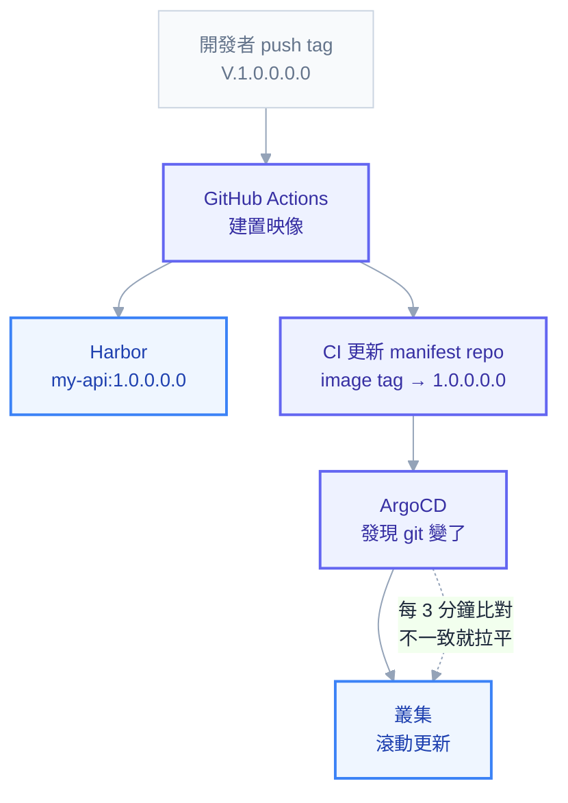

# 實戰第三章：讓部署自動化（GitOps）

上一章你手動跑了 `kubectl apply`，服務跑起來了。這一章要把那個動作拿掉——**因為手動 apply 是所有部署問題的根源**。

原因不是「手動很累」，累只是表面。真正的問題有三個：**沒有紀錄**（誰在什麼時候改了什麼？改之前是什麼樣子？），**會漂移**（有人為了救火直接 `kubectl edit` 改了線上設定，那個改動不在任何檔案裡，下次部署就被蓋掉，或者永遠沒人知道），以及**難以重現**（叢集掛了要重建，你只能憑記憶）。

GitOps 的解法很直接：**git 是唯一真相，叢集只是 git 的投影。** 想改線上，就改 git；叢集發現自己跟 git 不一樣，自己改回去。

## 兩個 repo 的分工

第一個要理解的設計是：**程式碼和部署設定要分開放**。

| repo | 放什麼 | 誰改 |
| --- | --- | --- |
| **app repo** | 原始碼、Dockerfile、單元測試 | 開發者，每天很多次 |
| **manifest repo** | K8s YAML、Kustomize overlay、Helm values | CI 自動改（換 tag），人工改（改設定） |

為什麼不放一起？三個理由。

**權限不同。** 能改程式碼的人不一定該有權改正式環境的副本數與資源配額。分開之後可以對 manifest repo 加嚴格的 review 規則。

**變更頻率不同。** 程式碼一天可能提交幾十次，但正式環境的設定可能一個月才改一次。混在一起，部署歷史會被程式碼提交淹沒。

**避免循環。** CI 建置完要更新映像 tag，如果 tag 寫在同一個 repo，這個提交又會觸發 CI，然後又更新 tag……需要額外的防護才不會無限循環。

## 完整流程



注意那條虛線：**ArgoCD 是主動去拉，不是 CI 推進來的。** 這是 GitOps 跟傳統 CI/CD 最大的差別，也是它的安全優勢——CI 不需要握有叢集的憑證，因為它根本不碰叢集，只改 git。

## CI：建置與推送

`.github/workflows/release.yml`，用 tag 觸發（對應你的 `V.X.X.X.X.X` 格式）：

```yaml
name: Release
on:
  push:
    tags: ["V.*.*.*.*.*"]

permissions:
  contents: read

concurrency:
  group: release-${{ github.ref }}
  cancel-in-progress: false

jobs:
  build-push:
    runs-on: ubuntu-latest
    outputs:
      version: ${{ steps.ver.outputs.version }}
    steps:
      - uses: actions/checkout@v4

      - id: ver
        run: echo "version=${GITHUB_REF_NAME#V.}" >> "$GITHUB_OUTPUT"

      - uses: docker/setup-buildx-action@v3

      - uses: docker/login-action@v3
        with:
          registry: harbor.example.com
          username: ${{ secrets.HARBOR_USERNAME }}
          password: ${{ secrets.HARBOR_PASSWORD }}

      - uses: docker/build-push-action@v6
        with:
          context: ./MyApi
          push: true
          tags: harbor.example.com/demo/my-api:${{ steps.ver.outputs.version }}
          cache-from: type=gha
          cache-to: type=gha,mode=max
```

三個刻意的設定：

`cancel-in-progress: false`——**部署類的工作不能中途被取消**。建置階段可以取消（重跑就好），但如果一次部署做到一半被砍，叢集會停在半套狀態。

`permissions: contents: read`——預設收到最小權限。GitHub 的預設 token 權限很寬，明確收緊是基本功。

Harbor 帳密走 `secrets`——你的 Harbor robot 帳號名稱含 `$`（正文第 13 章的真實案例），直接寫在 YAML 裡會被 shell 展開成空字串，導致認證莫名失敗。走 secret 就不會有這個問題。

## CI：更新 manifest repo

```yaml
  bump-manifest:
    needs: [build-push]
    runs-on: ubuntu-latest
    steps:
      - uses: actions/checkout@v4
        with:
          repository: org/k8s-manifests
          token: ${{ secrets.MANIFEST_REPO_TOKEN }}

      - name: 只改這一個服務的 tag
        env:
          VERSION: ${{ needs.build-push.outputs.version }}
        run: |
          yq -i '(.images[] | select(.name == "harbor.example.com/demo/my-api")).newTag = strenv(VERSION)' \
            overlays/prod/kustomization.yaml

      - run: |
          git config user.name "ci-bot"
          git config user.email "ci@example.com"
          git commit -am "chore(prod): my-api -> ${{ needs.build-push.outputs.version }}"
          git push
```

**這裡用 `yq` 而不是 `sed`，是有代價的教訓。** 用 `sed 's/newTag:.*/newTag: 1.0.0/'` 這種全域替換，會把檔案裡**所有服務**的 tag 一起改掉——你只想部署 API，結果前端也被換成 API 的版本號。這個事故在正文第 13 章的案例庫裡，而且它很難發現，因為 CI 顯示成功、ArgoCD 顯示同步成功，只有服務行為不對。

`yq` 用路徑精準定位，只改指定的那一項。這是「工具選擇本身就是防呆設計」的例子。

## ArgoCD：讓叢集自己拉

```yaml
apiVersion: argoproj.io/v1alpha1
kind: Application
metadata:
  name: demo-prod
  namespace: argocd
  finalizers:
    - resources-finalizer.argocd.argoproj.io
spec:
  project: default
  source:
    repoURL: https://github.com/org/k8s-manifests.git
    targetRevision: main
    path: overlays/prod
  destination:
    server: https://kubernetes.default.svc
    namespace: demo-prod
  syncPolicy:
    automated:
      prune: true
      selfHeal: true
      allowEmpty: false
    syncOptions:
      - CreateNamespace=true
      - PruneLast=true
    retry:
      limit: 5
      backoff:
        duration: 5s
        factor: 2
        maxDuration: 3m
  ignoreDifferences:
    - group: apps
      kind: Deployment
      jsonPointers:
        - /spec/replicas
```

四個欄位決定了這個 Application 的性格：

**`selfHeal: true`** ——有人手動 `kubectl edit` 改了叢集，ArgoCD 會把它改回 git 的樣子。這一行把「不准手改線上」從**規定**變成**技術上做不到**，是 GitOps 最實際的價值。

**`prune: true`** ——git 裡刪掉的資源，叢集也跟著刪。沒開的話，你以為刪掉的舊服務其實還在跑（還在燒錢、還可能被存取）。

**`allowEmpty: false`** ——防呆。萬一 CI 出錯把目錄清空了，ArgoCD 不會照著把叢集資源全刪光。

**`ignoreDifferences` 忽略 `/spec/replicas`** ——如果你用 HPA 自動擴縮，副本數會一直變動，而 git 裡寫的是固定值。不忽略的話，ArgoCD 會不斷把副本數改回 git 的值，HPA 又改回去，兩者無限打架。**這是 HPA + GitOps 組合的必要設定**，也是新手最常踩的坑。

套用之後：

```powershell
kubectl apply -f application.yaml
argocd app get demo-prod
argocd app sync demo-prod        # 手動觸發一次（自動同步預設約 3 分鐘輪詢）
```

## 讀懂 ArgoCD 的狀態

ArgoCD 有**兩個互相獨立**的狀態維度，混淆它們會導致查錯方向：

| | 意思 |
| --- | --- |
| **Sync Status** | 叢集跟 git 一不一樣 |
| **Health Status** | 這些資源本身健不健康 |

四種組合的判讀：

| 組合 | 意思 | 下一步 |
| --- | --- | --- |
| `Synced` + `Healthy` | 一切正常 | — |
| `Synced` + `Degraded` | **YAML 已照 git 部署，但 Pod 起不來** | 查 Pod，跟 ArgoCD 無關 |
| `OutOfSync` + `Healthy` | 有差異但服務正常 | 多半是 webhook 或預設值造成，用 `ignoreDifferences` 處理 |
| `OutOfSync` + `Degraded` | 同步失敗且服務有問題 | 看 `argocd app get` 的 message |

**`Synced` + `Degraded` 是最容易誤判的一個。** 很多人看到紅字就去查 ArgoCD，但 ArgoCD 的工作已經完成了——它把 git 的內容部署了，是應用自己起不來。這時候該做的是 `kubectl describe pod`，回到入門第六章的排錯流程。

診斷差異：

```powershell
argocd app diff demo-prod
kubectl get application demo-prod -n argocd -o jsonpath='{.status.conditions}'
```

看起來明明一樣卻顯示 OutOfSync 時，通常是快取——ArgoCD 有一個「hard refresh」可以強制重讀 repo（UI 上是 Refresh 旁的下拉選單）。

## 部署順序：Sync Wave

資料庫 migration 必須在新版程式啟動**之前**跑完，否則新程式會查到不存在的欄位。ArgoCD 用 annotation 控制順序：

```yaml
apiVersion: batch/v1
kind: Job
metadata:
  name: db-migrate
  annotations:
    argocd.argoproj.io/hook: PreSync
    argocd.argoproj.io/hook-delete-policy: HookSucceeded
spec:
  template:
    spec:
      restartPolicy: Never
      containers:
        - name: migrate
          image: harbor.example.com/demo/my-api:1.0.0
          command: ["dotnet", "MyApi.dll", "--migrate-only"]
```

`hook: PreSync` 讓這個 Job 在所有其他資源之前執行，而且**失敗就中止整個同步**——新版程式不會被部署，避免了「程式已上線但資料庫還沒 migrate」的災難。`hook-delete-policy: HookSucceeded` 讓成功的 Job 自動清掉，不會累積。

一般資源之間的順序則用 `argocd.argoproj.io/sync-wave`（數字小的先，可為負數）。

## 怎麼回滾

有兩種方式，用途不同：

**`git revert` + 讓 ArgoCD 同步**（推薦）：

```powershell
git revert <壞掉的那個 commit>
git push
```

好處是 git 歷史保持真實——**回滾這件事本身也被記錄下來**，而且下次有人看 git 會知道發生過什麼。

**`argocd app rollback`**（緊急時）：

```powershell
argocd app history demo-prod
argocd app rollback demo-prod <revision-id>
```

比較快，但它讓叢集暫時偏離 git。**用了之後一定要記得回頭修 git**，否則下一次同步又會把壞版本推回去。半夜救火用它，但隔天早上要補上 git 的修正。

## 常見的坑

| 症狀 | 原因 | 解法 |
| --- | --- | --- |
| 副本數一直跳動 | HPA 與 git 的 `replicas` 互相覆寫 | `ignoreDifferences` 忽略 `/spec/replicas` |
| CI 成功但部署的是錯的版本 | `sed` 全域替換改到別的服務 | 改用 `yq` 精準路徑 |
| Harbor 認證莫名失敗 | robot 名稱含 `$` 被 shell 展開 | 走 GitHub secret，不要寫在指令裡 |
| 一直 OutOfSync 但看起來一樣 | mutating webhook 改了物件（例如 Istio 注入 sidecar） | `ignoreDifferences` 或 `ServerSideApply=true` |
| 刪了 git 檔案但叢集還在 | 沒開 `prune` | 開啟 `prune: true` |
| 有人手改線上，過幾分鐘變回去 | `selfHeal` 生效中 | 這是**正確行為**，要改就改 git |
| 同步時服務短暫中斷 | 刪除舊資源與建立新資源交錯 | 加 `PruneLast=true` |

倒數第二條值得特別說明：第一次遇到「我改的東西自己變回去了」時，很多人以為是 bug。那正是 selfHeal 在工作——**你的手改被視為漂移，被自動修正了**。這正是你要的行為。

## 上線前檢查清單

- [ ] app repo 與 manifest repo 分開
- [ ] CI 用 tag 觸發，版本號從 tag 解析
- [ ] 部署 job 的 `cancel-in-progress: false`
- [ ] 更新 image tag 用 `yq` 精準路徑，不用 `sed`
- [ ] registry 憑證走 secret
- [ ] ArgoCD 開 `selfHeal` 與 `prune`，並設 `allowEmpty: false`
- [ ] 用 HPA 的服務有 `ignoreDifferences` 忽略 replicas
- [ ] DB migration 用 PreSync hook
- [ ] manifest repo 的正式環境目錄有 PR review 保護
- [ ] 團隊知道「改線上要改 git」，且知道回滾方式

## 本章回顧

- 手動 apply 的問題是**沒紀錄、會漂移、難重現**，不只是累
- app repo 與 manifest repo 分開：權限不同、頻率不同、避免 CI 循環
- ArgoCD 是**主動拉**，所以 CI 不需要叢集憑證
- `selfHeal` 把「不准手改線上」從規定變成技術上做不到
- Sync 與 Health 是兩個獨立維度，`Synced` + `Degraded` 代表該查 Pod 而不是查 ArgoCD
- HPA + GitOps 必須忽略 `/spec/replicas`，否則兩者無限打架
- 回滾優先用 `git revert`，緊急才用 `argocd rollback`（事後要補 git）

## 自我檢查

1. 為什麼程式碼和部署設定要放在不同的 repo？
2. ArgoCD 是 CI 推給它，還是它自己去拉？這個差別帶來什麼好處？
3. `Synced` + `Degraded` 代表什麼？你該去查什麼？
4. 為什麼用 HPA 就一定要設 `ignoreDifferences`？
5. 你手動改了線上設定，五分鐘後變回去了，發生什麼事？

到這裡，你已經走完「寫程式 → 容器化 → 部署 → 自動化」的完整鏈路。接下來該回頭把原理補齊——正文的十六章就是為此存在。

## 連結

- [[practice-2-deploy-real-app]] — 上一章：完整部署一組應用
- [[11-argocd]] — 正文：GitOps pull 模型、Sync Wave、OutOfSync 診斷的完整說明
- [[22-yaml-fields-ecosystem]] — 附錄 C-5：ArgoCD Application/AppProject/ApplicationSet 全欄位
- [[25-yaml-fields-pipeline]] — 附錄 C-8：GitHub Actions workflow 全欄位
- [[13-troubleshooting]] — 正文：`sed` 互蓋、Harbor robot `$` 等真實案例
- [[cicd-pipeline]] — CI/CD 完整流程
- [[61-compliance-and-audit]] — 附錄 AM：GitOps 天然滿足職務分離，但前提是人真的沒有寫入權
- [[63-ci-in-cluster]] — 附錄 AO：那 runner 本身可以搬進叢集嗎？三個難點與決策
- [[k8s-mastery]] — 教材總目錄（含各階段的閱讀路徑）
