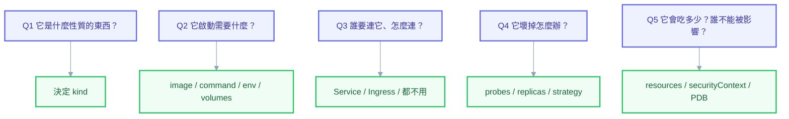

# 實戰第四章：不靠複製貼上，自己寫出 YAML

前面幾章給了你一堆可以抄的範例，附錄 C 有八份逐欄位的參考。但這些解決的都是「查」的問題，不是「寫」的問題。

真正的卡點通常長這樣：主管說「幫我把對帳程式排成每天凌晨三點跑」，你打開編輯器，游標在第一行閃，然後你去 Google「kubernetes cronjob example」。**能改範例，但寫不出來。**

這一章要處理的就是這件事。核心觀點有兩個：第一，**你永遠不需要從空白檔案開始**——K8s 內建了產生骨架的工具，不用它是在為難自己；第二，寫 YAML 不是回憶欄位，而是**回答一連串關於需求的問題**，每個答案對應到某些欄位。學會問那些問題，欄位自己會長出來。

## 第一件事：不要從空白開始

多數人不知道 `kubectl create` 可以只產生 YAML 而不真的建立東西：

```powershell
kubectl create deployment api --image=my-api:1.0 --dry-run=client -o yaml
```

```yaml
apiVersion: apps/v1
kind: Deployment
metadata:
  creationTimestamp: null
  labels:
    app: api
  name: api
spec:
  replicas: 1
  selector:
    matchLabels:
      app: api
  strategy: {}
  template:
    metadata:
      creationTimestamp: null
      labels:
        app: api
    spec:
      containers:
        - image: my-api:1.0
          name: api
          resources: {}
status: {}
```

骨架有了。`apiVersion` 不用背、`selector` 跟 `template.labels` 的對應關係自動幫你配好、巢狀結構不會縮排錯。你要做的只剩「往上加需要的東西」與「刪掉 `creationTimestamp: null`、`status: {}` 這些垃圾」。

**這是整章最重要的一句話：你的起點永遠是一份能跑的最小骨架，不是空白檔案。**

常用的骨架產生指令，值得存成書籤：

```powershell
# 工作負載
kubectl create deployment api --image=my-api:1.0 --dry-run=client -o yaml
kubectl create job migrate --image=my-api:1.0 --dry-run=client -o yaml
kubectl create cronjob report --image=my-api:1.0 --schedule="0 3 * * *" --dry-run=client -o yaml

# 網路
kubectl create service clusterip api --tcp=80:8080 --dry-run=client -o yaml
kubectl create ingress web --rule="example.com/api*=api-svc:80" --dry-run=client -o yaml

# 設定
kubectl create configmap app-config --from-literal=LOG_LEVEL=info --dry-run=client -o yaml
kubectl create secret generic db --from-literal=password=x --dry-run=client -o yaml

# 權限
kubectl create serviceaccount app-sa --dry-run=client -o yaml
kubectl create role reader --verb=get,list --resource=pods --dry-run=client -o yaml
kubectl create rolebinding reader-bind --role=reader --serviceaccount=demo:app-sa --dry-run=client -o yaml

# 其他
kubectl create namespace demo --dry-run=client -o yaml
kubectl create quota compute --hard=cpu=10,memory=20Gi --dry-run=client -o yaml
```

沒有對應 `create` 指令的資源（PVC、NetworkPolicy、HPA v2、PDB），就從附錄 B 的骨架庫複製——**但那是複製「結構」，不是複製「答案」**，接下來每個欄位的值仍然要靠下一節的方法推導。

## 第二件事：五個問題，長出所有欄位

拿到需求之後，依序問這五個問題。每個問題的答案會直接對應到一組欄位。



### Q1：它是什麼性質的東西？→ 決定 `kind`

| 需求裡出現的字眼 | kind |
| --- | --- |
| 「一直跑著、隨時能接請求」「多開幾份分擔」 | `Deployment` |
| 「每個副本要有自己的資料」「有主從、有順序」 | `StatefulSet` |
| 「每台機器都要跑一份」（日誌收集、監控 agent） | `DaemonSet` |
| 「跑完就結束」「一次性的匯入／遷移」 | `Job` |
| 「每天／每小時定時跑」 | `CronJob` |

判斷不出來時問一個問題：**「這個程式跑完會自己結束嗎？」** 會結束就是 Job 家族，不會結束就是 Deployment 家族。再問第二個問題：**「兩個副本可以完全一樣、互相取代嗎？」** 可以就 Deployment，不行（各自有身分與資料）就 StatefulSet。

### Q2：它啟動需要什麼？→ 容器內容

逐項問，有就寫，沒有就跳過：

| 問題 | 對應欄位 |
| --- | --- |
| 用哪個映像？哪一版？ | `image`（**永遠鎖版本**） |
| 要覆蓋預設啟動指令嗎？ | `command` / `args` |
| 有哪些設定值？ | `env` / `envFrom` + ConfigMap |
| 有密碼、金鑰嗎？ | `envFrom` + Secret |
| 需要讀寫檔案嗎？重開要保留嗎？ | 要保留 → PVC；不用保留 → `emptyDir` |
| 需要掛設定檔（不是環境變數）嗎？ | ConfigMap 掛成 volume |
| 需要知道自己是誰（Pod 名、Node 名）嗎？ | Downward API |
| 要打 K8s API 嗎？ | ServiceAccount + RBAC；**不用的話設 `automountServiceAccountToken: false`** |

### Q3：誰要連它、怎麼連？→ 網路物件

| 情境 | 要什麼 |
| --- | --- |
| 完全不需要被連（批次工作） | **什麼都不用**——不要為了習慣而建 Service |
| 只有叢集內部要連 | `Service`（`ClusterIP`） |
| 外部使用者要用網址連 | `Service` + `Ingress` |
| 每個副本要能被個別定址（資料庫叢集） | headless `Service`（`clusterIP: None`） |
| 只能被特定來源連 | 再加 `NetworkPolicy` |

「批次工作不需要 Service」這一條值得強調——很多人套範本時連 Job 都配一個 Service，那是純粹的雜訊。

### Q4：它壞掉怎麼辦？→ 韌性欄位

| 問題 | 欄位 | 沒想清楚的後果 |
| --- | --- | --- |
| 怎麼判斷它還活著？ | `livenessProbe`（**只檢查自己**） | 不設＝當掉了也不會重啟 |
| 怎麼判斷它能接請求了？ | `readinessProbe`（可含下游） | 不設＝還沒好就開始收流量，更新時掉請求 |
| 啟動要多久？ | `startupProbe` | 慢啟動被 liveness 誤殺 |
| 要幾份？ | `replicas` | 單份＝更新一定中斷 |
| 更新時能容忍降載嗎？ | `strategy.rollingUpdate` | 預設 25% 不可用 |
| 關閉時手上的請求怎麼辦？ | `preStop` + `terminationGracePeriodSeconds` | 更新期間偶發 502 |
| 失敗要重試幾次？（Job） | `backoffLimit` | 無意義的重試燒資源 |

### Q5：它會吃多少？誰不能被影響？→ 資源與安全

| 問題 | 欄位 |
| --- | --- |
| 正常用多少？（排程依據） | `resources.requests` |
| 最多能吃多少？ | `resources.limits.memory`（**一定要設**） |
| 需要 root 嗎？ | `securityContext`（預設答案是「不需要」） |
| 需要寫入根目錄嗎？ | `readOnlyRootFilesystem: true` + `emptyDir` 掛可寫路徑 |
| 維護時最少要留幾份？ | `PodDisruptionBudget` |
| 要不要跟著負載自動增減？ | `HorizontalPodAutoscaler` |

## 完整推導示範：對帳程式

需求原文：

> 「我們有一支對帳程式，每天凌晨三點跑，要連 Oracle 撈前一天的交易。跑很久，大概二十分鐘到一小時。**絕對不能同時跑兩份**，會重複入帳。失敗的話重試兩次就好，不要一直重試。」

一句一句對應到欄位：

**「每天凌晨三點跑」** → Q1 定 kind 為 `CronJob`，`schedule: "0 3 * * *"`。而且——**時區！** K8s 的 CronJob 預設用 UTC，凌晨三點會變成上午十一點。必須寫 `timeZone: "Asia/Taipei"`。這是需求裡沒說、但你必須主動想到的。

**「絕對不能同時跑兩份」** → 這句話同時決定兩個欄位。`concurrencyPolicy: Forbid` 讓前一次沒跑完就跳過這次；`parallelism: 1`（預設值，明確寫出來表達意圖）。

**「跑很久，二十分鐘到一小時」** → `activeDeadlineSeconds` 設一個上限（例如 7200，兩小時），避免卡死的任務永遠佔著。也代表**不能設 `livenessProbe`**（批次工作沒有健康端點）。

**「失敗重試兩次」** → `backoffLimit: 2`。

**「連 Oracle」** → Q2：需要連線資訊（ConfigMap）與密碼（Secret）。

**沒有人要連它** → Q3：不需要 Service。

**Q5 補上**：資源要設、非 root 要設、跑完要自動清掉（`ttlSecondsAfterFinished`，否則每天累積一個 Completed Pod，一年就是 365 個）。

從骨架開始：

```powershell
kubectl create cronjob reconcile --image=harbor.example.com/demo/recon:1.0.0 --schedule="0 3 * * *" --dry-run=client -o yaml > cronjob.yaml
```

補完之後：

```yaml
apiVersion: batch/v1
kind: CronJob
metadata:
  name: reconcile
  namespace: demo
spec:
  schedule: "0 3 * * *"
  timeZone: "Asia/Taipei" # 需求說凌晨三點，不寫會變 UTC
  concurrencyPolicy: Forbid # 需求說「絕對不能同時兩份」
  startingDeadlineSeconds: 600 # 叢集當時忙碌就晚一點跑，超過十分鐘才放棄
  successfulJobsHistoryLimit: 3
  failedJobsHistoryLimit: 5 # 失敗的多留幾筆好查
  jobTemplate:
    spec:
      backoffLimit: 2 # 需求說重試兩次
      activeDeadlineSeconds: 7200 # 跑最久一小時，給兩小時上限
      ttlSecondsAfterFinished: 86400 # 一天後自動清掉，不累積
      template:
        spec:
          restartPolicy: OnFailure # Job 只能是 OnFailure 或 Never
          securityContext:
            runAsNonRoot: true
            runAsUser: 64198
            seccompProfile:
              type: RuntimeDefault
          containers:
            - name: reconcile
              image: harbor.example.com/demo/recon:1.0.0
              envFrom:
                - configMapRef:
                    name: api-config
                - secretRef:
                    name: api-secret
              resources:
                requests:
                  cpu: "200m"
                  memory: "512Mi"
                limits:
                  memory: "1Gi"
              securityContext:
                allowPrivilegeEscalation: false
                readOnlyRootFilesystem: true
                capabilities:
                  drop: ["ALL"]
```

**每一個欄位都能指回需求的某一句，或指回五個問題的某一題。** 沒有一個是「範例裡有所以我留著」——這就是「自己寫出來」跟「改範例」的差別。

反過來檢查也成立：需求說「失敗要通知」，而上面這份 YAML 沒有任何欄位對應到它。這正確地暴露了一件事——**K8s 沒有內建通知機制**，這個需求要靠監控告警（`kube_job_status_failed` 指標）來滿足，不是 YAML 能解決的。**能看出「這個需求 YAML 做不到」，也是這套方法的產出之一。**

## 第二個示範：把需求翻成 Deployment

> 「前端要能連到這個 API，一天大概三萬次請求，尖峰在早上九點。更新的時候不能中斷。它要三十秒左右才啟動完成。」

| 需求 | 欄位 |
| --- | --- |
| 「前端要能連」 | Service + Ingress（Q3） |
| 「三萬次／天、尖峰早上九點」 | 有明顯尖峰 → HPA；`requests` 依實測設（Q5） |
| 「更新不能中斷」 | `replicas: 3`、`maxUnavailable: 0`、`readinessProbe`、`preStop`（Q4） |
| 「三十秒才啟動完成」 | `startupProbe` 給 `failureThreshold × periodSeconds > 30s`（Q4） |

「三十秒啟動」這句話特別值得練習。新手的直覺是 `livenessProbe.initialDelaySeconds: 30`，但這是錯的——**那會讓每次重啟都再空等 30 秒**。正解是 `startupProbe`，它成功之後就把棒子交給另外兩個 probe，重啟時同樣受保護但不浪費時間。

需求說的是「三十秒左右」，所以門檻要留餘裕：`periodSeconds: 5` × `failureThreshold: 12` = 最多容忍 60 秒。

## 反向練習：讀一份 YAML，說出它在回答什麼

正向寫得出來之後，用反向練習驗證你真的懂。看到下面這幾行，你應該能說出它背後的需求或決策：

| 看到 | 它在回答什麼 |
| --- | --- |
| `maxUnavailable: 0` | 「更新時容量不能下降」 |
| `clusterIP: None` | 「我要能個別連到每一個副本」 |
| `readOnlyRootFilesystem: true` + `emptyDir` on `/tmp` | 「加固，但程式需要寫暫存檔」 |
| `envFrom` 而不是 `env` | 「設定很多，而且不需要熱更新」 |
| `subPath` 掛單一檔案 | 「要注入到一個已經有別的檔案的目錄」（**代價是失去熱更新**） |
| `topologySpreadConstraints` | 「副本不能全擠在同一台／同一區」 |
| `ignoreDifferences` on `/spec/replicas` | 「這個服務由 HPA 管副本數」 |
| 沒有設 CPU limit | 「刻意讓它在尖峰能借用閒置 CPU」 |

看到欄位卻說不出它在回答什麼需求，就是該去查附錄 C 的訊號。

## 遇到不確定的欄位：三個自問工具

### 工具一：`kubectl explain` 往下探

不必記欄位，問叢集就好。它回答的永遠是**你這座叢集這個版本**支援什麼：

```powershell
kubectl explain cronjob.spec                     # 這一層有哪些欄位
kubectl explain cronjob.spec.jobTemplate.spec    # 往下一層
kubectl explain deployment.spec.template.spec.containers.livenessProbe --recursive  # 整棵子樹攤平
```

### 工具二：`--dry-run=server` 看 K8s 補了什麼

```powershell
kubectl apply -f cronjob.yaml --dry-run=server -o yaml
```

你寫 30 行、它回你 90 行，多出來的 60 行全是預設值。**這是理解「不寫會怎樣」最快的方法**——想知道 `concurrencyPolicy` 不寫是什麼，看回傳的 YAML 就有答案（是 `Allow`）。

### 工具三：從活著的東西反推

叢集裡已經有一個做類似事情的資源時，直接拿它當參考：

```powershell
kubectl get deploy api -o yaml > reference.yaml
```

不過要注意：這份輸出含有大量執行期欄位（`status`、`managedFields`、`creationTimestamp`、`resourceVersion`），不能直接拿去 apply。安裝 `kubectl-neat` 外掛可以自動清乾淨：

```powershell
kubectl get deploy api -o yaml | kubectl neat
```

## 寫完之後的四步驗證

寫出來不代表對。按這個順序驗，每一步抓的是不同層次的問題：

```powershell
# 1. YAML 語法對不對
python -c "import yaml;yaml.safe_load(open('x.yaml',encoding='utf-8'));print('OK')"

# 2. 欄位名稱與型別對不對（不需要連叢集）
kubeconform -strict -summary x.yaml

# 3. K8s 真的接受嗎，它會補什麼預設值
kubectl apply -f x.yaml --dry-run=server -o yaml

# 4. 有沒有踩到最佳實踐的雷
kube-linter lint x.yaml
```

第 4 步的 `kube-linter` 特別適合這個階段——它會直接告訴你「沒設 readinessProbe」「用了 latest tag」「以 root 執行」這類問題。**把它當成免費的資深同事 review**，比自己土法煉鋼快得多。

再加上附錄 C-4 結尾那份通用檢查清單走一遍，就算完成。

## 練習題

自己從零寫，寫完用 `--dry-run=server` 驗證。答案在附錄 B 的骨架庫與附錄 C 的欄位百科裡，但**先自己寫完再對照**。

1. 「內部工具，只有公司內網要用，一份就夠，重開機資料不用留。」
2. 「Redis 快取，叢集內部使用，資料重開要留著，只有一份。」
3. 「每台機器都要跑一個日誌收集 agent，要能讀到主機的 `/var/log`。」
4. 「一次性的資料庫 schema 遷移，必須在新版程式部署前跑完，失敗就中止整個部署。」
5. 「對外 API，尖峰時段要能自動從 3 份擴到 20 份，維護 Node 時最少要保留 2 份可用。」

<details>
<summary>解題方向（不是完整答案）</summary>

1. Deployment + ClusterIP Service（不要 Ingress，因為不需對外）+ `emptyDir`。`replicas: 1` 代表更新會中斷，需求可接受就不用 PDB。
2. **StatefulSet**（要留資料 + 單一身分）+ headless Service + `volumeClaimTemplates`。用 Deployment + PVC 在單副本時也能動，但擴容或重排程時會撞 RWO 的 Multi-Attach。
3. DaemonSet + `hostPath` 掛 `/var/log`（唯讀）+ `tolerations: [{operator: Exists}]` 讓 control plane 節點也跑。不需要 Service。
4. Job + ArgoCD 的 `argocd.argoproj.io/hook: PreSync` + `hook-delete-policy: HookSucceeded`。「失敗就中止部署」正是 PreSync hook 的語意。
5. Deployment（`replicas` 交給 HPA，git 裡不要寫死）+ HPA `minReplicas: 3, maxReplicas: 20` + PDB `minAvailable: 2` + Service + Ingress。記得 ArgoCD 要 `ignoreDifferences` 忽略 replicas。

</details>

## 本章回顧

- **永遠不要從空白檔案開始**——`kubectl create ... --dry-run=client -o yaml` 產生骨架
- 寫 YAML 是**回答五個關於需求的問題**，不是回憶欄位：什麼性質 → 啟動需要什麼 → 誰要連 → 壞掉怎麼辦 → 吃多少／影響誰
- 每個欄位都要能指回需求的某一句；指不回去的就該刪掉
- 需求裡沒寫但你必須主動想到的東西（時區、TTL、非 root、資源上限）才是專業度所在
- 「這個需求 YAML 做不到」也是有效產出
- 三個自問工具：`kubectl explain`、`--dry-run=server`、從活著的資源反推
- 四步驗證：語法 → schema → API Server → 最佳實踐 linter

## 自我檢查

1. 要寫一個新的 Deployment，你的第一個動作是什麼？
2. 「這個程式跑完會自己結束嗎」這個問題在決定什麼？
3. 需求說「三十秒才啟動完成」，你設哪個 probe？為什麼不是 `initialDelaySeconds`？
4. 怎麼知道某個欄位不寫的話預設值是什麼？
5. 看到一份 YAML 有 `clusterIP: None`，你知道作者在解決什麼需求嗎？

## 連結

- [[practice-3-gitops-pipeline]] — 上一章：GitOps 自動部署
- [[intro-4-yaml-syntax]] — 入門 4：YAML 語法本身
- [[18-yaml-fields-pod]] — 附錄 C-1：欄位百科（查詢用）
- [[17-cheatsheet]] — 附錄 B：17 種 YAML 骨架
- [[21-yaml-fields-cluster-security]] — 附錄 C-4：結尾的通用檢查清單
- [[03-api-and-yaml]] — 正文：API 機制與 `kubectl explain` 的原理
- [[k8s-mastery]] — 教材總目錄（含各階段的閱讀路徑）
