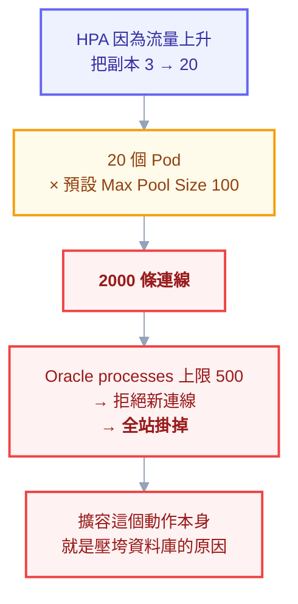

# 實戰第五章：接上資料庫

前面四章部署的服務都是無狀態的——砍掉重建沒有任何損失。但真實的應用幾乎都要連資料庫，而資料庫是整個系統裡**唯一不能隨便砍掉重建**的東西。

這一章處理三件事：資料庫該不該跑在 K8s 裡（這是最重要的決策，錯了後面全錯）、應用怎麼安全地連上它、以及 schema 變更怎麼跟部署配合。內容以你的 Oracle 環境為主軸，但原則適用於任何資料庫。

## 第一個決策：資料庫要跑在 K8s 裡嗎

先講結論：**多數情況下不要。** 這不是保守，是取捨。

K8s 的核心假設是「Pod 可拋棄、可隨時重排程」，而資料庫的核心需求是「資料絕對不能掉、身分要穩定、IO 要快」。這兩者不是不能調和（StatefulSet 就是為此設計的），但調和的成本很高，而收益在多數團隊身上並不存在。

| 情境 | 建議 | 理由 |
| --- | --- | --- |
| 公司已有 Oracle 主機／DBA 團隊 | **外部資料庫**，K8s 只連過去 | 備份、調校、授權都有現成流程，沒有理由搬 |
| 雲端環境 | **託管服務**（RDS、Cloud SQL、Autonomous DB） | 備份、HA、修補都是別人的事 |
| 開發／測試環境 | 跑在 K8s 沒問題 | 資料可拋棄，省成本，環境好重建 |
| 需要大量獨立資料庫實例（多租戶、每個 PR 一個環境） | 跑在 K8s，用 Operator | 自動化的價值超過運維成本 |
| 團隊有專職平台工程能力，且已用成熟 Operator | 可以考慮 | CloudNativePG、Percona 這類 Operator 已相當成熟 |

**Oracle 特別要謹慎。** 除了技術面，還有授權面——Oracle 的授權計費在容器環境的認定相當複雜，而且 K8s 上的 Oracle 生態遠不如 PostgreSQL 成熟。你的環境已經有 Oracle 主機的話，**讓應用跑在 K8s、資料庫留在外面，是明顯正確的選擇**。

這一章因此分兩條路：先講「連外部資料庫」（你的情況），再講「跑在 K8s 裡」（開發環境或未來需要時）。

---

## 路線 A：連外部資料庫

### 三種接法

假設 Oracle 在 `oracle-prod.internal:1521`，叢集外。

**做法一：直接寫在設定裡（最簡單，適合起步）**

```yaml
apiVersion: v1
kind: ConfigMap
metadata:
  name: api-config
data:
  Oracle__Host: "oracle-prod.internal"
  Oracle__Port: "1521"
  Oracle__ServiceName: "ORCLPDB1"
```

**做法二：用 ExternalName Service 包一層（推薦）**

```yaml
apiVersion: v1
kind: Service
metadata:
  name: oracle-db
  namespace: demo
spec:
  type: ExternalName
  externalName: oracle-prod.internal
```

應用連 `oracle-db`（叢集內名稱），K8s 的 DNS 回一個 CNAME 指向真正的主機。好處是**換資料庫主機時只要改這一個 Service，應用的設定完全不動**——dev 指向測試庫、prod 指向正式庫，用同一份應用設定。

注意 `ExternalName` **只做 DNS 別名，不做代理**，所以它不能改 port、不能負載平衡、也不受 NetworkPolicy 管（因為根本沒有流量經過 K8s 的轉發層）。

**做法三：無 selector 的 Service + 手動 EndpointSlice（要用 IP 時）**

資料庫只有 IP 沒有 DNS 名稱時用這個（附錄 C-3 有完整欄位）：

```yaml
apiVersion: v1
kind: Service
metadata:
  name: oracle-db
spec:
  ports:
    - port: 1521
---
apiVersion: discovery.k8s.io/v1
kind: EndpointSlice
metadata:
  name: oracle-db-1
  labels:
    kubernetes.io/service-name: oracle-db
addressType: IPv4
ports:
  - port: 1521
endpoints:
  - addresses: ["10.20.30.40"]
```

這種做法流量**會**經過 kube-proxy，所以 NetworkPolicy 管得到，也能在 Service 層做 port 轉換。

### 連線字串放哪

拆成兩半：**非敏感的放 ConfigMap，密碼放 Secret**（實戰第二章做過）。組裝可以交給應用：

```yaml
env:
  - name: ConnectionStrings__DefaultConnection
    value: "User Id=$(Oracle__User);Password=$(Oracle__Password);Data Source=$(Oracle__Host):$(Oracle__Port)/$(Oracle__ServiceName);"
```

`$(VAR)` 是 K8s 的環境變數展開語法（不是 shell 的），會用同一個容器裡先定義的變數替換。注意**引用的變數必須在 `env` 陣列中更早出現**，順序錯了不會展開，會原封不動變成字面字串。

正式環境的正解仍是 Vault + External Secrets Operator（附錄 C-5）——讓密碼留在 Vault，K8s 裡只有一份「去哪拿」的宣告，git 裡不出現任何機密。

### 別忘了 egress 與防火牆

叢集裡有 NetworkPolicy 的話，**預設 deny 會把資料庫連線一起擋掉**，而症狀是連線逾時，看起來像資料庫掛了：

```yaml
apiVersion: networking.k8s.io/v1
kind: NetworkPolicy
metadata:
  name: api-egress
  namespace: demo
spec:
  podSelector:
    matchLabels:
      app.kubernetes.io/name: api
  policyTypes: [Egress]
  egress:
    - to:
        - namespaceSelector: {}
          podSelector:
            matchLabels:
              k8s-app: kube-dns
      ports:
        - protocol: UDP
          port: 53
        - protocol: TCP
          port: 53
    - to:
        - ipBlock:
            cidr: 10.20.30.40/32 # 資料庫主機
      ports:
        - protocol: TCP
          port: 1521
```

**DNS 那條一定要寫**（附錄 D 的實驗 C4 讓你親手踩過這個坑）。

另一個方向的問題是資料庫端的防火牆：Pod 的來源 IP 通常會被 SNAT 成 Node IP，所以 DBA 要放行的是**所有 Node 的 IP**，不是 Pod 網段。節點會增減的話，這件事要納入擴容流程。

---

## 連線池：最容易算錯的一件事

這一節是整章最實用的部分，因為它的錯誤方式很隱蔽：**你的應用在單機時完全正常，上了 K8s 之後把資料庫打掛。**

原因是乘法：

```
資料庫實際連線數 = Pod 數 × 每個 Pod 的連線池大小
```



.NET 的 Oracle 連線池預設 `Max Pool Size=100`。三個副本就是 300 條連線。開了 HPA 擴到 20 個副本，就是 **2000 條**——多數 Oracle 執行個體的 `processes` 參數根本沒設這麼高，結果是資料庫拒絕新連線，全站掛掉，而且**擴容這個動作本身就是壓垮它的原因**。

正確做法是反過來算：

```
每個 Pod 的連線池上限 = (資料庫能接受的連線數 × 安全係數) ÷ 最大 Pod 數
```

資料庫允許 500 條、留 20% 給其他系統與 DBA、HPA 最大 20 個副本：

```
(500 × 0.8) ÷ 20 = 20 條/Pod
```

```yaml
env:
  - name: ConnectionStrings__DefaultConnection
    value: "...;Min Pool Size=2;Max Pool Size=20;Connection Timeout=15;"
```

三個延伸提醒：

**HPA 的 `maxReplicas` 從此不只是成本問題，也是資料庫容量問題。** 調高它之前要重算連線池。

**CronJob 與 Job 也要算進去。** 對帳程式跑起來也會佔連線，而它通常沒人設連線池上限。

**連線數要監控。** 把資料庫的 active session 數做成儀表板與告警（附錄 H 的告警清單思路），否則你只會在它爆掉時才知道。

---

## Schema Migration：三個不能做的事

### 不能在應用啟動時跑

最常見的寫法是在 `Program.cs` 裡呼叫 `db.Database.Migrate()`。單機沒問題，K8s 上是災難：**三個副本同時啟動，三個同時開始跑 migration**，輕則卡住互等鎖，重則資料損壞。

正解是把 migration 抽成獨立的 Job，用同一個映像換一個進入點（實戰第三章的 PreSync hook）：

```yaml
apiVersion: batch/v1
kind: Job
metadata:
  name: db-migrate
  annotations:
    argocd.argoproj.io/hook: PreSync
    argocd.argoproj.io/hook-delete-policy: HookSucceeded
spec:
  backoffLimit: 1 # migration 失敗通常不該重試
  activeDeadlineSeconds: 900
  template:
    spec:
      restartPolicy: Never
      containers:
        - name: migrate
          image: harbor.example.com/demo/my-api:1.0.0
          command: ["dotnet", "MyApi.dll", "--migrate-only"]
          envFrom:
            - configMapRef:
                name: api-config
            - secretRef:
                name: api-secret
```

`backoffLimit: 1` 是刻意的：migration 失敗多半是 schema 衝突或資料問題，重試六次只是把同一個錯誤做六遍。

### 不能假設新舊版程式不會同時存在

滾動更新時，**新舊兩版程式必然同時在跑**（這正是零停機的代價）。所以 migration 不能做出「只有新版能用」的 schema 變更。

解法是 **expand-contract（擴張—收縮）模式**，把一次破壞性變更拆成三次部署：

| 階段 | 做什麼 | 這時候誰能跑 |
| --- | --- | --- |
| **Expand** | 只加不刪：新增欄位（可為 NULL）、新增表 | 新舊版都能跑 |
| **Migrate** | 部署新版程式，同時寫新舊欄位；背景回填舊資料 | 新舊版都能跑 |
| **Contract** | 確認沒有程式再用舊欄位後，才刪掉它 | 只剩新版 |

舉例：要把 `user_name` 改名成 `full_name`。

**錯的做法**（一次改完）：`ALTER TABLE users RENAME COLUMN user_name TO full_name`。滾動更新期間，舊版程式查 `user_name` 直接爆炸。

**對的做法**：
1. 加一個 `full_name` 欄位（可為 NULL），部署——舊版不知道它存在，照常運作
2. 部署新版程式，寫入時兩個欄位都寫、讀取優先用 `full_name`；跑一支背景程式把舊資料複製過去
3. 確認所有副本都是新版、且沒有讀 `user_name` 之後，下一次部署才刪掉它

麻煩，但這是零停機的必要代價。**趕時間想一次改完，代價是接受一段停機時間**——那也是合法的選擇，只要是有意識地選的。

### 不能沒有回滾計畫

程式可以 `kubectl rollout undo` 秒回，**資料庫不行**。所以：

- migration 一律**只往前**，回滾靠「再寫一個往前的 migration 修正」，不要寫 down script
- 破壞性操作（刪欄位、刪表）之前先備份，而且要確認備份能還原
- Contract 階段跟 Expand 階段之間，隔至少一個發版週期

---

## 應用啟動時資料庫還沒好

實戰第一章提過：**K8s 沒有 `depends_on`**。Compose 可以「等資料庫健康了再啟動」，K8s 不行——所有 Pod 同時起來，誰先誰後不保證。

三種處理方式，取捨不同：

| 做法 | 優點 | 缺點 |
| --- | --- | --- |
| **應用自己重試**（推薦） | 對重啟、資料庫短暫抖動都有效 | 要改程式 |
| initContainer 等待資料庫 | 不用改程式 | **每次重啟都要等一次**，拖慢恢復；資料庫掛掉時 Pod 全卡在 Init |
| 只靠 readinessProbe | 簡單 | Pod 會 CrashLoop（連不上就退出的話） |

推薦做法是「應用連不上時不要立刻退出，而是重試並讓 readiness 失敗」：

```csharp
// 啟動時不要因為連不上資料庫就 throw
// 讓 readiness 檢查回報未就緒，K8s 就不會送流量過來
builder.Services.AddHealthChecks()
    .AddOracle(connectionString, name: "oracle", tags: new[] { "ready" });
```

這樣的行為是：資料庫還沒好 → readiness 失敗 → 不收流量，但 Pod 不會被重啟（因為 liveness 打的是 `/healthz`，只看自己）→ 資料庫好了 → readiness 自動通過 → 開始收流量。**整個過程不需要人介入，也不會產生 CrashLoop 的雜訊。**

這正是實戰第一章堅持「liveness 與 readiness 要分兩個端點」的原因，到這裡才看得出完整價值。

---

## 路線 B：資料庫跑在 K8s 裡

開發環境或未來需要時。以 PostgreSQL 為例（Oracle 在 K8s 的生態不成熟，不建議自己組）。

### 為什麼一定要用 StatefulSet

不能用 Deployment 的理由很具體：Deployment 的 Pod 名稱隨機、重建後換一個新的，而且**多個副本共用同一個 PVC**——RWO 的 PVC 在新舊 Pod 排到不同節點時會出現 `Multi-Attach error`（附錄 C-3），滾動更新直接卡死。

StatefulSet 提供三個保證：穩定的名稱（`db-0`、`db-1`）、每個副本**各自**的 PVC、以及有序的建立與刪除。

```yaml
apiVersion: v1
kind: Service
metadata:
  name: db-headless
spec:
  clusterIP: None # headless：DNS 直接回 Pod IP
  selector:
    app: db
  ports:
    - port: 5432
---
apiVersion: apps/v1
kind: StatefulSet
metadata:
  name: db
spec:
  serviceName: db-headless
  replicas: 1
  selector:
    matchLabels:
      app: db
  template:
    metadata:
      labels:
        app: db
    spec:
      securityContext:
        fsGroup: 999 # 讓非 root 的 postgres 寫得進 PVC
      containers:
        - name: postgres
          image: postgres:17
          ports:
            - containerPort: 5432
          env:
            - name: POSTGRES_PASSWORD
              valueFrom:
                secretKeyRef:
                  name: db-secret
                  key: password
            - name: PGDATA
              value: /var/lib/postgresql/data/pgdata # 子目錄，不要用掛載點根目錄
          resources:
            requests:
              cpu: "500m"
              memory: "1Gi"
            limits:
              memory: "2Gi"
          readinessProbe:
            exec:
              command: ["pg_isready", "-U", "postgres"]
            periodSeconds: 5
          volumeMounts:
            - name: data
              mountPath: /var/lib/postgresql/data
  volumeClaimTemplates:
    - metadata:
        name: data
      spec:
        accessModes: ["ReadWriteOnce"]
        storageClassName: standard
        resources:
          requests:
            storage: 20Gi
```

三個容易踩的細節：

**`fsGroup`** 讓 volume 掛載後把檔案群組改掉，否則非 root 的資料庫程序寫不進 PVC（症狀是 permission denied 然後 CrashLoop）。

**`PGDATA` 指到子目錄**而不是掛載點本身。很多儲存後端會在掛載點根目錄留下 `lost+found`，PostgreSQL 看到非空目錄會拒絕初始化。

**`volumeClaimTemplates` 建立後幾乎不可修改。** 要擴容儲存得直接改各個 PVC 的 `resources.requests.storage`（且 StorageClass 要 `allowVolumeExpansion: true`），改 template 會被 API Server 拒絕。

### 備份不是「有快照就好」

PVC 快照只保證「檔案系統當下的樣子」，不保證資料庫處於一致狀態。正確做法：

- **邏輯備份**：定期跑 `pg_dump`／Data Pump 的 CronJob，輸出到物件儲存
- **實體備份**：用資料庫自己的機制（PostgreSQL 的 WAL 歸檔、Oracle 的 RMAN）
- **PVC 快照**：可以有，但當作補充而非主力

而最重要的一條（附錄 H 也強調過）：**沒有實際還原過的備份等於沒有備份**。把還原演練排進行事曆。

### 真的要在 K8s 跑正式資料庫，用 Operator

自己拼 StatefulSet 只能處理「單一實例跑起來」。正式環境需要的主從複製、自動故障轉移、備份排程、版本升級，全部要自己寫——那是一個專案，不是一份 YAML。

成熟的選擇：PostgreSQL 用 **CloudNativePG** 或 **Zalando Postgres Operator**，MySQL 用 **Percona** 或 **Oracle MySQL Operator**。它們把上述能力包成 CRD，你只要宣告「我要三副本、每天備份、保留七天」。

---

## 常見坑

| # | 症狀 | 原因 | 解法 |
| --- | --- | --- | --- |
| 1 | 擴容之後資料庫拒絕連線 | Pod 數 × 連線池 超過資料庫上限 | 反推每個 Pod 的池上限，並監控 session 數 |
| 2 | 部署時 migration 跑了三次 | 在應用啟動時跑 migration | 抽成 Job + PreSync hook |
| 3 | 滾動更新期間大量 500 | 破壞性 schema 變更，舊版程式查不到欄位 | expand-contract 三階段 |
| 4 | 應用一直 CrashLoop | 連不上資料庫就退出 | 改成重試 + readiness 失敗 |
| 5 | 連線逾時但資料庫正常 | NetworkPolicy 擋掉 egress | 放行資料庫 IP 與 **DNS** |
| 6 | DBA 說看到一堆陌生 IP | Pod 來源 IP 被 SNAT 成 Node IP | 白名單放所有 Node，並納入擴容流程 |
| 7 | 資料庫 Pod permission denied | PVC 權限不符 | 設 `fsGroup` |
| 8 | PostgreSQL 初始化失敗 | `PGDATA` 指向掛載點根目錄（有 `lost+found`） | 指到子目錄 |
| 9 | 縮容之後 PVC 還在計費 | StatefulSet 預設保留 PVC | 設 `persistentVolumeClaimRetentionPolicy` 或定期盤點 |
| 10 | 對帳 Job 把連線吃光 | 批次工作沒設連線池上限 | Job 也要納入連線數計算 |

## 檢查清單

- [ ] 已明確決定資料庫在叢集內還是叢集外，且理由寫下來了
- [ ] 連線資訊拆成 ConfigMap（非敏感）與 Secret（密碼）
- [ ] **每個 Pod 的連線池上限是從資料庫容量反推的**，不是預設值
- [ ] HPA 的 `maxReplicas` 已納入連線數計算
- [ ] 批次 Job 的連線也算進去了
- [ ] migration 由獨立 Job 執行，不在應用啟動時
- [ ] 破壞性 schema 變更走 expand-contract
- [ ] 應用連不上資料庫時會重試，不是直接退出
- [ ] NetworkPolicy 放行了資料庫 port **與 DNS**
- [ ] DBA 端的 IP 白名單包含所有 Node
- [ ] 資料庫連線數有監控與告警
- [ ] 備份存在，且**實際還原演練過**

## 本章回顧

- 資料庫該不該進 K8s 是第一個也最重要的決策；已有 Oracle 主機的話，留在外面是正確答案
- `ExternalName` Service 讓應用不必知道資料庫實際在哪，換環境只改一處
- **連線數是乘法**：Pod 數 × 連線池大小，擴容本身可能就是壓垮資料庫的原因
- migration 抽成獨立 Job，絕不在應用啟動時跑
- 滾動更新期間新舊版必然共存，破壞性 schema 變更要走 expand-contract 三階段
- K8s 沒有 `depends_on`；正解是應用重試 + readiness 失敗，而不是 initContainer 等待
- 跑在叢集內就用 StatefulSet，正式環境用 Operator 而不是自己拼

## 自我檢查

1. 你的 HPA 最大 20 副本、每個 Pod 連線池 100，資料庫會看到幾條連線？
2. 為什麼不能在 `Program.cs` 裡呼叫 `Migrate()`？
3. 要把一個欄位改名，零停機的做法是幾個步驟？
4. 應用啟動時資料庫還沒好，最好的處理方式是什麼？為什麼不用 initContainer？
5. 為什麼資料庫不能用 Deployment 而要用 StatefulSet？

## 連結

- [[71-schema-migration]] — 附錄 AW：改 schema 時，滾動更新讓每次部署都變成新舊並存
- [[practice-4-write-yaml-from-scratch]] — 上一章：從需求推導出 YAML
- [[practice-1-containerize-your-app]] — 實戰 1：liveness 與 readiness 分兩個端點的理由
- [[practice-3-gitops-pipeline]] — 實戰 3：PreSync hook 的完整說明
- [[06-config-and-storage]] — 正文：PV/PVC/StorageClass 三層與 Vault + ESO
- [[04-workloads]] — 正文：StatefulSet 三保證
- [[20-yaml-fields-network-storage]] — 附錄 C-3：Service/EndpointSlice/PVC 全欄位
- [[oracle]] — Oracle SQL 與 C# 連接方式
- [[62-stateful-workloads-decision]] — 附錄 AN：那把資料庫也搬進叢集呢？決策框架在這裡
- [[k8s-mastery]] — 教材總目錄（含各階段的閱讀路徑）
