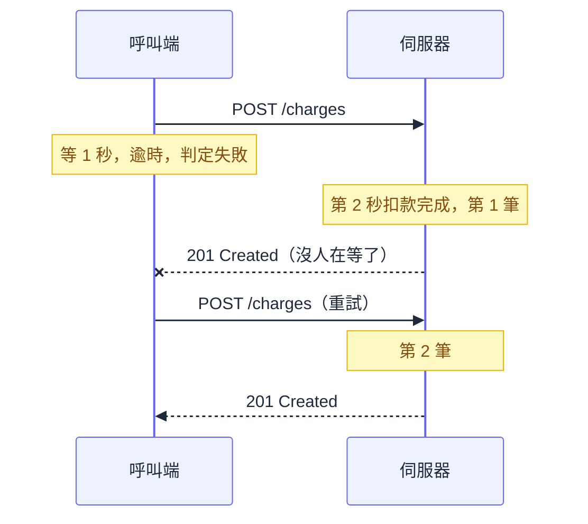

# 入門第 01 章：HTTP 與 Web API — 瀏覽器與伺服器到底在交換什麼

## 一筆扣了三次的款

想像一支結帳 API，上線半年都沒事。某個週末尖峰，金流商變慢，客服開始接到電話：同一筆訂單被扣了好幾次。

後端用 `HttpClient` 呼叫金流商，為了穩定加了一行 `AddStandardResilienceHandler()`。它的[預設值](https://learn.microsoft.com/en-us/dotnet/core/resilience/http-resilience)是單次逾時 10 秒、總逾時 30 秒、最多重試 3 次，而且所有 HTTP method 都重試。那個週末金流商處理一筆要 11 秒。後端等到第 10 秒放棄、判定失敗、再送一次，而金流商對第一次請求的處理還在進行，第 11 秒成功扣款。總逾時到達之前，這件事發生了三輪。

根因不在 C#，也不在 ASP.NET Core，而是兩件屬於 HTTP 的事：逾時只代表「我沒等到回應」，不代表對方沒做；`POST` 也從來沒有承諾過「做兩次等於做一次」。這兩件事在第 2.3 節會用幾十行程式親手重現。

要看懂這種事故，得先看清楚瀏覽器與伺服器之間真正流動的東西，因為所有框架功能都蓋在 HTTP 上。有一句話值得先記住：

> 不是在「寫 .NET API」，你是在「用 .NET 寫一個 HTTP Server」。

HTTP Server 就是一支收到 HTTP 格式的請求、回 HTTP 格式回應的程式。Web API 是其中一種，回應的讀者是其他程式，內容通常是 JSON。ASP.NET Core 替你解析請求、分派給對應程式碼（routing）、組裝回應，但交換的東西跟下一節你親眼看到的一模一樣。

---

## 一、先看一次真實的請求

打開 PowerShell 打一支公開的練習用 API。要寫 `curl.exe`，因為 PowerShell 5.1 的 `curl` 是 `Invoke-WebRequest` 的別名；`-v` 印出過程，`-sS` 關掉進度列但保留錯誤。

```powershell
curl.exe -sS -v https://jsonplaceholder.typicode.com/todos/1
```

實際輸出如下（省略 TLS 訊息與本章用不到的 header）：

```text
* Connected to jsonplaceholder.typicode.com (172.67.167.151) port 443
* using HTTP/1.x
> GET /todos/1 HTTP/1.1
> Host: jsonplaceholder.typicode.com
> User-Agent: curl/8.10.1
> Accept: */*
> 
* Request completely sent off
< HTTP/1.1 200 OK
< Content-Type: application/json; charset=utf-8
< Content-Length: 83
< cache-control: max-age=43200
< etag: W/"53-hfEnumeNh6YirfjyjaujcOPPT+s"
< x-powered-by: Express
< Age: 5
< cf-cache-status: HIT
< Server: cloudflare
< alt-svc: h3=":443"; ma=86400
< 
{ [83 bytes data]
{
  "userId": 1,
  "id": 1,
  "title": "delectus aut autem",
  "completed": false
}
* Connection #0 to host jsonplaceholder.typicode.com left intact
```

行首符號標出身分：`*` 是 curl 的旁白，`>` 是送出的內容，`<` 是收到的內容，`{`、`}` 是 body 傳輸摘要。瀏覽器與伺服器交換的，就是 `>` 與 `<` 那些文字。沒有物件，沒有函式呼叫，只有一段約定好格式的訊息。

### 1.1 請求：一行動作、幾行補充、一個空行

第一行 `GET /todos/1 HTTP/1.1` 叫 request line，依序是 method、目標路徑、協定版本。Method 負責動作，URL 負責目標。網址列的完整 URL 到這裡被拆開了：`https` 決定連線方式與 443 port，主機名稱進了 `Host` header，路徑與查詢字串（`?status=done`）留在第一行。

接著是 headers，一行一個 `名稱: 值`。`Host` 是 HTTP/1.1 必備：同一個 Cloudflare IP 背後有無數網站，伺服器靠它知道你找誰。`Accept: */*` 表示任何回應格式都接受。最後那個只有 `>` 的空行是協定的一部分，標示 headers 結束，空行之後才是 body。這個 GET 沒有 body，訊息到此為止。

### 1.2 回應：結果、描述、內容

回應結構對稱：status line、headers、空行、body。`200` 是給機器看的結果，`OK` 只是附帶文字。

Headers 分組後就不多了。`Content-Type`、`Content-Length` 描述 body：UTF-8 的 JSON，共 83 個位元組，接收方靠長度知道訊息在哪裡結束。`cache-control`、`etag`、`Age`、`cf-cache-status` 跟快取有關。`Server: cloudflare`、`x-powered-by: Express` 透露經手者。

這兩行經手者值得多看一眼，因為請求很少直接抵達執行程式的那台機器。它常先經過 CDN（分散在各地、替源站快取並轉送請求的節點，Cloudflare 就是一家 CDN 業者）與 proxy（代替別人轉送請求的伺服器），最後才到真正執行程式的源站。JSONPlaceholder 的源站是用 Node.js 的 Express 框架寫的，所以回應同時留下兩者的痕跡。這些中介者不懂你的商業邏輯，卻要決定能不能快取、能不能重送，這是第二節的關鍵。

順帶一提，同一份回應裡 `Content-Type` 與 `cache-control` 大小寫不一致完全合法，因為 header 名稱不分大小寫。

HTTPS 就是把 HTTP 放進 TLS 通道，`-v` 印的是加密前與解密後的內容；線路上的第三者看不到路徑與 headers，但看得到你連到哪個主機。

### 1.3 有 body 的請求

前端呼叫 API 最常寫的是 `fetch`。下面是一個有 body 的請求：

```ts
fetch("/api/users", {
  method: "POST",
  headers: { "Content-Type": "application/json", "Authorization": "Bearer <token>" },
  body: JSON.stringify({ name: "Vic", email: "vic@example.com" })
});
```

這些屬性最後都變成剛才那種文字：`method` 進第一行，`headers` 逐行展開，`body` 放空行之後。用 curl 送一個真的：

```powershell
'{"title":"buy milk","completed":false,"userId":1}' | curl.exe -sS -v https://jsonplaceholder.typicode.com/todos -H 'Content-Type: application/json' --data-binary '@-'
```

```text
> POST /todos HTTP/1.1
> Host: jsonplaceholder.typicode.com
> User-Agent: curl/8.10.1
> Accept: */*
> Content-Type: application/json
> Content-Length: 51
> 
} [51 bytes data]
```

用管線是因為 PowerShell 5.1 傳參數給外部程式時會吃掉雙引號（7.3 起改善）。直接寫 `-d '{"title":"buy milk"}'`，伺服器會收到壞掉的 JSON，後果留到第 3.3 節再談。

`Content-Type` 與 `Accept` 最常被搞混。`Content-Type` 陳述事實：這則訊息的 body 是什麼格式，請求與回應都有。`Accept` 表達期望：希望你回什麼格式，它本身是 header，跟 body 無關。Body 格式不被接受時得到 `415`（見 [[basics-05-model-binding-and-validation]]）；`Accept` 則可能被忽略，這支 API 收到 `Accept: application/xml` 照樣回 JSON。

---

## 二、GET 和 POST 只是名字不同嗎

從線路上看，是的，差別只在第一行幾個位元組。協定沒有任何機制阻止伺服器在收到 `GET /orders/5/delete` 時真的刪掉訂單。

但 method 的價值在於其他人怎麼看待它。Method 讓 Client 與 Server 不需溝通實作細節就能理解彼此的意圖，這是 Web 能大規模擴展的關鍵。剛才 Cloudflare 完全不懂這支 API 的商業邏輯，卻敢直接用快取回答，憑的就是「這是 GET」。Method 是你對路徑上每個瀏覽器、爬蟲、proxy、CDN、重試函式庫的公開承諾，承諾的內容主要有 safe 與 idempotent 兩個屬性。下表多數 method 由現行標準 [RFC 9110](https://www.rfc-editor.org/rfc/rfc9110.txt) 定義，只有 PATCH 另外定義在 [RFC 5789](https://www.rfc-editor.org/rfc/rfc5789.txt)：

| Method | 用途 | Safe | Idempotent（冪等） | 回應可快取 |
| --- | --- | --- | --- | --- |
| GET | 讀取資源 | 是 | 是 | 是 |
| HEAD | 同 GET，只要 headers | 是 | 是 | 是 |
| OPTIONS | 詢問伺服器支援哪些操作（瀏覽器跨網域呼叫前會自動先問一次，見 [[basics-09-configuration-and-environments]]） | 是 | 是 | 否 |
| POST | 建立資源或觸發行為 | 否 | 否 | 規範有條件允許，實務幾乎不做 |
| PUT | 以送出內容完整取代資源 | 否 | 是 | 否 |
| PATCH | 部分更新 | 否 | 不保證 | 規範有條件允許，實務幾乎不做 |
| DELETE | 刪除資源 | 否 | 是 | 否 |

### 2.1 Safe：別人可以替你按下去

Safe 指語意上唯讀：呼叫者沒有要求、也不預期狀態改變。寫存取記錄這類副作用不算違規。RFC 講明了這個屬性的目的：讓爬蟲與預先載入可以放心抓取。爬蟲、連結預覽、郵件閘道的安全掃描，都會在沒有人點擊時對連結發 GET，所以下面的設計會出事：

```text
反例
GET /subscriptions/confirm?token=abc123   → 啟用訂閱，token 作廢
GET /articles/42?do=delete                → 刪除文章
```

郵件閘道掃過第一個連結，使用者再點就看到「token 已使用」。好的做法：GET 只回確認頁，改變狀態用 POST。

### 2.2 Idempotent：做兩次等於做一次

Idempotent 談效果：同樣的請求送一次和送 N 次，對伺服器的預期效果相同。它不談回應，所以 `DELETE /tasks/5` 第一次回 `204`、第二次回 `404` 仍是冪等。

PUT 的語意是「變成這個樣子」，變幾次都一樣。POST 沒有這個承諾，每次都可能多一筆。PATCH 要看內容：`{"status":"done"}` 做幾次都一樣，「在清單尾端加一項」每做一次就多一項，所以規範只說不保證，不說一定不冪等。

### 2.3 重試：冪等性真正要回答的問題

網路有一種無法消除的狀況：送出去了，沒收到回應。你無從分辨是請求沒到，還是事情做完了、回應丟在路上。



這可以親手重現。下面這支小程式用 ASP.NET Core 最精簡的 minimal API 寫成，`MapPost`、`Results.Created` 這些寫法從 [[basics-03-first-project]] 開始解釋，這裡只需要看它的行為。已安裝 .NET SDK 的話可以照做；還沒裝可以只讀輸出，結論不變。主線專案之後改用 Controller（[[basics-04-controllers-and-routing]]）。執行 `dotnet new web -o ChargeLab`，把 `Program.cs` 換成：

```csharp
var builder = WebApplication.CreateBuilder(args);
var app = builder.Build();

var charges = new List<string>();

app.MapGet("/charges", () => charges);

// POST：每收到一次就多一筆，編號由伺服器決定
app.MapPost("/charges", async () =>
{
    // 模擬等銀行回覆兩秒。刻意不接 CancellationToken：
    // 銀行一旦開始處理，呼叫端斷線也收不回來。
    await Task.Delay(2000);
    var id = $"c{charges.Count + 1}";
    charges.Add(id);
    return Results.Created($"/charges/{id}", new { id });
});

// PUT：編號由呼叫端決定，同一個編號做幾次都只有一筆
app.MapPut("/charges/{id}", (string id) =>
{
    if (charges.Contains(id))
    {
        return Results.Ok(new { id });
    }

    charges.Add(id);
    return Results.Created($"/charges/{id}", new { id });
});

app.Run();
```

這三十多行就是一個 HTTP Server。用 `dotnet run --urls http://localhost:5080` 啟動後，它持續監聽 5080 port，收到文字格式的請求就交給對應的 lambda，再把結果寫回回應。另開視窗，先讓呼叫端只等 1 秒，過兩秒查詢，再重試一次：

```text
PS> curl.exe -sS -X POST --max-time 1 http://localhost:5080/charges
curl: (28) Operation timed out after 1006 milliseconds with 0 bytes received
PS> curl.exe -sS http://localhost:5080/charges
["c1"]
PS> curl.exe -sS -X POST http://localhost:5080/charges
{"id":"c2"}
PS> curl.exe -sS http://localhost:5080/charges
["c1","c2"]
```

呼叫端拿到明確的錯誤，伺服器卻已經扣款。換成 PUT 對同一個編號連送兩次，第一次回 `201 Created`，第二次回 `200 OK`，清單只多一筆：

```text
PS> curl.exe -sS -o NUL -w '%{http_code}' -X PUT http://localhost:5080/charges/order-42
201
PS> curl.exe -sS -o NUL -w '%{http_code}' -X PUT http://localhost:5080/charges/order-42
200
PS> curl.exe -sS http://localhost:5080/charges
["c1","c2","order-42"]
```

回應不同，效果相同。解法的核心是讓「這是同一件事」可以被伺服器辨認。冪等性是那段 `Contains` 判斷換來的，method 名稱不會替你變出來；把 PUT 寫成每次都新增，協定不會阻止，路徑上的元件卻會信以為真。

除了連按兩下的使用者，還有誰會重送？比多數人以為的多：

| 誰 | 對 POST 的行為 | 依據 |
| --- | --- | --- |
| 瀏覽器 | 表單 POST 後重新整理會跳確認框 | 瀏覽器實作行為（RFC 9110 §9.2.1 只要求 UI 讓使用者分辨 unsafe 動作） |
| Proxy | 不得自動重試非冪等請求；nginx 已送達上游後，POST、LOCK、PATCH 預設不轉給下一台 | RFC 9110 §9.2.2 的 MUST NOT；[`proxy_next_upstream`](https://nginx.org/en/docs/http/ngx_http_proxy_module.html) |
| `AddStandardResilienceHandler` | 預設全部重試，用 `options.Retry.DisableFor(HttpMethod.Post, HttpMethod.Patch)` 關閉 | 官方文件 |

注意 nginx 只排除非冪等 method，代表 PUT 與 DELETE 遇到上游逾時可能被轉給下一台重送，宣稱冪等卻沒做到的 PUT 就在這裡出事。這裡也能看出 safe 與 idempotent 是兩回事：另一個設定 `DisableForUnsafeHttpMethods()` 依 safe 來分，連冪等的 PUT、DELETE 也一起停止重試。重試的紀律見 [[18-resilience-and-performance]]。

POST 不能都改成 PUT 時，業界做法是呼叫端為每個動作產生唯一鍵，放進 `Idempotency-Key` header，由伺服器記住處理過的鍵。這個 header 目前仍是 IETF 草案，實作留到 [[expert-01-advanced-api-design]]。

### 2.4 快取：GET 的紅利與代價

回頭看第一節：`cache-control: max-age=43200` 表示 12 小時內算新鮮，`cf-cache-status: HIT` 加 `Age: 5` 表示這是 Cloudflare 5 秒前存的副本，請求根本沒碰到 Express。POST 的回應則是 `cf-cache-status: DYNAMIC`，穿透到應用程式。兩者的差別只來自 method。

`etag` 是內容的指紋。把它放進 `If-None-Match` 再問一次，內容沒變就得到沒有 body 的 `304 Not Modified`，省下傳輸量。

代價也在這裡。改用 `POST /search` 等於放棄路徑上所有快取。反過來，GET 的錯誤也會被存，這支 API 的 `404` 同樣可能是 `cf-cache-status: HIT`。個人化回應若被共用快取存下，就是把 A 的資料給 B 看，至少要加 `Cache-Control: private` 或 `no-store`。進階用法見 [[expert-01-advanced-api-design]]、[[expert-05-performance-engineering]]。

### 2.5 為什麼登入用 POST、GET 不放 body

常聽到「登入會產生 token 所以用 POST」，但產生資料不是判準。真正的理由是登入並非 safe（會更新登入時間、累計失敗次數），而且密碼不能放 URL：HTTPS 雖會加密路徑，URL 仍會留在存取記錄與瀏覽器歷史裡。

反過來，GET 不該帶 body：RFC 說它沒有通用語意，瀏覽器 `fetch` 直接丟 `TypeError`。條件因此放查詢字串，也就受長度限制，超過會得到 `414 URI Too Long`。

Method 談「想做什麼」。伺服器回答「結果如何」的方式是狀態碼。

---

## 三、狀態碼的設計哲學：第一位數字決定下一步

不要把所有錯誤都包成 200。要理解為什麼，先記住狀態碼首先是給程式看的。HTTP 函式庫、proxy、CDN、重試邏輯、監控都靠它做決定，給人讀的是 body 裡的訊息。

正因讀者是程式，RFC 9110 才規定 client 必須懂第一位數字，遇到沒見過的狀態碼就當該類的 x00 處理。第一位數字其實在回答：下一步輪到誰動。

| 類別 | 意思 | 下一步誰動 | 原封不動重送有用嗎 | 監控 |
| --- | --- | --- | --- | --- |
| 1xx | 臨時通知，最終回應還在後面 | 呼叫端繼續等 | 不適用 | 很少直接碰到 |
| 2xx | 成功 | 沒有人 | 不需要 | 正常 |
| 3xx | 還要再做一步 | 呼叫端去新位置，或用手上副本 | 不適用 | 正常 |
| 4xx | 請求有問題 | 呼叫端修正 | 沒用（例外：429 等一下再送；401 換新 token 後再送） | 單筆不告警，看比例 |
| 5xx | 伺服器沒做好 | 伺服器方修復 | 可能有用，僅限冪等操作 | 要告警 |

### 3.1 依呼叫端的下一步選狀態碼

有了這張表就不用背細項，只要問「呼叫端該採取什麼不同的行動」。應對方式相同就用同一個碼，不同才分開：

| 狀態碼 | 何時用 | 呼叫端的反應 |
| --- | --- | --- |
| 200／204 | 成功，有內容／沒內容 | 讀 body／不解析 |
| 201 | 建立了新資源，帶 `Location` | 記下新網址 |
| 301、308／302、307 | 永久／暫時搬家，帶 `Location` | 跟過去；308、307 保證不改 method |
| 304 | 條件請求，內容沒變 | 用手上副本 |
| 400 | 語法錯、缺欄位、驗證失敗 | 修正內容 |
| 401 | 沒帶或帶了無效憑證，帶 `WWW-Authenticate` | 登入或換 token |
| 403 | 知道你是誰，但沒權限 | 換 token 沒用，別再試 |
| 404／405 | 資源不存在／路徑在但不收這個 method（帶 `Allow`） | 檢查網址／換 method |
| 409 | 與資源目前狀態衝突 | 重新讀取再決定 |
| 415／422 | body 格式不支援／格式對但內容無法處理 | 修正 `Content-Type`／內容 |
| 429／503 | 流量超限／暫時無法服務 | 依 `Retry-After` 等待 |
| 500 | 未預期的伺服器錯誤 | 冪等操作可稍後再試，回報 |
| 502／504 | 上游回應無效／上游逾時 | 稍後再試 |

401 與 403 的差別在「換一張 token 有沒有用」。Unauthorized 這名字其實取錯了，它講的是驗證而非授權，[[basics-11-auth-concepts-and-pipeline]] 會畫清楚這條線。

### 3.2 轉址：POST 可能變成 GET

轉址藏著很難查的 API bug。很多伺服器把 `http://` 用 301 轉到 `https://`，呼叫端若誤寫 http，POST 會在半路變形。用 httpbin 的轉址端點可以看到這件事。`-L` 叫 curl 跟著轉址，`-d` 讓它送 POST；不要加 `-X POST`，那會強制轉址後仍用 POST，反而看不到實際的行為：

```powershell
curl.exe -sS -v -L -o NUL -d 'x=1' 'https://httpbin.org/redirect-to?url=https://httpbin.org/anything&status_code=301'
curl.exe -sS -v -L -o NUL -d 'x=1' 'https://httpbin.org/redirect-to?url=https://httpbin.org/anything&status_code=308'
```

輸出只留關鍵行，先是 301，再是 308：

```text
< HTTP/1.1 301 Moved Permanently
* Switch from POST to GET
> GET /anything HTTP/1.1

< HTTP/1.1 308 Permanent Redirect
> POST /anything HTTP/1.1
```

301 之後 POST 變 GET，body 不見了，規範基於歷史原因允許。結果可能是 `405`，更糟的是 `200` 的清單，呼叫端還以為建立成功。308 的第二個請求仍是 POST，body 也還在。所以 API 的轉址要用 307 或 308，呼叫端設定一律直接寫 https。

### 3.3 4xx 與 5xx 的界線

這條界線決定半夜會不會被叫起來。對第 1.3 節那支 API 送一份壞掉的 JSON：

```powershell
curl.exe -sS -o NUL -w '%{http_code}' https://jsonplaceholder.typicode.com/todos -H 'Content-Type: application/json' -d '{bad'
```

JSON 壞掉是呼叫端的錯，JSONPlaceholder 卻回 `500`，呼叫者誤以為對方掛了，對方的錯誤率也被別人的打字錯誤墊高，正確答案是 `400`。這條界線與 `ProblemDetails` 標準格式（RFC 9457，`application/problem+json`）見 [[15-error-handling]]，實作在 [[basics-08-middleware-and-exception-handling]]。

### 3.4 反例：一律回 200

最常見的反例是一律回 200：

```text
反例
HTTP/1.1 200 OK
Content-Type: application/json

{"success":false,"errorCode":"ORDER_NOT_FOUND"}
```

動機是「前端統一處理比較方便」，代價卻由所有人承擔：監控的成功率永遠 100%，全面故障也不告警；`fetch` 的 `res.ok` 永遠為真，漏寫判斷的地方就把錯誤當資料用；重試函式庫也不會動作。業務錯誤碼有價值，但應該放在正確狀態碼的 body 裡。

具體情境怎麼選，是下一章的主題。這裡先留一個問題：上面這些請求之間，伺服器記得你嗎？

---

## 四、無狀態：伺服器不記得你

不記得。對一支會檢查 token 的公開測試端點連送三次：

```text
PS> curl.exe -sS -o NUL -w '%{http_code}' https://httpbin.org/bearer
401
PS> curl.exe -sS -H 'Authorization: Bearer abc123' https://httpbin.org/bearer
{
  "authenticated": true,
  "token": "abc123"
}
PS> curl.exe -sS -o NUL -w '%{http_code}' https://httpbin.org/bearer
401
```

第二次成功，第三次又回到 401。RFC 9110 定義 stateless 為每則請求的語意都可單獨理解，與連線無關。第一節結尾的 `left intact` 只是保留連線省時間，同一條連線上的兩個請求依然是陌生人。

好處是任何一台伺服器都能處理任何請求：同一支 API 跑的副本從 2 份擴到 20 份（K8s 上就是 Pod 數量）、滾動更新換掉一半，都不必搬動對話狀態。麻煩是每個請求都得自己帶上身分。

### 4.1 身分怎麼帶

帶法有兩類，差在狀態放哪裡。Session 是伺服器把「你是誰」記在自己這邊，只給瀏覽器一張編號，瀏覽器放在 Cookie 裡每次帶上。Token 是把身分資料寫進一張有簽章的憑證，由請求自己帶著走，JWT 是最常見的格式。

| | Session + Cookie | Token（如 JWT） |
| --- | --- | --- |
| 誰記得你 | 伺服器端的 session 儲存 | token 本身 |
| 多台伺服器 | 要共用儲存（如 Redis 這類記憶體資料庫） | 每台驗簽章即可 |
| 立刻撤銷 | 刪掉 session | 等過期或另做機制 |

Web API 常用 token，因為呼叫者常不是瀏覽器、加開副本也單純，但撤銷是它的代價。簽發與驗證在 [[basics-12-jwt-login]]，前端存放在 [[basics-13-permissions-with-frontend]]。

### 4.2 無狀態不等於沒有資料

無狀態指的是協定，不是應用程式沒有資料，關鍵是狀態要放在所有副本都讀得到的地方。ChargeLab 的 `List` 放在程序記憶體裡，部署兩個副本就各有一份，重啟就消失，也不是執行緒安全的：當練習可以，當正式程式就是反例。[[basics-10-efcore-and-oracle]] 才會把資料存進資料庫。

---

## 五、Web API、網頁、RPC 差在哪

前四節談的是協定本身，現在回到本書的主角。Web API 與你每天打開的網頁用的是同一套 HTTP，差別在讀者。網頁的讀者是人，回應是 HTML；Web API 的讀者是程式，回應通常是 JSON。RPC 風格則把遠端呼叫看成呼叫函式，URL 是動詞，method 不帶語意：

| 操作 | 網頁 | REST 風格 | RPC 風格 |
| --- | --- | --- | --- |
| 讀訂單 | `GET /orders/5` 回 HTML | `GET /api/orders/5` 回 JSON | `POST /api/getOrder` |
| 找不到 | 404 頁面 | `404` | 常見 `200` 加錯誤碼 |
| 中介者看得懂嗎 | 看得懂 | 看得懂 | 只看到一連串 POST |

你已經能說出右欄損失了什麼：CDN 不能快取、重試函式庫不知道能否重送、監控分不出成敗。

RPC 也不是錯的。`POST /orders/5/cancel` 這種動作很難硬塞成名詞，業界常接受混合。判準是：呼叫者是否跨團隊、來自瀏覽器，或需要路徑上的中介者幫忙。是就走 HTTP 語意，否才考慮 RPC。主線 TaskTracker 走 REST 風格，gRPC 見 [[expert-06-streaming-and-realtime]]。

---

## 六、HTTP/1.1、2、3：對 API 開發者有感的部分

第一節的輸出是 HTTP/1.1，瀏覽器 DevTools 的 Protocol 欄卻多半顯示 `h2` 或 `h3`。同一個網址會走哪個版本，取決於連線兩端都支援什麼。Windows 內建的 `curl.exe` 沒有編進 HTTP/2，所以它只會顯示 1.1，這不代表伺服器不支援。HTTP/3 則靠第一節那行 `alt-svc: h3=":443"; ma=86400` 被發現：這個 port 也有 HTTP/3，呼叫端第一次走 1.1 或 2，之後才切換。

版本換了，method、狀態碼、header 的語意都相同，你之後寫的 Controller 不因版本改變。有感的差別在傳輸方式：

| | HTTP/1.1 | HTTP/2 | HTTP/3 |
| --- | --- | --- | --- |
| 訊息格式 | 文字 | 二進位 frame | 二進位 frame |
| 傳輸層 | TCP | TCP | QUIC（UDP） |
| 單一連線並行 | 一次一個請求 | 多工 | 多工，掉封包不互相拖累 |

前端同時打十幾支 API 時，HTTP/1.1 要排隊或多開連線，HTTP/2 在一條連線上就能並行。要提防的是 HTTP/2 起 header 名稱一律小寫、狀態行也沒有 `OK` 這段文字，程式不能依賴這兩者。

正式環境裡，瀏覽器協商到的版本通常只到最外層的 CDN，CDN 與源站之間是另一段連線，CDN 開 h3 不代表你的程式也要開。Kestrel 怎麼監聽見 [[00-hosting-and-startup]]，上線時的設定留到 [[basics-16-deployment-and-go-live]]。

---

## 七、驗收：自己讀一次

這是第 1.3 節 POST 的請求與回應（略去 `*` 旁白與 body，headers 只留與問題相關的）。先回答四個問題再看解答。

```text
> POST /todos HTTP/1.1
> Content-Type: application/json
> Content-Length: 51
> 
< HTTP/1.1 201 Created
< Content-Type: application/json; charset=utf-8
< location: https://jsonplaceholder.typicode.com/todos/201
< cf-cache-status: DYNAMIC
< alt-svc: h3=":443"; ma=86400
```

1. 這個請求若逾時，程式可以自動重送嗎？
2. 新資源在哪裡？
3. 這份回應是 CDN 的副本，還是應用程式產生的？
4. 它支援 HTTP/3 嗎？

第一題不行，POST 非冪等，重送可能建立兩筆。第二題看 `location`，這是 `201` 的標準搭配。第三題是應用程式產生的，`cf-cache-status: DYNAMIC` 表示 Cloudflare 沒用快取回答。第四題看 `alt-svc`，有。

還有第五題，光讀輸出答不出來：這份回應說建立成功，接著 `GET /todos/201` 卻得到 `404`，因為 JSONPlaceholder 是假資料服務，不會真的儲存。狀態碼是伺服器的陳述，可信度取決於實作者有沒有誠實遵守語意。接下來幾章，你就是那個實作者。

---

## 常見誤解

**「Status code 是給人看的。」** 它首先給程式看：瀏覽器、proxy、CDN、重試函式庫、監控都依它行動，人讀的是 body 的訊息。

**「冪等就是每次回應都一樣。」** 冪等談的是對伺服器的效果。DELETE 第一次 204、第二次 404，效果相同，仍然冪等。

**「GET 是 safe，所以敏感資料用 GET 比較安全。」** Safe 指語意唯讀，跟資訊安全無關。放在查詢字串的資料會留在存取記錄和瀏覽器歷史。

## 同事會來問你的問題

**Q：前端已經停用按鈕了，後端還要防重複嗎？**

要。前端擋不住網路重試、兩個分頁或後端自己的重試設定。扣款這類操作要靠呼叫端提供的識別碼或 `Idempotency-Key`，配合資料庫唯一約束。

**Q：`AddStandardResilienceHandler()` 能直接加嗎？**

讀取類呼叫可以。同一個 `HttpClient` 也送 POST 時，先確認下游是否冪等，否則設定 `options.Retry.DisableFor(HttpMethod.Post, HttpMethod.Patch)`。

**Q：回 400 還是 422？**

光看請求就知道錯（JSON 壞掉、缺欄位）用 400；要跑業務邏輯才知道不行（庫存不足）可用 422。全用 400 也行，團隊一致就好，界線見 [[15-error-handling]]。

## 這章的位置

讀完這章，你能逐行讀懂 `curl -v` 輸出，能判斷一個操作能否自動重試、會不會被快取，能依呼叫端的下一步選狀態碼，也知道身分為什麼要每次重新證明。下一章把這些用在設計上：URL 與狀態碼怎麼決定，才不會每個人寫得不一樣。錯誤處理的完整機制在深度篇 [[15-error-handling]]。

---

## 連結

- 上一章：無（全書第一章）
- 下一章：[[basics-02-rest-api-design]]
- 對應深度章：[[15-error-handling]]
- 全書目錄：[[dotnet-web-api]]
