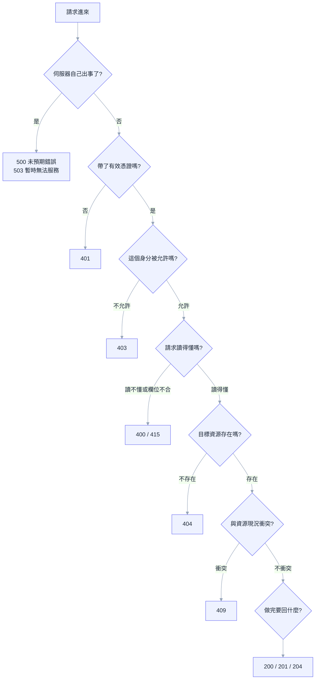

# 入門第 02 章：REST API 設計 — URL 與狀態碼怎麼決定，才不會每個人寫得不一樣

## 同一週，三個人寫出三種 API

假設團隊要做 Task Tracker 的後端，三位同事同一週各認領一支端點，沒有人訂規則。週五整合時，前端同事 Vic 打開三份程式碼，看到這些：

```text
反例
GET  /api/getTasks
POST /api/task/delete/5
POST /api/Tasks/Create    → 200 {"ok":false,"msg":"title is empty"}
```

第一支把動作寫進路徑，第二支把動作和編號都塞進路徑還用了 POST，第三支用 POST 建立資源，驗證失敗卻回 200。每一支單獨看都能動，湊在一起卻要前端記三套規矩：刪除要打哪、建立失敗怎麼判斷、路徑要不要大寫。更糟的是，監控圖表顯示成功率 100%，因為每一個回應都是 200。

[[basics-01-http-and-web-api]] 講過兩件事：method 是對路徑上每個中介者的承諾，狀態碼的讀者是程式。本章把這兩件事變成設計決策：URL 怎麼命名、每種情況回哪個狀態碼、錯誤的 body 長什麼樣。這些決定不需要天分，需要的是一份團隊共同遵守的規則，以及每條規則背後的理由，這樣新同事遇到沒見過的情境也能推導出同樣的答案。本章最後會交出一份 TaskTracker API 規格，後面每一章的實作都以它為依據。

---

## 一、沒有共同規則時，會長出什麼

### 1.1 動作塞進 URL

`/getTasks`、`/task/delete/5`、`/createOrder` 都很直覺，因為寫的人腦中想的是「函式」：要取得任務，就呼叫 `getTasks`。這是 RPC 的思維，在小專案裡沒有問題。問題出在系統長大之後。

動詞放進路徑，method 就失去作用，於是 `GET /task/delete/5` 這種東西會出現。[[basics-01-http-and-web-api]] 的 safe 一節已經示範過它的後果：連結預覽、爬蟲和郵件閘道會對 GET 網址自動發請求，沒有人點擊任務就被刪了。就算每個動作都用 POST，路徑上的 CDN 與重試函式庫也只看到一串 POST，無法判斷哪些可以快取、哪些重送是安全的。

動詞還有一個隱性的成本：數量。一個資源有讀取、建立、修改、刪除四種基本動作，每個團隊成員對動詞的選擇不同，有人寫 `delete`、有人寫 `remove`，有人寫 `cancel`，API 文件就變成要逐一背誦的清單。把動作交給 method，路徑只剩名詞，要背的東西就少了一半。

### 1.2 一律 POST、一律 200

另一種常見做法是整支 API 只用 POST，所有結果都回 200，靠 body 裡的 `ok` 或錯誤碼分辨成敗。動機通常是「前端只寫一個處理函式」。這個便利很快被代價吃掉：`fetch` 的 `res.ok` 永遠是 `true`，漏寫判斷的地方會把錯誤當資料；監控看不到錯誤率，整個服務掛掉也不會告警；重試與快取元件完全沒有可用的訊號。[[basics-01-http-and-web-api]] 第三節的反例就是這個形狀，這裡不再重複。

這個便利要付的代價是：前端確實可以只寫一個處理函式，但這個函式得自己重新發明一套「成功與失敗」的協定，而 HTTP 已經提供了。

### 1.3 看似小事的不一致

還有一些不影響功能、卻會讓整合變慢的差異：集合有人用單數（`/task`）有人用複數（`/tasks`）；有人用駝峰（`/taskItems`）有人用底線（`/task_items`）；有人把編號放路徑（`/tasks/5`），有人放查詢字串（`/tasks?id=5`）；成功建立後有人回 200，有人回 201，有人回 201 卻沒帶 `Location`。每一個差異單獨看都能接受，累積起來的結果是前端同事每接一支新端點，就得重新讀一次程式碼才敢動手。

這些問題的共同解法是同一件事：先寫下規則，再寫程式。接下來兩節就是這份規則，先 URL，再狀態碼。

---

## 二、以資源為中心：URL 說目標，method 說動作

收斂的方向很單純：URL 只描述「你要操作哪個東西」，method 描述「你要做什麼」。前者的詞彙是名詞，後者是 HTTP 已經定義好的那幾個。這個被操作的東西稱為資源（resource），它是系統裡一個可以被指名的物件，例如一筆任務、一位使用者、一張訂單。

### 2.1 名詞，而且用集合的複數

任務的集合是 `/api/tasks`，其中一筆是 `/api/tasks/5`。集合用複數，是因為同一個路徑要同時表示「全部」與「其中一筆」，`/api/tasks` 與 `/api/tasks/5` 讀起來像一個資料夾與裡面的檔案，不需要另外解釋。單數也能運作，但 `GET /api/task` 回傳一整份清單時，路徑讀起來像只有一筆。選哪邊都行，重點是全團隊選同一邊；業界多數用複數，用複數就不必再討論。

用 method 表達動作之後，一個資源的基本操作剛好對應四種 HTTP 請求：

| 想做的事 | 請求 | 對照反例 |
| --- | --- | --- |
| 列出任務 | `GET /api/tasks` | `GET /api/getTasks` |
| 讀一筆 | `GET /api/tasks/5` | `GET /api/getTask?id=5` |
| 新增 | `POST /api/tasks` | `POST /api/Tasks/Create` |
| 整筆更新 | `PUT /api/tasks/5` | `POST /api/task/update/5` |
| 刪除 | `DELETE /api/tasks/5` | `POST /api/task/delete/5` |

左欄不需要任何文件就能猜出來，右欄每一條都得去問寫的人。這是 [[basics-01-http-and-web-api]] 說的「Method 讓 Client 與 Server 不需溝通實作細節就理解意圖」在 URL 設計上的落地。

### 2.2 編號放路徑，條件放查詢字串

路徑回答「哪一個資源」，查詢字串回答「用什麼條件看這個集合」。`/api/tasks/5` 指名一筆任務；`/api/tasks?status=done&page=2` 仍然是任務的集合，只是縮小範圍與指定第幾頁。

分界的測試方法是問：拿掉這一段，指的還是同一個東西嗎？拿掉 `5`，從一筆變成全部，是不同資源，所以放路徑。拿掉 `?status=done`，還是任務的集合，只是範圍變大，所以放查詢字串。這條規則也影響快取：`/api/tasks?status=done` 與 `/api/tasks?status=todo` 對快取來說是兩個不同的網址，各自存一份，不會混在一起。

### 2.3 巢狀只放一層，而且要有理由

有些資源天生屬於另一個資源，例如訂單的明細。`/api/orders/123/items` 表示「訂單 123 的明細」，這個巢狀成立的條件是：明細脫離訂單就沒有意義，也不會單獨被查詢。

層數多了就是麻煩。`/api/users/1/orders/123/items/9/discounts` 的每一段都要檢查父子關係是否一致，路由要多寫幾條，前端也得傳一長串編號。實務上的做法是巢狀最多一層；多了的話，內層資源本身若有全域唯一的編號，就直接用 `/api/items/9` 存取。TaskTracker 目前只有任務一種資源，沒有巢狀，這條規則先放著，專案長出專案（Project）、標籤（Tag）之類的資源時再回來用。

### 2.4 路徑是契約，不要讓程式碼偷偷決定它

ASP.NET Core 的 `[Route("api/[controller]")]` 很方便，`[controller]` 會展開成類別名稱去掉 `Controller` 的部分，實測 `UsersController` 會展開成 `api/Users`，保留類別名稱的大小寫，比對時則不分大小寫。方便的代價是改類別名稱就會改 URL，而 URL 是前端、文件、書籤與其他系統都依賴的契約，不該因為重構一個類別而變動。所以 TaskTracker 直接寫死字串 `[Route("api/tasks")]`。機制細節見 [[03-routing-and-endpoints]]。

路徑的格式也一併固定：全部小寫，多個單字用連字號（`/api/task-templates`），不用底線也不用駝峰。理由是各層對大小寫的處理並不一致：ASP.NET Core 的路由比對不分大小寫，但 URL 規格本身（RFC 3986）把路徑視為區分大小寫，快取與 CDN 也多半照此處理，所以大小寫不同的網址可能各存一份。全部小寫可以少一個變因。

---

## 三、REST 套不上的地方

到這裡規則很整齊，但真實的系統有些操作硬套名詞會變得很彆扭。與其假裝 REST 能解釋一切，不如先把這些情境講清楚，因為團隊常在這些地方吵最久。

### 3.1 不是新增、修改、刪除的動作

「取消訂單」、「封存任務」、「寄出重設密碼信」，這些是動作，不是資源的建立或更新。業界有三種常見處理，各有適用的場合。

第一種是把動作變成狀態欄位。任務標為完成，就是把 `status` 從 `todo` 改成 `done`，用 `PUT /api/tasks/5` 送新的狀態即可，不需要 `POST /api/tasks/5/complete`。凡是動作的結果是「資源進入某個狀態」，而且這個狀態本來就該出現在資源裡，這個做法最乾淨，TaskTracker 就是這樣設計。

第二種是把動作建模成子資源：`POST /api/orders/5/cancellation` 表示「為訂單 5 建立一筆取消紀錄」。當這個動作本身有需要保存的資料（取消原因、操作者、時間）時，這樣做自然。

第三種是直接承認它是動詞：`POST /api/orders/5/cancel`、`POST /api/auth/login`。前面兩種硬套名詞時，反而需要解釋的成本比動詞還高，就選這個。判準是「兩位新同事看到網址，能不能不問就知道它在做什麼」，如果硬湊的名詞要靠註解才懂，直接用動詞更誠實。這類端點要用 POST，因為它不是 safe 的，也不一定冪等。

### 3.2 搜尋

簡單篩選用查詢字串就夠。條件變複雜之後，網址會長得很誇張，長到超過伺服器或 proxy 的長度限制就會得到 `414`；GET 又不該帶 body。這時有人改用 `POST /api/tasks/search`，把條件放 body。這是合理的妥協，但要知道代價：POST 的回應通常不被快取，重試函式庫也不敢自動重送，`POST` 的 search 明明是唯讀，卻失去了 GET 的紅利。能用查詢字串解決就不要換成 POST；非換不可，請在文件上註明這支 POST 是唯讀的。

### 3.3 批次

「一次標記 50 筆為完成」沒有放進 REST 的標準位置。最簡單的做法是前端迴圈呼叫 50 次單筆端點，缺點是 50 次往返。另一個做法是新增批次端點，例如 `POST /api/tasks/bulk-update`，這時要先回答一個難題：50 筆裡有 3 筆失敗時，整體算成功還是失敗？全有或全無（交易）最容易理解，部分成功則需要把每筆結果列在回應裡。這些取捨牽涉的設計空間不小，專案需要時請看 [[expert-01-advanced-api-design]]，本章的規格先不做批次。

### 3.4 關於「REST 純度」

學術上的 REST 是 Roy Fielding 提出的一組架構限制，其中包括 hypermedia（回應裡帶著下一步可以做什麼的連結）。業界今天說的「REST API」大多是「以資源為中心、善用 HTTP method 與狀態碼的 JSON API」，通常不實作 hypermedia。這沒有問題，因為前面提到的規則已經解決了實際的麻煩。本書的立場是：不為了貼上 REST 這個標籤去做會讓使用者困惑的事，也不放棄資源導向設計帶來的可預測性。舉例來說，Code Review 時有人堅持把 `POST /auth/login` 改成 `POST /sessions` 才算 REST，這種爭論用前面的判準就能收斂：兩位新同事看到網址，哪一個不用問就懂？答案是 `login`，那就留著。判斷任何設計爭議時，問的是「這樣讓呼叫端更好猜，還是更難猜」。

---

## 四、狀態碼：用問題逐步縮小

[[basics-01-http-and-web-api]] 第三節給過一張依呼叫端下一步分類的表，並說明第一位數字決定誰該動手。本節換一個角度：面對一個具體的情境，該用哪個碼。不要背表格，問下面這串問題，通常三題以內就會得到答案。



這張圖是決策順序的簡化版：路由階段就決定的 404（網址根本對不上）與 405（路徑對、method 不支援）不在圖內，見 6.3；`422`（格式對、語意懂、但業務規則不允許）也被省略，TaskTracker 目前沒有這種情境，4.3 會說明。

順序有它的道理。先確認身分再看請求內容，是因為沒登入的人沒有資格知道欄位寫錯了；先看請求能不能讀，再查資源存不存在，是因為連格式都不對的請求，查資料庫是浪費。實作上，這個順序是框架依序執行的幾道關卡（[[basics-08-middleware-and-exception-handling]] 稱為 middleware）決定的，[[basics-11-auth-concepts-and-pipeline]] 會說明身分驗證那幾關。

### 4.1 成功：200、201 還是 204

先說明這一節起的範例：下面的回應都來自寫完的 TaskTracker，你現在還跑不起來，先當成規格的示範輸出閱讀，[[basics-04-controllers-and-routing]] 起會親手重現。

三者的差別是「有沒有新東西要告訴呼叫端」。

讀取成功，回 `200` 與資源。新增成功，回 `201 Created`，因為伺服器做了一件新事：產生了一筆資源，而且通常由伺服器決定它的編號。依慣例（RFC 9110 允許用 `Location` 指出新資源的位置），`201` 應帶 `Location` 指向新資源，TaskTracker 規定一律要帶；body 則帶出新資源的內容，這樣前端不必再補一次 GET 就能拿到伺服器產生的 `id`。以下是完成後的 TaskTracker 的回應：

```powershell
'{"title":"Write chapter 10"}' | curl.exe -s -i -X POST http://localhost:5080/api/tasks -H "Content-Type: application/json" -d '@-'
```

```text
HTTP/1.1 201 Created
Content-Type: application/json; charset=utf-8
Date: Fri, 30 Oct 2026 14:36:26 GMT
Server: Kestrel
Location: http://localhost:5080/api/tasks/a8f845e2-dbc6-41ca-a47c-d3e6bb1e0848
Transfer-Encoding: chunked

{"id":"a8f845e2-dbc6-41ca-a47c-d3e6bb1e0848","title":"Write chapter 10","status":"todo","createdAt":"2026-10-30T14:36:26.6763444+00:00"}
```

更新成功的選擇比較微妙。PUT 之後回 `204`（沒有 body）是合法的，但 TaskTracker 選擇回 `200` 與更新後的完整資源。原因是伺服器可能改動了前端送出的內容，例如去掉標題前後空白，前端拿到回應才知道最後存下的值是什麼；而且回傳內容讓畫面可以直接用回應更新，不必多打一次 GET。如果一支 API 的更新結果完全等於送出的內容，回 204 也沒有問題，重點是全團隊一致。

刪除成功回 `204 No Content`，因為資源已經不存在，沒有東西可以回傳（`$newId` 是上一步回應裡的 `id`）：

```powershell
curl.exe -s -i -X DELETE "http://localhost:5080/api/tasks/$newId"
```

```text
HTTP/1.1 204 No Content
Date: Fri, 30 Oct 2026 14:36:29 GMT
Server: Kestrel
```

### 4.2 請求本身有問題：400、415、405

這一類的特徵是：不論資料庫裡有什麼，這個請求都不會成功，呼叫端必須修改請求再送。最常見的是 `400 Bad Request`：JSON 壞掉、缺必填欄位、字串太長、查詢字串 `pageSize=1000` 超過上限。TaskTracker 對空物件的回應是：

```powershell
'{}' | curl.exe -s -i -X POST http://localhost:5080/api/tasks -H "Content-Type: application/json" -d '@-'
```

```text
HTTP/1.1 400 Bad Request
Content-Type: application/problem+json; charset=utf-8
Date: Fri, 30 Oct 2026 14:20:44 GMT
Server: Kestrel
Transfer-Encoding: chunked

{"type":"https://tools.ietf.org/html/rfc9110#section-15.5.1","title":"One or more validation errors occurred.","status":400,"errors":{"Title":["The Title field is required."]},"traceId":"00-51ea20c4e7b9e159a42c4ddc7b9f4318-6e06157e42f484c3-00"}
```

另外兩個碼讓呼叫端更快找到原因。送了伺服器不支援的 `Content-Type`（例如 `text/plain`）得到 `415 Unsupported Media Type`，這與欄位值不合法是不同的問題；路徑存在但不接受這個 method 得到 `405 Method Not Allowed`，並帶 `Allow` header 告訴對方可以用哪些。TaskTracker 對 `POST /api/tasks/{id}` 的實際回應：

```powershell
'{}' | curl.exe -s -i -X POST http://localhost:5080/api/tasks/11111111-1111-1111-1111-111111111111 -H "Content-Type: application/json" -d '@-'
```

```text
HTTP/1.1 405 Method Not Allowed
Content-Type: application/problem+json
Date: Fri, 30 Oct 2026 14:25:13 GMT
Server: Kestrel
Allow: DELETE, GET, PUT
Transfer-Encoding: chunked

{"type":"https://tools.ietf.org/html/rfc9110#section-15.5.6","title":"Method Not Allowed","status":405,"traceId":"00-c652726c81962af23af376eac1595345-b18070803c636781-00"}
```

405 與 404 的分別在於前者「路徑對了、method 錯了」，後者「這條路徑不存在」。前端看到 `Allow: DELETE, GET, PUT` 馬上知道自己打錯 method，不必猜。

### 4.3 請求沒問題，但資源不允許：404、409、422

請求格式完全正確，但結果取決於伺服器當下的資料。這一類的共同點是：同一個請求，資料變了就可能成功。

最常見的是 `404 Not Found`。資源編號是合法的 GUID，資料庫裡卻沒有這一筆。承上例，再刪除同一筆任務就是這個情境，也是 [[basics-01-http-and-web-api]] 說的冪等：效果相同（資源已經不在），回應碼不同：

```powershell
curl.exe -s -i -X DELETE "http://localhost:5080/api/tasks/$newId"
```

```text
HTTP/1.1 404 Not Found
Content-Type: application/problem+json
Date: Fri, 30 Oct 2026 14:36:29 GMT
Server: Kestrel
Cache-Control: no-cache,no-store
Expires: -1
Pragma: no-cache
Transfer-Encoding: chunked

{"type":"https://tools.ietf.org/html/rfc9110#section-15.5.5","title":"Not Found","status":404,"detail":"Task 'a8f845e2-dbc6-41ca-a47c-d3e6bb1e0848' was not found.","traceId":"00-ef9d40a2cdf62f67dc88b7d4b4ff3d84-c6bdf4891f5d35eb-00"}
```

有人會問：刪除一個本來就不存在的資源，不是「目標已達成」嗎？為什麼要報錯？兩種都有團隊在用。TaskTracker 選回 404，是因為這讓前端能發現「我的畫面是舊的」：使用者在別的分頁已經刪過這一筆，現在的畫面該重新整理了。回 204 的優點則是呼叫端重試時不必處理第二次的錯誤。選哪個是設計決定，關鍵是寫進規格。

`409 Conflict` 表示請求與資源目前的狀態衝突，呼叫端需要先改變現況或換內容才能成功。TaskTracker 規定任務標題不可重複，所以承上例，同名任務已經存在時再建立一次會得到 409：

```powershell
'{"title":"Write chapter 10"}' | curl.exe -s -i -X POST http://localhost:5080/api/tasks -H "Content-Type: application/json" -d '@-'
```

```text
HTTP/1.1 409 Conflict
Content-Type: application/problem+json
Date: Fri, 30 Oct 2026 14:36:28 GMT
Server: Kestrel
Cache-Control: no-cache,no-store
Expires: -1
Pragma: no-cache
Transfer-Encoding: chunked

{"type":"https://tools.ietf.org/html/rfc9110#section-15.5.10","title":"Conflict","status":409,"detail":"A task titled 'Write chapter 10' already exists.","traceId":"00-bbce35d53484bb8d48d24cad1780be82-55a27cdb5189618d-00"}
```

這個規則還意外帶來一個好處。[[basics-01-http-and-web-api]] 的重試問題在於 POST 沒有冪等承諾，逾時後重送可能建立兩筆。因為標題唯一，重送同一個標題會得到 409，不會變成兩筆重複資料。這只是一個巧合式的保護，因為多數資源沒有天然唯一的欄位，真正通用的解法是冪等鍵，留在 [[expert-01-advanced-api-design]]。

`422` 常被拿來和 400、409 比較。RFC 9110 的名稱是 Unprocessable Content（舊稱 Unprocessable Entity），意思是格式正確、語意也看得懂，但無法照辦，典型例子是業務規則違反：庫存不足、餘額不夠。三者在 TaskTracker 的取捨是：欄位缺漏或長度不符，光看請求就能判斷，用 400；與資料庫目前的內容衝突，用 409；而「格式對、語意懂、因為業務規則不允許」這個 422 的專屬領域，目前的規格裡還沒有這種情境，所以專案不使用 422。等出現這種規則（例如「已完成的任務不能再改標題」）時，團隊可以新增，但要寫進規格並維持一致。很多 API 乾脆全部用 400，也站得住腳，機制比較見 [[15-error-handling]]。

### 4.4 身分與權限：401 與 403

401 的意思是「我不知道你是誰」，要不是沒帶憑證，就是憑證無效或過期。403 是「我知道你是誰，你不能做這件事」。差別在於呼叫端的下一步：收到 401，換一張新 token 或重新登入有機會成功；收到 403，換 token 也沒用，除非換成權限更高的帳號。

TaskTracker 第 12 章之後的行為如下：沒帶 token 就呼叫（連讀取也一樣），得到 401，並附上 `WWW-Authenticate` 告訴對方用哪種驗證方案：

```text
HTTP/1.1 401 Unauthorized
Content-Type: application/problem+json; charset=utf-8
Date: Sat, 31 Oct 2026 01:22:26 GMT
Server: Kestrel
Transfer-Encoding: chunked
WWW-Authenticate: Bearer

{"type":"https://tools.ietf.org/html/rfc9110#section-15.5.2","title":"Unauthorized","status":401,"traceId":"00-1683081e4e9541ecab2169ab41d7945e-21487d3b22c8dcc9-00"}
```

有一個進階的取捨值得先知道：如果一個資源屬於別人，是回 403（承認它存在但不給看）還是 404（假裝不存在）？回 403 洩漏了「這個編號有資料」，對資源編號可猜的系統（例如連續整數）可能被用來掃描；回 404 則避免洩漏。TaskTracker 的任務對所有登入使用者都可見，不涉及這個問題。授權的機制是 [[basics-11-auth-concepts-and-pipeline]] 的主題。

### 4.5 伺服器的事：500 與 503

`500 Internal Server Error` 是「我沒預料到這件事」：沒被接住的例外、程式 bug、資料庫連不上。它的規則很簡單但常被違反：程式不要主動回 500。只要是預期內的失敗（找不到、衝突、輸入錯誤），就該換成 4xx；500 應該只由框架在例外沒人接住時產生，並且必須觸發告警。`4xx` 與 `5xx` 的界線影響的是半夜會不會被叫醒，理由在 [[15-error-handling]] 有完整討論。

TaskTracker 在資料庫連不上時的回應如下。注意回應只有通用訊息和 `traceId`，沒有例外細節，細節只寫進伺服器的 log，不會洩漏給呼叫者：

```text
HTTP/1.1 500 Internal Server Error
Content-Type: application/problem+json; charset=utf-8
Date: Fri, 30 Oct 2026 14:37:47 GMT
Server: Kestrel
Cache-Control: no-cache,no-store
Expires: -1
Pragma: no-cache
Transfer-Encoding: chunked

{"type":"https://tools.ietf.org/html/rfc9110#section-15.6.1","title":"An error occurred while processing your request.","status":500,"traceId":"00-e9853b619de5e2cc01478754341545de-3b9ce19ff6df6293-00"}
```

`503 Service Unavailable` 則是「我知道自己現在無法服務，晚點再來」，例如維護中或過載保護，可以搭配 `Retry-After` 告訴對方等多久。它與 500 的差異在於：503 是伺服器有意識地說「暫時不行」，呼叫端與重試元件可以據此安排重試。TaskTracker 在 [[basics-10-efcore-and-oracle]] 為止，資料庫連不上一律走 500；到了 [[basics-16-deployment-and-go-live]] 有健康檢查之後，才把「確認是資料庫暫時連不上」的錯誤改成 503，其他沒預期的例外仍是 500。閘道回的 `502`／`504`、流量限制的 `429` 通常不由應用程式自己決定，見 [[basics-01-http-and-web-api]] 第 3.1 節與 [[15-error-handling]]。

---

## 五、錯誤的長相：先預告 ProblemDetails

前面的回應有一個共同點：錯誤的 body 都是 `application/problem+json`，欄位也相同（`type`、`title`、`status`，視情況有 `detail`、`errors`、`traceId`）。這不是 TaskTracker 自己發明的格式，而是 RFC 9457 定義的標準，名稱是 Problem Details for HTTP APIs，它取代了舊的 RFC 7807。ASP.NET Core 內建的 `ProblemDetails` 型別對應這份規格。

為什麼需要標準格式？回到本章開頭的情境：三位同事各自設計錯誤 body，一個回 `{"ok":false,"msg":...}`，一個回 `{"error":{"code":...}}`，一個回純文字。前端必須為每支端點寫一套解析。如果所有錯誤都是同一種形狀，前端只要寫一次：看 `status` 決定行為，顯示 `title` 或 `detail`，驗證失敗時再從 `errors` 取出每個欄位的訊息。還有一個實用的欄位是 `traceId`，使用者回報問題時提供這個值，後端就能在 log 裡找到那一次請求。

本章只需要記住兩件事：錯誤回應要有統一的格式，而且這個格式已經有標準。誰來產生它、驗證失敗與例外怎麼各自轉成這個格式，是 [[basics-08-middleware-and-exception-handling]] 的主題，機制與取捨則在 [[15-error-handling]]。

---

## 六、TaskTracker API 規格

前面的規則現在收斂成一份可以直接交給實作者、也可以交給前端的規格。後續章節的實作與測試都對照它，例如 [[basics-04-controllers-and-routing]] 把它變成 Controller，[[basics-05-model-binding-and-validation]] 實作驗證規則。規格描述的是完成後的 TaskTracker；涉及身分的部分（6.3、6.4）以第 12 章之後的終點狀態為準，並標明各階段何時生效。

### 6.1 資源：Task

| 欄位 | 型別 | 誰決定 | 說明 |
| --- | --- | --- | --- |
| `id` | string（GUID） | 伺服器 | 建立時產生，之後不變；用 GUID 而非遞增整數，避免編號被猜號掃描，理由見 4.4 |
| `title` | string | 呼叫端 | 必填，1 到 100 字元，存入前會去掉前後空白，不可與其他任務同名 |
| `status` | `"todo"` 或 `"done"` | 呼叫端（建立時固定為 `todo`） | 小寫字串 |
| `createdAt` | string（ISO 8601，含時區偏移） | 伺服器 | 建立時間，唯讀 |

前端的 Task Tracker（[[javascript-typescript-react-foundations]]）把 Task 定義為 `{ id: string, title: string, status: "todo" | "done" }`，與上表前三個欄位一致；`createdAt` 是後端多回的唯讀欄位，前端的型別可以暫時不宣告，需要顯示建立時間時再補上。

```ts
type TaskStatus = "todo" | "done";

interface Task {
  id: string;
  title: string;
  status: TaskStatus;
}
```

這裡有一個前端要配合的地方：列表端點回傳的是帶分頁資訊的物件（見下表），任務陣列在 `items` 欄位裡，不是直接回傳陣列。前端那份範例若直接把 `fetch("/api/tasks")` 的結果當陣列使用，接上真實後端時要改讀 `items`。

### 6.2 端點

所有路徑都在 `/api/tasks` 之下。版本路徑（`/api/v1/...`）到 [[basics-14-openapi-and-versioning]] 才加。

| 動作 | 請求 | 請求內容 | 成功回應 |
| --- | --- | --- | --- |
| 列出 | `GET /api/tasks` | 查詢字串 `status`（`todo` 或 `done`，可省略）、`page`（預設 1，合法範圍 1 到 1,000,000）、`pageSize`（預設 20，合法範圍 1 到 100） | `200`，`{ "items": [Task], "page": 1, "pageSize": 20, "totalCount": 3 }`，依建立時間由舊到新排序 |
| 讀取 | `GET /api/tasks/{id}` | 無 | `200`，Task |
| 新增 | `POST /api/tasks` | `{ "title": "..." }` | `201`，Task，`Location` 指向新任務 |
| 整筆更新 | `PUT /api/tasks/{id}` | `{ "title": "...", "status": "todo" 或 "done" }`，兩個欄位都必填 | `200`，更新後的 Task |
| 刪除 | `DELETE /api/tasks/{id}` | 無 | `204`，無 body |

PUT 對不存在的 `id` 回 404，不會順便建立；這與 [[basics-01-http-and-web-api]] 的 ChargeLab 不同，因為 TaskTracker 的 `id` 由伺服器產生，呼叫端無從自訂。PUT 要求 `title` 與 `status` 兩個欄位都必填，是因為 PUT 的語意是「用送出的內容完整取代資源中呼叫端可寫的部分」。`id` 與 `createdAt` 由伺服器擁有，呼叫端不能寫，所以不放進請求。這個設計的代價是：前端只想把任務標為完成，也得把標題一起送回去；兩個使用者同時編輯同一筆時，後送的會蓋掉先送的。只改一個欄位的 PATCH，以及偵測這類覆蓋的 ETag，都是規格故意先不做的事。

### 6.3 錯誤情境

| 情境 | 狀態碼 | 說明 |
| --- | --- | --- |
| 缺 `title`、`title` 空白或超過 100 字元 | 400 | 驗證失敗，`errors` 欄位列出問題欄位 |
| PUT 的 `status` 不是 `todo`／`done`，或缺欄位 | 400 | 同上 |
| 查詢字串的 `status` 不是 `todo`／`done`，或 `page`、`pageSize` 不在合法範圍（page ≥ 1、pageSize 1 到 100） | 400 | 同上；page 超過總頁數不算錯誤，回 200 與空的 `items` |
| `Content-Type` 不是 JSON | 415 | |
| `{id}` 不是 GUID 格式 | 404 | 路徑限制為 GUID，不符的網址等於沒有這條路由 |
| 任務不存在（讀取、更新、刪除） | 404 | |
| 路徑存在但 method 不支援 | 405 | 回應帶 `Allow` |
| 新增或更新後標題與其他任務重複 | 409 | 更新自己的標題不算重複 |
| 沒帶有效 token | 401 | 第 11 章階段只有寫入類操作需要登入，第 12 章起包含讀取 |
| 登入了但角色不足 | 403 | 第 12、13 章起生效 |
| 未預期的錯誤 | 500 | body 只有通用訊息與 `traceId` |

所有錯誤回應的 body 都是 `application/problem+json`。

「`{id}` 不是 GUID 就回 404」這一條值得多說一句：直覺上也許會想回 400，因為編號格式錯了。但 TaskTracker 把路由設定為只接受 GUID 形狀，不符合的網址在路由階段就判定「沒有這個端點」，與打一個根本不存在的網址無異。這與 `/api/tasks/abc/xyz` 同類，和 405 的判斷在同一個階段；若想回 400，得自己寫驗證與錯誤格式，成本高於收益。這是 TaskTracker 的選擇，用 400 也合理，重點是規格寫明了，測試才有依據。實際回應見 [[basics-08-middleware-and-exception-handling]]。

### 6.4 權限

目標權限矩陣（來自作者的 RuleViewer 需求）如下：所有登入使用者（含只讀的 Viewer）可以讀取；Editor 與 Admin 可以新增與更新；只有 Admin 可以刪除。實作分階段完成：[[basics-11-auth-concepts-and-pipeline]] 階段匿名仍可讀取，只有寫入類操作需要登入；[[basics-12-jwt-login]] 簽發 token 並加入角色，從這一章起讀取也要登入；[[basics-13-permissions-with-frontend]] 讓前端依權限顯示按鈕。規格先寫下目標，是為了讓每一階段都知道自己要往哪裡去。

### 6.5 規格故意沒涵蓋的事

下面這些在真實系統裡很快會需要，但本章不做：只更新部分欄位的 PATCH、依欄位排序、游標式分頁、ETag 與條件請求、冪等鍵、批次操作、軟刪除。它們的取捨集中在 [[expert-01-advanced-api-design]]。規格有明確的邊界，是為了讓入門篇每一章的實作量可控，也讓讀者清楚知道「現在這份設計能做什麼，不能做什麼」。

---

## 七、拿規格找碴

最後用本章開頭那三個反例來驗收。試著自己先改寫，再對照解答。

```text
反例
GET  /api/getTasks
POST /api/task/delete/5
POST /api/Tasks/Create    → 200 {"ok":false,"msg":"title is empty"}
```

第一條改成 `GET /api/tasks`：動詞交給 GET，路徑只留集合名稱。第二條改成 `DELETE /api/tasks/5`，成功回 `204`，再刪一次回 `404`。第三條改成 `POST /api/tasks`，成功回 `201` 加 `Location`，標題為空時回 `400` 與 `problem+json`，不再用 200 夾帶 `ok:false`。三條改完，前端不用問任何人就能推導出另外兩支怎麼打；這就是一份共同規則的用處。

---

## 常見誤解

**「REST 就是用 JSON 傳資料。」** JSON 只是常見的格式。REST 的重點在資源導向的設計與 HTTP 語意的善用，用 XML 也可以是 REST，用 JSON 加上 `POST /getUser` 則不是。

**「URL 要用複數，所以每個資源都必須是 CRUD。」** 複數只是命名習慣。遇到登入、取消訂單這類動作，直接用動詞端點是可接受的設計，前提是寫進規格並維持一致。

**「PUT 就是更新、POST 就是新增。」** 常見的對應不是定義。是否冪等才是 PUT 與 POST 的分野：PUT 重送結果相同，POST 重送可能多建一筆，見 [[basics-01-http-and-web-api]]。

**「404 比 403 安全，所以權限不足一律回 404。」** 回 404 能避免洩漏資源存在，但也會讓真的有權限的人排查問題更困難。只有當資源的存在本身是敏感資訊時才這樣做，一般的角色限制應該回 403。

## 同事會來問你的問題

**Q：更新時前端只想改狀態，一定要把標題一起送嗎？**

依目前的規格要。PUT 是完整取代可寫欄位。若需要只送變動的欄位，改用 PATCH，它的格式與冪等性都比 PUT 複雜，請看 [[expert-01-advanced-api-design]]。

**Q：為什麼列表回的是 `{ items, page, ... }`，不直接回陣列？**

陣列沒有地方放總筆數與頁碼。日後想加欄位時，物件可以新增屬性而不破壞舊的呼叫端，陣列做不到。

**Q：有一個查詢條件超過十個，用 GET 網址太長怎麼辦？**

先檢查設計：條件超過十個，多半有可以合併或省略的。真的要保留時的做法與代價見 3.2。

**Q：同樣是找不到，查詢清單篩選後沒有結果也要回 404 嗎？**

不用。集合本身存在，只是目前沒有符合的項目，回 `200` 與空陣列。404 留給「你指名的那個資源不存在」。

**Q：404 的回應是 HTML 還是 JSON？**

TaskTracker 的所有錯誤，包括路由找不到的 404，都是 `application/problem+json`，前端不需要分辨兩種格式。這由後面章節的設定達成。

## 這章的位置

讀完這章，你能把一支新端點的 URL 與狀態碼用同一套規則決定出來，也能指出別人設計中的問題並說明理由。你手上也有了 TaskTracker 的 API 規格，它是後面每一章要實作的目標。下一章開始動手：安裝 SDK、建立專案，並看懂 `Program.cs` 在請求進來時做了什麼。錯誤處理的完整機制在深度篇 [[15-error-handling]]，路由的內部機制在 [[03-routing-and-endpoints]]，進階的 API 設計（分頁、PATCH、冪等鍵）在 [[expert-01-advanced-api-design]]。

---

## 連結

- 上一章：[[basics-01-http-and-web-api]]
- 下一章：[[basics-03-first-project]]
- 對應深度章：[[15-error-handling]]、[[03-routing-and-endpoints]]
- 全書目錄：[[dotnet-web-api]]
