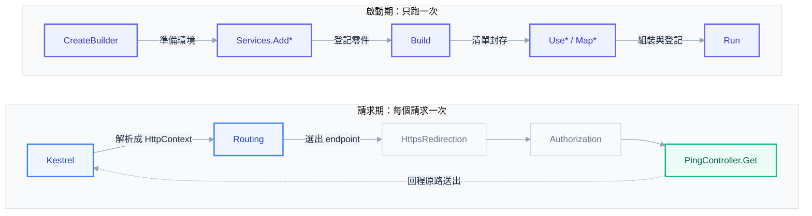

# 入門第 03 章：第一個專案 — `dotnet new` 產生了什麼，請求進來時 Program.cs 做了什麼

## 一行被清掉的程式，換來一整片 404

範本產生的 `Program.cs` 只有十幾行，裡面還夾著幾行英文註解。有人覺得註解礙眼，順手整理了一下，連同看起來「沒在用」的 `app.MapControllers();` 一起刪了。專案照樣編譯成功，`dotnet run` 照樣印出 `Now listening on`，沒有任何錯誤。接著前端打 API：

```powershell
curl.exe -s -i http://localhost:5090/api/ping
```

```text
HTTP/1.1 404 Not Found
Content-Length: 0
Date: Sat, 31 Oct 2026 06:26:44 GMT
Server: Kestrel
```

404，body 是空的，伺服器的 console 也沒有任何一行錯誤。Controller 明明還在，路徑也沒打錯。（5090 是這位同事專案自己的連接埠，本書的範例統一用 5080，後面會看到為什麼。）要看懂這件事，必須知道 `Program.cs` 那十幾行各自在做什麼，以及它們為什麼分成前後兩段。這是本章的主軸。

[[basics-02-rest-api-design]] 交出了 TaskTracker 的 API 規格，本章開始動手：裝好 SDK、建立專案、讀懂範本產生的每一個檔案，最後讓第一個端點跑起來，用 `curl.exe` 打它，並用第一章學的方式讀回應。這一章的 Controller 只有一個 `GET /api/ping`，真正的任務端點從 [[basics-04-controllers-and-routing]] 開始。

---

## 一、動手之前：用哪個版本的 .NET

整本書以 .NET 10 為基準。理由是支援週期：.NET 10 是 LTS（長期支援），官方支援到 2028 年 11 月。反過來，.NET 8 與 .NET 9 都在 2026-11-10 終止支援，本書寫作時距離那一天只剩十天。新專案若選一個即將停止收安全更新的版本，等於一開始就欠了一筆升級債。.NET 11 預計 2026 年 11 月發布，屬於 STS（標準期限支援，只有兩年）；在 LTS 與 STS 之間，企業專案通常選 LTS，因為升級可以排在比較從容的時間。

安裝 .NET 10 SDK 後，用下面這行確認：

```powershell
dotnet --version
```

```text
10.0.301
```

版本號最後一段（patch）會隨時間增加，你看到的數字可能不同，只要開頭是 `10.0` 即可。SDK 是「建置與開發用的工具組」，裡面已包含執行 ASP.NET Core 所需的 runtime，不需要另外裝。

團隊開發時，建議在 solution 根目錄放一個 `global.json`，把 SDK 版本範圍固定下來，避免同事機器上裝了不同版本而出現「我這邊可以建置」的落差。本書的 TaskTracker 用的是：

```json
{
  "sdk": {
    "version": "10.0.301",
    "rollForward": "latestFeature"
  }
}
```

`rollForward: latestFeature` 表示使用機器上已安裝、major.minor 相同（這裡是 10.0）且不低於 10.0.301 的最高版 SDK，包含更高的 feature band，例如 10.0.4xx。所以它固定的是 major.minor 與版本下限，不是精確版本；同一台機器上如果裝了更新的 10.0.x，就會用更新的那個。想要精確版本，rollForward 設成 `disable`；只容許 patch 差異，設成 `latestPatch`。

---

## 二、建立 solution 與專案

指令都在 PowerShell 執行。先建 solution，再建 Web API 專案，最後把專案加進 solution：

```powershell
dotnet new sln -n TaskTracker
dotnet new webapi --use-controllers -n TaskTracker.Api -o src/TaskTracker.Api
dotnet sln add src/TaskTracker.Api
```

solution 是「專案的容器」。現在只有一個專案，看起來多此一舉，但後面的章節會加入測試專案，到時候 `dotnet build` 與 `dotnet test` 在根目錄一次處理全部。.NET 10 SDK 的 `dotnet new sln` 預設產生 `TaskTracker.slnx`，這是比舊式 `.sln` 更簡潔的 XML 格式，內容只有專案路徑的清單。目標框架預設就是 `net10.0`，不需要另外指定。

### 2.1 為什麼加 `--use-controllers`

這裡有一個容易被忽略的事實：`dotnet new webapi` 在 .NET 10 預設產生的是 Minimal API，不是 Controller。Minimal API 把路由和處理函式直接寫在 `Program.cs`，用 `app.MapGet("/weatherforecast", () => ...)` 的形式；範本裡甚至沒有 `Controllers` 資料夾。要得到 Controller 版本，必須明確加 `--use-controllers`。網路上很多舊教學寫的 `dotnet new webapi` 會產生 Controller，那是 .NET 8 以前的預設，照著做會得到完全不同的檔案結構。

本書先用 Controller，理由有三個。其一，Controller 把「一個資源的所有端點」收在同一個類別，TaskTracker 的 `/api/tasks` 規格剛好對應一個 `TasksController`，結構一目了然。其二，後面要學的 model binding、validation、filter、`[Authorize]` 這些機制，在 Controller 裡以 attribute 的形式出現，每個概念都有一個看得見的掛載點，適合第一次學。其三，現有的企業專案大多是 Controller 風格，讀懂它是接手舊程式的基本功。

Minimal API 在簡潔與 Native AOT 上有優勢，兩種風格的取捨留到 [[expert-03-minimal-api-and-aot]]。兩者共用同一套 pipeline 與 DI，這一章學到的 `Program.cs` 兩個階段對兩種風格完全適用。

---

## 三、範本產生了什麼

專案建好之後，扣掉 `bin` 與 `obj`（建置時產生的中間產物，不進版控），實際檔案是這些：

```text
src\TaskTracker.Api\appsettings.Development.json
src\TaskTracker.Api\appsettings.json
src\TaskTracker.Api\Program.cs
src\TaskTracker.Api\TaskTracker.Api.csproj
src\TaskTracker.Api\TaskTracker.Api.http
src\TaskTracker.Api\WeatherForecast.cs
src\TaskTracker.Api\Controllers\WeatherForecastController.cs
src\TaskTracker.Api\Properties\launchSettings.json
```

八個檔案，各自負責不同的事。

### 3.1 TaskTracker.Api.csproj：專案怎麼被建置

```xml
<Project Sdk="Microsoft.NET.Sdk.Web">

  <PropertyGroup>
    <TargetFramework>net10.0</TargetFramework>
    <Nullable>enable</Nullable>
    <ImplicitUsings>enable</ImplicitUsings>
  </PropertyGroup>

  <ItemGroup>
    <PackageReference Include="Microsoft.AspNetCore.OpenApi" Version="10.0.14" />
  </ItemGroup>

</Project>
```

最重要的是第一行 `Sdk="Microsoft.NET.Sdk.Web"`。同樣是 C# 專案，Console 用的是 `Microsoft.NET.Sdk`；換成 `.Web` 之後，專案會自動參考 ASP.NET Core 的整套 framework（`Microsoft.AspNetCore.App`），所以 csproj 裡不用逐一列出 MVC、Kestrel、設定、logging 等套件，一個 SDK 屬性全包。`TargetFramework` 是 `net10.0`，對應第一節選的版本。

`Nullable` 開啟後，編譯器會追蹤參照型別是否可能為 `null`，把一部分 `NullReferenceException` 提前變成編譯警告。`ImplicitUsings` 開啟後，常用的 `using`（`System`、`System.Linq`、`Microsoft.AspNetCore.Builder` 等）由 SDK 自動加入，這解釋了為什麼 `Program.cs` 第一行就能直接寫 `WebApplication.CreateBuilder`，沒有任何 `using`。最後的 `PackageReference` 是這個專案唯一直接選用的套件。你剛建好的範本裡，它的版本可能比這裡寫的舊（例如 10.0.9），下面這個警告就是它引起的。

#### restore 時的警告：NU1903

範本建立完成後，SDK 會自動執行還原（restore，下載專案需要的套件）。這時 console 可能多出一行：

```text
Restoring <repo>\src\TaskTracker.Api\TaskTracker.Api.csproj:
  Determining projects to restore...
<repo>\src\TaskTracker.Api\TaskTracker.Api.csproj : warning NU1903: Package 'Microsoft.OpenApi' 2.0.0 has a known high severity vulnerability, https://github.com/advisories/GHSA-v5pm-xwqc-g5wc
  Restored <repo>\src\TaskTracker.Api\TaskTracker.Api.csproj (in 351 ms).
Restore succeeded.
```

`Restore succeeded` 與 `warning` 同時出現，建置也會成功，沒有任何東西阻止你繼續寫程式，所以很多人的反應是略過它。這一行值得停下來讀。NU1903 是 NuGet 的套件稽核（audit）發出的：還原時它比對公開的弱點資料庫，發現套件有已知的 high 嚴重度弱點。注意警告指的是 `Microsoft.OpenApi`，而 csproj 裡根本沒有這個名字。原因是 transitive dependency（間接相依）：你選的 `Microsoft.AspNetCore.OpenApi` 10.0.9 自己依賴 `Microsoft.OpenApi`，被拉進來的是有弱點的 2.0.0 版。你沒有宣告它，它卻會被編進你的應用程式。

處理方式是升級直接相依的那個套件，讓它帶進比較新的間接相依：

```powershell
dotnet add src/TaskTracker.Api package Microsoft.AspNetCore.OpenApi --version 10.0.14
dotnet build
```

升級後建置輸出變成 `0 Warning(s)`，`dotnet list package --include-transitive` 看得到 `Microsoft.OpenApi` 已經是 2.12.2。要避免的做法是把 `NU1903` 加進 csproj 的 `NoWarn`：警告消失了，弱點還在，下一次同類警告也沒人看得到。養成一個習慣：`restore` 或 `build` 輸出出現 warning，先讀完再繼續。

這份警告是 SDK 出貨當下的快照，你現在照做可能看不到，也可能看到別的套件的新警告。判斷方式不變：讀編號、讀套件名、查連結的 advisory，再決定升級哪個直接相依。沒看到警告時怎麼確認，見文末 Q&A。

### 3.2 Program.cs：整個應用程式的起點

`Program.cs` 本章第四節專門拆解，這裡先記一件事：它沒有 `class Program`、沒有 `static void Main`，只有一排由上而下執行的敘述。這是 C# 的 top-level statements 語法，編譯器會自動替你產生 `Main`。對讀者來說，這代表應用程式的執行就是這個檔案「從第一行跑到最後一行」。

### 3.3 Controllers 資料夾與 WeatherForecast

`WeatherForecastController` 是範本附的範例。它宣告 `[ApiController]`、`[Route("[controller]")]`，並有一個 `Get()` 回傳五筆隨機天氣。它的作用是證明「專案裝好了、路由接上了」，對 TaskTracker 沒有用途。`WeatherForecast.cs` 是它回傳的資料型別，同樣是示範。這兩個檔案在實際專案的第一個動作就是刪除，本書也一樣：第五節會請你刪掉它們，換成自己寫的 `PingController`。Controller 每個 attribute 的作用，以及 `[Route("[controller]")]` 展開成什麼，留到 [[basics-04-controllers-and-routing]]。

### 3.4 appsettings.json 與 appsettings.Development.json

兩個檔案都是 JSON，內容是應用程式的設定。範本的 `appsettings.json` 只有兩件事：

```json
{
  "Logging": {
    "LogLevel": {
      "Default": "Information",
      "Microsoft.AspNetCore": "Warning"
    }
  },
  "AllowedHosts": "*"
}
```

`Logging:LogLevel` 決定 log 要印多細：預設 `Information` 以上都印，但 ASP.NET Core 框架自己的 log 只印 `Warning` 以上，否則每個請求會洗出一大堆框架內部訊息。`AllowedHosts` 是允許的 Host 標頭，`*` 表示不限制。`appsettings.Development.json` 只在環境為 Development 時載入，同名的設定會蓋過前者。連線字串、JWT 金鑰、環境差異這些東西怎麼放進來，是 [[basics-09-configuration-and-environments]] 的主題。

### 3.5 TaskTracker.Api.http：隨檔案附的請求清單

`.http` 檔是給 Visual Studio 與 VS Code 的 REST Client 外掛用的，在編輯器裡點一下就能對 API 發請求。內容是起始網址加幾行請求。它和應用程式本身無關，不打算用編輯器發請求的人可以忽略。本書統一用 `curl.exe`，原因是第一章練過讀它的輸出，而且它在任何環境（包含沒有圖形介面的伺服器）都可用。

### 3.6 launchSettings.json：只給 `dotnet run` 看的檔案

launchSettings.json 在第六節細看，這裡先釐清它的角色：它只在開發機上被 `dotnet run` 或 IDE 讀取，用來決定「開發時用什麼網址、什麼環境變數啟動」。發佈（publish）時它不會被打包，部署到伺服器或容器之後，它不存在。

---

## 四、Program.cs：兩個階段

範本原本的 `Program.cs` 夾了幾行註解。整理成最簡的樣子，TaskTracker 本章的版本是：

```csharp
var builder = WebApplication.CreateBuilder(args);

builder.Services.AddControllers();
builder.Services.AddOpenApi();

var app = builder.Build();

if (app.Environment.IsDevelopment())
{
    app.MapOpenApi();
}

app.UseHttpsRedirection();
app.UseAuthorization();
app.MapControllers();

app.Run();
```

可以把它想成兩個變數，`builder` 與 `app`，中間用 `builder.Build()` 隔開。前半段在使用 `builder`，後半段在使用 `app`。有一句話說得很準：「Web API 專案不是從 Controller 開始，而是從 Program.cs 開始」，Controller 只是 pipeline 的其中一站。要理解那一站為什麼存在、什麼時候被叫到，就得先分清這兩個階段各管什麼。

### 4.1 第一階段：builder，決定「有什麼東西可用」

`WebApplication.CreateBuilder(args)` 建出一個 builder 物件，上面掛著幾個可以設定的入口：`builder.Services`（服務清單）、`builder.Configuration`（設定）、`builder.Logging`、`builder.Environment`。這一行已經替你做了一批事：決定現在是 Development 還是 Production、把 `appsettings.json` 等設定來源疊起來、接上預設的 logging。這些細節在 [[00-hosting-and-startup]] 有完整展開，入門階段先接受「它把基本環境準備好了」即可。

接著兩行是這一階段的主角：

```csharp
builder.Services.AddControllers();
builder.Services.AddOpenApi();
```

`builder.Services` 是一張「服務清單」。`AddControllers()` 往清單裡登記「MVC 的 Controller 機制需要的全部零件」：怎麼找到 Controller 類別、怎麼做 model binding、怎麼把物件序列化成 JSON。`AddOpenApi()` 登記產生 OpenAPI 文件需要的零件。注意這一階段只是「登記」，沒有任何請求被處理，也沒有任何 Controller 被建立。把它想成備料：先決定廚房裡有哪些食材和工具。

登記不同型別的服務時，先後順序大多無關緊要：先登記 `AddOpenApi` 或先登記 `AddControllers`，結果一樣，因為真正用到服務的時機在請求進來之後，那時整張清單早已齊全。最常見的例外是同一個型別登記了多次：最後一筆勝出，而且用 `IEnumerable<T>` 取得全部實作時，排列順序就是登記順序；`IHostedService` 也是依登記順序啟動。這些規則在 [[02-dependency-injection]] 展開。第一階段還有第三種常見用途：登記你自己寫的 Service，那是 [[basics-07-dependency-injection-and-services]] 的內容。

### 4.2 分水嶺：Build()

```csharp
var app = builder.Build();
```

`Build()` 把剛才那張清單「封起來」，依清單內容產生真正可以建立物件的容器，同時產生 `app`。清單封起來之後就不能再修改：容器是依封存當下的清單建好的，之後才加進去的登記它根本看不到，所以框架乾脆讓清單變成唯讀，一改就丟例外，而不是讓你默默登記失敗。第三個情境（4.5）會看到實際的例外。

### 4.3 第二階段：app，決定「請求怎麼流過去」

```csharp
if (app.Environment.IsDevelopment())
{
    app.MapOpenApi();
}

app.UseHttpsRedirection();
app.UseAuthorization();
app.MapControllers();

app.Run();
```

第二階段不再登記零件，而是用 `app` 把一條處理線組裝起來，這條線叫 request pipeline（請求管線）。每一個請求都會依序流過線上每一站，每一站稱為 middleware（中介軟體）。這裡出現兩種動詞：`Use` 開頭的（`UseHttpsRedirection`、`UseAuthorization`）是在線上加一個 middleware；`Map` 開頭的（`MapControllers`、`MapOpenApi`）是登記 endpoint，也就是「某個路徑由誰處理」。

逐行來看：

- `UseHttpsRedirection()`：如果請求是用 `http://` 來的，且應用程式知道 https 的連接埠，就回一個轉址要求呼叫端改用 https。
- `UseAuthorization()`：檢查目標 endpoint 上有沒有 `[Authorize]` 之類的授權要求，有的話判斷放不放行。目前 TaskTracker 還沒有任何授權設定，它不會擋任何請求，範本預先放好，等 [[basics-11-auth-concepts-and-pipeline]] 才派上用場。範本裡沒有 `UseAuthentication()` 是正常的，因為還沒有任何驗證機制；日後加上驗證時，它會放在 `UseAuthorization()` 之前，你在別人的專案看到這一對一前一後，就是這個原因。錯誤處理與 CORS 的 middleware 也是之後的章節才加入，[[basics-08-middleware-and-exception-handling]] 會給出完整的順序。
- `MapControllers()`：掃描專案裡所有 Controller 的路由 attribute，把每個 action 登記成一個 endpoint。
- `if (IsDevelopment()) app.MapOpenApi()`：只有 Development 環境才登記 `/openapi/v1.json` 這個文件端點。Production 打這個網址會是 404，5.2 會實際驗證。
- `app.Run()`：啟動 Kestrel 開始監聽，並且在這一行停住，直到收到關機訊號。這是整個程式最後一行，也是最重要的一行：沒有它，`Program.cs` 跑完就結束，伺服器根本沒機會接任何請求。

### 4.4 一個請求進來的完整旅程

把兩個階段接起來，用一個 `GET /api/ping` 追蹤一遍。先看全貌：



上排是程式啟動時從頭跑到 `Run()` 的一次性工作，下排是啟動之後每個請求各走一遍的路。程式啟動時，第一階段登記好服務，`Build()` 封裝，第二階段組好 pipeline 並登記 endpoint，`Run()` 讓 Kestrel 開始在 5080 埠聽。從此每個請求的路徑是：

1. Kestrel 從網路讀進一段 HTTP 文字（第一章看到的那種），解析成一個 `HttpContext` 物件。它包著這次請求與即將送出的回應（`Request` 與 `Response`），後面每一站都靠它讀寫。
2. 請求進入 pipeline。路由比對（routing）先發生：用路徑 `/api/ping` 在登記好的 endpoint 裡找出對應的那個。`WebApplication` 會自動把 routing 放在 pipeline 最前面，所以第一個 middleware 就取得到被選中的 endpoint，不需要自己呼叫 `UseRouting()`（實測結果，細節在 [[01-request-pipeline]]）。
3. 依序經過 `UseHttpsRedirection`、`UseAuthorization`。每一站可以放行（呼叫下一站）或當場回應（短路）。
4. 抵達 pipeline 最後一站，執行被選中的 endpoint，也就是 `PingController.Get()`。
5. 結果從原路回頭，經過每一站（它們可以在回程時加標頭或記錄），最後由 Kestrel 組成回應文字送出。

這裡有個容易誤會的地方：`MapControllers()` 寫在 `UseAuthorization()` 後面，並不代表「controller 在授權之後才執行」是靠這兩行的先後決定的。在 `WebApplication` 裡，`Map*` 只是登記 endpoint，真正執行 endpoint 永遠是 pipeline 的最後一站。實測把 middleware 寫在 `MapControllers()` 之前或之後，結果完全相同：對 `/hello` 都是「middleware 進入、action 執行、middleware 離開」。真正需要注意先後的是 `Use*` 彼此之間，例如授權一定要在 endpoint 執行前完成。這個順序規則會在 [[basics-08-middleware-and-exception-handling]] 系統地講。

### 4.5 放錯階段會怎樣

兩階段的價值，在放錯時最看得出來。下面三個情境都是對 TaskTracker 專案做最小修改後實際執行的結果。

第一個，漏了第一階段的登記：刪掉 `builder.Services.AddControllers();`，其他不動。專案可以編譯，但啟動就直接丟例外：

```text
Unhandled exception. System.InvalidOperationException: Unable to find the required services. Please add all the required services by calling 'IServiceCollection.AddAuthorization' in the application startup code.
   at Microsoft.AspNetCore.Builder.AuthorizationAppBuilderExtensions.VerifyServicesRegistered(IApplicationBuilder app)
   at Microsoft.AspNetCore.Builder.AuthorizationAppBuilderExtensions.UseAuthorization(IApplicationBuilder app)
```

這個訊息有個陷阱：它叫你加 `AddAuthorization`，但你漏的其實是 `AddControllers`，只是 `AddControllers` 內部順便登記了授權相關服務，而 `UseAuthorization()` 排在 `MapControllers()` 之前，先檢查到缺這一塊。如果照字面去補 `AddAuthorization`，下一個錯誤才會指向 `AddControllers`。把 `UseAuthorization()` 也暫時拿掉再跑一次，訊息就變成：

```text
Unhandled exception. System.InvalidOperationException: Unable to find the required services. Please add all the required services by calling 'IServiceCollection.AddControllers' inside the call to 'ConfigureServices(...)' in the application startup code.
   at Microsoft.AspNetCore.Builder.ControllerEndpointRouteBuilderExtensions.EnsureControllerServices(IEndpointRouteBuilder endpoints)
   at Microsoft.AspNetCore.Builder.ControllerEndpointRouteBuilderExtensions.MapControllers(IEndpointRouteBuilder endpoints)
```

教訓有兩個。其一，漏登記服務的錯誤會在啟動階段大聲出現，這是好事，因為問題在部署前就被發現。其二，錯誤訊息指出的是「第一個發現缺料的地方」，未必是根因；讀 stack trace 的最上面幾行，看是哪個 `Use` 或 `Map` 觸發的，比照字面補一個 `Add` 更可靠。

第二個，漏了第二階段的登記：刪掉 `app.MapControllers();`。這就是本章開頭的情境。專案編譯成功，啟動沒有錯誤，console 顯示一切正常，每個請求都 404、body 是空的。因為沒有任何 endpoint 被登記，路由找不到目標，pipeline 走到盡頭就回 404。和第一種情境對照：漏了「服務」會在啟動時炸，漏了「endpoint」卻靜悄悄，因為沒有東西可以驗證「你本來應該呼叫它」。所以 404 且 body 為空，而 Controller 看起來完好時，第一個要查的就是 `Program.cs` 有沒有 `MapControllers()`。

第三個，在 `Build()` 之後還想登記服務。`builder.Services` 這個變數在 `Build()` 之後仍然存在，編譯器不會阻止你繼續呼叫它：

```csharp
var app = builder.Build();
builder.Services.AddSingleton<object>();
app.Run();
```

這段可以編譯，執行時啟動就失敗：

```text
Unhandled exception. System.InvalidOperationException: The service collection cannot be modified because it is read-only.
   at Microsoft.Extensions.DependencyInjection.ServiceCollection.ThrowReadOnlyException()
```

反方向的錯放通常在編譯時就被擋下。`app.Services` 的型別是 `IServiceProvider`（已經封好的容器），沒有 `AddControllers` 這類登記方法；`builder` 上也沒有 `UseHttpsRedirection`。兩個階段用兩種不同的型別，型別系統替你守住了大部分界線，只有「`Build()` 之後還去改 `builder.Services`」這種例外要靠執行時的檢查。

---

## 五、第一個端點

框架搭好了，接著放一個最小的 Controller。這個端點用來確認整條線是通的，所以刻意不依賴任何東西。先在你的專案裡動手：

1. 刪除 `Controllers/WeatherForecastController.cs` 與 `WeatherForecast.cs`。
2. 新增 `Controllers/PingController.cs`，貼上下面的程式碼。
3. 打開 `Properties/launchSettings.json`，把 `http` profile 的 `applicationUrl` 改成 `http://localhost:5080`。範本裡的連接埠是建立專案時隨機產生的，每個人都不一樣；本書所有指令與輸出都以 5080 為例，你改成自己習慣的埠也可以，後面的網址跟著換。

```csharp
using Microsoft.AspNetCore.Mvc;

namespace TaskTracker.Api.Controllers;

[ApiController]
[Route("api/ping")]
public class PingController : ControllerBase
{
    [HttpGet]
    public ActionResult<PingResponse> Get() => Ok(new PingResponse("pong", DateTimeOffset.UtcNow));
}

publicrecord PingResponse(string Message, DateTimeOffset Time);
```

逐項看一下它的零件，細節留給下一章：

- `ControllerBase` 是沒有 View 支援的 Controller 基底類別，適合 API，提供 `Ok()`、`NotFound()` 等回傳方法。
- `[ApiController]` 啟用一組 API 專用的預設行為，例如自動回 400 的 model validation。
- `[Route("api/ping")]` 決定這個 Controller 的網址前綴，`[HttpGet]` 決定 `Get()` 回應 GET 請求。兩者合起來就是 `GET /api/ping`，符合 [[basics-02-rest-api-design]] 的命名習慣（名詞、小寫）。
- `ActionResult<PingResponse>` 表示這個 action 可以回傳 `PingResponse`，也可以回傳狀態碼之類的結果。
- `PingResponse` 是一個 record：兩個屬性、唯讀，用一行宣告完。

### 5.1 跑起來

```powershell
dotnet run --project src/TaskTracker.Api --launch-profile http
```

console 輸出（Development 環境）：

```text
info: Microsoft.Hosting.Lifetime[14]
      Now listening on: http://localhost:5080
info: Microsoft.Hosting.Lifetime[0]
      Application started. Press Ctrl+C to shut down.
info: Microsoft.Hosting.Lifetime[0]
      Hosting environment: Development
info: Microsoft.Hosting.Lifetime[0]
      Content root path: <repo>\src\TaskTracker.Api
```

這四行是 `app.Run()` 之後 Kestrel 啟動的結果：監聽哪個網址、目前是哪個環境、內容根目錄在哪。

開另一個 PowerShell 視窗，用 `curl.exe` 發請求。要寫 `curl.exe` 而不是 `curl`，原因第一章講過，PowerShell 5.1 的 `curl` 是 `Invoke-WebRequest` 的別名。`-i` 讓 curl 印出回應標頭：

```powershell
curl.exe -s -i http://localhost:5080/api/ping
```

```text
HTTP/1.1 200 OK
Content-Type: application/json; charset=utf-8
Date: Fri, 30 Oct 2026 14:18:00 GMT
Server: Kestrel
Transfer-Encoding: chunked

{"message":"pong","time":"2026-10-30T14:18:00.8128603+00:00"}
```

回頭看跑著伺服器的那個視窗，多了一行警告：

```text
warn: Microsoft.AspNetCore.HttpsPolicy.HttpsRedirectionMiddleware[3]
      Failed to determine the https port for redirect.
```

這行不是啟動時印的，要等第一個請求經過 `UseHttpsRedirection()` 才會出現。它的來由在第六節解釋，請求本身不受影響。

用第一章的方式讀這段回應文字。狀態行是 `200 OK`，GET 取得資料成功。`Content-Type: application/json; charset=utf-8` 說明 body 是 JSON；這是 `ActionResult<PingResponse>` 經過 JSON 序列化的結果，程式碼裡沒有任何一行寫過 JSON。`Server: Kestrel` 指出這是 ASP.NET Core 內建的伺服器在回應。沒有 `Content-Length`，改用 `Transfer-Encoding: chunked`：伺服器沒有先算好 body 總長度，而是邊序列化邊分段送出，呼叫端靠最後一段的結束標記知道回應結束。

Body 裡的屬性是 `message` 和 `time`，C# 裡寫的是 `Message` 和 `Time`。ASP.NET Core 預設的 JSON 設定把屬性名轉成 camelCase，和 JavaScript 的慣例一致，前端不需要再轉一次。`time` 帶著 `+00:00`，因為用的是 `DateTimeOffset.UtcNow`，時區資訊跟著值一起送出；API 傳時間時帶時區可以避免前後端各猜各的。

再試兩個失敗的情況，因為 API 開發者一半的時間在讀錯誤：

```powershell
curl.exe -s -i http://localhost:5080/api/nope
curl.exe -s -i -X POST http://localhost:5080/api/ping
```

```text
HTTP/1.1 404 Not Found
Content-Length: 0
Date: Fri, 30 Oct 2026 14:18:03 GMT
Server: Kestrel
```

```text
HTTP/1.1 405 Method Not Allowed
Content-Length: 0
Date: Fri, 30 Oct 2026 14:18:04 GMT
Server: Kestrel
Allow: GET
```

不存在的路徑是 404；存在的路徑但 method 不對是 405，且回應帶了 `Allow: GET` 告訴呼叫端這個路徑接受什麼。這是第一章講的 method 語意在框架層的落實：路由比對先看路徑，路徑命中後再看 method。這兩個回應的 body 都是空的，[[basics-02-rest-api-design]] 預告過 TaskTracker 的錯誤會統一成 `application/problem+json`，那要等錯誤處理的章節才會設定。

### 5.2 OpenAPI 文件與環境的關係

Development 環境下，`MapOpenApi()` 登記的端點可以讀：

```powershell
curl.exe -s http://localhost:5080/openapi/v1.json
```

回應是一份機器可讀的 API 描述，開頭是：

```json
{
  "openapi": "3.1.1",
  "info": {
    "title": "TaskTracker.Api | v1",
    "version": "1.0.0"
  },
```

它列出了 `/api/ping` 的 `get` 操作與 `PingResponse` 的結構。這份文件怎麼變成給前端看的互動頁面，是 [[basics-14-openapi-and-versioning]] 的主題。注意 .NET 10 範本只產生文件，並不附 Swagger UI，這和較舊的範本（內建 Swashbuckle）不同，舊教學裡的 `UseSwagger()` 與 `UseSwaggerUI()` 在新範本中不存在。

接著把環境換成 Production。先在跑著伺服器的視窗按 Ctrl+C 停掉，再用下面的指令重新啟動：

```powershell
dotnet run --project src/TaskTracker.Api --no-launch-profile --urls http://localhost:5080
```

`--no-launch-profile` 告訴 `dotnet run` 不要讀 launchSettings.json，也就沒有人設定 `ASPNETCORE_ENVIRONMENT`，環境回到框架的預設值 Production（第六節會細講）；沒有 launchSettings 也就沒有 `applicationUrl`，所以用 `--urls` 自己指定網址。console 的 `Hosting environment` 這時會是 `Production`。同樣打兩個網址：

```text
GET /openapi/v1.json  ->  HTTP/1.1 404 Not Found
GET /api/ping         ->  HTTP/1.1 200 OK
```

文件端點消失了，`/api/ping` 照常回應。這一組對照把 `Program.cs` 裡那個 `if (app.Environment.IsDevelopment())` 的效果顯示得很清楚：它是在第二階段、依據執行環境，決定要不要登記某個 endpoint。Production 不應該公開內部 API 文件，這是預設的保守選擇。

---

## 六、launchSettings、環境變數與 https

launchSettings.json 決定 `dotnet run` 怎麼啟動應用程式。把連接埠固定之後，本書 TaskTracker 的版本是：

```json
{
  "$schema": "https://json.schemastore.org/launchsettings.json",
  "profiles": {
    "http": {
      "commandName": "Project",
      "dotnetRunMessages": true,
      "launchBrowser": false,
      "applicationUrl": "http://localhost:5080",
      "environmentVariables": {
        "ASPNETCORE_ENVIRONMENT": "Development"
      }
    },
    "https": {
      "commandName": "Project",
      "dotnetRunMessages": true,
      "launchBrowser": false,
      "applicationUrl": "https://localhost:7080;http://localhost:5080",
      "environmentVariables": {
        "ASPNETCORE_ENVIRONMENT": "Development"
      }
    }
  }
}
```

第五節請你改的只有 `http` profile 的埠。如果想完整照著走 6.1 的 https 實驗，也把 `https` profile 的 `applicationUrl` 改成上面這樣（7080 是 https，5080 是 http）。你自己建的專案以自己的 launchSettings.json 為準。

這個檔案有兩個 profile：`http` 只開 5080，`https` 同時開 7080（https）與 5080（http）。`applicationUrl` 決定 Kestrel 聽哪些網址，`environmentVariables` 裡的 `ASPNETCORE_ENVIRONMENT=Development` 決定環境。這就是為什麼在本機用 `dotnet run` 時永遠是 Development：launchSettings.json 設了這個環境變數。框架本身的預設是 Production，環境變數沒設時就是 Production。把應用程式放進容器或伺服器，launchSettings.json 不在其中，如果沒有另外設定環境變數，應用程式會以 Production 啟動，於是 OpenAPI 端點不見、`appsettings.Development.json` 不載入，行為和本機不同。這是新手把專案部署上去之後最常遇到的第一個差異，環境的完整設定方式在 [[basics-09-configuration-and-environments]] 與 [[17-configuration-and-secrets]]。

### 6.1 為什麼 http profile 會出現那行 warn

5.1 在你送出第一個請求後出現的警告 `Failed to determine the https port for redirect.` 來自 `UseHttpsRedirection()`。這個 middleware 在處理請求時才判斷 https 的連接埠，而要把 http 請求轉去 https，前提是它知道那個埠。`http` profile 只開了 5080，沒有任何 https 網址，它找不到可以轉去哪裡，只好警告後放行。警告只代表轉址沒有發生，請求照常處理，所以前面的 `200 OK` 才會成功。

改用 `https` profile，情況就不同：

```powershell
dotnet run --project src/TaskTracker.Api --launch-profile https
curl.exe -s -i http://localhost:5080/api/ping
```

```text
HTTP/1.1 307 Temporary Redirect
Content-Length: 0
Date: Sat, 31 Oct 2026 06:27:50 GMT
Server: Kestrel
Location: https://localhost:7080/api/ping
```

這次走 http 的請求被回了 307，`Location` 指向 https 的網址。用 307（而不是 301 或 302）是刻意的：[[basics-01-http-and-web-api]] 講過轉址有可能把 POST 變成 GET，307 則保證呼叫端用同樣的 method 與 body 重送，所以 POST 一個新任務被轉址之後，仍然是 POST。

### 6.2 開發憑證

https 需要憑證。.NET SDK 安裝時的 first-run 會在本機建立一張只給開發用的憑證（dev certificate），但這張憑證預設不被系統信任。`https` profile 啟動時，console 會有這一行：

```text
warn: Microsoft.AspNetCore.Server.Kestrel.Core.KestrelServer[8]
      The ASP.NET Core developer certificate is not trusted. For information about trusting the ASP.NET Core developer certificate, see https://aka.ms/aspnet/https-trust-dev-cert
```

在這種狀態下，用 `curl.exe -s` 打 `https://localhost:7080` 不會有任何輸出。伺服器其實連得上，失敗的是 TLS 的憑證驗證（curl 的 exit code 是 60），而 `-s` 把錯誤訊息一併靜音。改用 `-sS` 就看得到原因，在 Windows 上是 `SEC_E_UNTRUSTED_ROOT`，也就是憑證的簽發者不在信任清單裡。這是憑證問題，不用去查網路或防火牆。讓開發機信任這張憑證的指令是：

```powershell
dotnet dev-certs https --check
dotnet dev-certs https --trust
```

`--check` 檢查憑證是否存在、是否有效，`--trust` 把它加入信任清單（Windows 會跳出確認視窗）。這張憑證只適合本機，不要拿去任何其他地方。

本書的前面幾章不需要 https：TaskTracker 在本機用 `http` profile 就夠，所有 `curl.exe` 範例都打 `http://localhost:5080`。到了需要處理 token 與 cookie 的章節，才會回頭用 https。至於部署之後 TLS 在哪一層終結、`UseHttpsRedirection()` 在 proxy 後面要怎麼處理，留到 [[basics-16-deployment-and-go-live]]。

---

## 七、這一章結束時，專案長什麼樣

回顧一遍，TaskTracker 專案現在是範本經過三次最小的改動：

1. 範本原樣建立（含 `WeatherForecastController`）。
2. 把 `Microsoft.AspNetCore.OpenApi` 升到 10.0.14，消除 NU1903。
3. 刪掉 WeatherForecast 範例，加入 `PingController`，固定開發連接埠，`Program.cs` 去掉註解。

此時專案只有一個端點，沒有資料，沒有驗證。但整條線已經通了：SDK、套件還原、兩階段的 `Program.cs`、Kestrel、routing、Controller、JSON 序列化。從這裡開始，後面每一章都是在這條線上加東西：[[basics-04-controllers-and-routing]] 加上任務的端點，[[basics-05-model-binding-and-validation]] 處理輸入，後面的章節依序補上 Service、middleware、設定、資料庫、驗證。每次加什麼，都可以先問自己：它屬於第一階段（登記一個零件），還是第二階段（在 pipeline 上加一站或登記一個 endpoint）？這個問題幾乎能回答所有「這行該寫在哪」的疑問。

---

## 常見誤解

**「`dotnet new webapi` 預設會產生 Controller。」** 在 .NET 10 預設是 Minimal API，範本裡沒有 `Controllers` 資料夾。要 Controller 必須加 `--use-controllers`。舊教學的檔案結構與現在的範本不同，是因為預設值改過。

**「建置成功就代表沒問題，warning 可以晚點處理。」** NU1903 這類警告不影響編譯，但代表專案已經帶著已知弱點。警告可以看，不能略過。解法是升級直接相依的套件，不是用 `NoWarn` 把訊息關掉。

**「launchSettings.json 會跟著應用程式一起部署，所以線上也是 Development。」** 它只在開發機上被 `dotnet run` 或 IDE 讀取，發佈時不會被打包。線上沒設環境變數時是 Production。

**「`MapControllers()` 寫在最後，所以 Controller 最後才執行。」** 在 `WebApplication` 裡 `Map*` 只負責登記 endpoint，endpoint 的執行永遠在 pipeline 最後一站。決定先後的是 `Use*` 彼此之間的順序。

**「服務登記有順序，要先登記被依賴的。」** 不同型別之間，登記只是寫清單，解析發生在請求進來時，先後不影響能否找到依賴。需要留意的是同一個型別登記多次時最後一筆勝出，`IEnumerable<T>` 的排列與 `IHostedService` 的啟動也依登記順序，細節見 [[02-dependency-injection]]。

## 同事會來問你的問題

**Q：為什麼本書用 Controller，不用比較新的 Minimal API？**

Controller 風格的概念在 attribute 上看得見，適合第一次學 model binding、validation、授權；而且大量既有專案是這個風格。兩種風格共用同一套 pipeline 與 DI，學會一種不會白費。取捨比較在 [[expert-03-minimal-api-and-aot]]。

**Q：我照做卻沒看到 NU1903，是做錯了嗎？**

不是。那是 2026 年 10 月底、範本釘 `Microsoft.AspNetCore.OpenApi` 10.0.9 時的情況。新版 SDK 的範本可能已經釘在修復後的版本。確認方式是執行 `dotnet list package --vulnerable --include-transitive`，沒有輸出弱點就代表乾淨。

**Q：為什麼回應沒有 `Content-Length`？**

回應 body 是邊序列化邊送出的，送出標頭時總長度還不確定，所以改用 `Transfer-Encoding: chunked`。呼叫端照樣能完整讀取；不影響 API 的使用。

**Q：能不能在 `Build()` 之後再加服務，只改幾行就好？**

不行，會得到 `The service collection cannot be modified because it is read-only.`。需要的服務必須在第一階段登記完。要在執行期才決定行為，用設定值或在服務內部判斷，不要動態新增登記。

**Q：`UseAuthorization()` 現在不擋任何請求，可以先刪掉嗎？**

可以，但範本放著有它的道理：授權 middleware 的位置有講究，之後加上驗證機制時再調整比較不容易漏。刪掉它不會讓目前的 `/api/ping` 出問題。

## 這章的位置

讀完這章，你能用 `dotnet new` 建出 Controller 版的 Web API 專案，說出範本每個檔案的用途，處理還原警告，解釋 `Program.cs` 為什麼分成「登記」與「組裝 pipeline」兩個階段，並在放錯階段時從症狀（啟動例外或空 body 的 404）反推原因。你也有了第一個能用 `curl.exe` 驗證的端點。下一章 [[basics-04-controllers-and-routing]] 把 [[basics-02-rest-api-design]] 的規格變成 TaskTracker 的真實端點。想看 `CreateBuilder` 展開後做了哪些事、`Run()` 之後 Kestrel 與關機流程的運作，請讀深度篇 [[00-hosting-and-startup]]；pipeline 的組裝與順序推導在 [[01-request-pipeline]]。

---

## 連結

- 上一章：[[basics-02-rest-api-design]]
- 下一章：[[basics-04-controllers-and-routing]]
- 對應深度章：[[00-hosting-and-startup]]、[[01-request-pipeline]]
- 全書目錄：[[dotnet-web-api]]
