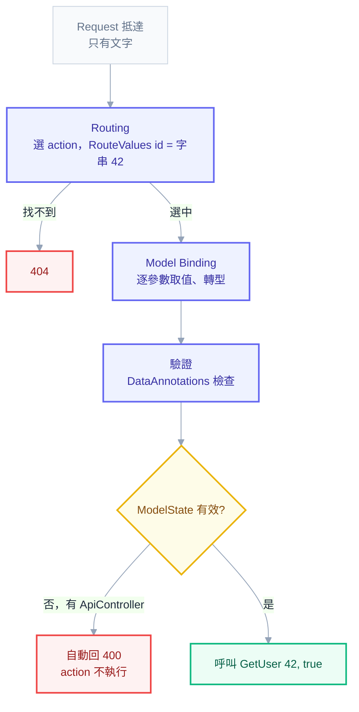

# 入門第 05 章：Model Binding 與驗證 — 請求裡的字串怎麼變成 C# 參數，不合法的輸入誰來擋

## 一個 `PUT` 把已完成的任務改回待辦

[[basics-04-controllers-and-routing]] 結束時，TaskTracker 有五支能用 `curl.exe` 呼叫的端點，但輸入完全沒人把關。拿種子資料裡已經完成的那筆任務（`Read chapter 4`，狀態 `done`），送一個忘了帶 `status` 的 `PUT`：

```powershell
'{"title":"Read chapter 4"}' | curl.exe -s -i -X PUT http://localhost:5080/api/tasks/11111111-1111-1111-1111-111111111111 -H "Content-Type: application/json" -d '@-'
```

```text
HTTP/1.1 200 OK
Content-Type: application/json; charset=utf-8

{"id":"11111111-1111-1111-1111-111111111111","title":"Read chapter 4","status":"todo","createdAt":"2026-10-01T09:00:00+00:00"}
```

回應 200，沒有任何錯誤，但這筆任務從 `done` 變成了 `todo`。請求裡根本沒提 `status`，伺服器卻悄悄把它寫成別的值。前端同事看到的症狀是「我只改了標題，為什麼任務又退回待辦」，要追好一陣子才會發現是 API 少了一道檢查。（部分輸出省略了 `Date`、`Server`、`Transfer-Encoding` 三個與主題無關的標頭；你機器上的 `traceId`、時間戳與新產生的 id 會和書上不同。）

這個例子裡有兩件事被混在一起。一件是**綁定**：請求裡只有字串（URL 的一段、query string 的一個值、body 的一段 JSON），框架要把它們轉成 `Guid`、`int`、`TaskItem` 這些 C# 型別，這個轉換會成功，也可能失敗。另一件是**驗證**：轉換成功之後，值合不合規格，例如標題不能空、`pageSize` 不能是一萬。上面那個 `PUT` 的問題出在兩者交界：缺欄位時綁定「成功」了，只是填進去的是型別的預設值，而預設值剛好是合法的 enum 成員，驗證也就沒有任何東西可以抱怨。

這一章依序回答兩個問題：請求裡的字串怎麼變成 C# 參數？不合法的輸入誰來擋？做完之後，`GET /api/tasks` 會多出分頁與狀態篩選，`POST` 和 `PUT` 會對標題做驗證，錯誤會以固定格式回給呼叫端。最後一節老實交代哪些問題這一章還是擋不住，它們為什麼要等 [[basics-06-dto-design]]。

---

## 一、從 Request 到 Action：字串被填進參數的時間軸

很多人把 action 想成「直接收到 HTTP 請求」。這個想法會在遇到第一個 binding 錯誤時出問題：為什麼 `/api/demo/users/abc` 會得到 400，而 `/api/tasks/abc` 卻是 404？要回答，得先看請求進來之後實際發生的順序。

用一個最小的例子。在 TaskTracker 專案新增 `Controllers/DemoController.cs`，這是做實驗用的暫時檔案，章末會刪掉：

```csharp
using Microsoft.AspNetCore.Mvc;

namespace TaskTracker.Api.Controllers;

[ApiController]
[Route("api/demo")]
public class DemoController : ControllerBase
{
    [HttpGet("users/{id}")]
    public IActionResult GetUser(int id, bool includeProfile, [FromHeader(Name = "X-Request-Id")] string? requestId)
        => Ok(new { id, includeProfile, requestId, raw = RouteData.Values["id"]?.GetType().Name });
}
```

呼叫端送出：

```text
GET /api/demo/users/42?includeProfile=true
X-Request-Id: abc-1
```

伺服器收到的是一串純文字，Kestrel 把它拆成 method、path、query string、headers、body。此時世界上還沒有任何叫 `id` 的 `int`，也沒有叫 `includeProfile` 的 `bool`。接下來的順序是：



第一站是 Routing，而且它只做一件事：判斷這個請求該交給哪一個 action。比對 `users/{id}` 時，`{id}` 吃到了 `42`，Routing 把它放進 `RouteValues["id"]`。重點在這裡：放進去的是**字串** `"42"`，不是 `int`。Routing 不知道也不在乎 action 的參數是什麼型別。上面那行 `raw = RouteData.Values["id"]?.GetType().Name` 就是為了讓這一點看得見：

```powershell
curl.exe -s -i http://localhost:5080/api/demo/users/42?includeProfile=true -H "X-Request-Id: abc-1"
```

```text
HTTP/1.1 200 OK
Content-Type: application/json; charset=utf-8

{"id":42,"includeProfile":true,"requestId":"abc-1","raw":"String"}
```

`id` 到了 action 裡已經是 `42`（`int`），而 `RouteData` 裡存的仍然是 `String`。中間發生轉換的那一站，就是第二站 Model Binding。

Model Binding 在 action 確定之後才開始，它拿著 action 的參數清單，一個一個問：這個參數的值該去哪裡找？找到之後是什麼字串？轉得成這個型別嗎？對 `int id`，它去 RouteValues 找 `id`，拿到 `"42"`，轉成 `int`，成功。對 `bool includeProfile`，它去 query string 找，拿到 `"true"`，轉成 `bool`。對 `string? requestId`，因為標了 `[FromHeader(Name = "X-Request-Id")]`，它去 header 找。全部填完，框架才等同於執行了 `GetUser(42, true, "abc-1")`，你的程式碼第一行到這時候才開始跑。

這個時間軸有一個反直覺的推論：**binding 錯誤發生在你的程式碼之前**。把 `id` 換成不是數字的字串：

```powershell
curl.exe -s -i http://localhost:5080/api/demo/users/abc?includeProfile=true
```

```text
HTTP/1.1 400 Bad Request
Content-Type: application/problem+json; charset=utf-8

{"type":"https://tools.ietf.org/html/rfc9110#section-15.5.1","title":"One or more validation errors occurred.","status":400,"errors":{"id":["The value 'abc' is not valid."]},"traceId":"00-fcf6d7651595717849deeda69adbd262-8f9c1ad0c106bb6d-00"}
```

Routing 看到 `users/abc`，模板 `users/{id}` 沒有任何限制，當然吻合，action 被選中；輪到 binding 時 `"abc"` 轉不成 `int`，失敗，`[ApiController]` 在 action 執行前就回了 400。同樣的道理，`includeProfile=maybe` 轉不成 `bool`，也是 400，`errors` 的 key 變成 `includeProfile`。沒帶 `includeProfile` 時，`bool` 是它的預設值 `false`，不會報錯：

```powershell
curl.exe -s -i http://localhost:5080/api/demo/users/42
```

```text
HTTP/1.1 200 OK
Content-Type: application/json; charset=utf-8

{"id":42,"includeProfile":false,"requestId":null,"raw":"String"}
```

現在可以回答開頭的問題。TaskTracker 的 `GET /api/tasks/{id:guid}` 在路由模板裡寫了 constraint，`abc` 不符合就視為「這條路由不適用」，在第一站就變成 404（[[basics-04-controllers-and-routing]] 的 3.3 節），根本走不到 Model Binding。`users/{id}` 沒有 constraint，`abc` 通過第一站，在第二站失敗，所以是 400。兩種都合理，選哪一種是規格決定的事，要的是兩者不要混在同一份 API 裡。

順帶一提，「沒帶的參數得到型別的預設值，而且不報錯」是本章後半所有問題的伏筆：`bool` 缺少就是 `false`，`string?` 缺少就是 `null`。

---

## 二、參數從哪來：`[FromRoute]`、`[FromQuery]`、`[FromBody]`、`[FromHeader]`

Model Binding 要知道「去哪裡找」。框架為此定義了一組 binding source，每一個對應 HTTP 請求的一個區塊：

| Attribute | 資料來源 | 適合放什麼 |
| --- | --- | --- |
| `[FromRoute]` | URL 路徑裡的 `{參數}` | 資源識別，如 `/api/tasks/{id}` |
| `[FromQuery]` | `?` 之後的 query string | 篩選、排序、分頁 |
| `[FromBody]` | 請求的 body（JSON） | 要建立或整份取代的資源內容 |
| `[FromHeader]` | HTTP 標頭 | 控制資訊，如 Correlation Id、語系 |

選擇的依據是這份資料「在請求裡扮演的角色」。路徑回答「是哪一個資源」，query string 回答「要用什麼條件看這批資源」，body 是「資源本身的內容」，header 是「這次請求的附帶資訊」。所以業務資料不放 header：`userId`、`orderId` 這類值放在 header 裡，代理伺服器、快取、log 工具都看不見它的語意，API 文件也不容易表達。header 適合放 `X-Request-Id`、`Accept-Language` 這類跟業務無關、每次請求都會帶的東西。

`[FromHeader]` 的名稱預設取參數名稱，所以 `requestId` 會去找 `requestId` 這個標頭，HTTP 標頭慣例是 `X-Request-Id`，兩者不同，就要像上面那樣用 `Name = "X-Request-Id"` 明確指定。`[FromRoute]` 也有同樣的 `Name`：route 模板寫 `{userId}`、C# 參數叫 `id` 時，要寫 `[FromRoute(Name = "userId")] int id`。最省事的做法是兩邊取同一個名字。

`[FromBody]` 有一條限制必須知道：**一個 action 最多只能有一個**。Request body 是只能讀一次的串流，JSON 反序列化會把它整個消耗掉，沒有第二個參數可以再讀。需要同時送兩份資料時，包成一個物件。為什麼 body 只能讀一次、框架在什麼時機檢查這條限制，是機制層面的問題，在 [[04-model-binding-and-validation]] 的 1.2 節。表單與檔案上傳用的 `[FromForm]` 先不展開，它的限制（大小、型別檢查、不能和 `[FromBody]` 混用）會在需要檔案上傳時再談。

---

## 三、沒標 Attribute 時：`[ApiController]` 的推斷規則

前面 `GetUser` 的 `id` 與 `includeProfile` 都沒有標註，卻能正確取值。這是 `[ApiController]` 在做事：沒有明確標註 binding source 時，它依參數的型別推斷。規則可以簡化成三條：

1. 參數名稱與 route 模板中的 `{參數}` 同名：從 route 取。
2. 簡單型別（`string`、`int`、`bool`、`Guid`、enum 等能從單一字串轉出來的型別）：從 query string 取。
3. 複合型別（class、record 這類有一包屬性的型別）：**從 body 取**。

注意第三條與 HTTP method 無關。很多人的直覺是「POST 才有 body，所以複合型別在 POST 從 body 取，在 GET 就從 query string 取」，這個直覺是錯的。在 TaskTracker 專案的 `DemoController` 裡加一個 GET，參數是複合型別，不標任何東西：

```csharp
[HttpGet("complex")]
public IActionResult Complex(SearchQuery q) => Ok(q);
```

`SearchQuery` 是一個實驗用的複合型別，放在同一個檔案的 `DemoController` 外面：

```csharp
public record SearchQuery(string? Keyword, int Page);
```

```powershell
curl.exe -s -i "http://localhost:5080/api/demo/complex?page=2"
```

```text
HTTP/1.1 415 Unsupported Media Type
Content-Type: application/problem+json; charset=utf-8

{"type":"https://tools.ietf.org/html/rfc9110#section-15.5.16","title":"Unsupported Media Type","status":415,"traceId":"00-882e308c7b1c291938299bb5edbaed76-f547c34ccd399315-00"}
```

415 的字面意思是「我不支援你送來的內容格式」。框架把 `TaskListQuery` 推斷成 `[FromBody]`，於是去找 JSON body；這個 GET 沒有 `Content-Type`，也沒有 body，找不到可用的 input formatter，就回 415。如果同一個請求帶了 JSON body，值會來自 body，query string 被完全忽略。無論哪一種，`?page=2` 都沒有被使用。

複合型別想從 query string 取值，必須明確標 `[FromQuery]`，這正是下一節要做的事。簡單型別則不需要標：`string name`、`int count` 這類參數推斷為 query，一般情況下省略即可。

那沒有 `[ApiController]` 的 controller 呢？推斷規則整個換了一套：複合型別從 route、query string、form 取，**永遠不從 JSON body 取**。這是傳統 MVC（回傳 HTML 的那種）的行為，那個年代表單提交是主流。這個差異可以用一個暫時的 controller 看到，新增 `Controllers/PlainController.cs`，注意這裡刻意不加 `[ApiController]`：

```csharp
using System.ComponentModel.DataAnnotations;
using Microsoft.AspNetCore.Mvc;

namespace TaskTracker.Api.Controllers;

public class PlainInput
{
    [Required]
    public string Title { get; set; } = string.Empty;
}

[Route("api/plain")]
public class PlainController : ControllerBase
{
    [HttpPost("tasks")]
    public IActionResult Create(PlainInput input)
        => Ok(new { input.Title, valid = ModelState.IsValid });

    [HttpGet("users/{id}")]
    public IActionResult Get(int id) => Ok(new { id, valid = ModelState.IsValid });
}
```

送一個完全合法的 JSON：

```powershell
'{"title":"x"}' | curl.exe -s -i -X POST http://localhost:5080/api/plain/tasks -H "Content-Type: application/json" -d '@-'
```

```text
HTTP/1.1 200 OK
Content-Type: application/json; charset=utf-8

{"title":"","valid":false}
```

回應 200，沒有錯誤，但 `title` 是空字串，`x` 不見了。JSON body 從頭到尾沒被讀，`Title` 保持初始值，`[Required]` 因此不通過，`ModelState.IsValid` 是 `false`，可是沒有人替你檢查它。這是最危險的組合，因為回應看起來成功了。另一個 action 也值得看，把 `id` 換成不是數字：

```powershell
curl.exe -s -i http://localhost:5080/api/plain/users/abc
```

```text
HTTP/1.1 200 OK
Content-Type: application/json; charset=utf-8

{"id":0,"valid":false}
```

binding 失敗，`ModelState.IsValid` 是 `false`，但沒有 `[ApiController]` 就沒有人替你回 400，action 照常執行，`id` 是 0。想在沒有 `[ApiController]` 的 controller 擋下它，每個 action 開頭都要自己寫 `if (!ModelState.IsValid) return BadRequest(ModelState);`，漏寫一個就漏一個洞。

整理起來：`[ApiController]` 同時改變了兩件事，**複合型別的預設來源是 body**，以及**binding 與驗證失敗會自動回 400**。所以「`[ApiController]` 只是多了自動 400」這個說法並不完整，少了它，行為差別會大到連 JSON 都收不到。回頭看這份 `PlainController`，它是反例：Web API 的 controller 一律加 `[ApiController]`，並且繼承 `ControllerBase`（[[basics-04-controllers-and-routing]]）。

驗證完請把 `PlainController.cs` 刪掉。

---

## 四、查詢物件：用 `[FromQuery]` 做分頁與篩選

規格要求 `GET /api/tasks` 支援三個選項：依 `status` 篩選、`page` 與 `pageSize` 分頁。最直覺的寫法是在 action 上平鋪三個參數：

```csharp
// 反例：條件一多，action 簽章就失控
[HttpGet]
public ActionResult GetAll(TaskItemStatus? status, int page = 1, int pageSize = 20)
```

三個還能忍受。實務上篩選條件很容易長到七、八個（關鍵字、日期區間、排序欄位……），每加一個就要改簽章，每個參數的範圍檢查也沒有地方放。改成把「一次查詢的所有條件」包成一個型別，用 `[FromQuery]` 套在整個物件上，框架會逐屬性去 query string 找同名的值。

先建立 `Dtos/TaskListQuery.cs`（`Dtos` 資料夾若不存在就新增）：

```csharp
using System.ComponentModel.DataAnnotations;
using TaskTracker.Api.Entities;

namespace TaskTracker.Api.Dtos;

public sealed class TaskListQuery
{
    [EnumDataType(typeof(TaskItemStatus))]
    public TaskItemStatus? Status { get; init; }

    [Range(1, 1_000_000)]
    public int Page { get; init; } = 1;

    [Range(1, 100)]
    public int PageSize { get; init; } = 20;
}
```

三個屬性都用 `init`：binding 階段可以設定，建構完成之後就不能再改。預設值寫在屬性上，所以呼叫端沒帶 `page` 就是第 1 頁，沒帶 `pageSize` 就是 20 筆。`Status` 宣告成 `TaskItemStatus?`，「沒帶」就是 `null`，代表不篩選。`[Range]` 先放著，第五節才講它的角色。

再建立回傳分頁結果用的 `Dtos/PagedResponse.cs`。規格說分頁回應要有 `items`、`page`、`pageSize`、`totalCount` 四個欄位：

```csharp
namespace TaskTracker.Api.Dtos;

public sealed record PagedResponse<T>(IReadOnlyList<T> Items, int Page, int PageSize, int TotalCount);
```

然後改 `TasksController.GetAll`，檔案開頭補上 `using TaskTracker.Api.Dtos;`：

```csharp
[HttpGet]
public ActionResult<PagedResponse<TaskItem>> GetAll([FromQuery] TaskListQuery query)
{
    var filtered = query.Status is null ? Tasks : Tasks.Where(t => t.Status == query.Status);
    var ordered = filtered.OrderBy(t => t.CreatedAt).ToList();
    var items = ordered.Skip((query.Page - 1) * query.PageSize).Take(query.PageSize).ToList();
    return Ok(new PagedResponse<TaskItem>(items, query.Page, query.PageSize, ordered.Count));
}
```

這裡的順序有道理：先篩選、再排序、最後才切頁，`totalCount` 取的是篩選後、切頁前的筆數，這樣前端才能算出「一共有幾頁」。排序一定要在 `Skip`／`Take` 之前，否則每次翻頁看到的順序不保證一致。

回頭看第三節那個 415 的實驗：這個 `GetAll` 之所以能運作，只因為多了 `[FromQuery]` 那一個標註。拿掉它，`GET /api/tasks` 就變成 415。

啟動 API（`dotnet run --launch-profile http`），逐一測試。預設分頁：

```powershell
curl.exe -s -i http://localhost:5080/api/tasks
```

```text
HTTP/1.1 200 OK
Content-Type: application/json; charset=utf-8
Date: Fri, 30 Oct 2026 14:20:37 GMT
Server: Kestrel
Transfer-Encoding: chunked

{"items":[{"id":"11111111-1111-1111-1111-111111111111","title":"Read chapter 4","status":"done","createdAt":"2026-10-01T09:00:00+00:00"},{"id":"22222222-2222-2222-2222-222222222222","title":"Write the first controller","status":"todo","createdAt":"2026-10-02T09:00:00+00:00"},{"id":"33333333-3333-3333-3333-333333333333","title":"Try the PUT endpoint","status":"todo","createdAt":"2026-10-03T09:00:00+00:00"}],"page":1,"pageSize":20,"totalCount":3}
```

沒帶任何參數，`page` 與 `pageSize` 是屬性上的預設值 1 與 20，三筆資料全回。篩選與換頁：

```powershell
curl.exe -s -i http://localhost:5080/api/tasks?status=todo
```

```text
HTTP/1.1 200 OK
Content-Type: application/json; charset=utf-8
Date: Fri, 30 Oct 2026 14:20:38 GMT
Server: Kestrel
Transfer-Encoding: chunked

{"items":[{"id":"22222222-2222-2222-2222-222222222222","title":"Write the first controller","status":"todo","createdAt":"2026-10-02T09:00:00+00:00"},{"id":"33333333-3333-3333-3333-333333333333","title":"Try the PUT endpoint","status":"todo","createdAt":"2026-10-03T09:00:00+00:00"}],"page":1,"pageSize":20,"totalCount":2}
```

```powershell
curl.exe -s -i "http://localhost:5080/api/tasks?page=2&pageSize=1"
```

```text
HTTP/1.1 200 OK
Content-Type: application/json; charset=utf-8
Date: Fri, 30 Oct 2026 14:20:39 GMT
Server: Kestrel
Transfer-Encoding: chunked

{"items":[{"id":"22222222-2222-2222-2222-222222222222","title":"Write the first controller","status":"todo","createdAt":"2026-10-02T09:00:00+00:00"}],"page":2,"pageSize":1,"totalCount":3}
```

有幾個行為值得留意，因為它們決定了前端可以怎麼寫。第一，query string 的屬性比對**不分大小寫**：`?status=DONE` 與 `?status=done` 一樣有效，`?PAGE=2` 也能綁到 `Page`。第二，**多餘的參數會被忽略**。`?foo=bar&pageSize=1` 照常運作，`foo` 沒有任何人理它，所以前端把參數名稱打錯（`pagesize` 倒是不分大小寫，`page_size` 就不會）時，不會有任何錯誤提示，只是篩選沒有生效。這是 query string 的特性，沒有「未知欄位報錯」的選項。第三，超出範圍的頁數不是錯誤：

```powershell
curl.exe -s -i http://localhost:5080/api/tasks?page=9
```

```text
HTTP/1.1 200 OK
Content-Type: application/json; charset=utf-8
Date: Fri, 30 Oct 2026 14:20:39 GMT
Server: Kestrel
Transfer-Encoding: chunked

{"items":[],"page":9,"pageSize":20,"totalCount":3}
```

回 200 加上空陣列。「這一頁沒有資料」是正常結果，不是呼叫端犯錯，所以不回 404；`totalCount` 還在，前端可以據此發現自己翻過頭了。

最後一個行為跟 enum 有關。`status` 在 query string 裡是字串，轉成 `TaskItemStatus` 時比對的是 C# 的成員名稱 `Todo`、`Done`，不分大小寫，所以 `todo`、`DONE` 都行。這跟 JSON body 裡的寫法不同：JSON 的 `"status":"todo"` 靠的是 enum 上 `[JsonStringEnumMemberName("todo")]` 的設定，那是 System.Text.Json 的規則，query string 的 binder 不看它。實測還有一個副作用：`?status=1` 會被當成 enum 的數值，綁成 `Done`，回傳 `done` 的那一筆。不在 enum 範圍內的數字則會被擋下：

```powershell
curl.exe -s -i http://localhost:5080/api/tasks?status=7
```

```text
HTTP/1.1 400 Bad Request
Content-Type: application/problem+json; charset=utf-8
Date: Fri, 30 Oct 2026 14:20:41 GMT
Server: Kestrel
Transfer-Encoding: chunked

{"type":"https://tools.ietf.org/html/rfc9110#section-15.5.1","title":"One or more validation errors occurred.","status":400,"errors":{"Status":["The value '7' is invalid."]},"traceId":"00-81523fe922b556d24ae62f2eef1c5ecd-9897dcf5fb610fe2-00"}
```

`?status=1` 能用，是 binder 的行為，不是規格承諾的功能。對外文件只說 `todo` 與 `done`，不要讓前端依賴數字。

---

## 五、驗證：binding 之後，框架檢查值合不合規格

上一節最後出現的 400 已經是驗證的產物。binding 只回答「這個字串轉得成這個型別嗎」，轉得成之後，`pageSize=1000` 是不是你要的值，binding 沒有意見。這件事屬於驗證，框架提供的標準工具是 **DataAnnotations**：把規則寫成 attribute 掛在屬性上。

常用的幾個：

- `[Required]`：值不能是 `null`；字串另外不能是空字串或全空白。
- `[StringLength(100)]`：字串長度上限，可以另外指定 `MinimumLength`。字串長度的慣用寫法，優先於 `[MaxLength]`；`[MaxLength]` 在資料庫對應時還會影響欄位長度，兩者語意不同，[[basics-10-efcore-and-oracle]] 會談。
- `[Range(1, 100)]`：數值範圍，含兩端。
- `[EmailAddress]`、`[RegularExpression]`：格式檢查。

`TaskListQuery` 的 `[Range]` 已經在上一節出現。現在對 `TaskItem` 加上標題的規格（必填，1 到 100 字元）。修改 `Entities/TaskItem.cs`：

```csharp
using System.ComponentModel.DataAnnotations;

namespace TaskTracker.Api.Entities;

public class TaskItem
{
    public Guid Id { get; set; }

    [Required]
    [StringLength(100)]
    public string Title { get; set; } = string.Empty;

    public TaskItemStatus Status { get; set; }

    public DateTimeOffset CreatedAt { get; set; }
}
```

這個位置其實是權宜之計：驗證輸入的規則掛在 entity 上，表示 entity 同時承擔了「資料庫裡的任務」與「呼叫端送來的建立請求」兩個角色，下一章 [[basics-06-dto-design]] 會把它拆開。現階段先讓規則生效。

重新啟動 API，送一個空物件。這個請求在 [[basics-04-controllers-and-routing]] 結尾曾經成功建立了一筆沒有標題的任務：

```powershell
'{}' | curl.exe -s -i -X POST http://localhost:5080/api/tasks -H "Content-Type: application/json" -d '@-'
```

```text
HTTP/1.1 400 Bad Request
Content-Type: application/problem+json; charset=utf-8
Date: Fri, 30 Oct 2026 14:20:44 GMT
Server: Kestrel
Transfer-Encoding: chunked

{"type":"https://tools.ietf.org/html/rfc9110#section-15.5.1","title":"One or more validation errors occurred.","status":400,"errors":{"Title":["The Title field is required."]},"traceId":"00-51ea20c4e7b9e159a42c4ddc7b9f4318-6e06157e42f484c3-00"}
```

被擋下的原因是 `[Required]`：`Title` 沒送，保持建構時的預設值 `string.Empty`，而 `[Required]` 不接受空字串。全空白的標題同樣被拒：

```powershell
'{"title":"   "}' | curl.exe -s -i -X POST http://localhost:5080/api/tasks -H "Content-Type: application/json" -d '@-'
```

```text
HTTP/1.1 400 Bad Request
Content-Type: application/problem+json; charset=utf-8
Date: Fri, 30 Oct 2026 14:20:44 GMT
Server: Kestrel
Transfer-Encoding: chunked

{"type":"https://tools.ietf.org/html/rfc9110#section-15.5.1","title":"One or more validation errors occurred.","status":400,"errors":{"Title":["The Title field is required."]},"traceId":"00-5baa6397790f3e1e1f8f0dd35dedc0fc-84d1c1fe72b3f21e-00"}
```

超過 100 字元則由 `[StringLength]` 擋下，訊息會直接說出上限：

```powershell
'{"title":"xxxxxxxxxxxxxxxxxxxxxxxxxxxxxxxxxxxxxxxxxxxxxxxxxxxxxxxxxxxxxxxxxxxxxxxxxxxxxxxxxxxxxxxxxxxxxxxxxxxxx"}' | curl.exe -s -i -X POST http://localhost:5080/api/tasks -H "Content-Type: application/json" -d '@-'
```

```text
HTTP/1.1 400 Bad Request
Content-Type: application/problem+json; charset=utf-8
Date: Fri, 30 Oct 2026 14:20:45 GMT
Server: Kestrel
Transfer-Encoding: chunked

{"type":"https://tools.ietf.org/html/rfc9110#section-15.5.1","title":"One or more validation errors occurred.","status":400,"errors":{"Title":["The field Title must be a string with a maximum length of 100."]},"traceId":"00-b33c92d5b5e185929ba4d5c7f5067d8e-ea70aab32bcd8705-00"}
```

合法的請求照常通過：

```powershell
'{"title":"Write chapter 5"}' | curl.exe -s -i -X POST http://localhost:5080/api/tasks -H "Content-Type: application/json" -d '@-'
```

```text
HTTP/1.1 201 Created
Content-Type: application/json; charset=utf-8
Date: Fri, 30 Oct 2026 14:20:45 GMT
Server: Kestrel
Location: http://localhost:5080/api/tasks/af231671-e4a4-455e-8edf-4f112bbd70b4
Transfer-Encoding: chunked

{"id":"af231671-e4a4-455e-8edf-4f112bbd70b4","title":"Write chapter 5","status":"todo","createdAt":"2026-10-30T14:20:45.862082+00:00"}
```

`PUT` 用的是同一個型別，所以標題規則也跟著生效，`{"title":"","status":"done"}` 同樣得到 `The Title field is required.` 的 400。

### 5.1 誰在擋：`[ApiController]` 的自動 400

`TasksController` 的 `Create` 裡沒有任何一行驗證程式。擋下請求的是 `[ApiController]` 附帶的一個內建 filter：binding 與驗證做完之後，它檢查 `ModelState`（框架收集所有 binding 與驗證錯誤的地方），只要有錯就直接回 400，action 根本不會被呼叫。這解釋了第三節的觀察：沒有 `[ApiController]` 時 `ModelState.IsValid` 是 `false`，但沒有人替你檢查。內部的 filter 流程在 [[05-filters-and-mvc-internals]]，不需要為了入門而理解它，只需要記住：**有 `[ApiController]`，錯誤的輸入進不到 action**。

### 5.2 `ValidationProblemDetails`：錯誤回應的長相

幾個 400 的 body 有同一個結構。以 `pageSize=1000` 為例：

```powershell
curl.exe -s -i http://localhost:5080/api/tasks?pageSize=1000
```

```text
HTTP/1.1 400 Bad Request
Content-Type: application/problem+json; charset=utf-8
Date: Fri, 30 Oct 2026 14:20:40 GMT
Server: Kestrel
Transfer-Encoding: chunked

{"type":"https://tools.ietf.org/html/rfc9110#section-15.5.1","title":"One or more validation errors occurred.","status":400,"errors":{"PageSize":["The field PageSize must be between 1 and 100."]},"traceId":"00-95c2b565d75877cbc0eef615f9373bf1-d77a8f98cdb2b546-00"}
```

`Content-Type` 是 `application/problem+json`，這是一個標準格式（RFC 9457，前身 RFC 7807）叫 ProblemDetails，專門用來描述 HTTP API 的錯誤。這裡多了 `errors` 欄位的版本稱作 `ValidationProblemDetails`。各欄位的用途：

- `type`：錯誤類型的識別網址。這裡指向 RFC 9110 對 400 的定義；若有自訂錯誤類型，這是放網址的地方。
- `title`：給人讀的簡短描述，同一種錯誤固定不變。
- `status`：HTTP 狀態碼，與回應的狀態列相同。
- `errors`：一個物件，key 是出錯的欄位名稱，value 是該欄位的**錯誤訊息陣列**。
- `traceId`：這次請求的追蹤 ID，出問題時可以拿它去伺服器 log 對照。

`errors` 的 value 是陣列，因為同一個欄位可能同時違反多條規則，而且多個欄位的錯誤會一起回來，不是遇到第一個就停：

```powershell
curl.exe -s -i "http://localhost:5080/api/tasks?page=0&pageSize=0"
```

```text
HTTP/1.1 400 Bad Request
Content-Type: application/problem+json; charset=utf-8
Date: Fri, 30 Oct 2026 14:20:40 GMT
Server: Kestrel
Transfer-Encoding: chunked

{"type":"https://tools.ietf.org/html/rfc9110#section-15.5.1","title":"One or more validation errors occurred.","status":400,"errors":{"Page":["The field Page must be between 1 and 1000000."],"PageSize":["The field PageSize must be between 1 and 100."]},"traceId":"00-d29dbdb78cce498abcd560866c04cb71-a4de1291294889b5-00"}
```

前端表單可以依據 `errors` 的 key 把訊息顯示在對應欄位旁邊，不需要解析訊息字串。訊息本身是英文，框架內建的預設文字，要在地化或改文案，可以在 attribute 上用 `ErrorMessage` 覆寫；這屬於呈現層，等 API 有了真實使用者再處理。

binding 層的錯誤長得一模一樣，只是訊息不同。`status=archived` 不是 enum 成員，`pageSize=abc` 不是數字，都在 binding 階段失敗，訊息來自型別轉換而不是 DataAnnotations：

```powershell
curl.exe -s -i http://localhost:5080/api/tasks?status=archived
```

```text
HTTP/1.1 400 Bad Request
Content-Type: application/problem+json; charset=utf-8
Date: Fri, 30 Oct 2026 14:20:41 GMT
Server: Kestrel
Transfer-Encoding: chunked

{"type":"https://tools.ietf.org/html/rfc9110#section-15.5.1","title":"One or more validation errors occurred.","status":400,"errors":{"Status":["The value 'archived' is not valid for Status."]},"traceId":"00-752dd20b0580772327ec9d07fcd492ce-e2adc707a079df61-00"}
```

```powershell
curl.exe -s -i http://localhost:5080/api/tasks?pageSize=abc
```

```text
HTTP/1.1 400 Bad Request
Content-Type: application/problem+json; charset=utf-8
Date: Fri, 30 Oct 2026 14:20:43 GMT
Server: Kestrel
Transfer-Encoding: chunked

{"type":"https://tools.ietf.org/html/rfc9110#section-15.5.1","title":"One or more validation errors occurred.","status":400,"errors":{"PageSize":["The value 'abc' is not valid for PageSize."]},"traceId":"00-afa63007a673c816b87ebd77e16fa736-533d320cf423884c-00"}
```

在這些請求裡，`TaskListQuery.Status` 上的 `[EnumDataType]` 其實不是必要的：把它拿掉，`status=archived` 與 `status=7` 的結果一樣是 400。binder 本身已經檢查了 enum 成員，這個 attribute 在這裡只是多一道保險。前端因此得到一致的承諾：不論錯在轉型還是在規則，都是 400 加 `ValidationProblemDetails`，用同一段程式碼處理。

body 的 JSON 壞掉（括號沒關、型別不符）與 `Content-Type` 不是 JSON（415）的樣子，在 [[basics-04-controllers-and-routing]] 的 5.3 節已經實測過。它們走的是同一套機制，也都在 action 之前被擋下。這份回應格式不是 `[ApiController]` 獨有的：下一個階段 [[basics-08-middleware-and-exception-handling]] 會讓未預期的例外也用同樣的格式回應，前端只需要面對一種錯誤形狀。

---

## 六、坑：Nullable 參照型別造成的「隱含必填」

前面 `Title` 缺欄位時被擋下，用的是明確的 `[Required]`。現在拿掉 `[Required]`，只留下型別，會怎樣？專案範本預設啟用 nullable reference types（csproj 裡的 `<Nullable>enable</Nullable>`），在這個模式下，宣告為 `string`（不是 `string?`）的屬性，ASP.NET Core 會**自動把它視為 `[Required]`**。道理是語意一致：型別說「這裡不可為 null」，驗證就替它執行這個承諾。

但這個自動行為有個條件，而且跟直覺不太一樣，用四個型別實測。暫時在 `DemoController` 加上這些型別與 action（做完一起刪掉）：

```csharp
public class NoInit { public string Name { get; set; } }
public class WithInit { public string Name { get; set; } = string.Empty; }
public class Nullable1 { public string? Name { get; set; } }
public record Pos(string Name);

[HttpPost("noinit")] public IActionResult A(NoInit x) => Ok(x);
[HttpPost("withinit")] public IActionResult B(WithInit x) => Ok(x);
[HttpPost("nullable")] public IActionResult C(Nullable1 x) => Ok(x);
[HttpPost("pos")] public IActionResult D(Pos x) => Ok(x);
```

`NoInit` 編譯時會得到 CS8618 警告（不可為 Null 的屬性必須包含非 Null 值），這是預期的，實驗要它。對四個端點都送 `{}`：

| 型別 | 缺少 `name` 時的結果 |
| --- | --- |
| `string Name`（沒有初始值） | 400，`The Name field is required.` |
| `string Name = string.Empty` | 200，`{"name":""}` |
| `string? Name` | 200，`{"name":null}` |
| `record Pos(string Name)` | 400，`The Name field is required.` |

第一列的完整回應：

```powershell
'{}' | curl.exe -s -i -X POST http://localhost:5080/api/demo/noinit -H "Content-Type: application/json" -d '@-'
```

```text
HTTP/1.1 400 Bad Request
Content-Type: application/problem+json; charset=utf-8

{"type":"https://tools.ietf.org/html/rfc9110#section-15.5.1","title":"One or more validation errors occurred.","status":400,"errors":{"Name":["The Name field is required."]},"traceId":"00-ce300e248babe3834b587e908d4d375f-e8ecb402914e620b-00"}
```

第二列才是這一節的重點。`WithInit` 的 `Name` 同樣是不可為 null 的 `string`，缺欄位時卻通過了，因為隱含的 `[Required]` 只檢查「值是不是 `null`」。JSON 沒送 `name`，反序列化器根本沒動這個屬性，它保持物件建構時的初始值 `""`，不是 `null`，驗證沒有抱怨。反過來，`NoInit` 沒有初始值，缺欄位時是 `null`，於是被擋下；`Pos` 是 positional record，缺少的建構子參數同樣是 `null`，也被擋下。連 `{"name":null}` 這樣明確送 null 的 JSON，送給 `WithInit` 也會得到 400（null 是 null，不管初始值是什麼）。

這個坑有兩個面向。第一，**同一個意圖，兩種寫法行為相反**。常見的 `= string.Empty` 寫法是為了消除 CS8618 警告，副作用卻是讓「缺欄位」變得驗證不出來；開頭那個 `PUT` 少帶 `status` 沒被擋住，同樣是因為缺少的欄位悄悄吃到了型別預設值。第二，**隱含必填不是你寫下的規格**。三個月後有人把 `string Name` 改成 `string? Name`，API 的行為就從「必填」變成「選填」，沒有任何地方會提醒，因為規格從來沒有明文寫下。

因此，需要「必填」的欄位，明確寫 `[Required]`。它同時處理三種輸入：缺欄位、`null`、空字串或全空白。實測 `[Required] string Name { get; set; } = string.Empty` 對 `{}` 回 400，同樣的 `The Name field is required.`。前面 `TaskItem.Title` 就是這個寫法。隱含必填留給「剛好有幫上忙」的場合，不是你設計驗證的依據。若真的想關掉這個自動行為，可以在 `AddControllers` 把 `SuppressImplicitRequiredAttributeForNonNullableReferenceTypes` 設為 `true`；選項細節與部分更新（PATCH）時該怎麼設計型別，在 [[04-model-binding-and-validation]] 的 2.3 節。

做完實驗，刪掉 `DemoController.cs`。

---

## 七、這一章擋不住的，以及為什麼

DataAnnotations 解決了「單一欄位的形狀」：有沒有值、多長、在不在範圍內。它不處理的事情很多，列出來是為了讓你知道邊界在哪。

第一，**缺欄位仍然可能被預設值蓋過**。開頭那個 `PUT` 沒有修好：`status` 是一個非 nullable 的 enum，缺欄位時是第一個成員 `Todo`，沒有 `null` 可以讓 `[Required]` 發現。反而是明確送 `"status":null` 的請求會得到 400，因為 `null` 轉不成 enum。要把「缺欄位」與「送了預設值」分開，請求型別的欄位必須能表達「沒有」，也就是 nullable 再配上 `[Required]`。但 `TaskItem` 是整個系統共用的 entity，不能為了請求把 `Status` 改成 nullable，所以這個問題要靠專為請求設計的型別，在 [[basics-06-dto-design]] 處理。

第二，**over-posting 依然存在**。`POST` 仍然接受整個 `TaskItem`，呼叫端可以在 body 裡夾帶 `id` 與 `createdAt`，現在只是 `Create` 手動指定每個欄位才擋得住。請求與 entity 分開，才是根本做法，同樣在 [[basics-06-dto-design]]。

第三，**DataAnnotations 看不到其他資料**。「標題不能與同一個專案裡的任務重複」要查資料才知道，這不是 attribute 能表達的規則，它屬於商業規則，由 Service 層判斷，違反時以 `409 Conflict` 回應（[[basics-07-dependency-injection-and-services]]）。把「形狀」放在 binding 層擋、「規則」放在 Service 層擋，是比較不容易互相打架的分工。

第四，**客戶端驗證不能取代伺服器驗證**。前端的表單驗證是為了使用者體驗，任何人都可以不透過前端直接打 API。驗證規則只在伺服器端才算數。

當規則越來越複雜（跨欄位、條件式、要查資料），attribute 會變得難讀。這時候的選項是 FluentValidation 這類以程式碼表達規則的套件，兩種方式的取捨、什麼時候該換，在 [[04-model-binding-and-validation]] 的第三節。這個階段 DataAnnotations 夠用。

---

## 常見誤解

**「複合型別的參數在 GET 從 query string 取，在 POST 才從 body 取。」** 推斷只看型別，不看 HTTP method。有 `[ApiController]` 時，複合型別一律被當成 `[FromBody]`，GET 也一樣，沒帶 body 的結果是 415。要從 query string 綁複合型別，明確標 `[FromQuery]`。

**「`[ApiController]` 只是在驗證失敗時多回一個 400。」** 它還改變了預設的 binding 來源。沒有 `[ApiController]` 時，複合型別永遠不從 JSON body 綁，POST 一個合法的 JSON 只會得到全是預設值的物件，而且回應是 200，沒有任何錯誤。

**「型別是 `string` 而不是 `string?`，缺欄位就一定會 400。」** 隱含的必填只在值是 `null` 時觸發。屬性有初始值（例如 `= string.Empty`），缺欄位時值是空字串，不會被擋；沒有初始值或是 positional record 才會。要必填就明確寫 `[Required]`。

**「參數名稱打錯，API 會回 400 告訴我。」** query string 裡多餘或拼錯的參數會被忽略，不是錯誤。`?pagesize=5` 因為比對不分大小寫能用，`?page_size=5` 則完全沒效果，也不會有任何訊息。

**「驗證失敗會進到 action，我在 action 裡檢查 `ModelState` 就好。」** 在有 `[ApiController]` 的 controller，驗證失敗的請求不會進到 action；在 action 裡寫 `if (!ModelState.IsValid)` 是永遠不會成立的死程式碼。只有沒有 `[ApiController]` 時才需要自己檢查，而這是不該有的狀況。

## 同事會來問你的問題

**Q：為什麼 `/api/tasks/abc` 是 404，`/api/demo/users/abc` 卻是 400？**

前者的路由模板是 `{id:guid}`，`abc` 不符合 constraint，Routing 認定這條路由不適用，請求根本沒有被送進 action；後者模板沒有限制，路由先選中了 action，之後 Model Binding 要把 `"abc"` 轉成 `int` 失敗，才由 `[ApiController]` 回 400。哪一種比較好由規格決定。TaskTracker 的 id 是程式產生的 GUID，404 的解讀（這個路徑不存在）說得通。

**Q：`[FromQuery]` 套在整個物件上，怎麼知道哪個屬性對應哪個參數？**

框架逐屬性用屬性名稱去 query string 找同名的 key，不分大小寫。找不到的屬性維持物件建構時的初始值，所以預設值寫在屬性上就有效。想讓 query 的 key 與屬性名稱不同，在屬性上加 `[FromQuery(Name = "page_size")]`。

**Q：驗證訊息是英文，前端要怎麼辦？**

不要解析訊息文字。前端依 `errors` 的 key 找到對應欄位，訊息用自己的文案顯示，或把框架訊息當作備用。如果要在伺服器端改文案，在 attribute 上加 `ErrorMessage`。

**Q：`[Required]` 和 `string?` 能一起用嗎？**

可以。`[Required] public string? Title { get; set; }` 的意思是「型別層面承認它可能是 null，但請求層面必須有值」，適合放在需要區分「沒送」與「送了」的請求型別上。這樣型別系統與驗證各負責一件事，也不會像隱含必填那樣在改型別時悄悄改了規格。

**Q：`pageSize` 的上限為什麼要設 100？前端要的是 1000 筆怎麼辦？**

上限是保護伺服器的設計，不是技術限制。沒有上限，一個請求就能讓資料庫與網路承受任意大的負載。數字取決於資料量與頻寬，100 是常見的起點。前端真的需要大量資料時，應該用分頁一頁一頁取，或另外設計匯出端點（非同步產生檔案），不是放寬上限。

## 這章的位置

讀完這章，你能畫出請求變成 action 參數的順序（Routing 只放字串、Model Binding 才轉型、驗證之後才呼叫 action），能用 `[FromRoute]`、`[FromQuery]`、`[FromBody]`、`[FromHeader]` 明確指定資料來源，能解釋 `[ApiController]` 對來源推斷與自動 400 各改變了什麼，能用 DataAnnotations 加驗證規則並讀懂 `ValidationProblemDetails`，也知道 nullable 參照型別的隱含必填什麼時候會漏接。TaskTracker 現在的 `GET /api/tasks` 支援分頁與狀態篩選，`POST`、`PUT` 會擋下沒有標題、標題太長的請求；還沒解決的是缺 `status` 被預設值蓋過，以及 `POST` 可以夾帶 `id`。

下一章 [[basics-06-dto-design]] 處理這兩個遺留問題：把「請求」與「回應」從 entity 拆開，讓每一種輸入有自己專屬的型別。想知道 binding 內部如何選 value provider、input formatter，怎麼自訂 binder，以及 FluentValidation 的取捨，請讀深度篇 [[04-model-binding-and-validation]]；每個 attribute 的速查在 [[basics-17-attribute-reference]]。

---

## 連結

- 上一章：[[basics-04-controllers-and-routing]]
- 下一章：[[basics-06-dto-design]]
- 對應深度章：[[04-model-binding-and-validation]]
- 全書目錄：[[dotnet-web-api]]
