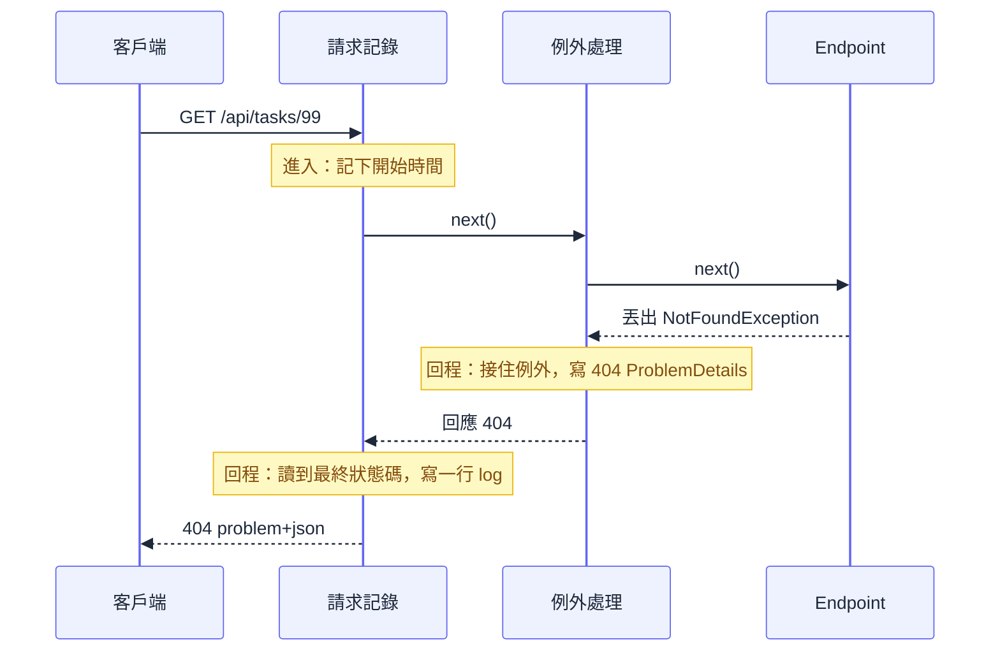
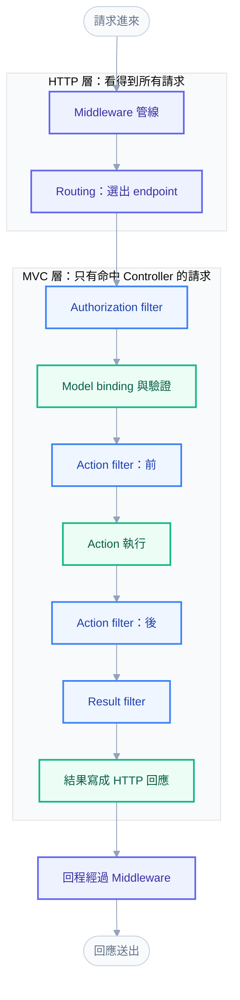

# 入門第 08 章：Middleware 與例外處理 — 每支 API 都要做的事放哪，為什麼順序會影響結果

## 兩個需求，五個 Action，十個地方要改

[[basics-07-dependency-injection-and-services]] 結束時，`TaskService` 已經把任務的邏輯收進來，Controller 變薄了。接著同一個星期出現兩個新需求。維運同事說，每個請求都要留一行 log，內容是方法、路徑、狀態碼與花了幾毫秒，不然半夜被叫起來時沒有線索。產品同事說，建立任務時標題不能重複，重複要回 409；查不到任務要回 404；其他沒料到的錯誤要回 500，但不能把 stack trace 吐給前端。

最直覺的做法，是把這些事塞進每一個 Action：

```csharp
// 反例：每個 Action 都長這樣，不要抄
[HttpGet("{id:guid}")]
public async Task<IActionResult> GetByIdAsync(Guid id, CancellationToken ct)
{
    var started = Stopwatch.GetTimestamp();
    try
    {
        var task = await _taskService.GetByIdAsync(id, ct);
        return task is null ? NotFound() : Ok(task);
    }
    catch (Exception ex)
    {
        _logger.LogError(ex, "GetById failed");
        return StatusCode(500, new { message = "Internal Server Error" });
    }
    finally
    {
        _logger.LogInformation("GET {Id} took {Ms} ms", id, Stopwatch.GetElapsedTime(started).TotalMilliseconds);
    }
}
```

五個 Action 就要寫五次。下一個人新增第六個 Action 時忘了抄，那個端點的錯誤格式就和別人不一樣，log 也少一行。更根本的問題在 409：Service 回傳 `null` 只能表達「沒有」，無法區分「查不到」和「標題重複」，Controller 又不該去猜原因。

這兩件事有一個共同點：它們與任何一個端點的業務無關，卻要套用在每一個請求上。這類需求叫橫切關注點（cross-cutting concern），它們需要一個「所有請求都會經過」的位置。ASP.NET Core 提供的位置就是 middleware pipeline。本章先看 pipeline 長什麼樣、順序為何決定結果，接著寫一個請求記錄 middleware，再用 `IExceptionHandler` 搭配 ProblemDetails 做全域例外處理，最後釐清哪些事該放 middleware、哪些該放 filter。

---

## 一、洋蔥：請求進去，回應出來

一個請求進到 ASP.NET Core 後，會依序穿過一串 middleware。每個 middleware 拿到 `HttpContext`，可以先做自己的事，再呼叫 `next()` 把請求交給下一個，等下一個回來之後，還有機會對已經產生的回應再做一次處理。因為「進去的路」與「出來的路」走過同一批 middleware，只是方向相反，這個結構常被稱為洋蔥模型。



這張圖的重點在「回程」。請求記錄要在回程才寫 log，因為只有回程才知道狀態碼與耗時；例外處理要在回程才能接住例外，因為例外是 Endpoint 丟出來的，它沿著呼叫鏈往外傳，經過每一層，直到有人接住為止。這也回答了「為什麼要有順序」：誰在外層，誰就看得到內層發生的一切，內層看不到外層的事。

Pipeline 的內部只是一串函式的串接，每個函式的型別都叫 `RequestDelegate`，這個結構如何組裝、為什麼是由後往前組，[[01-request-pipeline]] 有完整推導，本章只用結果。

接下來先看這個結構提供了哪些寫法。

---

## 二、`Use`、`Run`、`Map`：三種擺放 middleware 的方式

在 `Program.cs` 裡，`var app = builder.Build();` 這行之後的每一個 `app.UseXxx()` 與 `app.MapXxx()`，登記的順序就是 pipeline 的順序。要親手感受順序，最快的方法是寫一個拋棄式的小專案，裡面只放三種寫法：

```csharp
var app = WebApplication.CreateBuilder(args).Build();

app.Use(async (ctx, next) =>
{
    Console.WriteLine("A before");
    await next();
    Console.WriteLine("A after, status " + ctx.Response.StatusCode);
});

app.Map("/health", branch => branch.Run(ctx => ctx.Response.WriteAsync("ok")));

app.Use(async (ctx, next) =>
{
    Console.WriteLine("B before");
    await next();
    Console.WriteLine("B after");
});

app.Run(ctx => ctx.Response.WriteAsync("terminal"));
app.Run();
```

`Use` 是最常用的：先做事、呼叫 `next()`、回來後再做事。`Run` 是終點：它不接收 `next`，因為它後面沒有人了。`Map` 依路徑前綴開出一條分支，進入分支的請求只走分支裡面的 middleware，不會回到主線。依序打 `/health` 與 `/x`，console 印出：

```text
A before
A after, status 200
A before
B before
B after
A after, status 200
```

前兩行是 `/health`：A 進去、被 `Map` 分支截走，所以 B 完全沒執行，回程的 A 讀到 200。後四行是 `/x`：A、B 依序進入，最後落到 `Run`，再依相反順序離開。程式裡的兩個 `Use` 與一個 `Map` 沒有任何位置標記，順序全由寫的先後決定。

另外，`app.Use` 有兩種 overload。上面用的是 `(ctx, next)` 並呼叫 `next()`；另一種是 `next(ctx)`，把 `HttpContext` 傳進去，少一次閉包配置，.NET 7 之後官方範例多半用這種。兩者行為相同，讀別人的程式碼時兩種都會遇到。

### 不呼叫 `next()` 會怎樣

常見的說法是「忘了呼叫 `next()`，請求就卡住了」。實測不是這樣。在一個最小專案裡放兩層 `app.Use` 與一個 `MapGet("/hello")`，外層 middleware 什麼都不做就返回：

```text
GET /hello -> 200 OK | Content-Length: 0
  執行順序：外層 middleware：進入 -> 外層 middleware：離開
```

沒有卡住，沒有 500，也沒有 404。HTTP 的預設狀態碼就是 200，空 body 也是合法回應，所以客戶端看到的是一個「成功」的空回應；內層 middleware 與 Endpoint 完全沒有執行，伺服器也沒有任何錯誤 log。這種沒有聲音的錯，比 500 更難查。

如果只設定 `StatusCode = 418` 就返回，客戶端收到 `418` 加空 body；如果寫了 body，就照寫的送出。這說明了短路（short-circuit）是正常機制：CORS 的 preflight、驗證失敗直接回 401、健康檢查都靠它。刻意短路時，要明確設定狀態碼與 body，不要依賴預設的 200。外層 middleware 在 `await next()` 之後的程式碼仍會執行，所以放在最外層的請求記錄，連短路的請求也記得到。

---

## 三、自訂 middleware 類別：請求記錄

Lambda 適合試驗與一次性的小事。要長期維護的邏輯，寫成類別比較好：可以注入服務、可以獨立測試、`Program.cs` 也不會被塞滿。TaskTracker 的請求記錄 middleware 放在 `Middleware/RequestLoggingMiddleware.cs`：

```csharp
using System.Diagnostics;

namespace TaskTracker.Api.Middleware;

public sealed class RequestLoggingMiddleware
{
    private readonly RequestDelegate _next;
    private readonly ILogger<RequestLoggingMiddleware> _logger;

    public RequestLoggingMiddleware(RequestDelegate next, ILogger<RequestLoggingMiddleware> logger)
    {
        _next = next;
        _logger = logger;
    }

    public async Task InvokeAsync(HttpContext context)
    {
        var started = Stopwatch.GetTimestamp();
        var statusCode = StatusCodes.Status500InternalServerError;
        try
        {
            await _next(context);
            statusCode = context.Response.StatusCode;
        }
        finally
        {
            _logger.LogInformation(
                "HTTP {Method} {Path} responded {StatusCode} in {ElapsedMs:0.0} ms",
                context.Request.Method,
                context.Request.Path,
                statusCode,
                Stopwatch.GetElapsedTime(started).TotalMilliseconds);
        }
    }
}
```

這種寫法稱為 convention-based middleware，沒有要實作的介面，靠兩條約定：建構子的第一個參數是 `RequestDelegate`（下一站），並且有一個 `InvokeAsync(HttpContext)` 方法。幾個細節值得逐一說明。

計時用 `Stopwatch` 而不是 `DateTime.UtcNow` 相減，因為系統時鐘可能被校時調整，`Stopwatch` 讀的是單調遞增的計數器。`statusCode` 一開始設成 500，只有 `await _next(context)` 順利返回後才改成真正的狀態碼。若例外沿著呼叫鏈往外傳（下一節會看到這什麼時候發生），`finally` 仍會執行，log 也一定會寫，狀態碼則維持 500。如果少了 `try/finally`，一旦內層丟例外，這一行 log 就消失了，而這正是最需要它的時候。

Log 訊息用 `{Method}`、`{Path}` 這種具名佔位符，而不是 `$"..."` 字串插值。前者讓 logging 系統保留結構化欄位，之後可以依狀態碼或路徑篩選；後者在呼叫當下就把字串組好，欄位資訊也丟了。結構化 log 在 [[16-logging-and-observability]] 與 [[basics-16-deployment-and-go-live]] 會再延伸。

### middleware 與 DI：生命週期的陷阱

[[basics-07-dependency-injection-and-services]] 講過 captive dependency：長壽命的物件抓住短壽命的物件。middleware 就是一個容易踩到的場合。Convention-based 的 middleware 類別在應用程式啟動、組 pipeline 時只建立一次，之後所有請求共用同一個實例，壽命等同 Singleton。所以建構子只能收 Singleton 等級的服務（`RequestDelegate`、`ILogger<T>`、`IOptions<T>` 之類）。需要 Scoped 服務（例如之後的 `DbContext`）時，要把它放在 `InvokeAsync` 的參數上，框架會在每個請求從請求自己的 scope 解析。

用一個只有 `Scoped` 服務 `Counter`（內含一個 `Guid`）的實驗驗證。好的寫法，`Counter` 放在 `InvokeAsync` 參數：

```csharp
public async Task InvokeAsync(HttpContext c, Counter counter)
{
    c.Response.Headers["X-Counter"] = counter.Id.ToString();
    await _next(c);
}
```

連續打兩次，回應標頭的 `Guid` 不同，證明每個請求拿到各自的實例：

```text
X-Counter: 895b2b61-8e44-481c-a492-9ba6a1b386dc
X-Counter: 77a3cce0-531e-4df5-b95b-2a1eb0255474
```

壞的寫法，把 `Counter` 放進建構子，結果取決於環境。Development 環境預設做 scope 驗證，應用程式在啟動時就失敗：

```text
Hosting failed to start System.InvalidOperationException: Cannot resolve scoped service 'Counter' from root provider.
```

Production 環境預設不驗證，同一份程式碼靜默啟動成功，那個 `Counter` 從此被 middleware 抓住，所有請求共用同一個。這和上一章 Singleton 注入 Scoped 的實測一致：開發時會報錯，上線後靜默出事，所以請在 Development 就把它修掉。

如果希望 middleware 本身就是 Scoped（每個請求新建一次，建構子可以直接收 Scoped 服務），可以實作 `IMiddleware` 介面並把類別註冊進 DI。注意它的簽章是 `InvokeAsync(HttpContext context, RequestDelegate next)`，`next` 是參數而不是建構子參數，和上面的 convention 寫法不同，不少教學文章把兩種寫法混在一起，沒有交代差別。兩種寫法的取捨與工廠細節見 [[01-request-pipeline]]。

---

## 四、順序就是行為

類別寫好之後，要把它放進 pipeline。TaskTracker 的 `Program.cs` 在 `Build()` 之後是這樣：

```csharp
var app = builder.Build();

// 順序即行為：RequestLogging 放最外層，才記得到 ExceptionHandler 處理完的最終狀態碼
app.UseMiddleware<RequestLoggingMiddleware>();
app.UseExceptionHandler();
app.UseStatusCodePages();

if (app.Environment.IsDevelopment())
{
    app.MapOpenApi();
}

app.UseHttpsRedirection();
app.UseAuthorization();
app.MapControllers();

app.Run();
```

先看最前面兩行。請求記錄放在最外層，例外處理緊貼其後。這個順序的理由，用「換掉順序會怎樣」最容易講清楚。假設把兩者對調，讓 `UseExceptionHandler()` 在外、請求記錄在內：Endpoint 丟出 `NotFoundException`，例外先經過請求記錄。它的 `await _next(context)` 被例外打斷，`statusCode` 還是預設的 500，`finally` 寫出「responded 500」；然後例外才傳到外層的例外處理，被轉成 404 回給客戶端。結果是 log 說 500，客戶端實際拿到 404。log 與事實不一致，半夜查問題的人會被誤導。原順序下，例外在抵達請求記錄之前就已經被處理掉，請求記錄回程看到的是已經寫好的 404，兩邊一致。

一般的原則是：全域性的、需要「包住」其他東西的 middleware 放外層。例外處理要包住後面所有會丟例外的元件，所以越前面越好；請求記錄要看到最終結果，所以更前面。

`UseStatusCodePages()` 為什麼緊跟在例外處理後面，留到下一節看了回應內容再說明。`UseHttpsRedirection()` 在目前以 `http://localhost:5080` 執行的環境下，啟動時會印一行 `Failed to determine the https port for redirect.` 的警告，這是因為沒有設定 HTTPS 連接埠，不影響本章；環境與設定留到 [[basics-09-configuration-and-environments]]，反向代理後面的轉址問題留到 [[basics-16-deployment-and-go-live]]。

### 兩個常見的順序迷信，實測之後不成立

第一個迷信是「`MapControllers()` 之後註冊的 middleware 不會執行」。在 `WebApplication` 的寫法下，這不成立。`Map*` 只是登記 endpoint，並不會在 pipeline 的那個位置插入任何東西；所有被選中的 endpoint 都由 pipeline 最後一站的 endpoint middleware 執行。實測：兩個專案，一個在 `MapControllers()` 之前放自訂 middleware M，另一個放在之後，請求 `/hello` 的執行順序完全相同：

```text
M-進入 -> controller action 執行 -> M-離開
```

只有明確呼叫 `UseRouting()` 與 `UseEndpoints(...)` 的舊式寫法（`Startup.cs` 時代），放在 `UseEndpoints` 之後的 middleware 才會變成「只有 endpoint 沒命中時才執行」。所以在 `WebApplication` 下要在意的是 `Use*` 與 `Use*` 之間的先後，不是 `Use*` 與 `Map*` 之間。把 `MapControllers()` 放最後是慣例，不是規定。

第二個迷信是「一定要自己呼叫 `UseRouting()`」。`WebApplication` 發現有 endpoint 就會自動把 routing 放到 pipeline 的最前面。實測：沒有呼叫 `UseRouting()` 的專案裡，連第一個自訂 middleware 都能用 `context.GetEndpoint()` 取得被選中的 endpoint（`HTTP: GET /hello`）。反過來，一旦明確呼叫 `UseRouting()`，routing 就發生在你放的位置：它前面的 middleware 看到 `null`，後面的才看得到。需要讀 endpoint 的 metadata（例如 `[Authorize]`）的自訂 middleware，必須排在 `UseRouting()` 之後；沒有呼叫的話，自動插入的 routing 已經在最前面，所以沒問題。本章的請求記錄就是這樣，它排在最前面，仍然取得到 endpoint。順序為什麼要拆成「選出 endpoint」與「執行 endpoint」兩段，見 [[01-request-pipeline]]。

---

## 五、全域例外處理

回到開頭的第二個需求：查不到回 404、標題重複回 409、沒料到的錯誤回 500。先看為什麼不放在 Controller。

### 為什麼不在 Controller 裡 try-catch

每個 Action 各寫一份 `try/catch`，會有三個問題：重複，因為每個端點都要抄；容易漏，因為新增端點的人不一定記得；格式不一致，因為每個人寫的錯誤回應都不同。更深一層的問題是，Controller 是處理 HTTP 的地方，卻被迫去知道「重複標題」這種領域規則該對應哪個狀態碼。例外處理的責任應該集中成一個地方，其餘程式碼只管丟出有意義的例外。

這個做法要守兩條原則。第一，客戶端不該看到例外細節，stack trace、SQL 語句、檔案路徑對攻擊者都是情報。第二，伺服器端要完整記錄，不然出事時沒有線索。這兩條看似衝突，其實只是分工：回給客戶端的是整理過的訊息加上一個 `traceId`，完整細節寫進 log，兩邊用 `traceId` 對起來。

### 先改 Service：用例外表達「為什麼不行」

basics-07 的 `TaskService` 用 `null` 與 `bool` 表達「查無」。現在要多區分「重複」，單靠回傳值不夠了。本章把領域錯誤改成例外。新增 `Exceptions/NotFoundException.cs` 與 `Exceptions/ConflictException.cs`：

```csharp
namespace TaskTracker.Api.Exceptions;

public sealed class NotFoundException : Exception
{
    public NotFoundException(string resource, object key)
        : base($"{resource} '{key}' was not found.")
    {
    }
}
```

```csharp
namespace TaskTracker.Api.Exceptions;

public sealed class ConflictException : Exception
{
    public ConflictException(string message)
        : base(message)
    {
    }
}
```

這兩個例外的訊息是寫給客戶端看的，所以內容要乾淨，只有資源名與識別值，沒有任何內部細節。接著 `ITaskService` 的回傳型別不再需要 nullable，因為「查無」不再用 `null` 表示：

```csharp
Task<TaskResponse> GetByIdAsync(Guid id, CancellationToken ct);
Task<TaskResponse> UpdateAsync(Guid id, UpdateTaskRequest request, CancellationToken ct);
Task DeleteAsync(Guid id, CancellationToken ct);
```

`TaskService` 加上兩個私有方法，並讓各個方法呼叫它們：

```csharp
private TaskItem Find(Guid id)
{
    return _tasks.FirstOrDefault(t => t.Id == id) ?? throw new NotFoundException("Task", id);
}

private void EnsureTitleIsUnique(string title, Guid? exceptId)
{
    if (_tasks.Any(t => t.Id != exceptId && string.Equals(t.Title, title, StringComparison.Ordinal)))
    {
        throw new ConflictException($"A task titled '{title}' already exists.");
    }
}
```

`CreateAsync` 在同一把 lock 裡先 `Trim()` 再呼叫 `EnsureTitleIsUnique(title, exceptId: null)`，`UpdateAsync` 則是 `Find(id)` 之後呼叫 `EnsureTitleIsUnique(title, exceptId: id)`。`exceptId` 的用途是排除自己：更新任務時，把標題改成自己原本的標題不算重複。`DeleteAsync` 則是 `_tasks.Remove(Find(id))`。為了讓後面的輸出和書上一致，種子資料的三個標題請改成 `Read chapter 8`、`Add an exception handler`、`Write a logging middleware`（其餘欄位不變）。

Controller 因此變得更薄，三個 Action 不再需要判斷 `null`：

```csharp
[HttpGet("{id:guid}")]
public async Task<ActionResult<TaskResponse>> GetByIdAsync(Guid id, CancellationToken ct)
{
    return Ok(await _taskService.GetByIdAsync(id, ct));
}

[HttpDelete("{id:guid}")]
public async Task<IActionResult> DeleteAsync(Guid id, CancellationToken ct)
{
    await _taskService.DeleteAsync(id, ct);
    return NoContent();
}
```

`UpdateAsync` 同理，直接 `return Ok(await _taskService.UpdateAsync(id, request, ct));`。

這裡要說清楚一個取捨：用例外表達「業務上預期會發生」的情況，有兩個代價。例外在 .NET 裡比一般的回傳值昂貴，若某個端點被大量以不存在的 id 轟炸，每一次都會丟一次例外；另外，呼叫端無法從方法簽章看出它可能丟什麼。如果一個「失敗」是呼叫端的常態分支（例如批次匯入中，重複就跳過），回傳結果物件比丟例外合適。[[15-error-handling]] 討論了何時用例外、何時改用 Result pattern。TaskTracker 的查無與重複是少數情況，且統一出口讓 Controller 最乾淨，所以採用例外。

### 寫 `IExceptionHandler`：把例外翻成 HTTP

現在要有一個地方把這兩個例外翻成 404 與 409。.NET 8 引入的 `IExceptionHandler` 就是為這件事設計的。新增 `Exceptions/DomainExceptionHandler.cs`：

```csharp
using Microsoft.AspNetCore.Diagnostics;
using Microsoft.AspNetCore.Mvc;

namespace TaskTracker.Api.Exceptions;

public sealed class DomainExceptionHandler : IExceptionHandler
{
    private readonly IProblemDetailsService _problemDetailsService;
    private readonly ILogger<DomainExceptionHandler> _logger;

    public DomainExceptionHandler(IProblemDetailsService problemDetailsService, ILogger<DomainExceptionHandler> logger)
    {
        _problemDetailsService = problemDetailsService;
        _logger = logger;
    }

    public async ValueTask<bool> TryHandleAsync(HttpContext httpContext, Exception exception, CancellationToken cancellationToken)
    {
        var status = exception switch
        {
            NotFoundException => StatusCodes.Status404NotFound,
            ConflictException => StatusCodes.Status409Conflict,
            _ => 0
        };
        if (status == 0)
        {
            return false;
        }

        _logger.LogInformation("Domain exception {ExceptionType}: {Message}", exception.GetType().Name, exception.Message);
        httpContext.Response.StatusCode = status;
        return await _problemDetailsService.TryWriteAsync(new ProblemDetailsContext
        {
            HttpContext = httpContext,
            Exception = exception,
            ProblemDetails = new ProblemDetails { Status = status, Detail = exception.Message }
        });
    }
}
```

`TryHandleAsync` 的回傳值是整個設計的關鍵：回傳 `true` 表示「這個例外我處理完了」，框架就不再往下找；回傳 `false` 表示「不歸我管」，框架會問下一個已註冊的 handler，全部都不處理時，由框架套用預設行為。這個 handler 只認得兩種領域例外，其餘一律回傳 `false`，所以它不需要也不應該想辦法處理所有錯誤。若之後新增資料庫相關的錯誤，再另寫一個 handler 註冊進去，不必動這個類別。

寫回應的工作交給 `IProblemDetailsService`，不自己拼 JSON。這樣做的好處是格式統一：所有錯誤回應，不論誰產生，都經由同一個服務輸出。ProblemDetails 是 RFC 9457 定義的錯誤格式（它取代了較早的 RFC 7807），Content-Type 是 `application/problem+json`，標準欄位有 `type`、`title`、`status`、`detail`、`instance`，可以另加擴充欄位。ASP.NET Core 會自動補上 `type`、`title` 與 `traceId`。

註冊分兩處。`Program.cs` 的服務區加兩行：

```csharp
builder.Services.AddProblemDetails();
builder.Services.AddExceptionHandler<DomainExceptionHandler>();
```

`AddProblemDetails()` 註冊 `IProblemDetailsService`；`AddExceptionHandler<T>()` 把 handler 登記進去。只有這兩行還不會生效，pipeline 裡要有 `app.UseExceptionHandler();`（第四節那份 `Program.cs` 已經有了）。這個無參數的版本會去找已註冊的 handler，沒有註冊任何 handler 或 ProblemDetails 時，單獨一行 `UseExceptionHandler()` 達不到想要的效果。

### 跑起來看

啟動 TaskTracker（專案根目錄下，連接埠 5080）：

```powershell
dotnet run --project src\TaskTracker.Api --launch-profile http
```

另開一個 PowerShell，查詢不存在的任務：

```powershell
curl.exe -s -i http://localhost:5080/api/tasks/99999999-9999-9999-9999-999999999999
```

```text
HTTP/1.1 404 Not Found
Content-Type: application/problem+json
Date: Fri, 30 Oct 2026 14:25:10 GMT
Server: Kestrel
Cache-Control: no-cache,no-store
Expires: -1
Pragma: no-cache
Transfer-Encoding: chunked

{"type":"https://tools.ietf.org/html/rfc9110#section-15.5.5","title":"Not Found","status":404,"detail":"Task '99999999-9999-9999-9999-999999999999' was not found.","traceId":"00-a0591f8f706a8493fa2c99cd65c7faec-5ecee3bf8140d47a-00"}
```

`Date` 與 `traceId` 每次不同。`Cache-Control: no-cache,no-store` 是例外處理 middleware 自動加的，避免錯誤回應被快取。接著建立任務，再建立一次同名的：

```powershell
'{"title":"Write chapter 8"}' | curl.exe -s -i -X POST http://localhost:5080/api/tasks -H "Content-Type: application/json" -d '@-'
```

第一次得到 `201 Created`，第二次：

```text
HTTP/1.1 409 Conflict
Content-Type: application/problem+json
...
{"type":"https://tools.ietf.org/html/rfc9110#section-15.5.10","title":"Conflict","status":409,"detail":"A task titled 'Write chapter 8' already exists.","traceId":"00-d371ec19d9a41df09b65a5d994d6fec3-2824a2ca356aa335-00"}
```

把第一次建立的任務用 `PUT` 改成另一個任務已使用的標題 `Read chapter 8`，同樣得到 409；改成自己的標題則是 200，因為 `exceptId` 排除了自己。`PUT` 一個不存在的 id 與重複 `DELETE` 同一個 id，都得到 404。

回頭看三個沒有經過 Service 的情況，也有統一的格式：

```powershell
curl.exe -s -i http://localhost:5080/api/tasks/abc
```

```text
HTTP/1.1 404 Not Found
Content-Type: application/problem+json
...
{"type":"https://tools.ietf.org/html/rfc9110#section-15.5.5","title":"Not Found","status":404,"traceId":"00-56b23995113eb4ee91f5f376598447fd-a68de3a853593572-00"}
```

`abc` 不是 `Guid`，路由約束 `{id:guid}` 不通過，沒有任何 endpoint 比對成功，也沒有丟任何例外，所以不會進到 `IExceptionHandler`。這是 `UseStatusCodePages()` 的工作：它檢查回應，如果狀態碼是 400 到 599 而且 body 是空的，就補上一個回應 body。因為前面已經 `AddProblemDetails()`，補上去的就是 ProblemDetails，沒有 `detail` 是因為沒有人提供。不註冊 ProblemDetails 的話，它會寫純文字的 `Status Code: 404; Not Found`。完全不存在的路徑 `/api/nope` 同樣如此；對只接受 GET 的路徑發 POST 則是 405，同樣補上 problem+json，並保留 `Allow: DELETE, GET, PUT` 標頭。

那 `UseStatusCodePages()` 為什麼緊跟在 `UseExceptionHandler()` 之後？它們合起來涵蓋兩種「錯誤」：丟出例外的，與沒丟例外但狀態碼是 4xx/5xx 的。兩者都在請求記錄之內、其他功能之前，後面所有 middleware 與 endpoint 造成的錯誤才都能被包到。

驗證失敗的 400 則不受影響，仍然由 `[ApiController]` 在 Action 執行之前產生，格式本來就是 problem+json，並帶有 `errors` 欄位：

```text
{"type":"https://tools.ietf.org/html/rfc9110#section-15.5.1","title":"One or more validation errors occurred.","status":400,"errors":{"Title":["The Title field is required."]},"traceId":"00-aa64e5f555bf001218a4af6b2a447935-88663ecf5c69860c-00"}
```

到這裡 TaskTracker 所有錯誤都是同一種形狀：前端只要檢查 `Content-Type` 是不是 `application/problem+json`，就能用同一套程式處理 404、409、400、405。

### 沒料到的例外：500，而且不洩漏細節

`DomainExceptionHandler` 回傳 `false` 之後會發生什麼，用一個拋棄式專案實測：註冊一個永遠回傳 `false` 的 handler，端點丟出 `InvalidOperationException("boom")`。客戶端得到：

```text
HTTP/1.1 500 Internal Server Error
Content-Type: application/problem+json
...
{"type":"https://tools.ietf.org/html/rfc9110#section-15.6.1","title":"An error occurred while processing your request.","status":500,"traceId":"00-c551b38f9a81e657d49aa09fc85a1bf1-a38df36ef387213a-00"}
```

沒有 `detail`，沒有 `boom`，沒有 stack trace；客戶端只拿到一個 `traceId`。同一時間，伺服器 console 多了一筆 `fail` 層級的 log：

```text
fail: Microsoft.AspNetCore.Diagnostics.ExceptionHandlerMiddleware[1] An unhandled exception has occurred while executing the request. System.InvalidOperationException: boom ...
```

完整例外與 stack trace 在這一筆裡，值班的人拿客戶端回報的 `traceId` 就能找到。這正好符合前面兩條原則：客戶端看不到細節，伺服器完整記錄。

---

## 六、.NET 10 的改變：被處理的例外，預設不再留下 log

上一小節有一個容易忽略的對比。同樣是例外，`DomainExceptionHandler` 回傳 `true` 處理掉的那些（404、409），console 上沒有 `fail` 那一筆；沒人處理的才有。這是 .NET 10 的行為：`TryHandleAsync` 回傳 `true` 時，ASP.NET Core 預設不再為這個例外寫 log 與診斷資料。在 .NET 9 及更早的版本，被處理的例外仍然會寫一筆 `Error` 層級的 `An unhandled exception has occurred`，一個 404 就多一筆看起來像故障的 Error，告警系統會被這些「其實是正常業務分支」的訊息洗版。.NET 10 把預設反過來：被處理就視為已解決，不再當作故障報告。

這個改變帶來一個要負責的後果：log 的責任交給 handler 自己。從 TaskTracker 的 console 可以看到，`DomainExceptionHandler` 自己用 `LogInformation` 寫了一行：

```text
info: TaskTracker.Api.Exceptions.DomainExceptionHandler[0]
      Domain exception NotFoundException: Task '99999999-9999-9999-9999-999999999999' was not found.
```

這一行是刻意寫的，因為 404 與 409 屬於預期內的業務結果，Information 層級就夠。但如果某個 handler 把一個真正的錯誤（比如外部服務逾時）轉成 503 並回傳 `true`，卻沒有自己 log，那麼整個系統沒有任何一筆紀錄說這件事發生過。原則是：只要 handler 回傳 `true`，就要自己判斷這件事值不值得留下紀錄，狀態碼 5xx 的應當至少 `LogError`。

如果團隊的監控依賴舊行為，可以還原。實測加上這個設定，被處理的例外就會再度出現 `fail` 那一筆：

```csharp
builder.Services.Configure<ExceptionHandlerOptions>(o => o.SuppressDiagnosticsCallback = _ => false);
```

```text
fail: Microsoft.AspNetCore.Diagnostics.ExceptionHandlerMiddleware[1] An unhandled exception has occurred while executing the request. System.InvalidOperationException: boom ...
```

要不要還原，看的是團隊怎麼用 log。若 Error 層級的 log 會觸發值班告警，預設的新行為比較合理，因為領域例外不是故障；若有人依賴「每個例外都有一筆」做統計，就還原，但要同時接受 404 與 409 也會製造 Error。更好的做法是不依賴 log 做統計，改用指標（metrics），這在 [[16-logging-and-observability]] 展開。

---

## 七、Response 已經開始之後丟例外

到目前為止，例外處理看起來很萬能，但它有一個物理限制。HTTP 回應是「狀態列與標頭，然後 body」依序送出的。一旦第一個位元組離開伺服器，狀態碼就已經寄出，再也收不回來。如果例外是在這之後才丟的，例外處理器想把狀態碼改成 500 也來不及。

實測：端點先寫出 `part-1;` 並 `Flush`，再丟例外。`IExceptionHandler.TryHandleAsync` 一次都沒被呼叫。客戶端看到的是：

```text
客戶端收到的狀態列：200 OK
Transfer-Encoding：chunked
客戶端讀 body 時已收到："part-1;"，接著丟出 HttpIOException: The response ended prematurely. (ResponseEnded)
```

也就是一個成功的狀態碼，加上被截斷、沒有正常結束的 body。伺服器端這一筆例外會被記好幾次：`ExceptionHandlerMiddleware` 記一筆 Warning（`The response has already started, the error handler will not be executed.`）與一筆 Error；在 Development 環境，`WebApplication` 自動加入的開發者例外頁 middleware 又記一筆 Error 與一筆 Warning；Kestrel 自己再記一筆 Error。同一件事合計三筆 Error、兩筆 Warning，排查時要知道它們是同一次失敗。

這個現象有兩個實務含意。第一，對於串流、大檔下載、Server-Sent Events 這類「先送標頭再送內容」的端點，不能指望全域例外處理來回報失敗，所有可能失敗的檢查（權限、參數、資源是否存在）都要在開始寫出 body 之前做完，途中的失敗則要靠協定本身表達，客戶端也必須把 `The response ended prematurely` 當作失敗，不能因為先前收到 200 就當成功。這類端點在 [[expert-06-streaming-and-realtime]] 再展開。第二，這就是請求記錄 middleware 一開始把 `statusCode` 設成 500 的原因：例外往外丟的時候，`context.Response.StatusCode` 讀到的仍是已經送出的 200，若直接記這個值，log 會說「成功」，而客戶端其實拿到一個壞掉的回應。把例外路徑記成 500，代表從伺服器的角度，這個請求失敗了。

---

## 八、Middleware 與 Filter：誰負責什麼

ASP.NET Core 裡還有另一個放「每個請求都要做」的地方：Filter。兩者看起來功能重疊，用一張請求生命週期圖就能看出分界。



圖中的上半部（藍紫色）是 HTTP 層，所有請求都要通過，包括根本沒有命中任何 Controller 的請求，例如 `/api/nope`、靜態檔、`/openapi/v1.json`。下半部（藍色是 filter，綠色是 MVC 本身的步驟）只有被 Routing 選到 Controller Action 的請求才會進來。兩者的差別，簡單說就是看得見的東西不同：Middleware 只看得到 `HttpContext`，也就是原始的請求與回應；Filter 看得到 MVC 已經準備好的東西，包括被選中的 Action、綁定好的參數、`ModelState`、Action 回傳的結果物件。

這個分別直接導出判斷準則：

- 與具體端點無關、對所有請求（包含 404 的請求）都要做的事，放 middleware。請求記錄、例外處理、HTTPS 轉址、CORS、壓縮屬於這一類。
- 需要知道「這是哪個 Action、它收到什麼參數、它回了什麼結果」的事，放 filter。依 Action 屬性決定的行為、檢查綁定後的參數、統一包裝回傳結果、在 Action 前後開關交易屬於這一類。
- 兩者都能做、而且和 MVC 無關的事（例如計時），放 middleware，因為它能涵蓋更多請求。

這張圖也可以回頭解釋本章已出現的東西。`[ApiController]` 的自動 400，是 MVC 內建的一個 action filter 在 Action 執行之前檢查 `ModelState` 後產生的，這就是為什麼它在 middleware 管線之內、Action 之前出現，同時也是為什麼 `/api/nope` 不會產生任何驗證 400。標準的 `[Authorize]` 則是由 `UseAuthorization()` 這個 middleware 在 Routing 之後、進入 MVC 之前判斷（見 [[basics-11-auth-concepts-and-pipeline]]），圖中 Authorization filter 那一步保留給自訂的授權 filter。

Filter 還有自己的順序規則、作用範圍（全域、Controller、Action）、與 DI 的整合方式（`ServiceFilter`、`TypeFilter`），以及為什麼本章的全域例外處理選用 `IExceptionHandler` 而不是 Exception filter，這些細節都在 [[05-filters-and-mvc-internals]]。本章只需要記住一件事：全域的錯誤處理與請求記錄放在 middleware，是因為它們必須涵蓋 MVC 以外發生的事，也要能接住 filter 自己丟出的例外。

---

## 九、整體驗收：一個請求在 console 留下什麼

最後把前面所有部分合在一起，看 TaskTracker 跑完一輪操作之後，console 的樣子。因為 `appsettings.json` 把 `Microsoft.AspNetCore` 的最低層級設成 `Warning`（範本預設），框架自己的請求 log 被壓下去，留下的是我們自己的：

```text
info: TaskTracker.Api.Exceptions.DomainExceptionHandler[0]
      Domain exception NotFoundException: Task '99999999-9999-9999-9999-999999999999' was not found.
info: TaskTracker.Api.Middleware.RequestLoggingMiddleware[0]
      HTTP GET /api/tasks/99999999-9999-9999-9999-999999999999 responded 404 in 52.1 ms
info: TaskTracker.Api.Middleware.RequestLoggingMiddleware[0]
      HTTP GET /api/tasks/abc responded 404 in 1.0 ms
info: TaskTracker.Api.Middleware.RequestLoggingMiddleware[0]
      HTTP POST /api/tasks responded 201 in 42.1 ms
info: TaskTracker.Api.Exceptions.DomainExceptionHandler[0]
      Domain exception ConflictException: A task titled 'Write chapter 8' already exists.
info: TaskTracker.Api.Middleware.RequestLoggingMiddleware[0]
      HTTP POST /api/tasks responded 409 in 0.9 ms
```

每個請求只有一行請求記錄，領域例外多一行 Information；耗時第一個請求最長，因為那是啟動後第一次執行，後面都在 1 毫秒上下，耗時數字會因機器而異。而請求記錄那一行裡的狀態碼（404、409）與客戶端實際收到的完全一致，正是第四節所說「請求記錄在最外層」換來的結果。順手觀察：`/api/tasks/abc` 沒有 `DomainExceptionHandler` 那一行，因為它沒有丟例外。

做完之後，本章 TaskTracker 的變動共有：新增 `Exceptions/` 三個檔案與 `Middleware/RequestLoggingMiddleware.cs`；修改 `ITaskService`、`TaskService`、`TasksController`、`Program.cs`。開頭的兩個需求，一個放在 middleware，一個放在 handler，五個 Action 一個都不需要知道這些事。

---

## 常見誤解

**「忘了呼叫 `next()`，請求會卡住或逾時。」** 實測不成立。不呼叫 `next()` 只是短路：回應立刻結束，沒設任何東西就是 `200 OK` 加空 body，內層 middleware 與 Endpoint 不會執行。這種靜默的成功比錯誤更難發現。

**「`MapControllers()` 之後註冊的 middleware 不會執行。」** 在 `WebApplication` 的寫法下不成立。`Map*` 只是登記 endpoint，執行由 pipeline 最後的 endpoint middleware 負責，所以放在 `MapControllers()` 前或後，對請求的行為相同。這個說法只對舊式 `UseEndpoints` 成立。

**「一定要自己呼叫 `UseRouting()`。」** `WebApplication` 會自動把 routing 放在最前面。明確呼叫只在你想控制 routing 發生的位置時才需要，之後它前面的 middleware 就取不到 endpoint。

**「Controller 裡 try-catch 最保險。」** 它保險的只有那一個 Action。每個端點各寫一份，格式必然分歧，而且領域規則和 HTTP 狀態碼的對照被打散在每個角落。全域的例外處理才是集中的做法。

**「全域例外處理會接住所有例外。」** 例外發生在 response 開始送出之後就接不住了：狀態碼已經是 200，客戶端收到的是被截斷的 body，`IExceptionHandler` 根本不會被呼叫。

## 同事會來問你的問題

**Q：Middleware 和 Filter 該選哪個？**

看有沒有用到 MVC 才有的資訊。只需要原始的請求與回應、而且要涵蓋沒命中 Controller 的請求（例如 404），就用 middleware；需要知道被選中的 Action、綁定好的參數或回傳結果，就用 filter。請求記錄與全域例外處理屬於前者。

**Q：為什麼領域例外對應的是 404、409，不是 422？**

TaskTracker 的規則是：資源不存在 404，與現有資源衝突（標題重複）409，格式或欄位本身不合法 400。422（Unprocessable Content）留給「格式正確但語意上做不到」且沒有更貼切狀態碼的情況，使用上容易與 400、409 混淆，所以這個專案不用。團隊要採用 422 也可以，重點是全專案一致並寫進 API 規格。

**Q：升到 .NET 10 之後，Error log 變少了，是漏記了嗎？**

不是漏記。.NET 10 起，`IExceptionHandler` 回傳 `true` 的例外預設不再寫 `An unhandled exception has occurred` 的 Error log。需要紀錄的話，在 handler 裡自己 log，或設定 `ExceptionHandlerOptions.SuppressDiagnosticsCallback = _ => false` 還原。

**Q：我的 middleware 要用 `DbContext`，能放建構子嗎？**

不行。Convention-based middleware 只建立一次，等同 Singleton，建構子收 Scoped 服務會造成 captive dependency；Development 環境啟動就會報錯，Production 則靜默通過。把它放在 `InvokeAsync` 的參數上，或改實作 `IMiddleware`。

**Q：為什麼 `UseExceptionHandler()` 不用傳參數？**

因為已經用 `AddExceptionHandler<T>()` 註冊了 handler，且 `AddProblemDetails()` 提供了輸出格式。這個無參數的版本會使用這些註冊。單獨呼叫而沒有註冊任何 handler 或 ProblemDetails，就是網路上只寫一行 `app.UseExceptionHandler();` 的範例看起來有效、實際沒有預期效果的原因。

## 這章的位置

讀完這章，你能說出洋蔥模型為什麼進去和出來經過同一批 middleware，能用 `Use`、`Run`、`Map` 組出 pipeline 並預測順序造成的結果，能寫出符合 DI 生命週期的自訂 middleware，能用 `IExceptionHandler` 與 ProblemDetails 把領域例外變成一致的 404、409，並理解 .NET 10 對 log 的影響與 response 已開始後的限制。你也知道什麼時候該用 filter 而不是 middleware。

TaskTracker 目前的設定都寫死在程式碼裡，開發機與正式機要不同的行為時怎麼辦，是下一章 [[basics-09-configuration-and-environments]] 的主題。想看 pipeline 如何組裝、短路與分支的細節，請讀深度篇 [[01-request-pipeline]]；Filter 的完整機制在 [[05-filters-and-mvc-internals]]；錯誤處理的完整策略（例外與 Result pattern、4xx 與 5xx 的界線、記錄層級）在 [[15-error-handling]]。

---

## 連結

- 上一章：[[basics-07-dependency-injection-and-services]]
- 下一章：[[basics-09-configuration-and-environments]]
- 對應深度章：[[01-request-pipeline]]、[[05-filters-and-mvc-internals]]、[[15-error-handling]]
- 全書目錄：[[dotnet-web-api]]
