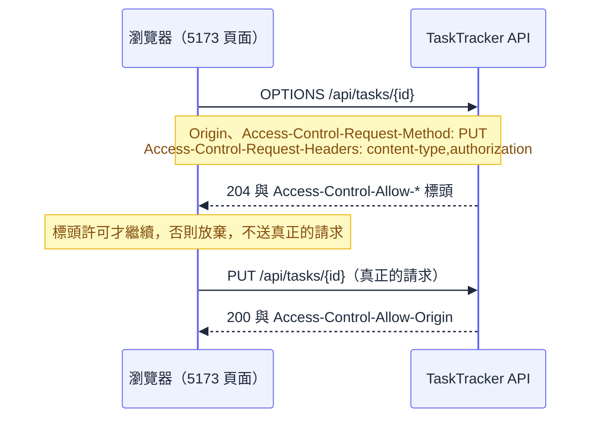

# 入門第 09 章：設定與環境 — 同一份程式在開發機與正式機，怎麼不改 code 就行為不同

## 伺服器回 200，瀏覽器卻說被擋了

前端同事把 React 專案跑在 `http://localhost:5173`，要呼叫 TaskTracker 的 `GET /api/tasks`。畫面一片空白，瀏覽器的 console 噴出一長串紅字，意思是這個請求被 CORS policy 擋下。他跑來找後端：API 是不是壞了？後端看一眼 [[basics-08-middleware-and-exception-handling]] 做的請求記錄，那一行清清楚楚寫著 `responded 200`。伺服器正常回應了，資料也送出去了，是瀏覽器把它丟掉的。

這個問題要處理兩件事。第一件是搞懂 CORS 到底是誰在擋誰，這是本章第七節的內容。第二件更根本：就算後端把 `http://localhost:5173` 寫進程式碼放行了，上線之後前端的網址會變成 `https://tasktracker.example.com`，難道每換一個環境就改 code、重新編譯、重新發版？同樣的問題還會接連出現：預設每頁幾筆想在正式機調成 50，之後接資料庫要放連線字串，接 JWT 要放簽章金鑰。這些值「因環境而異」，其中有些還「不能被別人看到」。

[[basics-08-middleware-and-exception-handling]] 結束時，TaskTracker 的行為都寫死在程式碼裡。本章讓它學會從外面讀設定：先看設定從哪些地方來、互相怎麼覆蓋，再用 Options pattern 把設定變成有型別的物件，並讓壞設定在啟動時就讓程式起不來；接著處理機密該放哪，最後把 CORS 白名單做成一份隨環境改變的設定。

---

## 一、先分清楚：哪些東西該是「設定」

設定檔的本質，是把「與環境、部署相關、不應硬寫在程式碼裡」的值集中管理。判斷一個值該不該抽出來，看它有沒有下面任何一個特徵：會因環境（開發、測試、正式）而不同；改它不應該需要重新編譯；與商業邏輯沒有直接關係。

最容易搞混的是「設定」和「程式」的邊界。下面這張分層表把四類東西各自該放的位置分清楚：

| 類型 | 放哪裡 | TaskTracker 的例子 |
| --- | --- | --- |
| 商業規則 | C# 程式碼 | 標題不可重複、狀態只有 todo 與 done |
| 流程邏輯 | Controller 與 Service | 建立任務時要先檢查標題 |
| 系統策略 | appsettings 與環境變數 | 預設每頁幾筆、允許哪些前端來源 |
| 機密 | User Secrets（開發）、環境變數或 Secret（正式），不進 appsettings.json | 資料庫密碼、JWT 簽章金鑰 |

商業規則改了，行為本來就該重新測試、重新發版，所以留在程式碼裡。系統策略不同：「正式機每頁預設 50 筆」不是新功能，是營運要調的旋鈕，由維運人員在部署時決定，不該逼開發者改 code。

把值寫成 C# 常數（`const string ConnectionString = "..."`）的問題，在於換環境就得改程式、CI/CD 沒法對不同環境產出同一份 artifact，而且字串一旦寫進原始碼，每個看得到 repo 的人都看得到。程式碼只應該知道「我要讀一個設定」，實際的值由外部在啟動時提供，這是本章每一節共同的前提。

最後一列要特別說清楚。網路上不少教學把機密的位置寫成「appsettings + Secret / Env」，還拿 `Password=***` 的連線字串、14 個字元的 `SuperSecretKey` 當示範。這兩種寫法都不能照做：`appsettings.json` 是要進版控的檔案，把金鑰寫進去就等於寫進 git 歷史，「設定檔」並沒有帶來任何隔離。第六節會給正確做法。

---

## 二、設定從哪裡來：一疊來源，後面蓋前面

`WebApplication.CreateBuilder(args)` 那一行（[[basics-03-first-project]] 看過）做了很多事，其中之一是替你建好 `IConfiguration`，並依固定順序載入五個來源：

| 順序 | 來源 | 備註 |
| --- | --- | --- |
| 1 | `appsettings.json` | 所有環境共用的預設值 |
| 2 | `appsettings.{Environment}.json` | 只在該環境載入，例如 Development |
| 3 | User Secrets | 只在 Development 載入，第六節說明 |
| 4 | 環境變數 | 容器與 K8s 注入設定的主要管道 |
| 5 | 命令列參數 | 優先權最高，例如 `--Pagination:DefaultPageSize=5` |

編號越大優先權越高。要記住的重點是：這些來源不會先合併成一份再讀，而是保留成一疊，讀某個 key 的時候從最上面往下找，第一個有值的就是答案。結論有兩個。第一，覆蓋以單一 key 為單位：環境變數蓋掉 `Cors:AllowedOrigins` 的某一項，不會影響同一個檔案裡的其他 key。第二，來源的位置決定它能不能被覆蓋，所以「預設值放最底層的 `appsettings.json`、環境差異放上一層、部署時才知道的東西放環境變數」是自然的分工。照這個分工，共用設定放 `appsettings.json`，環境差異放 `appsettings.{Environment}.json`，敏感資訊不進版控。

### 2.1 階層的寫法：冒號與雙底線

JSON 的巢狀結構，在設定系統裡被攤平成以冒號分隔的 key：

```json
{ "Pagination": { "DefaultPageSize": 20 } }
```

對應的 key 是 `Pagination:DefaultPageSize`。但冒號在許多系統的環境變數名稱裡不合法（Linux 的 shell 尤其如此），所以環境變數用雙底線 `__` 代替冒號：`Pagination__DefaultPageSize`。程式讀到的仍是同一個 key。在 PowerShell 裡這樣設定，只影響目前這個視窗：

```powershell
$env:Pagination__DefaultPageSize = '2'
```

在 TaskTracker 完成本章修改後，用環境變數 `Pagination__DefaultPageSize=2` 啟動，不帶 `pageSize` 查詢清單，實測回應是（省略 `Date`、`Server` 等標頭）：

```text
HTTP/1.1 200 OK
Content-Type: application/json; charset=utf-8

{"items":[{"id":"11111111-1111-1111-1111-111111111111","title":"Read chapter 8","status":"done","createdAt":"2026-10-01T09:00:00+00:00"},{"id":"22222222-2222-2222-2222-222222222222","title":"Add an exception handler","status":"todo","createdAt":"2026-10-02T09:00:00+00:00"}],"page":1,"pageSize":2,"totalCount":3}
```

`appsettings.json` 寫的是 20，回應的 `pageSize` 卻是 2，沒有改任何檔案，也沒有重新編譯。這就是「同一份程式、不同環境」的最小實例。

### 2.2 陣列的覆蓋是逐索引的

設定裡的陣列，是以索引為 key 展開的：`Cors:AllowedOrigins:0`、`Cors:AllowedOrigins:1`。所以「覆蓋陣列」其實是覆蓋其中某幾個索引，結果會和直覺不同。TaskTracker 的實測：`appsettings.Development.json` 在索引 0 放了 `http://localhost:5173`，User Secrets 在索引 1 放了 `http://localhost:3000`，這時再用環境變數 `Cors__AllowedOrigins__0=http://localhost:4000` 啟動。對三個 origin 各發一次預檢，結果摘要如下：

```text
Origin http://localhost:5173 -> 204，沒有任何 Access-Control-* 標頭   （索引 0 被換掉了）
Origin http://localhost:3000 -> Access-Control-Allow-Origin: http://localhost:3000   （索引 1 仍在）
Origin http://localhost:4000 -> Access-Control-Allow-Origin: http://localhost:4000   （新值生效）
```

環境變數只換掉了第 0 項，第 1 項還活著。想用環境變數「整份替換」清單型設定，就必須把每個索引都覆蓋一遍，或者把清單設計成別的形狀（例如逗號分隔的字串自己拆開）。這是為什麼設計設定結構時，能不用陣列就盡量不用。本章的 CORS 白名單是少數合理使用陣列的地方，第七節會處理它的細節。覆蓋的完整機制，以及 provider 鏈的內部運作，在深度篇 [[17-configuration-and-secrets]]。

---

## 三、環境：程式怎麼知道自己在哪

所謂「環境」，在 ASP.NET Core 裡只是一個字串，來源是環境變數 `ASPNETCORE_ENVIRONMENT`。慣例的三個名字是 Development、Staging、Production；沒有人設定的時候，預設值是 Production。這個預設是刻意往安全方向偏的：忘了設環境的機器，會被當成正式機，不會意外開出除錯用的功能。

[[basics-03-first-project]] 已經看過這個機制運作：`launchSettings.json` 的 profile 替 `dotnet run` 設了 `ASPNETCORE_ENVIRONMENT=Development`，於是 `if (app.Environment.IsDevelopment())` 為真，`MapOpenApi()` 才會執行；改用 `--no-launch-profile` 啟動，環境回到 Production，文件端點就消失了。環境名稱決定兩件事：`Program.cs` 能用 `app.Environment` 做判斷，以及框架會去載入 `appsettings.{Environment}.json`，User Secrets 也只在 Development 載入。

環境名稱可以自訂。團隊有個叫 `Staging` 的預備環境，建一份 `appsettings.Staging.json` 就會在該環境自動疊上去，不需要任何註冊。

用環境做判斷時，有個界線值得守住。差異應該表現在「設定的值」，不應該表現在「程式碼的分支」。下面是壞做法：

```csharp
// 反例：商業邏輯裡用環境名稱分岔
var pageSize = env.IsProduction() ? 50 : 20;
```

這種寫法讓行為藏在程式裡，要調整就得改 code；而且測試時得想辦法偽造環境。好的做法是把 50 與 20 分別放進 `appsettings.Production.json`（或正式機的環境變數）與 `appsettings.json`，程式只讀 `DefaultPageSize`。`IsDevelopment()` 這類判斷適合留在 `Program.cs` 這種組裝層，用來決定「要不要登記這個只給開發者看的端點」，而不是滲進 Service 的邏輯裡。

另外一個現實：正式環境的值，多半由部署平台（容器、K8s）以環境變數注入，所以不一定需要 `appsettings.Production.json`。即使要放，也只放非機密的差異；它會隨 artifact 一起發佈，等同於進了版控的檔案。

---

## 四、讀取設定：從字串到型別安全的物件

知道設定從哪裡來之後，下一個問題是怎麼在程式裡讀它。最直接的方式是注入 `IConfiguration`，用 key 取值：

```csharp
// 反例：業務程式裡到處用字串 key 讀設定
public sealed class TaskService(IConfiguration configuration)
{
    public int PageSize() => int.Parse(configuration["Pagination:DefaultPageSize"]!);
}
```

這個寫法能運作，但問題不少：key 是 magic string，拼錯了編譯器不會說話；`configuration[...]` 永遠回傳 `string?`，要自己轉型、自己處理缺值；而且 Service 為了讀一個數字，卻依賴了「整個設定系統」，測試時得先偽造一個 `IConfiguration`。`GetSection("Pagination")` 把 key 縮短一層，但本質上仍是字串導向，沒有任何編譯期檢查。

這就是 Options pattern 存在的理由：定義一個類別，結構對應 JSON 的區塊；由框架負責把設定綁定（bind）到這個類別，再透過 DI 注入。Service 拿到的是型別明確、有 IntelliSense 的物件，也不需要知道值是從 JSON、環境變數還是 User Secrets 來的。

### 4.1 動手：Pagination 設定

TaskTracker 的 `GET /api/tasks` 目前把預設每頁筆數寫死為 20，放在 `TaskListQuery` 的預設值裡。這正是要抽成設定的東西。先建立 `Options/PaginationOptions.cs`：

```csharp
using System.ComponentModel.DataAnnotations;

namespace TaskTracker.Api.Options;

public sealed class PaginationOptions
{
    public const string SectionName = "Pagination";

    [Range(1, 100)]
    public int DefaultPageSize { get; init; } = 20;
}
```

`SectionName` 把 key 集中在類別旁邊，不讓字串散落在註冊處。`[Range(1, 100)]` 是第五節要用的驗證，先放著。在 `appsettings.json` 加上對應的區塊（暫時不用管 `Cors`，第七節才加）：

```json
{
  "Logging": {
    "LogLevel": {
      "Default": "Information",
      "Microsoft.AspNetCore": "Warning"
    }
  },
  "AllowedHosts": "*",
  "Pagination": {
    "DefaultPageSize": 20
  }
}
```

接著補註冊方法。`Extensions/ServiceCollectionExtensions.cs` 在 [[basics-07-dependency-injection-and-services]] 已經存在，裡面有 `AddTaskTrackerServices`，在同一個 class 補上第二個方法：

```csharp
public static IServiceCollection AddTaskTrackerOptions(this IServiceCollection services)
{
    services.AddOptions<PaginationOptions>()
        .BindConfiguration(PaginationOptions.SectionName);

    return services;
}
```

`AddOptions<T>()` 回傳一個 `OptionsBuilder<T>`，可以接著串 `BindConfiguration`、驗證等設定。網路上更常見的寫法是 `services.Configure<T>(configuration.GetSection(...))`，綁定的效果一樣，但它回傳的是 `IServiceCollection`，沒辦法接著串驗證，所以本書統一用 `AddOptions<T>()`。

需要的 using 是 `TaskTracker.Api.Options`。在 `Program.cs` 呼叫它（放在 `AddExceptionHandler` 之後、`AddTaskTrackerServices` 之前）：

```csharp
builder.Services.AddTaskTrackerOptions();
```

### 4.2 把設定注入 TaskService

`TaskService` 是用 `AddSingleton` 註冊的，建構子收 `IOptions<PaginationOptions>`，取出 `.Value` 存起來：

```csharp
private readonly PaginationOptions _pagination;

public TaskService(TimeProvider timeProvider, IOptions<PaginationOptions> pagination)
{
    _timeProvider = timeProvider;
    _pagination = pagination.Value;
}
```

（需要 `using Microsoft.Extensions.Options;` 與 `using TaskTracker.Api.Options;`。）`ListAsync` 原本直接用 `query.PageSize`，現在要處理「呼叫端沒指定」的情況，所以 `TaskListQuery.PageSize` 要從 `int = 20` 改成可為 null：

```csharp
[Range(1, 100)]
public int? PageSize { get; init; }
```

`ListAsync` 在方法開頭決定實際的頁大小，後面 `Skip`、`Take` 與回傳的 `PagedResponse` 都改用它：

```csharp
var pageSize = query.PageSize ?? _pagination.DefaultPageSize;
// ...
.Skip((query.Page - 1) * pageSize)
.Take(pageSize)
// ...
return Task.FromResult(new PagedResponse<TaskResponse>(items, query.Page, pageSize, ordered.Count));
```

`[Range(1, 100)]` 對 `int?` 的規則是：null 不驗證，有值才檢查範圍，所以「不帶 `pageSize`」不會被 400 擋下。這樣修改完，用 Development 環境啟動（連接埠沿用前幾章的 5080），另開一個視窗，先不帶參數查一次：

```powershell
dotnet run --project src/TaskTracker.Api --urls http://localhost:5080
```

```powershell
curl.exe -s -i http://localhost:5080/api/tasks
```

```text
HTTP/1.1 200 OK
Content-Type: application/json; charset=utf-8

{"items":[...三筆...],"page":1,"pageSize":20,"totalCount":3}
```

（`items` 內三筆任務與前面各章相同，此處省略。）`pageSize` 是 20，來自 `appsettings.json`。把 `appsettings.json` 改成 5 再重啟，值就變成 5，程式碼沒動。

### 4.3 `IOptions`、`IOptionsSnapshot`、`IOptionsMonitor` 三種注入方式

剛才注入的是 `IOptions<T>`，但 Options pattern 其實給了三個介面。它們常被誤認為「三個等級」，越後面越進階。實際上它們是三種不同生命週期的選擇，答案取決於「這個服務活多久」與「需不需要在不重啟的情況下看到新值」：

| 介面 | 生命週期 | 讀取時機 | 適合的情境 |
| --- | --- | --- | --- |
| `IOptions<T>` | Singleton | 第一次使用時建立一次，之後固定 | 啟動後不會變的設定，最常用 |
| `IOptionsSnapshot<T>` | Scoped | 每個請求（scope）重新讀一次 | 想讓每個請求看到最新值的 Web 服務 |
| `IOptionsMonitor<T>` | Singleton | 隨時取得目前值，可用 `OnChange` 訂閱變更 | 長壽命服務（Singleton、背景工作）需要看到新值 |

選哪一個，第一個考量是生命週期能不能配得起來。`TaskService` 是 Singleton，所以用 `IOptionsSnapshot<T>`（Scoped）會犯下 [[basics-07-dependency-injection-and-services]] 講過的 captive dependency。用一個最小專案實測：Singleton 的服務建構子收 `IOptionsSnapshot<Opt>`，在 Development 啟動時直接失敗：

```text
Unhandled exception. System.AggregateException: Some services are not able to be constructed (Error while validating the service descriptor 'ServiceType: NeedsSnapshot Lifetime: Singleton ImplementationType: NeedsSnapshot': Cannot consume scoped service 'Microsoft.Extensions.Options.IOptionsSnapshot`1[Opt]' from singleton 'NeedsSnapshot'.)
```

同樣的程式在 Production 啟動不會檢查，不報錯（DI 的 scope 檢查預設只在 Development 開，機制見 [[02-dependency-injection]]）。所以這類問題要靠在開發機上跑過才會被攔住。Singleton 需要看到新值就用 `IOptionsMonitor<T>`；一般 Web API 的 Service、Controller 讀「啟動後固定」的設定，用 `IOptions<T>` 就夠了。

第二個考量是「新值」從哪裡來。三個介面能讀到新值的前提，是設定來源本身會變。`appsettings.json` 的 JSON provider 預設會監看檔案，檔案改了就重載；環境變數在程序啟動之後不會再變。所以在 K8s 上改了 ConfigMap 注入的環境變數，重點不是用哪個 Options 介面，而是 Pod 得重啟。想靠「不重新部署就關掉某個功能」的功能開關，也必須先確認設定來源真的會被重新載入。熱重載的實作細節在 [[17-configuration-and-secrets]]。

---

## 五、壞設定要讓程式起不來：`ValidateOnStart`

型別安全解決了拼錯 key 與轉型的問題，卻沒解決另一個更危險的情況：設定的值不合理。想像正式機有人把 `Pagination__DefaultPageSize` 手滑打成 `500`，或是漏設了 CORS 的來源清單。若沒有任何檢查，程式照常啟動，健康檢查一片綠，直到某個請求碰到那個值：回傳 500 筆資料拖垮資料庫，或者前端被擋在外面。錯誤在數小時後以不相關的症狀出現，是最難追的一類。

比較好的做法是「快速失敗」：壞設定在程式啟動的當下就讓它起不來。Options 提供了這個機制，由兩部分組成：宣告驗證規則，以及要求啟動時就執行驗證。

### 5.1 加上 CORS 設定與驗證規則

TaskTracker 要有一份 CORS 來源清單（第七節才會用到它），先把設定類別與驗證補齊。新增 `Options/CorsPolicyOptions.cs`：

```csharp
using System.ComponentModel.DataAnnotations;

namespace TaskTracker.Api.Options;

public sealed class CorsPolicyOptions
{
    public const string SectionName = "Cors";
    public const string PolicyName = "Frontend";

    [Required]
    [MinLength(1)]
    public string[] AllowedOrigins { get; init; } = [];
}
```

`[Required]` 加 `[MinLength(1)]` 是故意兩個一起用：屬性有預設值 `[]`，永遠不是 null，所以單靠 `[Required]` 攔不到「清單是空的」；`[MinLength(1)]` 才會要求至少一個來源。DataAnnotations 能表達的是「欄位本身」的規則。像「來源必須是 `scheme://host[:port]` 的格式」這種規則，要寫成 `IValidateOptions<T>`。新增 `Options/CorsPolicyOptionsValidator.cs`：

```csharp
using Microsoft.Extensions.Options;

namespace TaskTracker.Api.Options;

public sealed class CorsPolicyOptionsValidator : IValidateOptions<CorsPolicyOptions>
{
    public ValidateOptionsResult Validate(string? name, CorsPolicyOptions options)
    {
        var invalid = options.AllowedOrigins.Where(origin => !IsOrigin(origin)).ToList();
        return invalid.Count == 0
            ? ValidateOptionsResult.Success
            : ValidateOptionsResult.Fail($"Cors:AllowedOrigins must be scheme://host[:port] without path or trailing slash. Invalid: {string.Join(", ", invalid)}");
    }

    private static bool IsOrigin(string value)
    {
        return Uri.TryCreate(value, UriKind.Absolute, out var uri)
            && uri.Scheme is "http" or "https"
            && !value.EndsWith('/')
            && uri.AbsolutePath == "/"
            && uri.Query.Length == 0;
    }
}
```

為什麼要這麼嚴格地檢查格式，第七節會用實測回答。現在把 `AddTaskTrackerOptions` 擴充，兩份設定都加上 `ValidateDataAnnotations()` 與 `ValidateOnStart()`，並註冊 validator：

```csharp
public static IServiceCollection AddTaskTrackerOptions(this IServiceCollection services)
{
    services.AddOptions<PaginationOptions>()
        .BindConfiguration(PaginationOptions.SectionName)
        .ValidateDataAnnotations()
        .ValidateOnStart();

    services.AddOptions<CorsPolicyOptions>()
        .BindConfiguration(CorsPolicyOptions.SectionName)
        .ValidateDataAnnotations()
        .ValidateOnStart();
    services.AddSingleton<IValidateOptions<CorsPolicyOptions>, CorsPolicyOptionsValidator>();

    return services;
}
```

`ValidateDataAnnotations()` 告訴框架依屬性上的標註驗證；`ValidateOnStart()` 才是整件事的重點。沒有它的話，驗證要等到第一次有人取用 `IOptions<T>.Value` 才跑，也就是上線後第一個請求把 Service 建出來的時候，錯誤會表現成一個莫名其妙的 500。有了它，主機在啟動階段就會把每一份標了 `ValidateOnStart` 的設定驗一遍，失敗就整個起不來。

最後補設定檔。`appsettings.json` 加入空清單（代表「這個環境必須自己提供來源」）：

```json
  "Cors": {
    "AllowedOrigins": []
  }
```

`appsettings.Development.json` 提供開發機要用的前端網址：

```json
{
  "Logging": {
    "LogLevel": {
      "Default": "Information",
      "Microsoft.AspNetCore": "Warning"
    }
  },
  "Cors": {
    "AllowedOrigins": [
      "http://localhost:5173"
    ]
  }
}
```

### 5.2 故意把設定弄壞

三種壞設定，各自啟動一次看輸出。第一種：以 Production 啟動，沒有任何覆寫，也就是把 CORS 來源清單留空。依照 [[basics-03-first-project]] 的做法，用 `--no-launch-profile` 讓環境回到 Production：

```powershell
dotnet run --project src/TaskTracker.Api --no-launch-profile --urls http://localhost:5080
```

```text
fail: Microsoft.Extensions.Hosting.Internal.Host[11]
      Hosting failed to start
      Microsoft.Extensions.Options.OptionsValidationException: DataAnnotation validation failed for 'CorsPolicyOptions' members: 'AllowedOrigins' with the error: 'The field AllowedOrigins must be a string or array type with a minimum length of '1'.'.
         at Microsoft.Extensions.Options.OptionsFactory`1.Create(String name)
         ...
         at Microsoft.Extensions.Options.StartupValidator.Validate()
```

（以上為輸出的前幾行，中間的堆疊省略。）程序直接結束，沒有出現 `Now listening on`。訊息指名了是哪份設定（`CorsPolicyOptions`）、哪個成員（`AllowedOrigins`）、違反什麼規則。維運人員不必翻 code 就知道要補什麼。

第二種：來源帶了結尾斜線。以 Development 啟動，用環境變數把索引 0 設成 `http://localhost:5173/`：

```powershell
$env:Cors__AllowedOrigins__0 = 'http://localhost:5173/'
dotnet run --project src/TaskTracker.Api --urls http://localhost:5080
```

```text
Microsoft.Extensions.Options.OptionsValidationException: Cors:AllowedOrigins must be scheme://host[:port] without path or trailing slash. Invalid: http://localhost:5173/
```

這一行是自己寫的 `IValidateOptions` 回的訊息，包含了「不合法的值是什麼」。第三種：先 `Remove-Item Env:Cors__AllowedOrigins__0` 清掉上一個實驗留在這個視窗的值，再以 Development 啟動，環境變數設 `Pagination__DefaultPageSize=500`：

```powershell
$env:Pagination__DefaultPageSize = '500'
dotnet run --project src/TaskTracker.Api --urls http://localhost:5080
```

```text
Microsoft.Extensions.Options.OptionsValidationException: DataAnnotation validation failed for 'PaginationOptions' members: 'DefaultPageSize' with the error: 'The field DefaultPageSize must be between 1 and 100.'.
```

三種情況的結果一致：程式不啟動、訊息指向問題。放到 K8s 上，起不來的新版本 Pod 不會通過 readiness，rollout 會卡住，舊版本繼續服務，壞設定不會被「部署上去」。這比起一個靜默吃預設值、數小時後才出錯的服務，好太多。

要注意不是每份設定都適合加 `[Required]`。`Pagination` 的 `DefaultPageSize` 有合理的預設值 20，區塊整個沒寫也能運作，所以只驗範圍；`Cors` 的來源清單沒有「合理的預設」（空清單等於沒人能呼叫），就要求一定要有。判準是：缺這個值時，程式有沒有一個安全且合理的行為。

`ValidateOnStart` 能攔下的是「值不合理」。拼錯區塊名稱（`Pagnation`）時，綁定得不到任何值，屬性會停在預設值，驗證仍然通過。有預設值的設定要接受這個風險；沒有預設值的設定則要靠 `[Required]` 之類的規則攔截。`ValidateOnStart` 與 K8s rollout 的關係、更多驗證寫法，見 [[17-configuration-and-secrets]]。

---

## 六、機密：放哪裡，不放哪裡

前面五節處理的都是「不敏感」的設定。現在輪到密碼與金鑰。TaskTracker 還沒有資料庫和 JWT，但 [[basics-10-efcore-and-oracle]] 與 [[basics-12-jwt-login]] 馬上就會用到，這一節先把放置位置的規則定下來。

先看會出事的壞做法，也就是上面提到的常見示範：

```json
// 反例：機密進了會被 commit 的檔案，不要照做
{
  "ConnectionStrings": {
    "DefaultConnection": "Server=localhost;Database=RuleViewer;User Id=sa;Password=***;"
  },
  "Jwt": {
    "Key": "SuperSecretKey"
  }
}
```

這個範例有三個問題。其一，密碼與金鑰躺在 `appsettings.json`，這個檔案是專案的一部分，會被 commit。就算「只是本機測試用」，進了 git 歷史就拿不回來：之後即使把檔案改乾淨，歷史裡仍然留著，任何 clone 過 repo 的人都有一份。其二，連線字串用了 `sa`，一個擁有全部權限的帳號，應用程式不該用這種身分。其三，`SuperSecretKey` 只有 14 個位元組，不到 HS256 要求的 32 位元組（[[basics-12-jwt-login]] 會看到不符合時的實際失敗），這種「示範用」的字串一旦被抄進真實專案，就是既太短又洩漏的金鑰。

### 6.1 開發機：User Secrets

開發時也需要真實的連線字串與金鑰，總不能每次都用環境變數。.NET 的解法是 User Secrets：一份存放在專案目錄之外的 JSON 檔，只有這台機器上的這個使用者看得到，也就不可能被誤 commit。

啟用只要一行指令，在 repo 根目錄（`TaskTracker.slnx` 所在的資料夾）執行：

```powershell
dotnet user-secrets init --project src/TaskTracker.Api
```

```text
Set UserSecretsId to 'c737eb17-5a49-44f6-9872-304c646c4e2f' for MSBuild project '<repo>\src/TaskTracker.Api\TaskTracker.Api.csproj'.
```

這道指令只做一件事：在 csproj 加一行 `<UserSecretsId>`，值是新產生的 GUID（你的會不同）。

```text
<UserSecretsId>c737eb17-5a49-44f6-9872-304c646c4e2f</UserSecretsId>
```

這個 GUID 只是「這個專案的機密放在哪個資料夾」的識別碼，本身不是機密，可以放心 commit。實際的檔案在 Windows 的 `%APPDATA%\Microsoft\UserSecrets\<UserSecretsId>\secrets.json`；Linux 與 macOS 在家目錄的 `.microsoft/usersecrets/<UserSecretsId>/secrets.json`。寫入與檢視：

```powershell
dotnet user-secrets set "Cors:AllowedOrigins:1" "http://localhost:3000" --project src/TaskTracker.Api
dotnet user-secrets list --project src/TaskTracker.Api
```

```text
Successfully saved Cors:AllowedOrigins:1 to the secret store.
Cors:AllowedOrigins:1 = http://localhost:3000
```

這裡借用了 CORS 的來源清單來示範，只是因為它是這一章手邊現成的設定。來源網址本身並不是機密，真實專案裡放進去的會是連線字串與簽章金鑰，key 的寫法完全相同（`ConnectionStrings:Default`、`Jwt:Key`）。User Secrets 載入後疊在 `appsettings.Development.json` 之上，兩者並存。實測 Development 啟動後，兩個來源都有效：

```text
Origin http://localhost:3000 -> Access-Control-Allow-Origin: http://localhost:3000   （來自 User Secrets）
Origin http://localhost:5173 -> Access-Control-Allow-Origin: http://localhost:5173   （來自 appsettings.Development.json）
```

兩個必須知道的限制。第一，User Secrets 只是「放在別的地方」，並沒有加密，內容就是明文 JSON。它的價值是不進版控，不是防止有人登入你的電腦。第二，它只在 Development 載入。把環境換成 Production，並用環境變數提供另一個來源，原本在 User Secrets 的 `localhost:3000` 就失效了：

```text
Production，Origin http://localhost:3000 -> 204，沒有 Access-Control-* 標頭
Production，Origin https://tasktracker.example.com -> Access-Control-Allow-Origin: https://tasktracker.example.com
```

這是刻意的設計：正式機即使不小心帶著開發機的 secrets.json 也不會被載入。做完實驗，用 `dotnet user-secrets clear --project src/TaskTracker.Api` 清掉，`list` 會顯示 `No secrets configured for this application.`。

新人第一天就該用 User Secrets，而不是「先寫在 `appsettings.json` 裡，記得別 commit」。那個「記得」遲早會失效。

### 6.2 正式環境：環境變數或 Secret，不是 appsettings

正式環境沒有 User Secrets，機密由部署平台在啟動時注入，通常是環境變數：

```powershell
$env:ConnectionStrings__Default = '...'
```

TaskTracker 的程式碼完全不用改，因為環境變數本來就是疊層裡優先權較高的來源。在 K8s 上，這個值由 Secret 物件提供，以 `secretKeyRef` 注入成環境變數；至於 ConfigMap 與 Secret 差在哪，簡單說：ConfigMap 放非機密設定（本章的 CORS 來源、`Pagination__DefaultPageSize`），Secret 放機密，兩者最後都會變成環境變數，同樣遵守 `__` 的命名規則。但 K8s Secret 預設只是 Base64 編碼，不是加密，存取權限要用 RBAC 控管，更進一步的做法是接 Vault。這些屬於部署維運的範疇，細節在 [[17-configuration-and-secrets]]。

萬一機密已經 commit 進去了怎麼辦？第一件事是把那組金鑰或密碼視為已經外洩，立刻更換，而不是只改檔案。清理歷史（改寫 git 歷史）是第二步，而且不能取代更換。處理流程在 [[17-configuration-and-secrets]] 的 Secret 洩漏一節。

---

## 七、CORS：先弄清楚是誰在擋誰

回到開頭那個畫面：伺服器回了 200，瀏覽器卻擋下。這一節先把機制講清楚，再把白名單做進 TaskTracker。

### 7.1 CORS 是瀏覽器的機制

瀏覽器有一條基本的安全規則叫 same-origin policy：網頁上的 JavaScript 預設只能讀取「同源」的回應。所謂 origin 是三個部分的組合：scheme（`http` 或 `https`）、主機名稱、連接埠。`http://localhost:5173` 與 `http://localhost:5080` 的連接埠不同，所以是不同的 origin。前端跑在 5173、API 在 5080，這是開發時的日常，也就是 cross-origin。

規則的用意是保護使用者。假設使用者已經登入銀行網站，如果任何網頁上的腳本都能讀取銀行網站的回應，惡意網頁就能偷走資料。但這條規則太嚴格，合法的前後端分離專案也被擋住。於是出現了 CORS（Cross-Origin Resource Sharing）：伺服器可以在回應裡附上標頭，明確告訴瀏覽器「這個 origin 的腳本可以讀我的回應」，瀏覽器看到許可才放行。

這個機制的結構決定了它的限制。下面是 TaskTracker 完成本章後的實測，用 `curl.exe` 模擬兩個不同 origin 的請求：

```powershell
curl.exe -s -i http://localhost:5080/api/tasks?pageSize=1 -H "Origin: http://localhost:5173"
```

```text
HTTP/1.1 200 OK
Content-Type: application/json; charset=utf-8
Access-Control-Allow-Origin: http://localhost:5173
Access-Control-Expose-Headers: Location

{"items":[{"id":"11111111-1111-1111-1111-111111111111","title":"Read chapter 8","status":"done","createdAt":"2026-10-01T09:00:00+00:00"}],"page":1,"pageSize":1,"totalCount":3}
```

```powershell
curl.exe -s -i http://localhost:5080/api/tasks?pageSize=1 -H "Origin: http://evil.example"
```

```text
HTTP/1.1 200 OK
Content-Type: application/json; charset=utf-8

{"items":[{"id":"11111111-1111-1111-1111-111111111111","title":"Read chapter 8","status":"done","createdAt":"2026-10-01T09:00:00+00:00"}],"page":1,"pageSize":1,"totalCount":3}
```

兩次都回 200，也都帶著完整的資料。差別只有：白名單內的 origin 得到了 `Access-Control-Allow-Origin`，`http://evil.example` 沒有。伺服器沒有拒絕這個請求，是瀏覽器收到沒有許可標頭的回應，才不讓腳本讀取。這解釋了開頭的現象：後端的記錄是 200，前端的 console 卻是錯誤。

從這裡可以推出一個很重要的結論：CORS 不是伺服器的安全防線。它保護的是「使用者的瀏覽器」不被其他網站的腳本利用，不保護 API 本身。任何不是瀏覽器的客戶端，包括 `curl.exe`、Postman、其他伺服器，根本不理會 CORS；而 `Origin` 標頭是客戶端自己填的，想偽造就偽造。所以 CORS 白名單不能取代驗證與授權（[[basics-11-auth-concepts-and-pipeline]] 開始處理）。也不要為了「擋掉別人呼叫」而去調整 CORS，它擋不住。

### 7.2 Preflight：瀏覽器先用 OPTIONS 問一次

[[basics-01-http-and-web-api]] 的方法表預告過：瀏覽器在跨網域呼叫之前，會自動先送一個 `OPTIONS` 請求。這個請求稱為 preflight（預檢）。原因是有些請求「如果直接送出就已經有副作用」，不能等回應回來才發現不被允許。

瀏覽器把請求分成兩類。「簡單請求」只用 `GET`、`HEAD`、`POST` 三種方法，只帶少數安全的標頭，且 `Content-Type` 只限表單那幾種（`application/x-www-form-urlencoded`、`multipart/form-data`、`text/plain`），這類請求直接送出，只在回應時才檢查許可。其他請求都要先預檢：用了 `PUT` 或 `DELETE`、帶了 `Authorization` 標頭，或者 `Content-Type` 是 `application/json`。對 TaskTracker 這樣的 JSON API 來說，幾乎所有寫入請求都會先預檢。



TaskTracker 對預檢的實際回答如下。先看允許的來源：

```powershell
curl.exe -s -i -X OPTIONS http://localhost:5080/api/tasks/11111111-1111-1111-1111-111111111111 -H "Origin: http://localhost:5173" -H "Access-Control-Request-Method: PUT" -H "Access-Control-Request-Headers: content-type,authorization"
```

```text
HTTP/1.1 204 No Content
Server: Kestrel
Access-Control-Allow-Headers: Content-Type,Authorization
Access-Control-Allow-Methods: GET,POST,PUT,DELETE
Access-Control-Allow-Origin: http://localhost:5173
```

`204 No Content` 加上三個 `Access-Control-Allow-*` 標頭，意思是「這個 origin 可以用這些方法、帶這些標頭」。這個請求沒有進到 Controller：CORS middleware 認得預檢，自己回答完就短路了（pipeline 位置見 [[01-request-pipeline]]）。換成不在白名單的來源：

```text
Origin: http://evil.example
HTTP/1.1 204 No Content
Server: Kestrel
```

仍然是 204，伺服器沒有報錯，只是沒給任何許可標頭。瀏覽器看到沒有許可，就不會送出真正的 `PUT`。再看來源允許、但請求的方法不在清單：

```text
Origin: http://localhost:5173，Access-Control-Request-Method: PATCH
HTTP/1.1 204 No Content
Access-Control-Allow-Headers: Content-Type,Authorization
Access-Control-Allow-Methods: GET,POST,PUT,DELETE
Access-Control-Allow-Origin: http://localhost:5173
```

這次回了許可標頭，但 `Access-Control-Allow-Methods` 裡沒有 `PATCH`。瀏覽器比對後發現方法不在清單，同樣放棄。這也是 CORS 錯誤難除錯的原因：伺服器永遠回 2xx，真正的失敗只存在於瀏覽器的 console。

### 7.3 白名單做法

了解機制之後，TaskTracker 的做法是把允許的來源放進設定（第五節已經建好 `CorsPolicyOptions`），再用它組出 CORS policy。在 `ServiceCollectionExtensions` 補上第三個方法：

```csharp
public static IServiceCollection AddTaskTrackerCors(this IServiceCollection services)
{
    services.AddCors();
    services.AddOptions<CorsOptions>()
        .Configure<IOptions<CorsPolicyOptions>>((cors, settings) =>
            cors.AddPolicy(CorsPolicyOptions.PolicyName, policy => policy
                .WithOrigins(settings.Value.AllowedOrigins)
                .WithMethods("GET", "POST", "PUT", "DELETE")
                .WithHeaders(HeaderNames.ContentType, HeaderNames.Authorization)
                .WithExposedHeaders(HeaderNames.Location)));
    return services;
}
```

需要的 using：`Microsoft.AspNetCore.Cors.Infrastructure`、`Microsoft.Net.Http.Headers`。最常見的寫法是在 `AddCors` 裡直接 `AddPolicy` 並傳入固定的陣列，但那樣設定要在註冊當下就拿到，沒法用上驗證過的 `IOptions<CorsPolicyOptions>`。這裡改用 `Configure<IOptions<...>>` 的形式，讓 policy 在第一次需要時，才從已經驗證過的設定物件建立。結果是「來源清單的格式有沒有錯」由第五節的 `ValidateOnStart` 負責，CORS 只負責用。

三個白名單串接各有其意：`WithOrigins` 只列出允許的來源；`WithMethods` 只列 TaskTracker 實際用到的四個方法；`WithHeaders` 只放行 `Content-Type`（JSON 請求需要）與 `Authorization`（之後帶 JWT 需要）。`WithExposedHeaders(Location)` 是最容易被忘記的一項：JavaScript 預設只能讀取少數幾個「安全」的回應標頭，`Location` 不在其中。TaskTracker 建立任務後用 `Location` 告訴呼叫端新資源在哪，不公開的話，前端的腳本讀到的是 `null`。前面第一個 `GET` 的回應可以看到 `Access-Control-Expose-Headers: Location`，就是這一行的結果。

接著在 `Program.cs` 註冊並啟用（第一行是第四節已經加過的，這裡連同新的兩行一起列出，方便看順序）：

```csharp
builder.Services.AddTaskTrackerOptions();
builder.Services.AddTaskTrackerCors();
builder.Services.AddTaskTrackerServices();

// ...

app.UseHttpsRedirection();
app.UseCors(CorsPolicyOptions.PolicyName);
app.UseAuthorization();
app.MapControllers();
```

`UseCors` 的位置有講究：要在 `UseAuthorization` 之前。授權失敗時 `UseAuthorization` 會直接短路回 401，如果 CORS 排在它後面，這個 401 回應就沒有 CORS 標頭，瀏覽器看到的不是 401 而是 CORS 錯誤，使用者以為是跨網域問題，實際上是沒登入。這個現象的完整解釋在 [[01-request-pipeline]]。

另一個容易被問的問題：API 在回錯誤時，前端還讀得到嗎？實測一個不存在的任務（領域例外產生 404）：

```powershell
curl.exe -s -i http://localhost:5080/api/tasks/99999999-9999-9999-9999-999999999999 -H "Origin: http://localhost:5173"
```

```text
HTTP/1.1 404 Not Found
Content-Type: application/problem+json
Access-Control-Allow-Origin: http://localhost:5173
Access-Control-Expose-Headers: Location
Cache-Control: no-cache,no-store

{"type":"https://tools.ietf.org/html/rfc9110#section-15.5.5","title":"Not Found","status":404,"detail":"Task '99999999-9999-9999-9999-999999999999' was not found.","traceId":"00-8c558c6fbe02a2b0994a4b6d467122f2-6bb9ebcd4fe43c53-00"}
```

經過 [[basics-08-middleware-and-exception-handling]] 的例外處理之後，404 的回應仍然帶著 CORS 標頭，前端讀得到 ProblemDetails 的 `detail`。若沒有，前端只會看到一個沒有內容的 CORS 錯誤。順帶一提，當白名單裡有多個來源時，回應會多一個 `Vary: Origin`（User Secrets 實驗的輸出可以看到），告訴中間的快取「這個回應會隨 Origin 而不同」。

白名單的值從哪裡來，現在就清楚了。原本的筆記在 `appsettings.json` 裡放過 `"http://localhost:5173"` 與正式網址 `https://ruleviewer.com` 兩項，這個想法保留，但拆到兩個環境：開發用的放在 `appsettings.Development.json`，正式環境由部署平台以環境變數 `Cors__AllowedOrigins__0=https://tasktracker.example.com` 提供。正式環境實測只剩這一個來源，Development 專用的 `localhost` 不會跟著上線。

### 7.4 常見錯誤

第一個也是最常見的：`AllowAnyOrigin()` 搭配 `AllowCredentials()`。前者是萬用字元「任何來源都可以」，後者表示「可以帶 cookie 等憑證」。兩者合在一起意味著任何網站的腳本都能以使用者的身分呼叫並讀取回應，這是 CORS 規格明確禁止的組合。在 ASP.NET Core 裡寫成這樣，會在啟動時就丟出例外。以最小專案實測 `policy.AllowAnyOrigin().AllowCredentials()`：

```text
crit: Microsoft.AspNetCore.Hosting.Diagnostics[6]
      Application startup exception
      System.InvalidOperationException: The CORS protocol does not allow specifying a wildcard (any) origin and credentials at the same time. Configure the CORS policy by listing individual origins if credentials needs to be supported.
```

遇到這個例外，有人會改成 `SetIsOriginAllowed(_ => true)` 讓它「通過」。這個寫法能啟動，因為它繞過了框架的防呆檢查，但效果等同「任何來源都放行，而且允許帶憑證」，安全性問題完全沒解決。正確的方向是列出明確的來源。附帶說明：TaskTracker 現在沒有用 `AllowCredentials`，因為 token 之後會放在 `Authorization` 標頭（[[basics-13-permissions-with-frontend]] 處理），由 JavaScript 明確加入，不屬於需要 credentials 模式的 cookie。哪天改成把 token 放在 cookie，才需要 `AllowCredentials`，而且那時來源必須逐一列舉。

第二個錯誤是來源格式不精確。`WithOrigins` 的字串要和瀏覽器送的 `Origin` 標頭逐字對得上，而瀏覽器的 `Origin` 不含路徑、不含結尾斜線。以最小專案實測，設定三種寫法，各自用 `Origin: http://localhost:5173` 發預檢：

```text
Origins:0 = http://localhost:5173/      -> 204，沒有 Access-Control-* 標頭
Origins:0 = http://localhost:5173/app   -> 204，沒有 Access-Control-* 標頭
Origins:0 = HTTP://LOCALHOST:5173       -> Access-Control-Allow-Origin: http://localhost:5173
```

結尾斜線與路徑都讓比對失敗，而伺服器不報錯、不出 log，症狀就是前端一直 CORS 錯誤。反過來，scheme 與主機的大小寫不影響比對。這就是第五節那個 validator 的來由：把「手滑多打一個斜線」這類錯誤，從「上線後前端一片紅」提前到「啟動失敗並指出哪個值不對」。

第三個錯誤是用 `AllowAnyOrigin()`、`AllowAnyMethod()`、`AllowAnyHeader()` 一路放行以求省事。真正對公眾開放、不需要識別呼叫者的公開 API，`AllowAnyOrigin()` 本身沒有問題；但內部的業務 API 這樣寫，等於主動放棄白名單。白名單雖然不能取代驗證，仍然是少一個人幫使用者的瀏覽器把關。第四個錯誤是正式環境帶著 `http://localhost:5173`。這就是為什麼 `appsettings.json` 裡的清單是空的、開發專用的來源放在 Development 檔：環境差異放進對應環境，不會汙染其他環境。

---

## 八、整體驗收

本章 TaskTracker 的變動，相對於 [[basics-08-middleware-and-exception-handling]] 結束時的狀態：

- 新增 `Options/PaginationOptions.cs`、`Options/CorsPolicyOptions.cs`、`Options/CorsPolicyOptionsValidator.cs`。
- 修改 `Extensions/ServiceCollectionExtensions.cs`（新增 `AddTaskTrackerOptions`、`AddTaskTrackerCors`）、`Services/TaskService.cs`（建構子多收 `IOptions<PaginationOptions>`）、`Dtos/TaskListQuery.cs`（`PageSize` 改為 `int?`）、`Program.cs`（兩行註冊、一行 `UseCors`）。
- 修改 `appsettings.json`（加 `Pagination`、`Cors`）、`appsettings.Development.json`（加 `Cors` 的開發來源）、`TaskTracker.Api.csproj`（`dotnet user-secrets init` 加的 `UserSecretsId`）。

照做的驗收流程，順序是：以 Development 啟動，打 `GET /api/tasks`，確認 `pageSize` 是 20；對 `OPTIONS` 請求帶 `Origin: http://localhost:5173` 與 `Access-Control-Request-Method: PUT`，確認有 `Access-Control-Allow-Origin`；改 `Origin: http://evil.example`，確認沒有；把 `Pagination__DefaultPageSize` 設為 500 再啟動，確認程式起不來；清除環境變數，改用 `--no-launch-profile` 以 Production 啟動，確認因 CORS 來源為空而起不來；補上 `Cors__AllowedOrigins__0=https://tasktracker.example.com`，確認起得來。最後用 `dotnet user-secrets clear` 清掉實驗用的值。

---

## 常見誤解

**「CORS 是伺服器的安全防線，設好白名單就沒人能亂呼叫。」** 實測不成立。不在白名單的 origin，伺服器照常回 200 與完整資料，只是不附許可標頭；擋下它的是瀏覽器。`curl`、Postman、其他伺服器完全不受影響，`Origin` 標頭還能偽造。API 的存取控制靠驗證與授權，CORS 只決定「瀏覽器裡的腳本能不能讀回應」。

**「機密可以放 appsettings.json，只要記得不要 commit。」** 「記得」遲早失效，而且 commit 之後改檔案救不回來，歷史裡仍然有。機密開發時放 User Secrets，正式環境放環境變數或 Secret。教學裡常見的「appsettings + Secret / Env」寫法是錯的。

**「`IOptions`、`IOptionsSnapshot`、`IOptionsMonitor` 是由淺入深的三個等級。」** 它們是三種生命週期：Singleton 且固定、Scoped 每個請求重讀、Singleton 且可訂閱變更。選擇看服務的生命週期與設定來源會不會變。Singleton 服務注入 `IOptionsSnapshot` 在 Development 會直接啟動失敗。

**「User Secrets 是加密儲存。」** 它只是放在專案目錄外的明文 JSON，目的是不進版控，不是防止有人登入你的機器。它也只在 Development 載入，Production 完全不讀。

**「環境變數覆蓋陣列，就會換掉整個陣列。」** 覆蓋是逐索引進行的。環境變數只設 `Cors__AllowedOrigins__0`，索引 1 以後的項目（可能來自別的來源）仍然存在。

## 同事會來問你的問題

**Q：前端說被 CORS 擋住，我看 API log 是 200，是前端寫錯了嗎？**

多半不是前端寫錯，是白名單沒有包含前端目前的 origin。用 `curl.exe` 帶上前端的 `Origin` 發一個 `OPTIONS` 預檢，看回應有沒有 `Access-Control-Allow-Origin`、`Allow-Methods` 有沒有包含要用的方法。逐項檢查：設定檔的來源是否有結尾斜線或路徑、環境是否載入了正確的設定、`UseCors` 是否在 `UseAuthorization` 之前。

**Q：正式環境的前端網址要怎麼放？要不要建一份 `appsettings.Production.json`？**

不必。非機密的差異可以用環境變數 `Cors__AllowedOrigins__0` 在部署時注入，在 K8s 上放 ConfigMap。需要多個來源就依序設 `__0`、`__1`。若真的放了 Production 檔，它會隨 artifact 一起發佈，所以只能放非機密的值。

**Q：設定在 appsettings.json 改了，已經跑著的服務會變嗎？**

看用的介面與來源。JSON 檔預設會被監看，改了會重新載入；但 `IOptions<T>` 在第一次使用之後值就固定了，要用 `IOptionsSnapshot<T>`（每個請求重讀）或 `IOptionsMonitor<T>`。環境變數在程序啟動之後不會改變，所以在 K8s 改了 ConfigMap，通常要重啟 Pod 才生效。

**Q：為什麼啟動一失敗，整個服務都起不來？不能退回預設值嗎？**

正是要這樣。缺少 CORS 來源或頁大小超出範圍時，繼續啟動的服務是「看起來健康，其實會出錯」的服務，問題在數小時後才露出來。啟動失敗會讓 K8s 的 rollout 停在新版本，舊版本繼續服務，修好設定再發一次即可。有安全且合理預設值的設定（例如頁大小 20），才適合不加 `[Required]`。

**Q：DataAnnotations 驗證和 `IValidateOptions` 差在哪？**

DataAnnotations 標在屬性上，表達「這個欄位的值要在範圍內、不可為空」之類單一欄位的規則。`IValidateOptions<T>` 是一個可以注入其他服務、能同時檢查多個欄位的類別，適合跨欄位或複雜的格式規則，例如「清單內每一個都要是合法的 origin」。兩者都在 `ValidateOnStart` 時執行。

## 這章的位置

讀完這章，你能說出設定來源的疊層與優先順序，用 `ASPNETCORE_ENVIRONMENT` 與 `__` 命名在不改 code 的前提下切換行為，用 Options pattern 把設定變成有型別的物件並在啟動時驗證，知道機密的位置（User Secrets、環境變數）與不能放的位置。你也能解釋 CORS 是瀏覽器的機制、preflight 為什麼存在，並做出一份可隨環境變化、格式經過驗證的白名單。

TaskTracker 的資料目前仍存在記憶體裡，重啟就消失。下一章 [[basics-10-efcore-and-oracle]] 會把它們存進 Oracle，連線字串就是本章機密規則的第一個真實應用。想看 provider 鏈的內部運作、熱重載、K8s ConfigMap 與 Secret、Vault 與 Secret 洩漏的處理，請讀深度篇 [[17-configuration-and-secrets]]。

---

## 連結

- 上一章：[[basics-08-middleware-and-exception-handling]]
- 下一章：[[basics-10-efcore-and-oracle]]
- 對應深度章：[[17-configuration-and-secrets]]
- 全書目錄：[[dotnet-web-api]]
