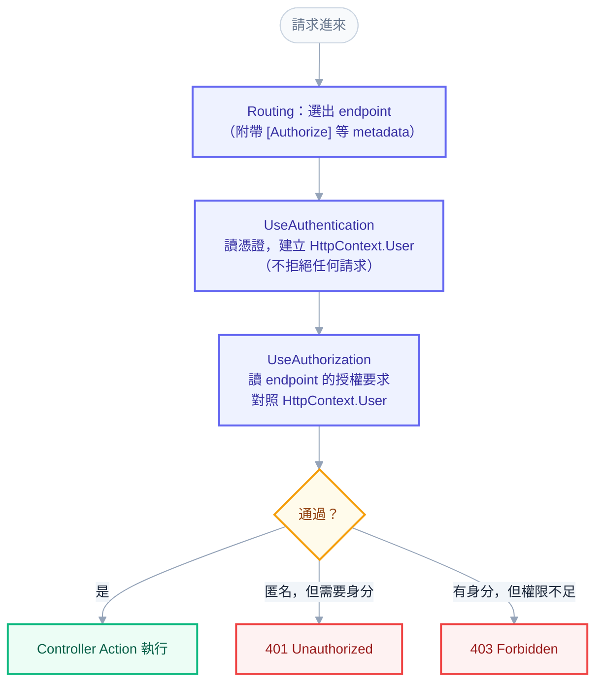

# 入門第 11 章：驗證與授權的骨架 — 誰可以呼叫這支 API

## 沒帶任何身分的 DELETE，回了 204

上一章結束時，TaskTracker 已經把任務存進 Oracle，資料重啟後還在。這也代表一件事：任何人只要知道網址，就能刪掉別人的資料。下面這個請求沒有帶使用者名稱、沒有帶密碼，什麼身分資訊都沒有：

```powershell
curl.exe -s -i -X DELETE "http://localhost:5080/api/tasks/$newId"
```

（`$newId` 是上一章用 `POST` 建立任務後，從回應取得的任務 id。照做時先用上一章的方式建一筆，或把它換成 `GET /api/tasks` 看到的任一個 id。）

```text
HTTP/1.1 204 No Content
Date: Fri, 30 Oct 2026 14:36:29 GMT
Server: Kestrel
```

204，刪掉了。API 開發到這個階段才碰到的問題是：誰可以呼叫這支 API？更精確一點，要拆成兩個問題。第一個是「你是誰」，第二個是「你被允許做這件事嗎」。這兩個問題在 ASP.NET Core 裡由不同的元件回答，順序有講究，搞錯時的症狀還很難查。

本章先把概念講清楚，再幫 TaskTracker 接上骨架：裝好 JWT Bearer 的驗證設定、在 pipeline 放進兩個 middleware、把 `POST`、`PUT`、`DELETE` 標上 `[Authorize]`。做完之後，這三個動作沒有 token 一律回 401，`GET` 維持公開。但是這一章結束時還沒有辦法「登入」，所以也沒有任何人能拿到有效的 token，寫入類的端點暫時沒人進得去。這是刻意的：登入、簽發 token 是 [[basics-12-jwt-login]] 的主題，本章只負責把門裝好、驗證門確實會鎖。

起點是 [[basics-10-efcore-and-oracle]] 結束時的 TaskTracker，終點是一支「讀取公開、寫入需要身分」的 API，加上一組你能自己判斷的除錯準則：身分明明有效卻一直 401，該先看哪裡。

機制推導不在本章重複：Scheme、Claims、Handler 的內部運作見 [[11-authentication]]，Policy 與權限模型見 [[14-authorization]]。

---

## 一、兩個問題，兩個階段

進公司大樓時，警衛先看你的證件，確認你是不是員工、是哪一位；接著你要進機房，門禁系統再查你這個人有沒有機房的權限。前一步叫驗證（Authentication，簡稱 AuthN），後一步叫授權（Authorization，簡稱 AuthZ）。兩件事分開有明確的好處：證件可以換成員工證、指紋或手機簽發的憑證，而「誰能進機房」是另一份獨立維護的規則，不必跟著證件的種類改。

放進 Web API，對應如下：

| | 驗證（Authentication） | 授權（Authorization） |
| --- | --- | --- |
| 回答 | 你是誰 | 你能不能做這件事 |
| 輸入 | 請求裡的憑證（例如 `Authorization: Bearer ...` 標頭） | 驗證的結果加上目標 endpoint 的要求 |
| 產出 | `HttpContext.User`（一個 `ClaimsPrincipal`） | 通過或拒絕 |
| 失敗時 | 沒有身分，請求照常往下走 | 401 或 403 |
| 對應的 middleware | `UseAuthentication()` | `UseAuthorization()` |

表格的第四列值得多看一眼，因為這是整章最容易誤解的地方：驗證本身不拒絕任何請求。`UseAuthentication()` 只做一件事，讀憑證、嘗試建立身分、把結果放進 `HttpContext.User`。憑證沒帶或是壞的，`User` 就是一個匿名身分（`IsAuthenticated` 為 `false`），請求繼續往下走，不丟例外，也不回應。「擋人」是授權的工作。可以把驗證想成只負責「解析」，授權才負責「判斷」。

這個分工在最小的例子裡看得最清楚。下面這個拋棄式專案不用 JWT，只用一個自己寫的 authentication handler：請求帶了 `X-User` 標頭，就當作那個人已登入。建立專案：

```powershell
dotnet new web -n AuthDemo
cd AuthDemo
```

把 `Program.cs` 換成下面的內容。前半是服務登記與 pipeline，用環境變數 `ORDER` 切換 middleware 的擺法，這樣之後做實驗不必重新編譯：

```csharp
using System.Security.Claims;
using System.Text.Encodings.Web;
using Microsoft.AspNetCore.Authentication;
using Microsoft.AspNetCore.Authorization;
using Microsoft.AspNetCore.Mvc;
using Microsoft.Extensions.Options;

var builder = WebApplication.CreateBuilder(args);
builder.Services.AddControllers();
builder.Services
    .AddAuthentication("Demo")
    .AddScheme<AuthenticationSchemeOptions, DemoHandler>("Demo", null);
builder.Services.AddAuthorization();

var app = builder.Build();

var order = Environment.GetEnvironmentVariable("ORDER") ?? "correct";
if (order == "correct")
{
    app.UseAuthentication();
    app.UseAuthorization();
}
else if (order == "reversed")
{
    app.UseAuthorization();
    app.UseAuthentication();
}
else if (order == "only-authn")
{
    app.UseAuthentication();
}

app.MapControllers();
app.Run();
```

後半是一個 controller 和那個 handler。Controller 取材自作者自己的 RuleViewer 專案：列出規則是公開的，新增需要登入，刪除只有 Admin。

```csharp
[ApiController]
[Route("api/rules")]
public class RulesController : ControllerBase
{
    [HttpGet]
    public IActionResult List() => Ok("public list");

    [Authorize]
    [HttpPost]
    public IActionResult Create() => Ok($"created by {User.Identity?.Name}");

    [Authorize(Roles = "Admin")]
    [HttpDelete]
    public IActionResult Delete() => Ok("deleted");
}

public class DemoHandler : AuthenticationHandler<AuthenticationSchemeOptions>
{
    public DemoHandler(IOptionsMonitor<AuthenticationSchemeOptions> options, ILoggerFactory logger, UrlEncoder encoder)
        : base(options, logger, encoder)
    {
    }

    protected override Task<AuthenticateResult> HandleAuthenticateAsync()
    {
        if (!Request.Headers.TryGetValue("X-User", out var user))
        {
            return Task.FromResult(AuthenticateResult.NoResult());
        }

        var claims = new List<Claim> { new(ClaimTypes.Name, user.ToString()) };
        if (Request.Headers.TryGetValue("X-Role", out var role))
        {
            claims.Add(new Claim(ClaimTypes.Role, role.ToString()));
        }

        var identity = new ClaimsIdentity(claims, "Demo");
        var ticket = new AuthenticationTicket(new ClaimsPrincipal(identity), "Demo");
        return Task.FromResult(AuthenticateResult.Success(ticket));
    }
}
```

`HandleAuthenticateAsync` 是整個驗證階段的核心：它回答「這個請求的主人是誰」。沒有 `X-User` 就回 `NoResult`，意思是「我沒看到憑證，不表示意見」；有的話就回 `Success` 並交出一個 `ClaimsPrincipal`。真實的 JWT Bearer handler 做的是同一件事，只是把「讀 `X-User`」換成「讀 `Authorization` 標頭、驗簽章、驗有效期限」。（`ClaimsPrincipal` 與 Claim 是什麼，下一章簽發 token 時會用到，現階段只要知道它是「一個人的身分與身分上的各項聲明」就夠了。）

用 `dotnet run --urls http://localhost:5601` 跑起來，順序正確（預設）時的結果：

```powershell
curl.exe -s -o NUL -w "%{http_code}`n" http://localhost:5601/api/rules
curl.exe -s -o NUL -w "%{http_code}`n" -X POST http://localhost:5601/api/rules
curl.exe -s -o NUL -w "%{http_code}`n" -X POST -H "X-User: alice" http://localhost:5601/api/rules
```

```text
200
401
200
```

公開的 `GET` 不管有沒有身分都是 200。`POST` 匿名是 401，帶了 `X-User: alice` 就是 200。注意第一個請求是匿名的，驗證階段回了 `NoResult`、請求沒有被擋下；擋下第二個請求的是授權。

---

## 二、`[Authorize]` 不是 Controller 裡的 if

到這裡會冒出一個直覺的疑問：既然 `Create` 需要登入，為什麼不直接在方法裡寫 `if (!User.Identity.IsAuthenticated) return Unauthorized();`？

```csharp
[HttpPost]
public IActionResult Create()
{
    if (User.Identity?.IsAuthenticated != true)
    {
        return Unauthorized();
    }
    // ...
}
```

這種寫法能運作，但有三個問題。第一，每個需要保護的方法都要記得寫，漏一個就是漏洞，而且漏掉時不會有任何錯誤訊息。第二，它太晚：要執行到 action 內，代表 routing、model binding、驗證、各種 action filter 都已經跑過，這些對一個本來就不該進來的請求是浪費，有時還有副作用。第三，規則散在每個方法的內文，要換成「需要 Admin 角色」就得逐一改。

`[Authorize]` 的做法不同。它不是在 Controller 裡面執行的判斷，而是附在 endpoint 上的 metadata（描述資料）。啟動時，ASP.NET Core 掃描所有 Controller，每個 action 對應一個 endpoint，類別與方法上的 attribute（`[Authorize]`、`[AllowAnonymous]`、`[HttpPost]` 等）會被收集起來，附在這個 endpoint 身上。請求進來時，routing 先根據網址與 HTTP method 選出 endpoint，後面的 middleware 就能讀到這個 endpoint 帶著哪些 metadata。`UseAuthorization()` 做的事，就是讀出目標 endpoint 的授權要求，拿 `HttpContext.User` 去對照，通過才讓請求往下，不通過就在這裡回應 401 或 403，Controller 根本不會被建立。



TaskTracker 的實測可以直接證明「Controller 沒被執行」。下一節做完之後，對一個根本不存在的任務 id 發 `PUT`，沒帶 token 時回的是 401，不是 404。404 是 Service 查不到任務才會丟出的，既然收到的是 401，代表請求在更前面就被擋了，Service 沒有被呼叫，伺服器 console 也沒有為這個請求產生任何一行 SQL。順帶一提，這也讓匿名的人無從得知某個 id 存不存在。

Routing 必須排在前面，原因就在這裡：授權要讀 endpoint 的 metadata，而 endpoint 是 routing 選的。`WebApplication` 會自動把 routing 放在 pipeline 最前面，所以 `Program.cs` 裡看不到 `UseRouting()`，順序關係不受影響；pipeline 的洋蔥模型與短路見 [[basics-08-middleware-and-exception-handling]]，routing 自動插入的細節見 [[01-request-pipeline]]。

---

## 三、動手：把骨架接上 TaskTracker

這一節要做的事共六步：裝套件、準備設定、登記驗證服務、放進兩個 middleware、標記 endpoint、跑起來確認。每一步改動的檔案都在 `src/TaskTracker.Api/` 底下。

### 3.1 裝 JWT Bearer 套件

```powershell
dotnet add src/TaskTracker.Api package Microsoft.AspNetCore.Authentication.JwtBearer --version 10.0.14
```

輸出的最後一行會提到 `PackageReference ... version '10.0.14' updated in file ...TaskTracker.Api.csproj`，代表成功。版本號跟著 .NET 10 的 patch 版本走，只要主版號是 10 即可。

為什麼是 JWT Bearer？前端（第 13 章的 React）和 API 不在同一個網域，沒有 Cookie 可以自動帶；常見做法是登入後拿到一串簽過章的 token，之後每個請求把它放在 `Authorization: Bearer <token>` 標頭。`AddJwtBearer` 登記的就是「怎麼讀這個標頭、怎麼驗這串 token」。Token 長什麼樣、怎麼簽發，下一章再講，本章只做驗證端的設定。

### 3.2 設定：簽章金鑰不進版控

驗證 token 需要四個設定：誰簽發的（Issuer）、給誰用的（Audience）、驗簽章用的金鑰，以及 token 的有效分鐘數（簽發時才用到）。前三個決定一個 token 會不會被接受，所以要集中管理。依第 9 章的做法建立 `Options/JwtOptions.cs`：

```csharp
using System.ComponentModel.DataAnnotations;

namespace TaskTracker.Api.Options;

public sealed class JwtOptions
{
    public const string SectionName = "Jwt";

    [Required]
    public string Issuer { get; init; } = string.Empty;

    [Required]
    public string Audience { get; init; } = string.Empty;

    [Required]
    public string SigningKey { get; init; } = string.Empty;

    [Range(1, 1440)]
    public int AccessTokenMinutes { get; init; } = 30;
}
```

金鑰的長度要另外檢查。本書用 HS256 簽章（用同一把秘密金鑰簽發與驗證，第 12 章詳述），它要求金鑰至少 32 bytes（256 bits）；金鑰太短時，錯誤要到第一次簽發 token 才會冒出來，而且訊息也不會直接說是金鑰長度的問題。比較好的做法是在啟動時就攔下來。建立 `Options/JwtOptionsValidator.cs`：

```csharp
using System.Text;
using Microsoft.Extensions.Options;

namespace TaskTracker.Api.Options;

public sealed class JwtOptionsValidator : IValidateOptions<JwtOptions>
{
    private const int MinimumKeyBytes = 32;

    public ValidateOptionsResult Validate(string? name, JwtOptions options)
    {
        return Encoding.UTF8.GetByteCount(options.SigningKey) >= MinimumKeyBytes
            ? ValidateOptionsResult.Success
            : ValidateOptionsResult.Fail($"Jwt:SigningKey must be at least {MinimumKeyBytes} bytes (256 bits) for HS256.");
    }
}
```

`appsettings.json` 加上 `Jwt` 區段，注意沒有 `SigningKey`：

```json
"Jwt": {
  "Issuer": "tasktracker-api",
  "Audience": "tasktracker-web",
  "AccessTokenMinutes": 30
}
```

`appsettings.json` 會進 Git。金鑰一旦寫進去，所有能讀 repo 的人都能自己簽出合法的 token，等於驗證形同虛設。開發機用 User Secrets（第 9 章已替專案設好 `UserSecretsId`），正式環境用環境變數 `Jwt__SigningKey` 或 K8s Secret。下面用 PowerShell 產生 32 個隨機 byte、轉成 Base64（44 個字元，UTF-8 下超過 32 bytes）並存進 User Secrets：

```powershell
$bytes = New-Object byte[] 32
[Security.Cryptography.RandomNumberGenerator]::Create().GetBytes($bytes)
$key = [Convert]::ToBase64String($bytes)
dotnet user-secrets set "Jwt:SigningKey" $key --project src/TaskTracker.Api
```

### 3.3 登記驗證服務

在 `Extensions/ServiceCollectionExtensions.cs` 新增一個擴充方法（檔案開頭補上 `System.Text`、`Microsoft.AspNetCore.Authentication.JwtBearer`、`Microsoft.IdentityModel.Tokens` 三個 using）：

```csharp
public static IServiceCollection AddTaskTrackerAuthentication(this IServiceCollection services)
{
    services.AddOptions<JwtOptions>()
        .BindConfiguration(JwtOptions.SectionName)
        .ValidateDataAnnotations()
        .ValidateOnStart();
    services.AddSingleton<IValidateOptions<JwtOptions>, JwtOptionsValidator>();

    services.AddAuthentication(JwtBearerDefaults.AuthenticationScheme).AddJwtBearer();
    services.AddOptions<JwtBearerOptions>(JwtBearerDefaults.AuthenticationScheme)
        .Configure<IOptions<JwtOptions>>((bearer, jwt) =>
        {
            bearer.TokenValidationParameters = new TokenValidationParameters
            {
                ValidateIssuer = true,
                ValidIssuer = jwt.Value.Issuer,
                ValidateAudience = true,
                ValidAudience = jwt.Value.Audience,
                ValidateIssuerSigningKey = true,
                IssuerSigningKey = new SymmetricSecurityKey(Encoding.UTF8.GetBytes(jwt.Value.SigningKey)),
                ValidateLifetime = true,
                ClockSkew = TimeSpan.FromSeconds(30)
            };
        });
    services.AddAuthorization();
    return services;
}
```

這段分四塊。前兩行把 `JwtOptions` 綁定並驗證，並用 `ValidateOnStart` 讓設定錯誤在啟動時就爆炸，而不是等到第一個請求。`AddAuthentication(JwtBearerDefaults.AuthenticationScheme)` 宣告「預設的驗證方式叫 `Bearer`」（常數的值就是字串 `"Bearer"`，用常數可避免打錯字），`AddJwtBearer()` 登記實際讀標頭、驗 token 的 handler。

`TokenValidationParameters` 是 token 的驗收清單：簽發者、對象、簽章、有效期限，逐項打勾才算有效。這裡全部都開，`ClockSkew`（容許伺服器之間的時鐘誤差）預設是 5 分鐘，這會讓過期 5 分鐘內的 token 仍然通過，本書縮成 30 秒。每一項的意義與失敗時的訊息在 [[basics-12-jwt-login]] 與 [[12-jwt-deep-dive]] 展開。

用 `Configure<IOptions<JwtOptions>>` 而不是直接在 `AddJwtBearer(options => ...)` 裡填值，是為了讓金鑰與簽發者只有一份來源：驗證端與（下一章的）簽發端讀同一個、已經通過驗證的 `JwtOptions`，不會一邊改了設定、另一邊漏改。

最後的 `AddAuthorization()` 登記授權服務。有趣的是，`AddControllers()` 其實已經帶入授權需要的核心服務，把這行拿掉專案仍然可以運作；但 Policy（第 12、14 章）都在這裡設定，習慣上明確寫出來。相反地，`AddAuthentication` 不能省：下面的 Q&A 會看到少了它的症狀。

接著在 `Program.cs` 呼叫它：

```csharp
builder.Services.AddTaskTrackerCors();
builder.Services.AddTaskTrackerAuthentication();
builder.Services.AddTaskTrackerDatabase();
```

### 3.4 放進兩個 middleware

```csharp
app.UseHttpsRedirection();
app.UseCors(CorsPolicyOptions.PolicyName);
app.UseAuthentication();
app.UseAuthorization();
app.MapControllers();
```

位置的理由有三層。`UseAuthentication()` 必須在 `UseAuthorization()` 之前，因為授權要用驗證的結果，下一節會實測反過來的後果。兩者都要在 `MapControllers()` 之前，因為它們得在請求抵達 endpoint 之前攔截。`UseCors()` 放在兩者之前，是因為授權失敗會直接短路回 401，如果 CORS 排在後面，這個 401 就不會帶 CORS 標頭，瀏覽器會把它顯示成「CORS 錯誤」，前端收不到 401，也就無法觸發「請重新登入」。這個現象在 [[01-request-pipeline]] 有完整推導。

### 3.5 標記 endpoint

TaskTracker 的決定是：讀取公開，寫入需要身分。在 `TasksController` 加上 `using Microsoft.AspNetCore.Authorization;`，然後在 `POST`、`PUT`、`DELETE` 三個 action 前各加一行 `[Authorize]`：

```csharp
[Authorize]
[HttpPost]
public async Task<ActionResult<TaskResponse>> CreateAsync(CreateTaskRequest request, CancellationToken ct)
```

`UpdateAsync`、`DeleteAsync` 同理，兩個 `GET` 不動。這跟 RuleViewer 的設計同構：公開 API 讀取規則、受保護 API 新增修改刪除，「pipeline 不變，控制權限靠 attribute」。（誰可以刪、誰可以改的細分，是第 12、13 章的內容；現在 `[Authorize]` 只表達一件事：必須有身分。）

### 3.6 跑起來：先看啟動檢查，再看 401

先驗證設定錯誤真的在啟動就被攔下。沒有設定 `Jwt:SigningKey` 時（暫時以 `dotnet user-secrets remove "Jwt:SigningKey" --project src/TaskTracker.Api` 移除，之後記得再 set 回來），`dotnet run` 的 console 出現：

```text
Hosting failed to start
Microsoft.Extensions.Options.OptionsValidationException: DataAnnotation validation failed for 'JwtOptions' members: 'SigningKey' with the error: 'The SigningKey field is required.'.; Jwt:SigningKey must be at least 32 bytes (256 bits) for HS256.
```

金鑰只給 5 個字元時，只剩後半句（省略堆疊）：

```text
Microsoft.Extensions.Options.OptionsValidationException: Jwt:SigningKey must be at least 32 bytes (256 bits) for HS256.
```

接著用正常的金鑰啟動，打幾個請求。`GET` 不需要登入：

```powershell
curl.exe -s -i http://localhost:5080/api/tasks
```

```text
HTTP/1.1 200 OK
Content-Type: application/json; charset=utf-8
...
{"items":[],"page":1,"pageSize":20,"totalCount":0}
```

`POST` 不帶任何憑證（依本書慣例，JSON 用管線傳給 `curl.exe`，避免 PowerShell 5.1 吃掉雙引號）：

```powershell
'{"title":"Write chapter 11"}' | curl.exe -s -i -X POST http://localhost:5080/api/tasks -H "Content-Type: application/json" --data-binary '@-'
```

```text
HTTP/1.1 401 Unauthorized
Content-Type: application/problem+json; charset=utf-8
...
WWW-Authenticate: Bearer

{"type":"https://tools.ietf.org/html/rfc9110#section-15.5.2","title":"Unauthorized","status":401,"traceId":"00-1683081e4e9541ecab2169ab41d7945e-21487d3b22c8dcc9-00"}
```

三件事值得拆開看。狀態碼 401 由授權階段決定，但回應內容是驗證的 handler 負責的：`WWW-Authenticate: Bearer` 是 HTTP 規範裡的「質詢」（challenge），告訴呼叫端「這裡用 Bearer 方案驗證」。這個分工很重要：授權 middleware 只決定「要拒絕」，由 JwtBearer 的 handler 決定回應長什麼樣；前面的 DemoHandler 在同樣情況下，log 裡也會出現一行 `AuthenticationScheme: Demo was challenged.`。Body 是標準的 `application/problem+json`，這是第 8 章設定的 `AddProblemDetails()` 與 `UseStatusCodePages()` 替空 body 的 401 補上的，前端錯誤處理的格式因此一致。最後，`PUT` 一個不存在的 id、`DELETE` 也都是同樣的 401，伺服器 console 的 SQL 只有 `GET` 那一次，另外三次都沒有碰資料庫：

```text
HTTP GET /api/tasks responded 200 in 731.1 ms
HTTP POST /api/tasks responded 401 in 41.4 ms
HTTP PUT /api/tasks/22222222-2222-2222-2222-222222222222 responded 401 in 9.1 ms
HTTP DELETE /api/tasks/22222222-2222-2222-2222-222222222222 responded 401 in 3.8 ms
```

（這幾行是第 8 章的 `RequestLoggingMiddleware` 寫的，已省略 logger 名稱。）

### 3.7 各種「壞」憑證：401 的細節

沒帶憑證是最單純的情況。實際上呼叫端會送出各式各樣的壞憑證，每一種都是 401，但 `WWW-Authenticate` 標頭會告訴你是哪一種。帶一個不是 JWT 的字串：

```powershell
'{"title":"x"}' | curl.exe -s -i -X POST http://localhost:5080/api/tasks -H "Content-Type: application/json" -H "Authorization: Bearer abc" --data-binary '@-'
```

```text
HTTP/1.1 401 Unauthorized
...
WWW-Authenticate: Bearer error="invalid_token"
```

用了別的驗證方案（`Basic`），API 只認識 `Bearer`，所以像沒帶一樣處理，標頭回到最單純的 `Bearer`：

```text
HTTP/1.1 401 Unauthorized
...
WWW-Authenticate: Bearer
```

比較有意思的是偽造。JWT 的格式是公開的，任何人都能組出三段 Base64Url 字串，header 與 payload 隨便填，payload 還能寫上正確的 `iss`、`aud`、一個很遠的 `exp`。差別在簽章：沒有伺服器的金鑰，就簽不出對的簽章。下面用 PowerShell 5.1 組一個格式完整、但用另一把金鑰簽的 token（這是在示範攻擊，目的是確認防線有效）：

```powershell
function ConvertTo-Base64Url([byte[]]$bytes) { [Convert]::ToBase64String($bytes).TrimEnd('=').Replace('+', '-').Replace('/', '_') }
$header = ConvertTo-Base64Url ([Text.Encoding]::UTF8.GetBytes('{"alg":"HS256","typ":"JWT"}'))
$payload = ConvertTo-Base64Url ([Text.Encoding]::UTF8.GetBytes('{"sub":"1","iss":"tasktracker-api","aud":"tasktracker-web","exp":4102444800}'))
$hmac = New-Object Security.Cryptography.HMACSHA256 -ArgumentList (,[Text.Encoding]::UTF8.GetBytes('an-attacker-key-that-is-32-bytes-long!'))
$signature = ConvertTo-Base64Url ($hmac.ComputeHash([Text.Encoding]::UTF8.GetBytes("$header.$payload")))
$forged = "$header.$payload.$signature"
```

把 `$forged` 放進 `Authorization: Bearer` 標頭送出：

```text
HTTP/1.1 401 Unauthorized
...
WWW-Authenticate: Bearer error="invalid_token", error_description="The signature key was not found"
```

另一種老把戲是把 header 改成 `"alg":"none"`，宣稱「這個 token 不需要簽章」，簽章欄位留空。實測同樣是 401：

```text
WWW-Authenticate: Bearer error="invalid_token", error_description="The signature is invalid"
```

兩個 `error_description` 的措辭是函式庫的內部說法，不必去背；重點是它們都在驗證階段就失敗了。這道防線成立的條件有兩個：金鑰只存在伺服器，以及 `TokenValidationParameters.RequireSignedTokens` 維持預設的 `true`（沒有簽章的 token 一律拒絕，`alg: none` 因此行不通）。順帶一提，`ValidateIssuerSigningKey` 檢查的是「簽章用的金鑰本身是否可信」（例如憑證是否過期），簽章比對則不論這個開關都會進行。到這裡，TaskTracker 的骨架已經裝好：沒有身分的寫入一律被拒絕。但目前沒有任何合法 token 存在，所以這些端點暫時只能得到 401。

---

## 四、順序與省略：除錯最值得練的一課

骨架能運作之後，馬上要面對的是它最常見的失敗方式：兩個 middleware 的位置。回到 `AuthDemo`。把 `ORDER` 設成 `reversed`（先 `UseAuthorization()`、再 `UseAuthentication()`）重新啟動，打下面五個請求（前三個與上一節相同，後兩個是 `DELETE`，一個只有 alice、一個加上 Admin 角色）：

```powershell
$env:ORDER = "reversed"
dotnet run --urls http://localhost:5602
```

```powershell
curl.exe -s -o NUL -w "%{http_code}`n" http://localhost:5602/api/rules
curl.exe -s -o NUL -w "%{http_code}`n" -X POST http://localhost:5602/api/rules
curl.exe -s -o NUL -w "%{http_code}`n" -X POST -H "X-User: alice" http://localhost:5602/api/rules
curl.exe -s -o NUL -w "%{http_code}`n" -X DELETE -H "X-User: alice" http://localhost:5602/api/rules
curl.exe -s -o NUL -w "%{http_code}`n" -X DELETE -H "X-User: alice" -H "X-Role: Admin" http://localhost:5602/api/rules
```

測完一種擺法就停掉伺服器，把 `ORDER` 換成 `only-authn` 再跑一次（正確順序則是 `$env:ORDER = "correct"`，埠號沿用 5601 的結果即可）。

下表是三種擺法的實測結果（`only-authn` 是只呼叫 `UseAuthentication()`，沒有呼叫 `UseAuthorization()`）：

| 請求 | 正確順序 | 授權在前（reversed） | 只呼叫 UseAuthentication |
| --- | --- | --- | --- |
| `GET /api/rules`（公開） | 200 | 200 | 200 |
| `POST`，匿名 | 401 | 401 | 401 |
| `POST`，`X-User: alice` | 200 | 401 | 401 |
| `DELETE`，alice，沒有角色 | 403 | 401 | 401 |
| `DELETE`，alice，Admin | 200 | 401 | 401 |

後兩欄的症狀是一樣的：已登入的使用者，包括 Admin，所有需要身分的請求都得到 401。沒有例外、沒有 500、沒有被「略過授權而放行」，是一種穩定、安靜的拒絕。原因看事件順序就懂了：授權 middleware 先執行，此時 `HttpContext.User` 還是匿名，判定「需要身分但沒有」，直接回 401 並短路；排在後面的 authentication middleware 與 handler 完全沒有機會執行。

最麻煩的是它安靜到什麼程度。把 `Microsoft.AspNetCore` 的 log 層級調到 `Information` 時，`reversed` 的情況在 console 只有一則 Information 層級的訊息：

```text
info: Microsoft.AspNetCore.Authorization.DefaultAuthorizationService[2]
      Authorization failed. These requirements were not met:
      DenyAnonymousAuthorizationRequirement: Requires an authenticated user.
```

而 TaskTracker 的 `appsettings.json`（`dotnet new` 範本的預設也一樣）把 `Microsoft.AspNetCore` 的 log 層級設為 `Warning`，這則訊息預設會被濾掉，所以在 TaskTracker 裡這個錯誤的症狀只有「401」，沒有任何 log。真實專案裡，這個症狀常被誤判成 token 過期、金鑰不一致、前端沒帶標頭，花上半天查錯方向。遇到「token 明明有效、卻一直 401」，先做這三件事：

1. 看 `Program.cs`：`UseAuthentication()` 在不在 `UseAuthorization()` 前面。
2. 在 `appsettings.Development.json` 把 `Logging:LogLevel:Microsoft.AspNetCore.Authorization` 設為 `Information`，如果出現 `Requires an authenticated user` 而 token 其實有送，就是驗證沒有執行或沒有成功。
3. 看回應的 `WWW-Authenticate`：有 `error="invalid_token"` 與 `error_description`，表示驗證執行了、token 被拒；只有單純的 `Bearer`，表示驗證階段沒有看到憑證，或根本沒有執行。

### 如果其中一個根本沒寫

有的專案 `Program.cs` 裡一個都沒呼叫 `UseAuthentication()`／`UseAuthorization()`，一樣可以運作。原因是 `WebApplication`（.NET 6 起的 minimal hosting 寫法）會檢查服務有沒有登記：只要登記了驗證與授權的服務，就會在你自己的 middleware 前面自動補上缺的那個。本書在 .NET 10 實測，兩個都不寫，行為與正確順序完全相同，Development 與 Production 一致。

這個便利有一個陷阱：只要自己寫了其中一個，補上的另一個位置就不是你以為的位置。只呼叫 `UseAuthentication()`（上表最右欄）時，框架自動補的 `UseAuthorization()` 排在最前面，比你寫的 `UseAuthentication()` 還前面，結果與順序反了完全相同：已登入也一律 401，沒有例外。反過來只呼叫 `UseAuthorization()` 則沒事，因為補上的 authentication 本來就在前面。

所以書中與下一章的程式都明確寫出兩行，並照這個固定的相對位置：`UseCors()` 之後、`MapControllers()` 之前，`UseAuthentication()` 在 `UseAuthorization()` 之前。不要靠自動補，因為「省一行」換來的是日後很難判讀的行為。

還有一種老專案的狀況值得認得出來：用 `Startup.cs` 的 Generic Host 寫法，框架不會自動補。實測在 `UseRouting()` 與 `UseEndpoints()` 之間漏掉 `UseAuthorization()`，標了 `[Authorize]` 的 endpoint 不會被放行，而是整個 500，log 裡有一句很明確的訊息：

```text
InvalidOperationException: Endpoint ... contains authorization metadata, but a middleware was not found that supports authorization.
Configure your application startup by adding app.UseAuthorization() in the application startup code. ...
```

漏掉的是 `UseAuthentication()` 則沒有例外，所有請求安靜地回 401，與前面的情形一樣。

再補一個忘記登記服務的症狀：如果 `AddAuthentication` 整段沒寫，但 endpoint 上有 `[Authorize]`，匿名請求不是 401，而是 500，訊息是：

```text
System.InvalidOperationException: No authenticationScheme was specified, and there was no DefaultChallengeScheme found. The default schemes can be set using either AddAuthentication(string defaultScheme) or AddAuthentication(Action<AuthenticationOptions> configureOptions).
```

授權決定要拒絕之後，需要一個驗證方案來產生回應，沒有方案可用就丟例外。這也再次說明了前面的分工：授權只決定「拒絕」，回應是驗證方案的 handler 製作的。

---

## 五、401 與 403

前面的表格已經出現這兩個狀態碼。它們都代表「請求被拒絕」，但問題不同，前端的反應也完全不同。

| 狀態碼 | 意思 | 呼叫端該怎麼做 |
| --- | --- | --- |
| 401 | 我不知道你是誰：沒有憑證、憑證壞了、過期 | 導向登入，或用 refresh token 換新 |
| 403 | 我知道你是誰，但你不能做這件事 | 顯示「沒有權限」，重新登入也沒用 |

401 的英文名字是 `Unauthorized`，字面像「未授權」，但實際意思是「未驗證」（unauthenticated），這是 HTTP 早期命名留下的包袱。判斷時看語意，不看名字。前一節的 AuthDemo 已經有兩個狀態碼的實例：alice 登入了（有 `X-User`），`POST` 通過；`DELETE` 要求 `Admin` 角色，alice 沒有，得到 403。加上 `X-Role: Admin` 就是 200。同一個使用者，同一種身分，因為目標 endpoint 要求的角色不同，一次通過、一次 403。匿名的人打同一個 `DELETE`，得到的是 401，因為更根本的問題是「我還不知道你是誰」。

混淆這兩個碼的代價很實際。如果權限不足的使用者被回 401，前端的攔截器會把他導回登入頁；登入後再試一次，又是權限不足，又被導回登入頁，形成一個無限迴圈。用 403 表達「你已登入但不夠格」，前端才有機會顯示正確的訊息。前端這一側的處理在 [[basics-13-permissions-with-frontend]] 實作；TaskTracker 現在只有 `[Authorize]`、還沒有角色，所以本章的 TaskTracker 只能看到 401，403 要等到下一章加上角色。

另有一個設計取捨：有些系統對「無權查看的資源」故意回 404 而非 403，避免讓人探測資源存不存在。何時值得這麼做，見 [[14-authorization]] 的 3.2 節。

---

## 六、`[AllowAnonymous]` 與 `[Authorize]` 疊在一起

一個 controller 通常有很多 action，把 `[Authorize]` 加在類別上，一次保護整個 controller，再用 `[AllowAnonymous]` 為個別 action（例如登入）開洞，是常見的寫法。但是一旦兩種 attribute 出現在不同層級，哪一個算數？常見的說法是「離 action 越近越優先」。這個說法是錯的，實測如下。

三個測試用 controller：`anon-class` 在類別標 `[AllowAnonymous]`；`auth-class` 在類別標 `[Authorize]`；`roles-class` 在類別標 `[Authorize(Roles = "Admin")]`。各自的 action 再標上不同的 attribute，用匿名、已登入無角色（alice）、Admin 三種身分打每個 endpoint：

| 類別上 | action 上 | 匿名 | alice | Admin |
| --- | --- | --- | --- | --- |
| `[AllowAnonymous]` | `[Authorize]` | 200 | 200 | 200 |
| `[AllowAnonymous]` | 沒標 | 200 | 200 | 200 |
| `[Authorize]` | `[AllowAnonymous]` | 200 | 200 | 200 |
| `[Authorize]` | 沒標 | 401 | 200 | 200 |
| `[Authorize(Roles = "Admin")]` | `[AllowAnonymous]` | 200 | 200 | 200 |
| `[Authorize(Roles = "Admin")]` | `[Authorize]` | 401 | 403 | 200 |

第一列是重點：類別上的 `[AllowAnonymous]` 把 action 上的 `[Authorize]` 蓋掉了，匿名也是 200。規則其實簡單：只要 endpoint 的 metadata 裡有 `[AllowAnonymous]`，不管它在類別還是 action，授權就整個略過，遠近不影響。第五列甚至連類別上的 `Roles = "Admin"` 也一起略過。`[Authorize]` 則是累加的：最後一列，類別要求 Admin，action 的 `[Authorize]` 並沒有取代它，而是疊加上去，結果匿名 401、alice 403、Admin 200。

編譯器看得出這種寫法有問題。在 AuthDemo 加上這樣一個 controller：

```csharp
[AllowAnonymous]
[Route("api/open")]
public class OpenController : ControllerBase
{
    [Authorize]
    [HttpGet]
    public IActionResult Get() => Ok("open anyway");
}
```

`dotnet build` 會警告，而匿名打 `GET /api/open` 實測是 200：

```text
warning ASP0026: This [Authorize] attribute is overridden by an [AllowAnonymous] attribute from farther away on 'OpenController'.
```

警告字面上寫 "from farther away"，但實測結果顯示這個覆蓋與距離無關。實務上的結論有兩條。第一，不要把 `[AllowAnonymous]` 放在類別上：它會讓整個 controller 變成公開，之後新增的 action 即使標了 `[Authorize]` 也不會生效。第二，想要「整個 controller 預設要登入，少數例外」，就在類別放 `[Authorize]`，例外的 action 放 `[AllowAnonymous]`。

更進一步的做法是把預設反過來：用 `FallbackPolicy` 讓「完全沒有授權設定的 endpoint」預設就需要登入，需要公開的才明確標 `[AllowAnonymous]`。這樣忘記加 `[Authorize]` 就不再是漏洞。它與 `DefaultPolicy` 的差別、寫法，在 [[14-authorization]] 的第四節。

---

## 常見誤解

**「有 token 就等於有權限。」** 有效的 token 只證明「我知道你是誰」。這個人能不能刪任務，是授權的規則另外決定的。TaskTracker 現在的 `[Authorize]` 只要求有身分，第 12、13 章加上角色之後，才會出現「登入了但不能刪」的 403。

**「`UseAuthentication()` 會把沒登入的人擋掉。」** 它只負責建立身分，沒有憑證時 `User` 是匿名的，請求照常往下走；擋人的是 `UseAuthorization()`。實測公開的 `GET` 不管有沒有帶身分都是 200，就是這個道理。

**「這兩個 middleware 都必須手寫。」** 過去是，現在不一定。`WebApplication` 在服務已登記時會自動補。但自動補的位置在最前面，只要自己寫了其中一個，另一個的位置就可能錯，已登入也一律 401。本書的做法是兩個都明確寫，順序固定。

**「Action 上的 `[AllowAnonymous]` 優先於類別上的，所以反過來也行。」** 只要 metadata 裡有 `[AllowAnonymous]`，位置是類別還是 action 都一樣，授權會被略過。類別上的 `[AllowAnonymous]` 會讓 action 上的 `[Authorize]` 失效。

**「401 和 403 差不多，回哪個都可以。」** 401 是「不知道你是誰」，前端的反應是導去登入；403 是「知道你是誰，但不行」，反應是顯示無權限。用錯會讓前端在登入頁與無權限頁之間打轉。

---

## 同事會來問你的問題

**Q：我的 token 明明是有效的，為什麼一直 401？**
最先看 `Program.cs`，`UseAuthentication()` 是否在 `UseAuthorization()` 之前，順序反了不丟例外，也沒有 log。其次看回應的 `WWW-Authenticate`：有 `error="invalid_token"` 就是驗證端拒絕了，常見原因是 Issuer、Audience、金鑰或有效期限對不上（細節在第 12 章）；只有單純的 `Bearer`，是驗證階段沒有看到憑證。

**Q：`GET /api/tasks` 沒有加 `[Authorize]`，是不是漏了？**
這是刻意的設計：TaskTracker 的任務清單讀取是公開的。但「忘記加」和「刻意不加」從程式碼看起來一模一樣，這是為什麼成熟的專案會用 `FallbackPolicy` 把預設改成需要登入，公開的端點明確標 `[AllowAnonymous]`，讓意圖寫在程式碼裡。

**Q：啟動時說 `Jwt:SigningKey` 是必填，或是 `must be at least 32 bytes`，金鑰到底該放哪？**
`appsettings.json` 裡沒有 `SigningKey` 是刻意的，金鑰不進版控。開發機用 `dotnet user-secrets set "Jwt:SigningKey" ... --project src/TaskTracker.Api`，部署環境用環境變數 `Jwt__SigningKey`。如果是設了值但仍報 32 bytes，代表金鑰太短，照 3.2 節重新產生。如果發現金鑰真的寫在 `appsettings.json` 裡，把那個值移出 repo，並視為已外洩。

**Q：前端收到 401 要怎麼辦？**
當作「身分沒被承認」：清掉本機的 token，導向登入，或在下一章會看到的 refresh 流程中換新 token。收到 403 則不要導向登入，顯示權限不足的訊息，並隱藏使用者做不到的操作（見第 13 章）。

---

## 這章的位置

讀完這一章，你能說明驗證與授權各自回答什麼問題；知道 `[Authorize]` 是附在 endpoint 上的 metadata、由 `UseAuthorization()` 在 Controller 之前判斷；能替專案接上 JWT Bearer 的驗證骨架，讓寫入類的端點在沒有身分時回 401；遇到「已登入卻一直 401」時，知道先檢查 middleware 的順序；也知道 `[AllowAnonymous]` 與 `[Authorize]` 疊在一起時的真實規則。TaskTracker 現在的狀態是：門已經裝好、也鎖上了，但還沒有鑰匙。[[basics-12-jwt-login]] 會補上登入端點、簽發 token，並加上角色，讓 401 與 403 都能真的被觸發。想看機制請讀 [[11-authentication]]（Scheme、Handler、Claims 的映射）與 [[14-authorization]]（Policy、Resource-based、FallbackPolicy）。

---

## 連結

- 上一章：[[basics-10-efcore-and-oracle]]
- 下一章：[[basics-12-jwt-login]]
- 對應深度章：[[11-authentication]]、[[14-authorization]]
- 總目錄：[[dotnet-web-api]]
