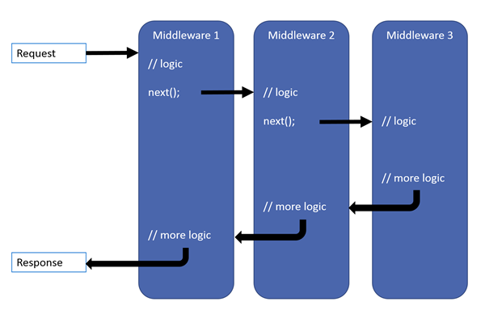
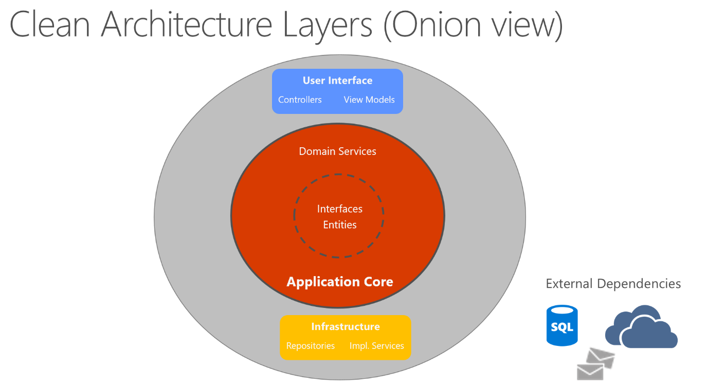
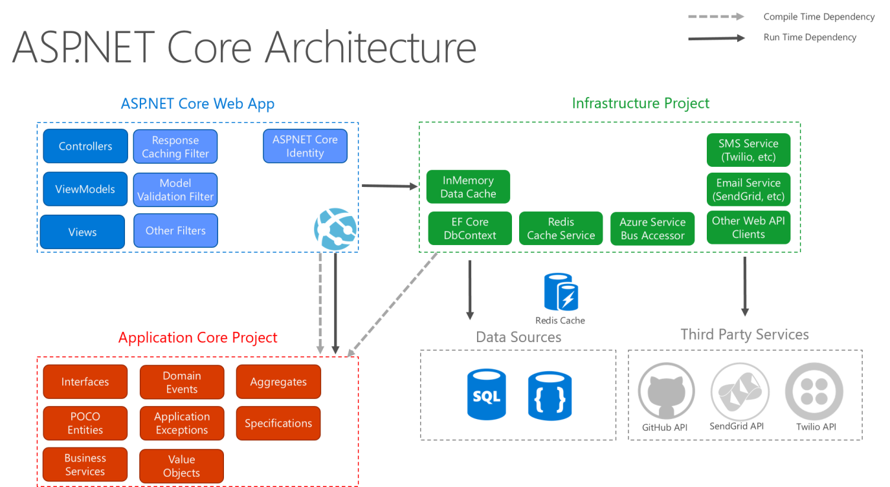

# .NET Web API

ASP.NET Core Web API 是建立 RESTful API 的框架，使用 C# 開發，支援 DI、Middleware Pipeline、JWT 等企業級功能。

這一頁有兩個身分。上半部是**教材總目錄**——一套從框架內部機制寫到生產維運的深度教材，回答「為什麼」；下半部是**速查**，回答「怎麼寫」。趕時間查語法就直接跳到速查區，想搞懂機制就從教材第 00 章開始。

---

## 教材：從會寫到問不倒

會寫 ASP.NET Core Web API 的人很多。能說清楚一個 request 從 Kestrel 收到 socket 之後、到 `IActionResult` 被序列化寫回去之前，中間經過哪幾層、每層改了什麼、哪一層攔得住例外的人很少。前者遇到「本機好好的、上 K8s 就 500」只能加 log 亂試，後者能從症狀反推到 scope 被誰提早釋放。

這套教材的目標是把讀者送到後者那一側。

### 誰該讀

預設讀者已經寫過 Controller、設過 DI、串過 JWT，也許已經把服務部署到容器裡跑過，但心裡清楚很多地方是照抄範例——不確定 `AddScoped` 和 `AddTransient` 在什麼情況下真的會差出 bug，不確定 `SaveChanges` 到底送了幾條 SQL，不確定 `[Authorize]` 失敗時回 401 還是 403 是誰決定的。

讀完之後，應該能夠獨立判斷一段設定會不會在高併發下出事、審查別人的 PR 並指出生命週期用錯的地方、從「偶發逾時」推理到 ThreadPool 飢餓或 connection pool 耗盡，以及在被同事追問「為什麼」的時候答得出機制。

### 進度總覽

**全書 22 章 + 2 附錄完成。** 每章以一個真實會出事的場景開篇，收尾固定「常見誤解」與「同事會來問你的問題」兩段自我檢測。

| 篇 | 章節 | 核心問題 | 狀態 |
| --- | --- | --- | --- |
| **執行模型篇** | [[00-hosting-and-startup]] | `WebApplication.CreateBuilder` 到 `app.Run()` 之間到底發生什麼事？ | ✅ |
| | [[01-request-pipeline]] | Middleware 為什麼是洋蔥？順序寫錯會怎樣？ | ✅ |
| | [[02-dependency-injection]] | scope 什麼時候建、什麼時候放？captive dependency 怎麼咬人？ | ✅ |
| | [[03-routing-and-endpoints]] | Endpoint routing 的兩階段、Minimal API 和 Controller 的底層差異 | ✅ |
| | [[04-model-binding-and-validation]] | 參數是怎麼被填進去的？驗證失敗的 400 是誰產生的？ | ✅ |
| | [[05-filters-and-mvc-internals]] | Filter 和 Middleware 差在哪？五種 Filter 的執行順序 | ✅ |
| | [[06-async-and-threading]] | async 到底省了什麼？ThreadPool 飢餓怎麼發生的？ | ✅ |
| **資料層篇** | [[07-efcore-internals]] | DbContext 為什麼一定要 Scoped？change tracker 在追蹤什麼？ | ✅ |
| | [[08-efcore-query]] | LINQ 怎麼變成 SQL？N+1 怎麼看出來？ | ✅ |
| | [[09-transactions-and-concurrency]] | 交易邊界該畫在哪？兩個人同時改一筆資料怎麼辦？ | ✅ |
| | [[10-oracle-specifics]] | Oracle + EF Core 的坑：大小寫、序列、CLOB、分頁 | ✅ |
| **認證授權篇** | [[11-authentication]] | Scheme 是什麼？Challenge 和 Forbid 差在哪？ | ✅ |
| | [[12-jwt-deep-dive]] | JWT 驗了哪些東西？登出為什麼沒用？ | ✅ |
| | [[13-oauth-oidc]] | Google 登入的完整流程、前後端分離的取捨 | ✅ |
| | [[14-authorization]] | Role、Claim、Policy、Requirement 該用哪個？ | ✅ |
| **工程實務篇** | [[15-error-handling]] | 例外該在哪一層接？什麼錯回什麼 status code？ | ✅ |
| | [[16-logging-and-observability]] | 結構化 log、correlation id、對接 ELK 與 Prometheus | ✅ |
| | [[17-configuration-and-secrets]] | Provider 鏈、Options 三介面、K8s Secret 注入 | ✅ |
| | [[18-resilience-and-performance]] | HttpClientFactory、Polly、快取、rate limiting | ✅ |
| | [[19-background-work]] | BackgroundService 與 Hangfire、多副本重複執行問題 | ✅ |
| | [[20-testing]] | 單元測試該測到哪？WebApplicationFactory 整合測試 | ✅ |
| | [[21-deployment]] | 容器化、probe 對接、graceful shutdown、API 版本 | ✅ |
| **附錄** | [[22-self-assessment]] | 自我檢測題，蓋住答案自己講一遍才算會 | ✅ |
| | [[23-cheatsheet]] | 速查：pipeline 骨架、生命週期決策表、常見錯誤對照 | ✅ |

### 怎麼用

**第一遍求通不求精。** 卡住的段落標記起來繼續往下，很多概念要看過後面才回頭理解得了——例如為什麼 middleware 裡不能直接注入 Scoped 服務，要先知道 scope 是誰建立的。

**第二遍動手拆。** 回到標記處，開一個空專案把每個機制實際跑一次。特別是「反例」那些段落，親手把它弄壞一次比讀十遍有效。

**第三遍反過來考自己。** 每章末尾的「同事會來問你的問題」蓋住答案先自己講一遍，講得出來才算會。

教材以 **.NET 8（LTS）** 為基準撰寫，涉及 .NET 9/10 新增特性的地方會明確標注版本門檻。

### 這套教材的取向

它假設的部署環境是 **K8s + Oracle + JWT/Google OAuth + 前後端分離**，所以很多章節會走到框架邊界之外——graceful shutdown 一節直接推導到 K8s 滾動更新掉請求的 `preStop` 解法、設定一章區分 ConfigMap 用 env 與 volume 注入的差別、資料層有一整章專講 Oracle provider 的坑（大小寫、空字串即 NULL、`IN` 上限 1000、DDL 隱含提交）。

這些是「照著 SQL Server 教學寫，上線才發現不一樣」的地方，也是一般教材不會寫的部分。

---

## 速查

### 技術堆疊選擇

- **.NET SDK**：8（LTS）
- **API 類型**：Controller-based（學習曲線清楚）
- **文件**：Swagger（Swashbuckle）
- **資料庫**：EF Core + Oracle（或其他）

### Controller 架構

```csharp
[ApiController]
[Route("api/[controller]")]
public class UsersController : ControllerBase
{
    private readonly IUserService _userService;

    public UsersController(IUserService userService)
    {
        _userService = userService;
    }

    [HttpGet]
    public async Task<IActionResult> GetAllAsync()
    {
        var users = await _userService.GetAllAsync();
        return Ok(users);
    }

    [HttpGet("{id}")]
    public async Task<IActionResult> GetByIdAsync(int id)
    {
        var user = await _userService.GetByIdAsync(id);
        if (user == null) return NotFound();
        return Ok(user);
    }

    [HttpPost]
    public async Task<IActionResult> CreateAsync([FromBody] CreateUserDto dto)
    {
        var user = await _userService.CreateAsync(dto);
        return CreatedAtAction(nameof(GetByIdAsync), new { id = user.Id }, user);
    }
}
```

### Middleware Pipeline



每個 middleware 元件選擇是否把 request 傳給下一個，可在前後各做一次工作。

| 方法 | 說明 |
| --- | --- |
| `Use` | 鏈接 middleware，呼叫 `next.Invoke()` 往下傳 |
| `Run` | Terminal middleware，結束 pipeline |
| `Map` | 依路徑前綴分支 |
| `MapWhen` | 依任意 Predicate 分支 |

```csharp
// Program.cs 的 Pipeline 順序（非常重要）
app.UseExceptionHandler();
app.UseHttpsRedirection();
app.UseRouting();
app.UseCors("ReactApp");
app.UseAuthentication();
app.UseAuthorization();
app.MapControllers();
```

注意：response 開始後不能修改 header；Exception middleware 要放最前面。順序的完整推導見 [[01-request-pipeline]]。

### DI 三種 Lifetime

```csharp
builder.Services.AddSingleton<IMyService, MyService>();      // 整個應用共用一個實例
builder.Services.AddScoped<IUserService, UserService>();      // 每個 HTTP Request 一個實例
builder.Services.AddTransient<IEmailService, EmailService>(); // 每次注入一個新實例
```

| Lifetime | 存活範圍 | 適用場景 |
| --- | --- | --- |
| Singleton | app 整個生命週期 | 無狀態工具、快取、設定 |
| Scoped | 一個 HTTP request | DB context、業務邏輯 Service |
| Transient | 每次被注入就新建 | 輕量、無狀態的小工具 |

詳細機制與踩坑見 [[02-dependency-injection]]。

### 內建自動註冊（不需手動加）

| 服務 | 說明 |
| --- | --- |
| `IConfiguration` | 設定系統，`CreateBuilder` 時自動建立 |
| `ILogger<T>` | Logging，自動注入 |
| `IWebHostEnvironment` | 環境資訊（Development / Production） |
| `IHttpContextAccessor` | 需手動加 `AddHttpContextAccessor()` |

### DTO 設計

```csharp
// 避免直接暴露 Entity，使用 DTO 作為 API 的資料契約
public record CreateUserDto(string Name, string Email, string Password);
public record UpdateUserDto(string? Name, string? Email);
public record UserDto(int Id, string Name, string Email);  // 不含 Password
```

### JWT 驗證設定

```csharp
builder.Services.AddAuthentication(JwtBearerDefaults.AuthenticationScheme)
    .AddJwtBearer(options =>
    {
        options.TokenValidationParameters = new TokenValidationParameters
        {
            ValidateIssuer = true,
            ValidateAudience = true,
            ValidateLifetime = true,
            ValidateIssuerSigningKey = true,
            ValidIssuer = builder.Configuration["Jwt:Issuer"],
            ValidAudience = builder.Configuration["Jwt:Audience"],
            IssuerSigningKey = new SymmetricSecurityKey(
                Encoding.UTF8.GetBytes(builder.Configuration["Jwt:Key"]!))
        };
    });
```

### CORS 設定（開發環境）

```csharp
builder.Services.AddCors(options =>
{
    options.AddPolicy("ReactApp", policy =>
    {
        policy.WithOrigins("http://localhost:5173")  // Vite 預設 port
              .AllowAnyHeader()
              .AllowAnyMethod()
              .AllowCredentials();
    });
});
```

### 常用 Attribute

| Attribute | 說明 |
| --- | --- |
| `[ApiController]` | 自動驗證 ModelState、自動推斷 [FromBody] |
| `[Route("api/[controller]")]` | 路由模板，`[controller]` 替換為 Controller 名稱 |
| `[HttpGet]` / `[HttpPost]` | HTTP 方法 |
| `[FromBody]` | 從 Request Body 綁定 |
| `[FromRoute]` | 從路由參數綁定 |
| `[FromQuery]` | 從 Query String 綁定 |
| `[Authorize]` | 需要認證 |
| `[AllowAnonymous]` | 允許匿名存取 |

### IConfiguration 合併順序

`WebApplication.CreateBuilder(args)` 執行時自動建立，依序載入（後面蓋前面）：

| 順序 | 來源 | 說明 |
| --- | --- | --- |
| 1 | `appsettings.json` | 基礎設定 |
| 2 | `appsettings.{Environment}.json` | 環境覆蓋 |
| 3 | 環境變數 | K8s Secret、Docker env 等 |
| 4 | 命令列參數 `args` | 最高優先權 |

```csharp
var key = _configuration["Jwt:Key"];   // 冒號分隔巢狀結構

// Options Pattern（強型別，推薦用於複雜設定）
builder.Services.Configure<JwtOptions>(builder.Configuration.GetSection("Jwt"));
```

| 環境 | 建議做法 |
| --- | --- |
| 本機開發 | `appsettings.Development.json` 或 User Secrets |
| K8s / Docker | 環境變數（覆蓋 appsettings.json 的同名 key） |
| 生產敏感資料 | K8s Secret → 環境變數 / Vault，**不進版控** |

### Routing 速查

| Template | 說明 |
| --- | --- |
| `{id}` | 必填路由參數 |
| `{id?}` | 可選參數 |
| `{id=1}` | 有預設值的參數 |
| `{**slug}` | Catch-all，匹配所有剩餘路徑 |

常用 constraint：`:int`、`:bool`、`:guid`、`:alpha`、`:minlength(N)`、`:maxlength(N)`、`:regex(pattern)`

```csharp
[Route("users/{id:int:min(1)}")]
public User GetUserById(int id) { }

app.MapGroup("/api/todos").MapTodosApi().RequireAuthorization();
```

### Filter Pipeline

```text
Authorization → Resource → Model Binding → Action → Exception → Result → Response
```

| 類型 | 時機 | 用途 |
| --- | --- | --- |
| Authorization | 最先 | 驗證授權，可 short-circuit |
| Resource | Authorization 後 | Model binding 前後，適合快取 |
| Action | Action method 前後 | 修改參數或結果 |
| Exception | 未處理例外 | 全域錯誤處理 |
| Result | Action result 執行前後 | 包裝 view/formatter |

有 DI 需求時用 `ServiceFilterAttribute` 或 `TypeFilterAttribute`；實作 `IOrderedFilter` 可覆蓋執行順序。完整推導見 [[05-filters-and-mvc-internals]]。

### 架構模式



依賴方向：由外往內（UI / Infrastructure → Application Core），核心不依賴外層。

| 層 | 內容 |
| --- | --- |
| Application Core | Entities、Interfaces、Domain Services、DTOs |
| Infrastructure | EF Core DbContext、Repository、外部服務 |
| UI Layer | Controllers、Middleware、Filters、Program.cs |

ASP.NET Core 完整架構：

傳統 N-Layer（`UI → BLL → DAL`）的缺點是 BLL 依賴 DAL 實作細節，難以單元測試；Clean Architecture 透過 DI + Interface 解決。

| | Monolith | Microservices |
| --- | --- | --- |
| 部署 | 單一 container | 多個獨立服務 |
| Scaling | 整體複製 | 個別服務 scale |
| 複雜度 | 低 | 高 |
| 適合 | 早期 / 小型 | 需獨立 scale 的大型系統 |

## 連結

- [[csharp]] — .NET Web API 使用的語言
- [[react]] — 前端框架，需設定 CORS 對接
- [[docker]] — 部署 Web API 到容器
- [[kubernetes]] — 容器編排，部署後端服務
- [[oracle]] — 資料庫，EF Core provider 對接
- [[hangfire]] — 背景排程工具
- [[k8s-mastery]] — 部署端的對應教材
- [[python-fast-api]] — 同一場景的 Python 版教材；跨框架翻譯表見 [[13-aspnet-mapping]]
