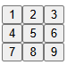

# 第 10 章：Tic-Tac-Toe — 把前四章組起來長什麼樣

## 九個格子都會動，卻沒有人知道誰贏了

Task Tracker 下一個需求是「復原」。你知道這會牽動 state 的形狀，想先在小一點的題目上試，於是開了一個井字遊戲。第一個念頭很自然：一個格子記住自己裡面是什麼，所以 state 放在格子裡。

```tsx
const Square = (): React.JSX.Element => {
  const [value, setValue] = useState<SquareValue>(null);

  return (
    <button type="button" className="square" onClick={() => setValue('X')}>
      {value}
    </button>
  );
};
```

九個格子放上去，點哪格哪格就出現 X，看起來進度很好。問題從第二個需求開始。上方的狀態列要顯示輪到誰，要在連線時宣布贏家，旁邊還要一顆「再來一局」。連點最上面三格，畫面是三個 X 排成一線，狀態列還寫著「下一步：X」。你打開 `Board` 想補判斷，才發現 `Board` 手上什麼都沒有：九個值分別鎖在九個 `Square` 裡，props 只往下流，它讀不到，也清不掉。

每個零件單獨看都沒錯，第 06 到 09 章也都讀過了，可是組起來就卡住。本章回答的問題是：拿到一個完整需求時，這些規則要按什麼順序用上？我們會從靜態畫面做到能回放任一步的遊戲，途中故意走幾條會出事的路，最後把同樣的判斷帶回 Task Tracker。

## 先有一個不會動的棋盤

用第 00 章建好的 Vite 專案就可以開始。`main.tsx` 是 component 和瀏覽器之間的橋：`react-dom/client` 的 `createRoot` 接上 `index.html` 裡的 `#root`，`styles.css` 由這裡載入，`StrictMode` 在開發時替我們多跑一次函式抓不純的程式，這是第 09 章講過的事，本章它還會抓到一個 bug。

```tsx
import { StrictMode } from 'react';
import { createRoot } from 'react-dom/client';
import './styles.css';
import { App } from './Game';

const container = document.getElementById('root');
if (container === null) {
  throw new Error('index.html 找不到 #root');
}

createRoot(container).render(
  <StrictMode>
    <App />
  </StrictMode>,
);
```

`getElementById` 的回傳型別是 `HTMLElement | null`，`createRoot` 不收 `null`，所以 strict 模式下必須先處理掉。`App` 是最外層的 component，本章最後才會寫到；現在先把 `Board` 直接放進去也行。

樣式不是本章重點，下面這份照抄即可，第 16 章才會換成 Tailwind。`*` 和 `body` 這種 selector 影響整頁，`.square` 只套用到 `className="square"` 的元素。JSX 用 `className` 而不用 `class`，原因第 06 章講過。`.square` 用 `float` 排成一列，所以每一列的 `.boardRow::after` 要清除浮動，下一列才不會擠上來。`margin` 的 `-1px` 則讓相鄰格子的邊框疊在一起。

```css
* {
  box-sizing: border-box;
}

body {
  font-family: sans-serif;
  margin: 20px;
  padding: 0;
}

.square {
  background: #fff;
  border: 1px solid #999;
  float: left;
  font-size: 24px;
  font-weight: bold;
  line-height: 34px;
  height: 34px;
  margin-right: -1px;
  margin-top: -1px;
  padding: 0;
  text-align: center;
  width: 34px;
}

.square.winning {
  background: #fde68a;
}

.boardRow::after {
  clear: both;
  content: '';
  display: table;
}

.status {
  margin-bottom: 10px;
}

.game {
  display: flex;
  flex-direction: row;
}

.gameInfo {
  margin-left: 20px;
}
```

畫面的第一版不需要任何判斷。三個 `div` 各放三顆 `<button className="square">`，外層用 Fragment 包起來，因為 component 只能回傳一個節點。寫完長這樣：



### 重複第二次時才抽 Square

九顆一模一樣的 button 寫到第三顆，你就會想抽 component。這裡抽的理由很具體：九份重複的標記將來要一起改，而且每顆只差一個值。差異只有一個值，就代表 props 只有一個，這是很好的抽取訊號。同一份程式改用資料驅動，列和格都來自 `BOARD_ROWS`：

```tsx
const BOARD_ROWS = [
  [0, 1, 2],
  [3, 4, 5],
  [6, 7, 8],
] as const;

interface SquareProps {
  value: number;
}

const Square = ({ value }: SquareProps): React.JSX.Element => (
  <button type="button" className="square">
    {value}
  </button>
);

export const Board = (): React.JSX.Element => (
  <>
    {BOARD_ROWS.map((row) => (
      <div className="boardRow" key={row[0]}>
        {row.map((index) => (
          <Square key={index} value={index + 1} />
        ))}
      </div>
    ))}
  </>
);
```

這裡第一次碰到 key，順手判斷一下。棋盤格不會重排、不會增減，格子編號就是它的身份，`key={index}` 完全正確。第 09 章的 index bug 來自「index 是目前的位置，資料卻會移動」，這裡位置和身份本來就是同一件事。一列也一樣，用它的第一格編號代表自己。

## state 為什麼不能留在 Square

回到開場。要判斷 state 放哪，先列出誰需要讀它：`Square` 要顯示自己的值，狀態列要知道下一步是誰，勝負判斷要同時看九格，「再來一局」要全部清空。第 08 章的規則是放在所有使用者的最近共同父層，這裡就是 `Board`。

有人會想保留 `Square` 的 state，再讓它用 callback 回報給 `Board`，由 `Board` 存一份彙整。這樣同一個事實有兩份，「再來一局」時你得想辦法讓九個子 component 各自清掉，而父層還沒有辦法直接改子層的 state。把 state 搬上來之後，這類同步問題就不存在，因為只剩一份。

```tsx
interface SquareProps {
  value: SquareValue;
  onSquareClick: () => void;
}

const Square = ({ value, onSquareClick }: SquareProps): React.JSX.Element => (
  <button type="button" className="square" onClick={onSquareClick}>
    {value}
  </button>
);

export const Board = (): React.JSX.Element => {
  const [squares, setSquares] = useState<Squares>(EMPTY_BOARD);
  const [isXNext, setIsXNext] = useState(true);

  const handleClick = (index: number): void => {
    if (squares[index] !== null) {
      return;
    }
    const nextSquares = [...squares];
    nextSquares[index] = isXNext ? 'X' : 'O';
    setSquares(nextSquares);
    setIsXNext(!isXNext);
  };

  return (
    <>
      <div className="status" role="status">
        下一步：{isXNext ? 'X' : 'O'}
      </div>
      {BOARD_ROWS.map((row) => (
        <div className="boardRow" key={row[0]}>
          {row.map((index) => (
            <Square key={index} value={squares[index]} onSquareClick={() => handleClick(index)} />
          ))}
        </div>
      ))}
    </>
  );
};
```

`SquareValue`、`Squares`、`EMPTY_BOARD` 都定義在下一節的 `gameLogic.ts`：`SquareValue` 是 `'X' | 'O' | null`，`Squares` 是它的唯讀陣列，`EMPTY_BOARD` 是九個 `null`。`Square` 現在沒有任何 state，顯示什麼、被點時做什麼都由父層決定。依序點第 0 格、第 0 格、第 1 格，棋盤是 `X O`，重複點第 0 格被 `squares[index] !== null` 擋下，沒有消耗回合。

### 傳函式，別傳呼叫結果

`() => handleClick(index)` 看起來可以簡化。省掉外面那層，寫成這樣：

```tsx
<Square value={squares[0]} onSquareClick={handleClick(0)} />
```

TypeScript 會當場擋下，報 TS2322：`handleClick(0)` 的回傳型別是 `void`，prop 要的是 `() => void`。同樣的寫法在純 JavaScript 專案裡，執行時會得到 `Too many re-renders`，因為這個括號是在 render 當中呼叫 `handleClick`，它呼叫 `setSquares`，又排一次 render，再呼叫一次，React 發現迴圈停不下來就丟錯。這個錯誤訊息常讓人以為是資料太多，其實只是少了一層箭頭函式。

## 勝負該存在 state 裡嗎

現在要宣布贏家。直覺是再開一個 state，在下棋的 handler 裡更新。先把判斷規則寫成一個函式，放在 `gameLogic.ts`，裡面完全沒有 React：

```ts
export type Mark = 'X' | 'O';
export type SquareValue = Mark | null;
export type Squares = readonly SquareValue[];

export type GameStatus =
  | { kind: 'playing'; nextMark: Mark }
  | { kind: 'won'; winner: Mark; line: readonly number[] }
  | { kind: 'draw' };

const WINNING_LINES = [
  [0, 1, 2],
  [3, 4, 5],
  [6, 7, 8],
  [0, 3, 6],
  [1, 4, 7],
  [2, 5, 8],
  [0, 4, 8],
  [2, 4, 6],
] as const;

export const EMPTY_BOARD: Squares = Array<SquareValue>(9).fill(null);

export const getGameStatus = (squares: Squares): GameStatus => {
  for (const line of WINNING_LINES) {
    const [a, b, c] = line;
    const mark = squares[a];
    if (mark !== null && mark === squares[b] && mark === squares[c]) {
      return { kind: 'won', winner: mark, line };
    }
  }
  const moveCount = squares.filter((value) => value !== null).length;
  if (moveCount === squares.length) {
    return { kind: 'draw' };
  }
  return { kind: 'playing', nextMark: moveCount % 2 === 0 ? 'X' : 'O' };
};

export const describeStatus = (status: GameStatus): string => {
  switch (status.kind) {
    case 'playing':
      return `下一步：${status.nextMark}`;
    case 'won':
      return `贏家：${status.winner}`;
    case 'draw':
      return '平手';
  }
};
```

`GameStatus` 是第 05 章的 discriminated union：只有 `won` 才有 `winner`，不會出現「平手但有贏家」這種組合。判斷順序也有意義，下滿九格時可能剛好連線，所以先查連線，再查平手。`describeStatus` 的 `switch` 沒有 `default`，將來多一種狀態卻忘了處理，函式少了 return，編譯就會失敗。

有了規則，壞版本長這樣。它多了一個 `winner` state，在 handler 裡更新：

```tsx
const handleClick = (index: number): void => {
  if (winner !== null || squares[index] !== null) {
    return;
  }
  const nextSquares = [...squares];
  nextSquares[index] = isXNext ? 'X' : 'O';
  setSquares(nextSquares);
  setIsXNext(!isXNext);

  const status = getGameStatus(squares);
  if (status.kind === 'won') {
    setWinner(status.winner);
  }
};
```

X 依序下第 0、1、2 格，O 下第 3、4 格，X 連成一線。畫面上三個 X，狀態列還是「進行中」。O 又能下一手，棋盤多出一個 O，這時狀態列才宣布「贏家：X」。第 08 章的快照解釋了全部經過：`setSquares` 不會改變這次 render 的 `squares`，下一行拿到的仍是下這一手之前的盤面，判斷永遠晚一步。

把 `squares` 改成 `nextSquares` 可以修好這個症狀，但病根還在：`winner` 是盤面的函式，你卻存了第二份，之後每一條會改盤面的路都得記得一起維護它。下一節的回放功能會多出一條路，到時你會再寫一次判斷，少寫就出錯。

正確的做法是不存。每次 render 從 `squares` 算一次：

```tsx
const status = getGameStatus(squares);
```

九個格子跑八條線，成本可以忽略。這一行同時帶來一個發現：`status.nextMark` 由盤面上的棋子數決定，X 永遠先手，下過偶數手就輪到 X。所以連 `isXNext` 都是多餘的 state。第 08 章說「能算出來的不要存」，這個例子裡它不是風格偏好，下一節你會看到留著它的具體代價。

## 歷史回放要求 state 再往上搬一次

新需求：旁邊列出每一步，點下去回到那個盤面。Task Tracker 的復原也是同樣的形狀，這正是我們開這個題目的原因。

需要多記什麼？每一步的盤面，以及現在看的是第幾步。誰需要讀？`Board` 要畫出當下盤面，步驟清單要知道總共幾步與目前位置。兩者是兄弟，最近共同父層是一個新的 `Game`。所以 state 再提升一次，`Board` 的 `useState` 全部消失，變成完全由 props 驅動的 component：

```tsx
const [history, setHistory] = useState<Squares[]>([EMPTY_BOARD]);
const [currentMove, setCurrentMove] = useState(0);

const handlePlay = (nextSquares: Squares): void => {
  const nextHistory = [...history.slice(0, currentMove + 1), nextSquares];
  setHistory(nextHistory);
  setCurrentMove(nextHistory.length - 1);
};
```

這段是 `Game` 的前半，畫面部分在後面的完整程式。當下盤面就是 `history[currentMove]`，一樣是算出來的，不另外存。`handlePlay` 裡的 `slice` 是這段最容易看漏的一行，用一盤棋走一遍。X 下第 0 格，O 下第 1 格，X 下第 2 格，再跳回第 1 步，然後 O 改下第 4 格：

```text
下完三手
  history = [開局, X........, XO......., XOX......]
  currentMove = 3

點「回到第 1 步」：只改 currentMove，history 不動
  currentMove = 1
  畫面 = history[1] = X........，下一步是 O
  清單仍有「回到第 3 步」，還可以跳回去

此時 O 下第 4 格
  history.slice(0, 2) = [開局, X........]
  接上新盤面 = [開局, X........, X...O....]
  currentMove = 2，原本的第 2、3 步被丟棄
```

跳回去只是移動指標，什麼都沒有遺失。只有在過去的位置下了新的一手，舊的未來才被切掉。如果少了 `slice`，直接 `[...history, nextSquares]`，新盤面會接在最後，歷史裡就混了兩條互不相關的棋局。

### 留著 isXNext 會怎樣

假設 `Game` 保留那個多餘的 state，透過 props 交給 `Board` 決定下 X 還是 O，`handlePlay` 順手切換它，而回放直接把 `setCurrentMove` 交給清單：

```tsx
const [isXNext, setIsXNext] = useState(true);

const handlePlay = (nextSquares: Squares): void => {
  const nextHistory = [...history.slice(0, currentMove + 1), nextSquares];
  setHistory(nextHistory);
  setCurrentMove(nextHistory.length - 1);
  setIsXNext(!isXNext);
};
```

下完三手後輪到 O。點「回到開局」，盤面清空，`isXNext` 卻仍是 `false`，於是在空棋盤下第一手，出現的是 O。沒有 error，型別全過，要真的玩過才會發現。補救辦法是寫一個 `jumpTo` 同時設定兩個 state，但那只是又多一條要記得同步的路。推導版本 `getGameStatus(history[currentMove])` 根本沒有不同步的可能，這就是第 08 章那條原則的實際價值。

### 不可變更新在這裡從美德變成需求

第 08 章預告過舊快照被污染的代價，這裡是兌現的地方。把 `Board` 的更新改成原地修改，這裡為了能寫入，`squares` 的型別用了可變的 `SquareValue[]`，`moveNumber` 由 `Game` 傳入當下的步數：

```tsx
const handleClick = (index: number): void => {
  squares[index] = moveNumber % 2 === 0 ? 'X' : 'O';
  onPlay(squares);
};
```

X、O、X 下完，畫面完全正常，因為 `handlePlay` 建了新的外層陣列，render 照樣發生。點「回到第 1 步」，棋盤還是 `XOX`；點「回到開局」，還是 `XOX`。清單裡的四筆紀錄全部指向同一個陣列，`history` 長度對，內容只有一份。這是開發時最難發現的那種 bug：功能的主要路徑全部正常，壞掉的只有用到舊資料的那條路。

`Squares` 定義成 `readonly` 就是為了擋這件事。`squares[0] = 'X'` 在唯讀陣列上會報 TS2542，你只能先 `[...squares]` 拿到可寫的副本。`EMPTY_BOARD` 是模組層級的常數，一旦被原地改掉，連「再來一局」的開局都會帶著舊棋子，所以這條型別守得很值得。要注意 `readonly` 只防編譯期，也只防第一層，第 04 章說過 TS 不存在於執行期。

## key 該加在哪裡，這一章出現了四種情況

到這裡 key 已經用了好幾次，放在一起比較最能看清判斷方式。第 09 章說 key 是在告訴 React「這是誰」，所以每次都問：這裡的身份是什麼？

**棋盤格**：`key={index}`。位置就是身份，前面解釋過。

**步驟清單**：`<li key={move}>`，`move` 也是陣列 index。清單只會在尾端增加或截斷，第 2 步永遠是第 2 步，中間不會插入，也不會重排，所以這個 index 真的代表那一步。第 09 章的編輯草稿錯位，條件是資料會移動而且列內有自己的 state，這裡兩個條件都不成立。將來要加「最新的在上」的反向顯示，也要繼續用 `move`，不要改用顯示順序的 index。

**再來一局**：這是 key 重置 state 的用法。`Game` 的 `history` 和 `currentMove` 都該回到初始值，最省事的方式是告訴 React 這是另一局：

```tsx
export const App = (): React.JSX.Element => {
  const [gameId, setGameId] = useState(0);

  return (
    <>
      <button type="button" onClick={() => setGameId((id) => id + 1)}>
        再來一局
      </button>
      <Game key={gameId} />
    </>
  );
};
```

按下去，`gameId` 變了，舊的 `Game` 被拆掉，新的從 `useState` 的初始值開始。將來 `Game` 多了新的 state 也會自動被清掉，不用回來改重置函式。你也可以在 `Game` 內寫 `setHistory([EMPTY_BOARD])` 加 `setCurrentMove(0)`，現在同樣有效，只是之後每多一個 state，就要回來多加一行。

**不該加的地方**：有人寫到回放時懷疑畫面沒更新，加一行強制刷新：

```tsx
<Board key={currentMove} squares={history[currentMove]} onPlay={handlePlay} />
```

棋照樣能下，看起來也沒事，因為 `Board` 本來就沒有 state 可丟。但每下一手，整個棋盤的 DOM 都被拆掉重建。點一格後，焦點原本會留在那顆 button 上；加了這個 key，button 被移除，`document.activeElement` 變成 `body`。靠鍵盤下棋的人按完 Enter，焦點就不在棋盤上了，接著按 Enter 不會有反應，Tab 會落在哪裡則由瀏覽器決定。這正是第 09 章列出的代價，在不需要重置的地方它只有壞處。

## 抽 component 的理由要說得出來

最後的結構是 `App` > `Game` > `Board` + `MoveList`，`Board` > `Square`。回頭看每一刀都有具體理由，這也是下次你切需求時可以問的問題：

| 切分 | 理由 |
| --- | --- |
| `Square` | 九份重複，差異只有 value 與 handler |
| `MoveList` | 只需要三個 props，讓 `Game` 不必看到 li 怎麼畫，也可以單獨改樣式 |
| `Board` 與 `Game` | state 的邊界：`Game` 管時間，`Board` 只看某一刻的盤面 |
| `App` 與 `Game` | 重置邊界：key 掛在哪，那一層以下就一起重來 |
| `gameLogic.ts` | 規則不依賴 React，不用 render 就能測，也可以換 UI |

反過來看哪些東西沒有抽。`BoardRow` 沒有抽，它只會把 `row`、`squares`、`status`、`handleClick` 全部原樣傳下去，props 比內容還多，看程式時要多跳一個檔案卻得不到新資訊。行數也不是理由：一個 80 行而職責單一的 component，比拆成四個互相傳 props 的片段好讀。

callback 也一路往下傳：`onPlay` 從 `Game` 到 `Board`，`onSquareClick` 再從 `Board` 到 `Square`。第 13 章會談到 prop drilling 與 Context，但這裡只有兩層，每層都真的用得上，直接傳最清楚。

把 `gameLogic.ts` 獨立出來的想法，你在後端早就熟悉：domain 邏輯不該依賴 `HttpContext`，controller 只負責轉接。對應到這裡，`getGameStatus` 是 domain，`Board` 是轉接層。這個類比破在 component 不只轉接，它還要描述畫面，所以 `Board` 留著 `isWinning` 這種顯示判斷是合理的。

## 完整的遊戲

`Game.tsx` 把上面的決定全部放在一起，`gameLogic.ts` 就是前面那一份：

```tsx
import { useState } from 'react';
import { describeStatus, EMPTY_BOARD, getGameStatus } from './gameLogic';
import type { Squares, SquareValue } from './gameLogic';

const BOARD_ROWS = [
  [0, 1, 2],
  [3, 4, 5],
  [6, 7, 8],
] as const;

interface SquareProps {
  value: SquareValue;
  isWinning: boolean;
  onSquareClick: () => void;
}

const Square = ({ value, isWinning, onSquareClick }: SquareProps): React.JSX.Element => (
  <button
    type="button"
    className={isWinning ? 'square winning' : 'square'}
    onClick={onSquareClick}
  >
    {value}
  </button>
);

interface BoardProps {
  squares: Squares;
  onPlay: (nextSquares: Squares) => void;
}

export const Board = ({ squares, onPlay }: BoardProps): React.JSX.Element => {
  const status = getGameStatus(squares);

  const handleClick = (index: number): void => {
    if (status.kind !== 'playing' || squares[index] !== null) {
      return;
    }
    const nextSquares = [...squares];
    nextSquares[index] = status.nextMark;
    onPlay(nextSquares);
  };

  return (
    <>
      <div className="status" role="status">
        {describeStatus(status)}
      </div>
      {BOARD_ROWS.map((row) => (
        <div className="boardRow" key={row[0]}>
          {row.map((index) => (
            <Square
              key={index}
              value={squares[index]}
              isWinning={status.kind === 'won' && status.line.includes(index)}
              onSquareClick={() => handleClick(index)}
            />
          ))}
        </div>
      ))}
    </>
  );
};

interface MoveListProps {
  moveCount: number;
  currentMove: number;
  onJump: (move: number) => void;
}

export const MoveList = ({ moveCount, currentMove, onJump }: MoveListProps): React.JSX.Element => (
  <ol>
    {Array.from({ length: moveCount }, (_, move) => (
      <li key={move}>
        <button type="button" disabled={move === currentMove} onClick={() => onJump(move)}>
          {move === 0 ? '回到開局' : `回到第 ${move} 步`}
        </button>
      </li>
    ))}
  </ol>
);

export const Game = (): React.JSX.Element => {
  const [history, setHistory] = useState<Squares[]>([EMPTY_BOARD]);
  const [currentMove, setCurrentMove] = useState(0);

  const handlePlay = (nextSquares: Squares): void => {
    const nextHistory = [...history.slice(0, currentMove + 1), nextSquares];
    setHistory(nextHistory);
    setCurrentMove(nextHistory.length - 1);
  };

  return (
    <div className="game">
      <div>
        <Board squares={history[currentMove]} onPlay={handlePlay} />
      </div>
      <div className="gameInfo">
        <MoveList moveCount={history.length} currentMove={currentMove} onJump={setCurrentMove} />
      </div>
    </div>
  );
};

export const App = (): React.JSX.Element => {
  const [gameId, setGameId] = useState(0);

  return (
    <>
      <button type="button" onClick={() => setGameId((id) => id + 1)}>
        再來一局
      </button>
      <Game key={gameId} />
    </>
  );
};
```

整個遊戲只有三個 state：`history`、`currentMove`、`gameId`。贏家、平手、下一手、連線標記、目前盤面全是算出來的。X 連線後再點其他格不會有反應，連線的三格會上色；跳回連線前一步，色塊消失，也可以改下別的地方。這些行為沒有一行同步的程式碼，它們直接來自 `v = fn(s)`。

## 把這套判斷帶回 Task Tracker

兩邊的形狀幾乎一樣，對照一下就能看出這些模式帶走的是什麼：

| 井字遊戲 | Task Tracker |
| --- | --- |
| `Square` 不持有資料，收 props 與 callback | `TaskItem` 收 `task` 與 `onToggle` |
| `squares` 放在共同父層 | `tasks` 放在 `TasksPage` |
| `getGameStatus` 從盤面算狀態 | `visibleTasks` 從 `tasks` 與 `filter` 算 |
| `<Game key={gameId} />` | `<TaskEditor key={selected.id} />` |
| `history` | 即將加入的 `past` |

所以開場那個復原需求，想法已經有了：每次編輯前把目前的任務清單存進 `past`，復原時取最後一份回來。第 02 章的 `toggleTask` 是這件事能成立的原因。假設 `tasks` 有 `t1`、`t2` 兩筆待辦，切換 `t2`：

```ts
const past = [tasks];
const after = toggleTask(tasks, 't2');

past[0][1].status; // 'todo'，快照沒被動到
after[0] === tasks[0]; // true，沒改的任務共用同一個物件
after[1] === tasks[1]; // false，只有 t2 是新物件
```

如果有人寫 `const copied = [...tasks]; copied[0].status = 'done'`，外層陣列是新的，元素卻是同一個物件，`past[0][0].status` 也跟著變成 `done`。淺複製保護不了這種寫法，所以整條路徑都要經過 `map` 加 spread。

但有三個地方不能照抄井字遊戲。第一，棋盤的 state 全部都該回放，Task Tracker 不是：篩選條件和輸入框草稿不算「編輯」，使用者按復原時，不會希望篩選也倒退。歷史的範圍要先決定。第二，棋局只有一條寫入路徑 `handlePlay`，Task Tracker 的新增、切換、改名、刪除各有一條，每條都要記得存 `past`，少一條就會出錯，第 13 章的開場正是這個 bug，它會用 reducer 收斂。第三，棋局完全在前端，任務接上後端之後，換回舊陣列並不會改變伺服器上的資料，復原還得對應到實際的 API 呼叫，第 20、21 章接上 API 之後才有辦法談這件事。

## 常見誤解

**「StrictMode 害棋子記錄多一筆，正式環境就好了。」** 這個情況出現在懂 functional update，卻在裡面動手腳的時候：

```tsx
setHistory((previous) => {
  previous.push(nextSquares);
  return previous;
});
```

包在 `StrictMode` 裡下一手，清單多出兩筆，拿掉 `StrictMode` 就只多一筆，於是有人把它關掉。React 要求 updater 是 pure，開發時會呼叫兩次來檢查，這次 push 兩次正是它要讓你看到的問題。正解是回傳新陣列 `[...previous, nextSquares]`，開著 StrictMode 也只多一筆。關掉它只是不再看到症狀，而 render 被重試時同樣的重複仍可能發生，第 30 章會談到這種可中斷的 render。

**「每一步複製陣列很浪費，應該改成就地修改加上差量。」** 複製的是外層陣列，裡面的元素只複製參考。上面的 `toggleTask` 中未改動的任務都是共用的，歷史有一百份快照，也不等於有一百份任務物件。真正要注意的是歷史無限成長：棋局最多十筆，Task Tracker 長時間開著的分頁就沒有上限，該設定長度上限，把最舊的丟掉。要不要優化先量測，第 28 章會講。

**「用 Effect 計算 winner 才符合 React 的響應式寫法。」** 把 `setWinner` 放進 `useEffect(() => {...}, [squares])` 確實不會晚一步，但第五手之後 component 會 render 兩次，第一次的 `squares` 已經連線，`winner` 還是 `null`，下一次才對上。那次中間狀態的 render 是白做的，它建立的 handler 拿到的也是不一致的資料。一行推導就沒有這個中間狀態。第 11 章會把「不該用 Effect 同步 state」這件事講完整。

**「state 放越上面越保險。」** 提升的目標是最近共同父層，再往上只有成本。`history` 放 `Game`，因為只有它的子孫需要；如果放到 `App`，`App` 要多接一堆 props，`key={gameId}` 也重置不了它，還得另寫重置邏輯。反過來，假如 `MoveList` 想加「反向顯示」開關，這個值只有它自己用，就留在 `MoveList` 自己的 `useState`。

## 同事會來問你的問題

**「history 為什麼存整個盤面？只存棋步不是更省？」** 兩種都成立。只存棋步時 `moves` 是格子編號的陣列，任一步的盤面由頭重播算出，就是後端的 Event Sourcing：

```ts
const boardAt = (moves: readonly number[], moveNumber: number): Squares => {
  const squares = [...EMPTY_BOARD];
  moves.slice(0, moveNumber).forEach((cell, turn) => {
    squares[cell] = turn % 2 === 0 ? 'X' : 'O';
  });
  return squares;
};
```

`boardAt([0, 4, 8], 2)` 得到第 0 格 X、第 4 格 O。這個類比破在持久化：這裡的事件只活在記憶體，不需要 schema 版本或快照重建，選擇也單純得多。棋盤只有九格，存快照讀取最直接；Task Tracker 的編輯種類多，事件要定義清楚才能重播，第 13 章的 action 會往這個方向靠近。

**「`onPlay` 為什麼傳整個盤面，不傳格子編號？」** 這決定規則放在哪。現在 `Board` 懂「下在哪裡合法」，`Game` 只管時間，`Game` 不必知道棋盤的規則。如果傳編號，所有判斷都搬進 `Game`，`Board` 變得更單純，但 `Game` 同時管時間和規則。兩種都合理，以這個大小傳盤面比較好讀，規則變多時可以把下棋規則搬進 `gameLogic.ts` 的 `applyMove`，由誰呼叫就只是一行差別。

**「這裡要用 `useReducer` 嗎？」** `handlePlay` 同時改兩個 state，算是個訊號，但只有一條寫入路徑，兩行也放在一起，沒有被漏改的風險，所以 `useState` 夠用。等更新規則散到多個 handler，例如 Task Tracker 的四種編輯都要留歷史，收斂的好處才超過多一層的成本，這是第 13 章的主題。

**「這種遊戲邏輯怎麼測？」** `getGameStatus` 是 pure function，直接餵陣列比對回傳值，就像 xUnit 的 `[Theory]` 給一排 `InlineData`，連 DOM 都不需要。互動部分要 render `Game` 再模擬點擊，檢查狀態列文字。這個類比破在 UI 測試要從使用者看得到的東西下手，不是去驗證內部 state，第 26 章會講為什麼。

## 本章小結

需求進來時的順序是：先畫靜態畫面，列出誰要讀什麼來決定 state 放哪，能算的一律不存，再讓更新不可變。贏家晚一步、回放全是最後盤面、O 搶先下，這幾個 bug 都來自同一份事實被存了兩份，或舊資料被原地改掉。key 每次都回到「這裡的身份是什麼」來判斷，要重置才換它。到這裡，只靠 state 和 props 的世界已經走完，下一章要接後端資料，資料不再由使用者點擊產生，就得處理 Effect 這個和外部世界同步的工具。

## 連結

- [[react-09-rendering]] — 上一章：render、樹上的位置、key 的角色
- [[react-11-effects]] — 下一章：Effect 什麼時候該用，為什麼不用它同步 state
- [[react-05-typescript-modeling]] — `GameStatus` 用到的 discriminated union
- [[react-06-components-and-jsx]] — JSX、Fragment、抽 component 的起點
- [[react-07-props]] — callback props 與單向資料流
- [[react-08-state]] — 快照、不可變更新、lifting state、衍生值
- [[react-13-reducer-and-context]] — 把 Task Tracker 的復原真正做出來
- [[react-26-testing]] — 測行為不測實作
